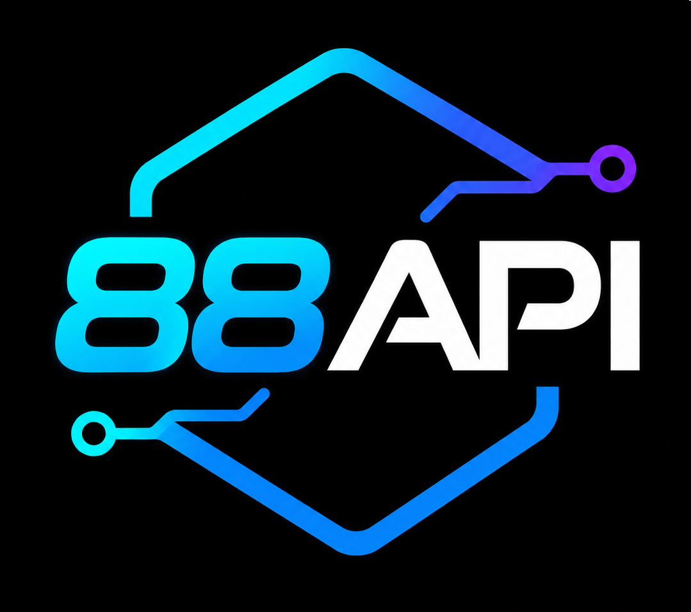
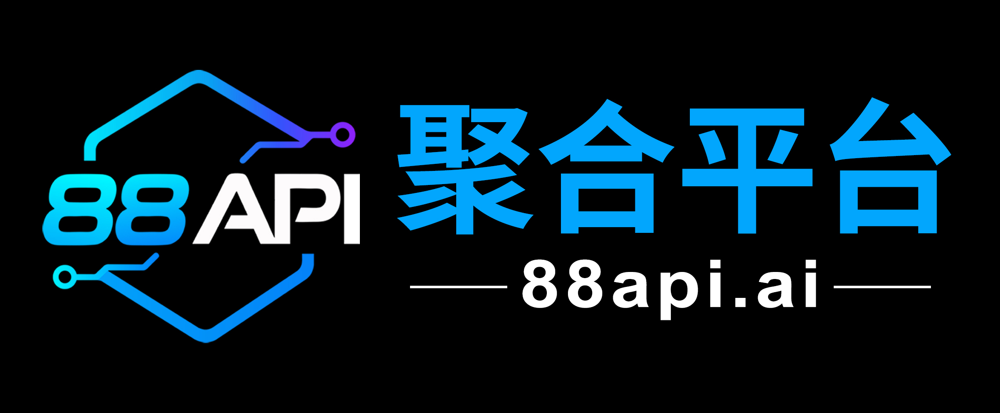
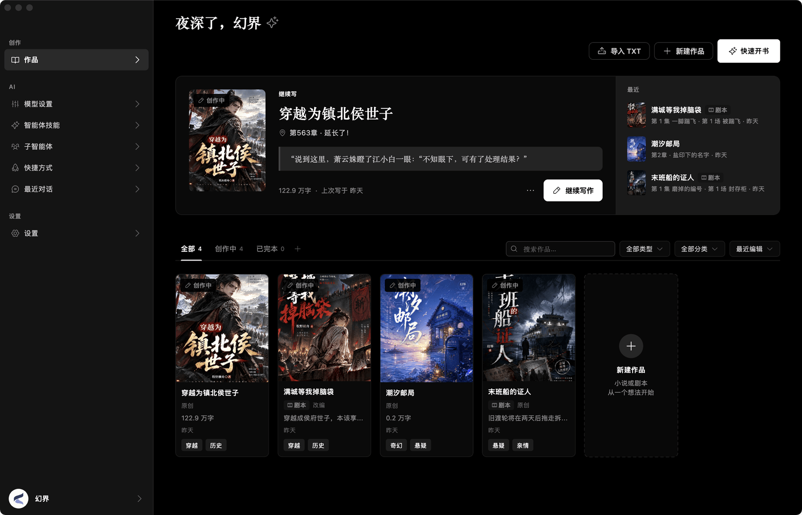
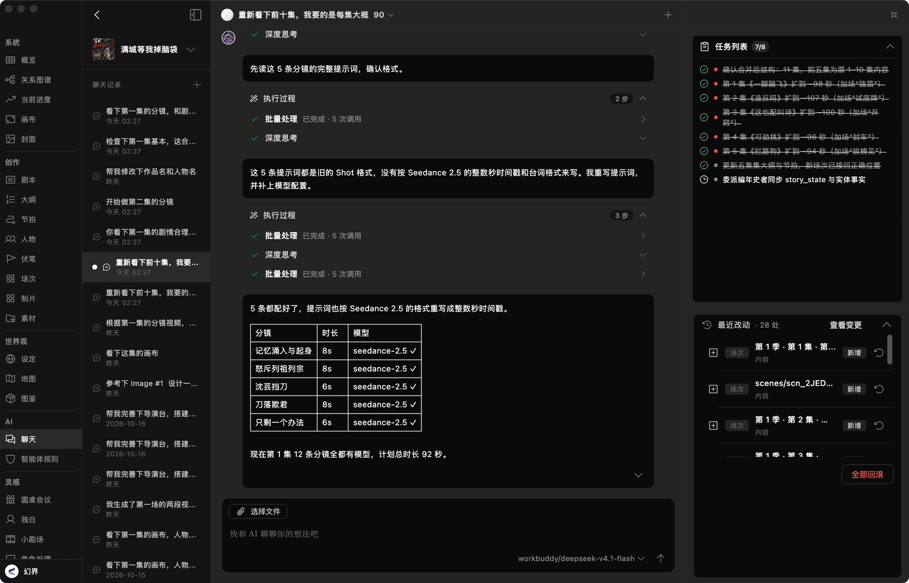
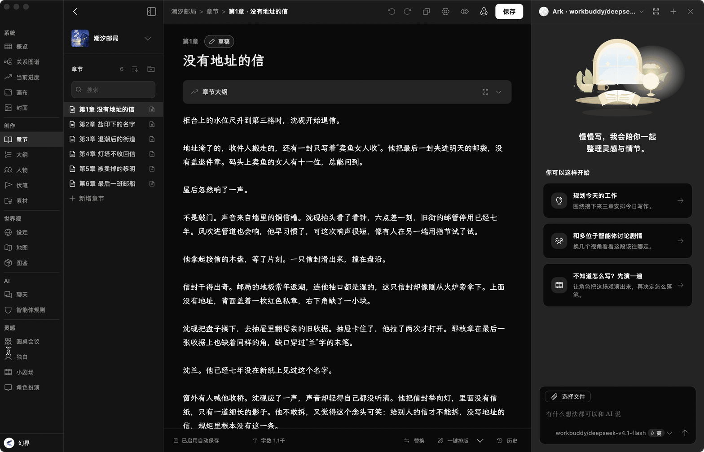
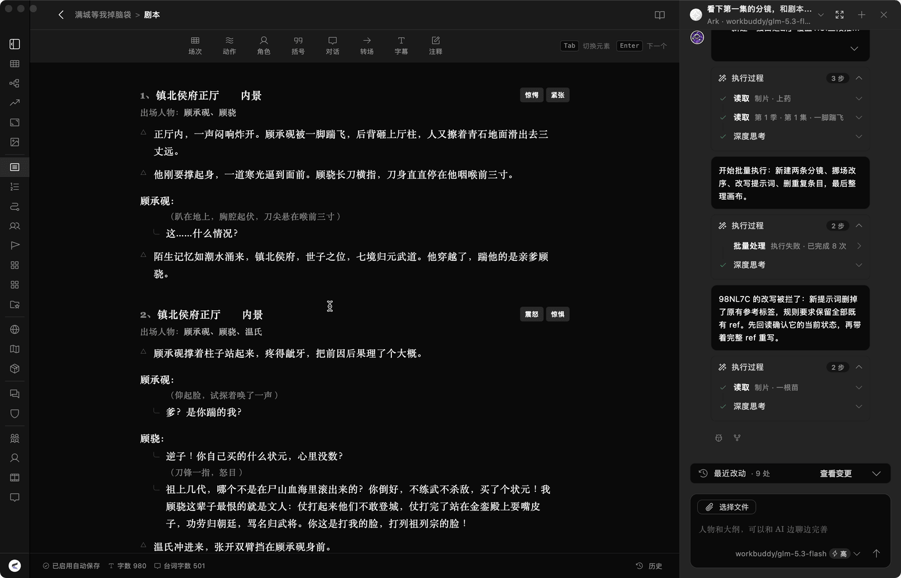
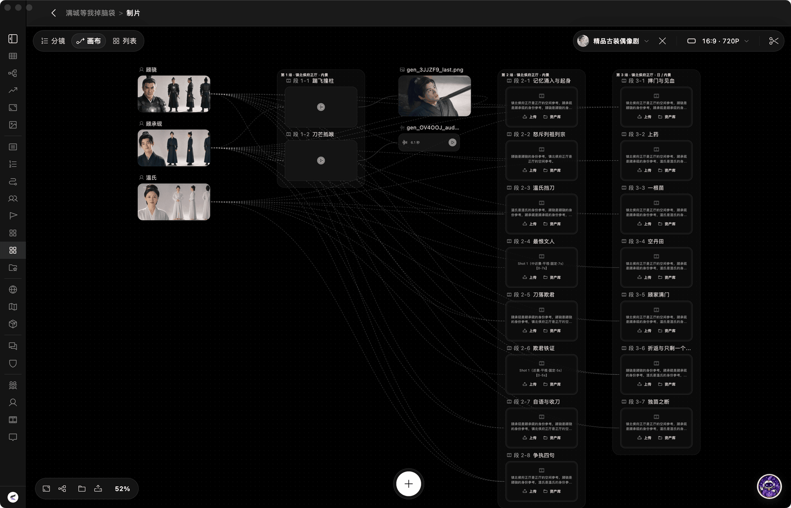
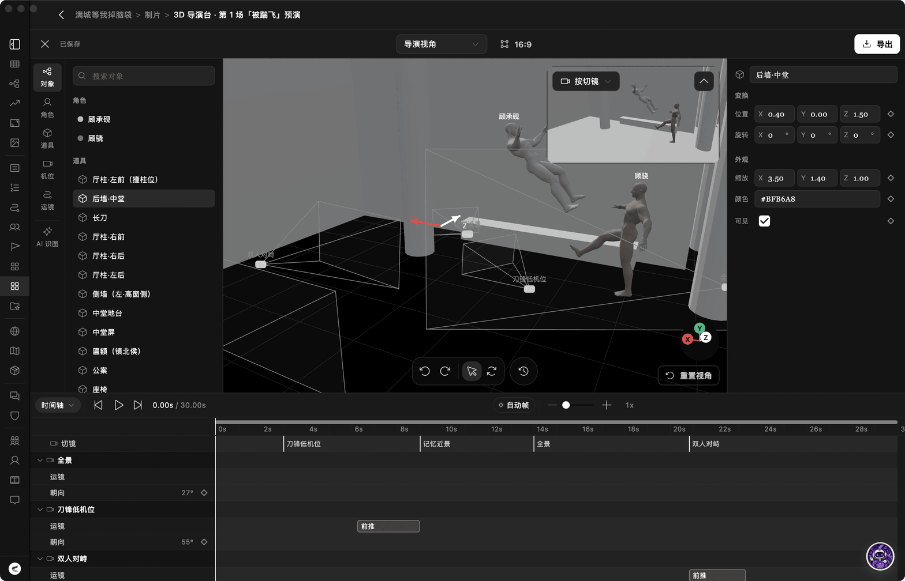
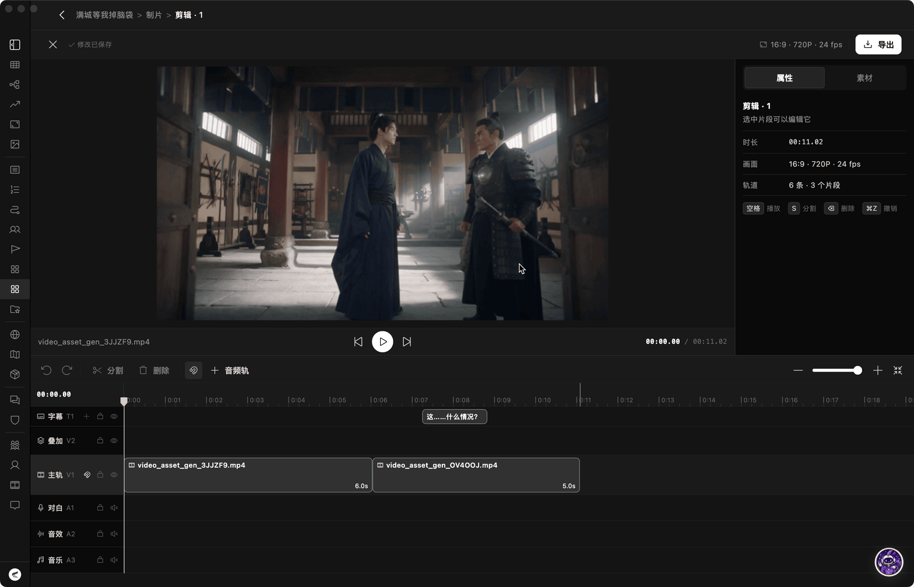

<div align="center">

# Reveric | 幻界

### AI-Native Desktop Creative Studio
**An agent that understands your entire work, from the first chapter to the final cut.**

<p align="center">
  <a href="./LICENSE"></a>
  <a href="https://github.com/looplj/reveric/releases/latest"></a>
  
  
  
</p>

<p align="center">
  <a href="README.md">简体中文</a> •
  <a href="README.en-US.md">English</a>
</p>

<p align="center">
  <a href="#core-features">Core Features</a> •
  <a href="#end-to-end-workflow">Workflow Showcase</a> •
  <a href="#supported-models">Supported Models</a> •
  <a href="#download--installation">Download</a> •
  <a href="#quick-start">Quick Start</a> •
  <a href="#developer-guide">Developer Guide</a> •
  <a href="#community--feedback">Feedback</a> •
  <a href="#license">License</a>
</p>

</div>

---

## Sponsors

<table width="100%">
  <tr>
    <td width="50%" align="center" valign="top">
      <a href="https://88api.ai/sign-up?aff=5q8X">
        
        <br/>
        <strong>88API Token Aggregation Platform</strong>
      </a>
      <p align="center">
        <a href="https://88api.ai/sign-up?aff=5q8X">
          
        </a>
      </p>
      <p align="left"><strong>Thank you to 88API for sponsoring this project!</strong></p>
      <p align="left">Operated by a Hong Kong company, 88API is a unified multi-model API platform for developers, creators, and AI application users. It provides access to text, image, speech, and video models through a single interface, supporting AI coding, translation, content creation, voiceovers, image generation, and video generation. The platform offers high-quality DeepSeek compute, major international payment methods, invoicing, and enterprise-grade reliability.</p>
      <p align="left"><a href="https://88api.ai/sign-up?aff=5q8X">Register through our referral link</a> to receive exclusive bonus credits!</p>
      <p align="left">
        Website: <a href="https://88api.ai/">88api.ai</a><br/>
        API Base URL: <code>https://api.88api.ai</code>
      </p>
    </td>
    <td width="50%" align="center" valign="top">
      <a href="https://metaso.cn/minimax-h3/?s=Reveric">
        
        <br/>
        <strong>MiniMax H3 Video Generation API | METASO</strong>
      </a>
      <p align="center">
        <a href="https://metaso.cn/minimax-h3/?s=Reveric">
          
        </a>
      </p>
      <p align="left"><strong>Thank you to METASO for sponsoring this project!</strong></p>
      <p align="left">METASO offers cost-effective MiniMax H3 video generation: <strong>768P from just ¥0.09/s and 2K from just ¥0.15/s</strong>. It supports clips up to 30 seconds, native 2K, and synced audio. The API is <strong>OpenAI-compatible</strong> and also works with <strong>ComfyUI</strong>, so there is no GPU to deploy yourself.</p>
      <p align="left">🎁 <a href="https://metaso.cn/minimax-h3/?s=Reveric">Register through the Reveric referral link</a> to receive bonus credits and exclusive offers.</p>
      <p align="left">
        Website: <a href="https://metaso.cn/minimax-h3/?s=Reveric">metaso.cn</a><br/>
        API Base URL: <code>https://metaso.cn/api/minimax</code>
      </p>
    </td>
  </tr>
</table>

---

## Overview

**Reveric (幻界) is a local-first, agent-centered desktop creative studio for long-form fiction, screenplay adaptation, and short drama / animated comic production.** Your entire work lives on your device and is also the agent's workspace: writing chapters, adapting scripts, laying out storyboards, setting up cameras, cutting the final video. Just say what you need, and the agent does it inside your work.

- **Reads the Whole Work on Demand**: The agent finds the chapters and settings it needs, so you never paste character sheets into the chat.
- **The Agent Operates Every Module**: Novel, screenplay, canvas, 3D Director Stage, and Editing Suite: the agent works hands-on in all of them.
- **Assets Generated for You**: Character looks, storyboard references, video clips, and audio are generated by the agent straight onto the canvas.
- **Local-First, Bring Your Own Key**: Your work stays in a local SQLite database. Connect directly to OpenAI, Anthropic, Gemini, DeepSeek, Seedance, H3, or a self-hosted gateway.



---

## Core Features

| Stage / Module | Workspace Capabilities | What the Agent Does Here |
| :--- | :--- | :--- |
| **Fiction Writing** | Hierarchical outlines, autosave, version diffs, rich codex (characters, factions, foreshadowing, maps), entity relationship graphs | Expands, polishes, and rewrites chapters with full story context; extracts chapter facts, checks continuity, and tracks character and relationship changes |
| **Screenplay Adaptation** | Professional formatting for scene headings, characters, dialogue, action, and transitions | Pulls scenes from the source novel, splits episodes, and writes dialogue and action lines |
| **Infinite Canvas** | Node-based storyboards, character looks, audiovisual assets, and image generation flows | Generates storyboard nodes from the screenplay, writes prompts, and calls image / video models |
| **3D Director Stage** | Set dressing, actor blocking, camera rigging and movement, timeline previs | Places cameras, plans cuts and moves, and samples frames to check composition as video generation references |
| **Multi-Track Editing** | 6-track timeline (video, overlays, dialogue, SFX, BGM, subtitles), split and export | Edits automatically: places clips, splits and trims, adds subtitles, extracts audio, sets aspect ratio, and renders previews |

---

## End-to-End Workflow

### 1. The Agent: Hand It the Whole Work

The agent can operate every module in a work. Say what you want and it acts in the matching editor.

- **Novel**: Read earlier chapters and settings, write and revise chapters, create characters, factions, and foreshadowing, maintain the relationship graph, and check continuity.
- **Screenplay**: Adapt from the source novel, split episodes and scenes, and write dialogue and action.
- **Canvas**: Lay out storyboard nodes from the script, write prompts, and generate character looks, reference images, and video clips.
- **3D Director Stage**: Place cameras, plan cuts and camera moves, and sample frames to check composition.
- **Editing Suite**: Automatic editing and asset processing: place media on the timeline; split, trim, and reorder clips; add subtitles, extract audio, replace sources, and set the aspect ratio; render previews and sample frames to check them.

Save voice, point of view, and things to avoid as rules it always follows, and install or import skills to extend what it can do.



---

### 2. Fiction Writing: Deep Worldbuilding & Relationship Graphs

Chapters, outlines, characters, foreshadowing, reference material, worldbuilding, maps, and illustrated references share one connected workspace, all of it open to the agent. The author decides pacing, what to keep, and the final text.

- **Chapter Editor**: Tree outline navigation, autosave, version snapshots, and one-click typography cleanup.
- **Story Codex**: Characters, factions, abilities, foreshadowing, locations, and maps. The relationship graph tracks how character relationships evolve and their key milestones.
- **AI Co-creation**: Have the agent read earlier chapters and settings before it expands, polishes, or rewrites. After a chapter, ask it to extract key facts and check continuity so nothing contradicts your canon.



---

### 3. Screenplay Adaptation: Professional Scriptwriting

Create adapted screenplays from existing novels. The editor follows film and television script conventions, with scene headings, action, characters, parentheticals, dialogue, transitions, and subtitles:

- **Standard Formatting**: Move fluidly between scene headings, action, characters, dialogue, and transitions without breaking your flow.
- **Source Side by Side**: Read the source novel on the left and write the script on the right; the agent reads the source across works to pull scenes, dialogue, and action.



---

### 4. Production · Infinite Canvas: Visual Storyboards & Multimodal Assets

The hub for turning a script into audiovisual language. Character looks, scene beats, storyboard segments, and generated images, audio, and video are laid out as nodes on an infinite canvas:

- **Node Flow**: Upstream and downstream shot references and image prompts are visible at a glance.
- **Agent Generation**: Have the agent break the script into storyboards, write prompts, and batch-generate reference images and video clips.
- **Multimodal Management**: Keep reference images, character looks, and shot batches in one place instead of scattered folders.



---

### 5. Production · 3D Director Stage: Spatial Blocking & Camera Rigging

A built-in 3D previs engine lets you direct as if on set:

- **Set Dressing & Blocking**: Place characters and props in 3D to confirm eyelines and spatial composition.
- **Camera Design**: Set close-ups, wide shots, and shot/reverse-shot angles; plan push, pull, pan, and tilt moves.
- **Timeline Previs**: Cut through a full scene on the timeline and export composition frames or previs animations as references for video generation.
- **Let the Agent Direct**: Have the agent place cameras, plan cuts and camera moves from the script, and sample frames to check composition.



---

### 6. Production · Editing Suite: Multi-Track Timeline & Final Export

A multi-track non-linear editor built for short dramas and animated comics:

- **6-Track Timeline**: Main video, overlays, character dialogue, ambient SFX, background music, and multilingual subtitles.
- **Precise Editing**: Blade split, ripple delete, and snapping.
- **One-Click Export**: Export the finished video directly, with no external software in between.
- **Let the Agent Edit**: The agent places canvas assets on the timeline, handles splits, trims, subtitles, and audio, and renders a preview.



---

## Supported Models

Reveric embraces a Local-First, Bring-Your-Own-Key (BYOK) architecture. Whether crafting long-form literature or producing short dramas, creators retain complete autonomy over model selection.

### 1. LLM & Reasoning Models

| Provider / Channel | Capabilities | Interface Protocol | Best Used For |
| :--- | :--- | :--- | :--- |
| **Anthropic** | Text generation, dialogue, tool calling | Official API | Long-form novel writing, nuanced prose, literary dialogue (Claude 3.5 Sonnet recommended) |
| **OpenAI** | Text generation, multimodal, tool calling | Official API | Plot architecture, character dynamics, multi-agent coordination (GPT-4o, o1, GPT-4 Turbo) |
| **Google Gemini** | Text generation, long context, multimodal | Official API | Panoramic novel analysis, reference storyboard parsing (Gemini 1.5 Pro / Flash) |
| **DeepSeek** | Text generation, deep reasoning | OpenAI-compatible API | Cost-effective logical reasoning, foreshadowing design, plot twist discovery (DeepSeek-V3 / R1) |
| **Major Chinese Providers** | Text generation, Chinese language understanding | OpenAI-compatible API | Zhipu GLM, Alibaba Qwen, Moonshot Kimi, MiniMax, etc. |
| **Local Models / Self-Hosted Gateways** | Offline inference, aggregated model routing | OpenAI / Anthropic compatible | Ollama, LocalAI, AxonHub, OneAPI, NewAPI, etc. |

### 2. Image Generation Models

Reveric natively supports leading generative image models across the Infinite Canvas and Story Codex for character design sheets, storyboard references, environment art, and concept props:

| Model / Family | Key Models | Core Capabilities | Integration Channels |
| :--- | :--- | :--- | :--- |
| **ByteDance Seedream** | Seedream 5.0 (Pro/Flash/Lite), 4.5, 4.0 | 2K-4K resolution, multi-image conditioning (14+ references), adaptive aspect ratios | Volcengine Ark official API |
| **Alibaba Wan & Qwen Image** | Wan 2.7 Image Pro, Qwen Image 3.0 / 2.1 | Up to 4K output, reference blending, high-fidelity inpainting and image editing | Alibaba DashScope / Compatible endpoints |
| **OpenAI** | GPT Image (gpt-image-2 / 1.5), DALL-E 3 | 2K-4K rendering, concept design illustration, character look references | Official API |
| **Google Gemini** | Gemini 3.1 Flash Image, Gemini Nano Banana 2.1 | Fast generation, multimodal reference parsing, dynamic aspect ratios | Official API |
| **Gateways & Custom Relays** | Unified dispatch for all above models | Unified request schemas, load distribution, and automated failover | OpenRouter, AtlasCloud, AxonHub, OneAPI |

### 3. Video Generation Models

Reveric integrates major video generation models into short drama production and the Infinite Canvas, with first/last frame control, multiple reference images, flexible aspect ratios, and camera movement controls:

| Model / Family | Key Models | Core Capabilities | Integration Channels |
| :--- | :--- | :--- | :--- |
| **ByteDance Seedance** | Doubao Seedance 2.5 / 2.0 | First/last frame control, multiple reference images (up to 30+), adaptive aspect ratios | Volcengine Ark official API |
| **Alibaba Wan** | Wan 2.7, Wan 2.6, Wan 2.5 | Cinematic texture, first/last keyframe control, stable motion in dynamic scenes | Alibaba DashScope / Compatible endpoints |
| **MiniMax Hailuo** | Hailuo 3 Max, Hailuo 2.3, Hailuo 02 | Nuanced human motion, flexible aspect ratios (16:9, 9:16, 21:9), first/last frame control | MiniMax official API / Aggregator |
| **Kuaishou Kling** | Kling v3.0 (Pro/Std/4K/Turbo), Kling O1 | 4K resolution, first/last frame locking, cinematic camera motion, multiple aspect ratios | OpenRouter / AtlasCloud / Compatible gateways |
| **Gateways & Custom Relays** | Unified dispatch for all above models | One protocol for multiple video models with automatic failover | OpenRouter, AtlasCloud, AxonHub, OneAPI |

---

## Download & Installation

Precompiled binaries for supported operating systems are available on the [Releases](https://github.com/looplj/reveric/releases/latest) page:

| Platform | Recommended Environment | Format | Notes |
| :--- | :--- | :--- | :--- |
| **macOS** | macOS 12.0+ (Apple Silicon / Intel) | `.dmg` | Drag into Applications |
| **Windows** | Windows 10 / 11 64-bit | `-setup.exe` | Standard Windows setup wizard |
| **Android** | Android 8.0+ (ARM64) | `.apk` | Mobile reading and on-the-go inspiration |

> **Note**: Application data is stored locally in a SQLite database and project folders. Install a newer release over the existing version to preserve your works and story settings automatically.

---

## Quick Start

Get started with your collaborative AI studio in four simple steps:

1. **Configure Model Providers**
   Open **Settings** ➔ **Model Settings** in the bottom-left corner. Add your AI provider, enter your API key and base URL, then test the connection and enable the provider.
2. **Create a Project**
   Click **New Project** on the home screen to start a novel or screenplay. Alternatively, use **Quick Start** to develop an idea into initial story settings with AI, or import an existing TXT manuscript.
3. **Build Your Setting by Chatting**
   When you open a new work, the built-in onboarding guide asks about genre, voice, and core settings in chat, saves writing constraints as agent rules, and writes characters and worldbuilding into the codex. You can add to them by hand at any time.
4. **Hand Tasks to the Agent**
   Just say "write chapter three", "adapt volume one into a screenplay", or "storyboard this scene and generate reference images". The agent researches and executes. Then stage shots in the 3D Director Stage and finish music and export in the Editing Suite.

---

## Developer Guide

Reveric is built using Flutter and modern cross-platform engineering practices. Community contributions are welcome!

### Tech Stack

- **Framework & Language**: Flutter 3.8+, Dart SDK
- **State Management**: Riverpod (Hooks Riverpod) + Flutter Hooks
- **Storage**: Drift (SQLite) with Local-First architecture
- **3D Engine**: Flutter Scene (spatial rendering & camera rigging)
- **Multimedia Engine**: FFmpeg Kit, FVP video player

### Local Setup & Build

```bash
# 1. Clone repository
git clone https://github.com/looplj/reveric.git
cd reveric

# 2. Install dependencies (FVM recommended)
make deps
# Or: fvm flutter pub get

# 3. Run code generation (Drift DB schema & Riverpod annotations)
make codegen

# 4. Launch locally in debug mode
make run-macos     # macOS client
# make run-windows # Windows client
# make run-linux   # Linux client

# 5. Build production releases
make build-macos-release   # macOS release bundle
make build-windows-release # Windows release bundle
```

---

## Community & Feedback

Encountering an issue or have an idea for a feature?

- File bug reports or submit feature requests on [GitHub Issues](https://github.com/looplj/reveric/issues).
- Learn about AI and share experiences in the [LINUX DO community](https://linux.do/).

---

## License

Licensed under the [AGPLv3](./LICENSE). See [NOTICES](./NOTICES) for additional terms and third-party notices. For commercial licensing inquiries, contact [bababaa261@gmail.com](mailto:bababaa261@gmail.com).

---

<div align="center">

**Reveric | 幻界** · An agent that creates alongside you

[Home](https://github.com/looplj/reveric) • [Releases](https://github.com/looplj/reveric/releases) • [Issues](https://github.com/looplj/reveric/issues)

</div>
