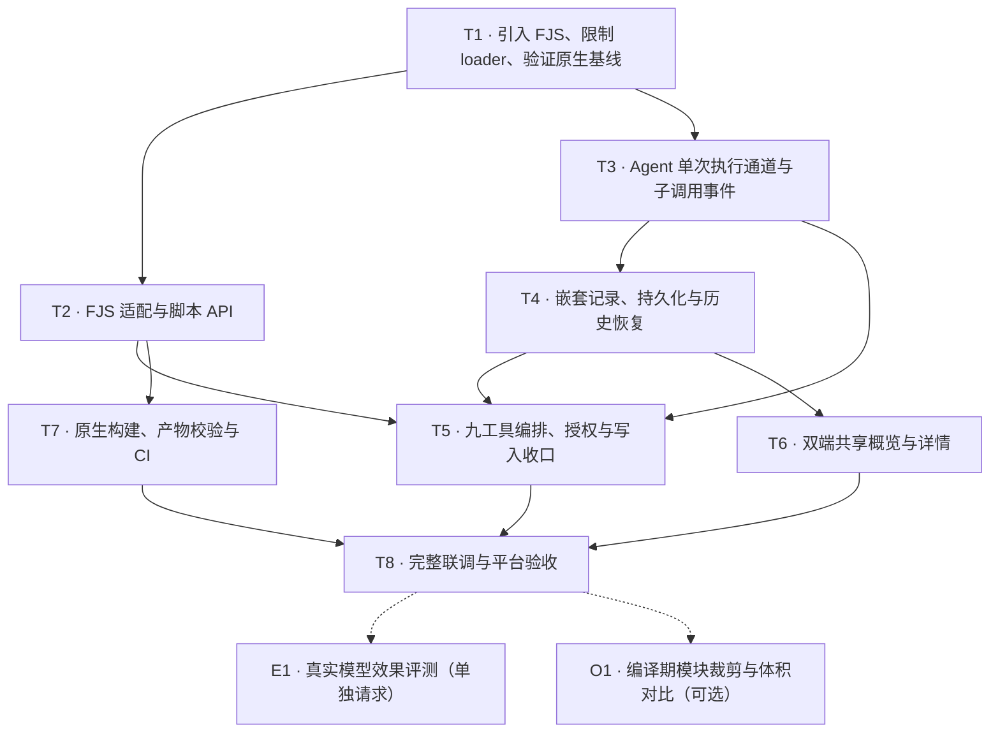

# AI Chat Codemode：工具编排与 JavaScript 运行时方案

> 状态：调研完成，实施方案待确认；本文不代表已接入或已通过运行验证。
> 调研日期：2026-09-30。
> 已确认范围：桌面、移动端共享能力和工具行为。
> 已确认要求：取消只读/写入分期；禁止 Web 工具、SpawnAgent 等子 Agent 编排、Run、SuggestNextAction 等建议类工具。
> 推荐：以 FJS 3.3.1 为依赖基线，补齐外部模块加载限制，在共享聊天 Agent 中提供 `Codemode`，一次交付九个本地数据读写工具。

## 1. 背景与目标

当前聊天由模型发出工具调用，Agent 执行后将结果写回模型上下文。对“读取若干章节、筛选符合条件的段落、比较角色资料、汇总搜索结果”等任务，模型需要处理大量中间数据；存在前后依赖的调用还需要多次模型往返。

Codemode 让模型生成一段 JavaScript，由脚本组合调用现有工具，并在本地完成循环、过滤、排序和汇总。脚本没有直接操作小说数据库、文件或网络的业务入口；`Read`、`Edit` 等实际操作仍由 Dart 工具执行。模型下一轮只收到脚本主动输出的内容及执行摘要。

例如，“比较 20 个角色的年龄和所属阵营”可以在脚本内读取、筛选并输出差异表。不会因为执行了 20 次读取，就自动把 20 份完整资料全部追加到模型历史。

### 1.1 成功标准

1. 桌面与移动端通过同一条聊天工具链执行 Codemode，权限、错误与历史恢复行为一致。
2. 模型能在一次 Codemode 调用中组合多个工具；中间结果不进入模型上下文，重建会话后也不重新泄漏进去。
3. 每个子调用保留 hooks、权限检查、取消、错误追踪和用户可见的执行记录。
4. 无限循环、悬空 Promise、内存超限、输出过量和显式取消都有可验证的终止行为。
5. 写操作继续使用现有 working changes 与来源归属；部分成功可以追溯，不自动重跑整段脚本。
6. 用固定任务比较质量、模型请求数、token 和耗时，确认收益后再扩大使用范围。

### 1.2 范围与约束

- 接入 `AiSessionMode.chat` 的主聊天 Agent。特殊模式、子 Agent、远程助手不自动取得 Codemode。
- 保留现有直接工具调用。模型可按任务选择直接调用或脚本编排。
- 不引入新的设置页、会话模式、用户开关、MCP 服务或后台执行服务。
- 第一版不提供 npm、文件模块、原生模块、直接 HTTP、Shell、持久化 JS 全局变量或跨调用 `store/load`。
- 脚本仅组合第 4.3 节列出的数据读写工具。`AskUser`、`TodoWrite`、`AgentSkill`、子 Agent 编排、`Run`、`SuggestNextAction`、图片生成等会话辅助或外部能力继续直接调用；不允许递归 Codemode。
- Codemode 不允许 `WebSearch`、`WebFetch` 及其他会发起外部网络请求的工具或分支。它们只能沿用脚本外的直接工具调用和可见工具卡，不因用户展开详情而放开。
- 工具 schema 和描述保持静态；可调用工具名称在执行时校验，不能通过隐藏 schema 代替执行授权。
- tool description 的新增与调整文案在本文列出，实施前随方案明确确认；AI 提示词不做 i18n，UI 文案做 i18n。
- 本方案不改变 REST API、Drift 表结构或 schemaVersion。

## 2. 现有实现

### 2.1 Reveric 接入基础

| 位置 | 当前职责 | 对本方案的意义 |
| --- | --- | --- |
| `lib/desktop/widgets/ai/chat/agent_factory.dart` | 构建共享 ChatSessionController | 桌面仅作为宿主，不放执行引擎 |
| `lib/mobile/pages/novel_chat_page.dart` | 经同一个 Controller 发送与取消 | 能复用同一能力 |
| `lib/shared/services/ai/chat_turn_runner.dart` | 构建 Agent、工具 dispatcher，消费事件并持久化 | 注入 Codemode、把子调用记录写入会话状态 |
| `lib/shared/services/ai/chat_agent_tool_dispatcher.dart` | 截获聊天专用工具，其余转交底层 | 增加 Codemode 分发入口 |
| `lib/shared/agent/agent.dart` | 执行前后 hooks、循环检测、结果归一化及上下文追加 | 对外提供不发事件、不写上下文的 `runToolCall`；调用循环不感知子调用 |
| `lib/shared/agent/agent_tool_dispatcher.dart` | ToolDef、执行上下文与取消信号 | 承载明确的父调用身份、子调用 scope 与生命周期观察者 |
| `lib/shared/services/ai/tools.dart` | 工具执行、模式权限、预览和 working changes | 保留现有业务边界 |
| `lib/shared/services/ai/agent_message_mapping.dart` | 持久化 UI 消息恢复为模型历史 | 防止子调用被重放成模型发起的调用 |

不能只在 JS bridge 内调用 `AiToolManager.executeTool()`：它会经过工具内部权限和 mutation 路径，但不会自动经过 `Agent` 的 `beforeToolCall/afterToolCall`。匿名 TraceHook 的工具计数与失败上报就在这些 hooks 中。

现有 mutation 路径主要记录预览及 working changes，不能把它描述成“所有写操作都先等待审批”。部分操作直接写业务数据，是否可撤销以各工具现有契约为准。

## 3. JavaScript 引擎调研

### 3.1 依赖基线

方案固定 FJS 3.3.1 发布包，升级时单独验证，不在实施时静默跟随 main。

### 3.2 FJS 的适配优势

检查的是 [3.3.1 发布归档](https://pub.dev/api/archives/fjs-3.3.1.tar.gz)。

1. `JsEngine.init(bridge: ...)` 把 Dart Future 映射为 JS Promise，适合 `tools.*` 异步调用。
2. `JsEngineRuntimeOptions` 在 context 创建前设置内存与栈限制。
3. `JsBuiltinOptions.none()` 能关闭 fs、process、child_process、fetch、socket、timers 等内置能力。
4. `close()` 会设置原子 shutdown 标记；QuickJS interrupt handler 轮询该标记，中断 CPU-bound JS。`closeGracefully()` 会等待既有工作，不能用于模型脚本取消。
5. FJS 已有独立 Rust JS executor，当前实现为两个工作线程。Reveric 不再为 FJS 叠加 Dart isolate，Dart 侧只处理工具请求与运行态。

本次只阅读源码，未执行上游测试。

### 3.3 FJS 必须补齐的边界

**禁用 builtins 不等于禁止文件模块。** `runtime.rs` 的 `make_loader_stack()` 无条件加入 `FileResolver`、`NativeLoader`、`ScriptLoader`。rquickjs 的默认 FileResolver 允许解析符合规则的相对 `.js` 路径，ScriptLoader 最终调用 `std::fs::read`。因此，脚本仍可能通过动态 import 触达本地 JS 文件。

这不是“已经证明能读取任意文件或任意动态库”：默认扩展名和 resolver 会影响可达路径。本方案要求没有这条外部加载路径，不能依赖文件恰好不存在或扩展名不匹配。

推荐在 `third/fjs/` 固定上游 3.3.1，维护一个最小补丁：

- 从 runtime 的 resolver/loader stack 移除上述三个外部 loader，仅保留宿主注册的内存模块路径。
- Codemode 使用 `JsBuiltinOptions.none()`，不注册额外模块；只接受内存源码，宿主不调用 `JsCode.file`、文件模块或字节码入口。
- Dart/Rust 公共 API 签名保持不变；此补丁只收紧 vendored FJS 的模块加载行为，不需要新增对外配置或修改 FRB API。
- 新增相对路径、路径穿越、绝对路径、原生库名和动态构造 import 的负向测试，并验证宿主显式注册的内存模块仍可用。
- 记录来源版本、commit、归档校验和、补丁意图和升级检查点。每次升级重跑能力边界与中断测试。

不能用正则扫描 `import`、屏蔽 `eval` 字符串、修改 prompt 或删除几个 JS 全局变量代替 loader 限制。

Codemode 的隔离能力以当前 FJS 配置和运行时测试为准，不能从其它方案的假设推断文件模块已经隔离。

### 3.4 隔离能力与选择结论

FJS 官方定位是可信或应用自有脚本运行时，并明确要求不可信代码使用额外进程或 OS 隔离。原生 QuickJS 与 Flutter 共享进程；内存上限和 API 限制不能隔离引擎漏洞、原生崩溃或所有宿主内存分配。

本方案交付的是“只授予现有工具能力的受限本地运行时”，不宣称具备 WASM 内存隔离能力。模型生成代码仍按不可信输入处理，所有桥接请求都检查权限、类型、数量和大小。

**数据外发与外部内容是独立于引擎隔离的边界。** 如果允许脚本先 Read 小说正文，再把内容拼入 WebSearch 查询词或 WebFetch URL，即使 JS 无法直接访问网络，也能经工具转发数据。子调用默认只在详情中展示，不能提供与直接网页工具卡相同的请求可见性；“只读”也不能代表没有外部副作用。网页返回内容还会增加提示词注入的输入面。

因此，Codemode 禁止 WebSearch、WebFetch 和同类外部网络能力，不能以展开工具详情、增加日志或提示词提醒代替宿主拒绝。运行时 builtin、模块加载与工具 bridge 三个入口分别约束；禁用原生 fetch 并不自动禁止经工具联网。网页检索继续由模型在脚本外直接调用，沿用现有可见请求记录。SpawnAgent 与 Run 等通用编排入口同样不开放，不能借它们间接发起网页工具调用。

该限制不改变现有模型请求或直接工具调用的数据流，也不声称消除外部文本风险：聊天历史、本地导入材料仍可能包含外部指令，必须当作数据，不能用于扩大脚本权限。

**关键前提：产品接受进程内原生引擎的残余风险。** 如果要求将恶意脚本或引擎漏洞与应用进程强隔离，本方案的 FJS 路线不能直接批准上线，应转向 QuickJS/WASM + 原生 WASM host 或独立沙箱进程；前者要补齐移动端 WASM host，后者不能直接作为 iOS 的同构方案。

| 路线 | 主要代价 | 选择 |
| --- | --- | --- |
| FJS + 最小 loader 补丁 | 一份原生依赖补丁及各平台重建产物 | 推荐；双端共用 QuickJS、已有异步桥和主动中断 |
| flutter_js | Apple/其他平台双引擎，需要补齐并分别验证资源控制 | 备选；stars 更多，但当前公共接口不满足一致控制要求 |
| 自写 QuickJS FFI | 维护 Promise、值生命周期、线程、取消、打包 | 不选；重复承担 FJS 已完成的工作 |
| QuickJS/WASM 原生宿主 | 新增 WASM runtime、WASI 限制与移动端构建链 | 仅在要求更强隔离时重新立项 |

## 4. 工具与运行时契约

### 4.1 模型入口

工具名采用项目现有命名风格：`Codemode`。输入是固定 object schema，唯一必填字段 `code` 为字符串。使用现有 JSON function calling，不改各 Provider 的工具协议，不要求 freeform/Lark 支持。

拟新增工具描述：

> 在受限 JavaScript 环境中组合工具调用并处理结果。中间工具结果保留在脚本内，只有显式输出和返回值进入后续对话。适用于批量读取、筛选、比较和多步工具编排。

拟新增 `code.description`：

> JavaScript async 函数体，支持 await 和 return。通过 tools 调用工具，通过 text() 输出结果；使用 ALL_TOOLS 查看当前可调用工具，使用 describeTool(name) 查看参数契约。

上述是待确认文案，不修改现有 Read/Edit 等描述。脚本长度与资源限制由宿主强制执行，不能由脚本 options 放大。

### 4.2 脚本 API

| API | 契约 |
| --- | --- |
| `tools.<name>(input)` | 调用当前允许的工具，返回 Promise；参数与结果按 JSON 数据跨桥 |
| `ALL_TOOLS` | 当前可调用名称和已有 description 的只读快照；不是授权凭据 |
| `describeTool(name)` | 返回已有静态 ToolDef 的名称、description、inputSchema、outputSchema；未知名称明确失败 |
| `text(value)` | 同步接受文本或 JSON 可序列化值，按顺序向宿主提交输出帧，计入输出预算 |
| `return value` | 添加最终返回值；没有返回值也可以成功 |

不注入标准 console、计时器、fetch、process、文件或模块能力；输出统一经 `text()`。不额外生成一份常驻 TypeScript 全量工具目录，避免与现有 schema 重复消耗上下文。工具数量增加到需要发现搜索时再评估搜索能力。

仅接受 JSON 类型；拒绝循环对象、函数、Symbol、BigInt、非有限数字和超出深度/大小的值。宿主返回的实体 ID 保留字符串类型。通过受控 JSON 编解码传递对象，避免原型键被当作控制字段。

bridge 仅接受两类明确消息：工具请求（工具名与输入）和输出帧（序号与文本）。session、turn、权限和 callId 由宿主创建。即使脚本绕过 `tools` 包装直接调用底层 bridge，也不能指定其他会话身份、扩大工具范围或跳过预算。

`text()` 的桥接 Promise 由运行时包装跟踪，模型不需要 await 每次输出；正常结束前等待已提交输出帧得到确认。失败或强制关闭时仅保留宿主已经接收的输出，不承诺取回仍留在 VM 内的缓冲区。工具调用与输出帧分别计数，不能借输出通道执行工具。

### 4.3 可调用集合与执行顺序

本次一次交付九个数据读写工具，不分只读版与写入版：

| 类别 | 可调用工具 |
| --- | --- |
| 读取与查询 | `Read`、`Glob`、`Grep`、`GraphSearch` |
| 内容变更 | `Create`、`Write`、`Edit`、`Replace`、`Remove` |

按“只组合本地数据操作”的边界，以下工具不进入脚本：

| 类别 | 排除工具 |
| --- | --- |
| 网页与外部内容 | `WebSearch`、`WebFetch` 及同类网络工具 |
| 子 Agent 编排与控制 | `SpawnAgent`、`SendAgentMessage`、`StopAgent`、`ForkAgent` |
| 通用命令与建议 | `Run`、`SuggestNextAction` |
| 会话交互与辅助 | `AskUser`、`TodoWrite`、`AgentSkill` |
| 其他执行能力 | 图片生成等外部工具、`Codemode` 自身 |

内容变更只复用现有操作与软删除契约。若具体参数或资源分支会触发网络下载、外部服务或其他外部系统副作用，必须在进入业务 handler、发生任何写入前拒绝，并交由脚本外直接调用。不能仅因工具名属于内容写工具就放开其所有分支。

排除工具不出现在脚本的 `tools` 和 `ALL_TOOLS` 中，`describeTool` 不返回它们的契约；猜测名称、动态构造名称或直接调用底层 bridge，均由宿主在调用实际工具前返回 `codemode_tool_forbidden`，不调用 handler、不启动子 Agent、不执行 Run 命令，也不生成建议或交互卡。新增工具或已有工具扩展外部副作用分支时，必须重新核对 Codemode 的能力范围，不自动继承主 Agent 的全部工具。

实际授权是“上述九工具白名单 ∩ 当前 Agent 允许集合 ∩ 已注册可执行工具 ∩ 当前模式权限”。每个子调用执行前重新检查；列表显示与实际执行不能分叉。

首版子调用按接收顺序串行执行，`Promise.all` 也不突破宿主队列。这样先验证编排与上下文收益，并保持现有业务工具的顺序假设；并行读取不属于本轮交付。

### 4.4 资源预算

以下均为建议的首版常量，不是已经测得的性能值，不新增用户设置。

| 资源 | 限制 | 超限行为 |
| --- | --- | --- |
| 单次源码 | UTF-8 64 KiB | 启动 runtime 前拒绝 |
| JS heap | 64 MiB/runtime | 映射内存错误并关闭 engine |
| JS stack | 1 MiB/runtime | 映射栈错误并关闭 engine |
| 整段执行 | 60 秒，含工具等待 | 宿主计时器调用 `close()`，取消子调用 scope |
| 单次工具参数 | UTF-8 JSON 256 KiB | 调用业务工具前拒绝 |
| 输出及返回值 | 合计 UTF-8 JSON 32 KiB、最多 256 条输出 | 保留宿主已收集输出并标记超限失败，要求缩小汇总 |
| 活跃 runtime | 应用级桌面最多 2、移动端最多 1 | 进入有界等待队列 |
| 等待队列 | 最多 8 项，等待最多 15 秒 | 明确返回 busy；排队取消不创建 engine |

执行时限从取得 runtime 名额开始；排队等待单独计时。应用级名额管理只保存占用与队列，不共享 JS context 或脚本数据。名额的可观察释放条件是本次 eval 已收口且 close Future 已收口，不能仅因超时 Future 已返回就释放。若任一原生调用未收口，隔离该名额并拒绝继续创建替代 runtime，避免累积失控实例。

FJS `close()` 在 JS executor 上安排后续 idle/GC/资源释放；公共 API 没有“所有原生分配均已回收”的完成信号。因此并发限制约束的是活跃执行和关闭过程，不能作为 RSS 硬上限。实现验收增加重复创建/关闭 100 次的驻留内存与未完成任务检查；不为等资源释放调用可能排空任意脚本工作的 `closeGracefully()`。

FJS 的 64 MiB 是 JS 分配上限，不是整个进程 RSS 上限。bridge 编码前后都检查大小，避免小 JS 对象经展开后形成大 Dart payload。取消是宿主主动调用原生中断，不用单纯 `Future.timeout` 冒充脚本已经终止。

## 5. 执行、事件与历史设计

### 5.1 组件关系

```text
桌面 / 移动聊天
  -> ChatSessionController -> ChatTurnRunner -> Agent
       -> ChatAgentToolDispatcher -> CodemodeOrchestrator
            -> FJS runtime（每次新建；Rust executor 执行 JS）
            -> bridge 请求
            -> Agent.runToolCall
                 -> hooks / 结果归一化（不发事件、不写上下文）
                 -> ChatAgentToolDispatcher -> AiToolManager -> 既有业务工具
            <- 子调用结果仅交回脚本
       <- 父调用输出进入模型历史

父调用事件 -> ChatTurnRunner -> 会话状态 -> 共享工具卡 / 持久化
子调用记录 -> orchestrator.onRecord -> 会话状态（不经过 Agent 事件流）
```

调用图中 dispatcher 会重新被进入，但白名单禁止子调用 `Codemode`，深度固定为一层，不形成递归执行环。

`CodemodeOrchestrator` 是每次调用的新实例，输入通过执行方法传入。`FjsRuntime` 只包装 engine 生命周期和 JSON bridge。应用级 Provider 持有 `CodemodeScheduler`，为不同会话共享名额并在应用容器销毁时结束等待；不使用永久静态全局队列。复用会话运行态的取消机制；UI 卸载或切换所选会话不取消后台聊天，显式停止、删除和运行态销毁才触发取消。

### 5.2 单次工具执行通道

Agent 只对外提供 `Agent.runToolCall(call, context:)`，按与模型发起调用相同的顺序执行 `beforeToolCall` → 派发 → 结果归一化 → `afterToolCall`，不发事件、不写 Agent 上下文。Agent 的调用循环不感知子调用，Codemode 对它而言只是一个普通工具。

编排由 `CodemodeOrchestrator` 负责：

1. 检查九工具范围与当前授权，生成宿主 callId。
2. 以带 `parentToolCallId`、子调用 scope 与 lifecycle observer 的 `ToolExecutionContext` 调用注入的 `runTool`（聊天接线为 `Agent.runToolCall`）。
3. hook 拦截返回 `error_code: hook_aborted`。编排器据此关闭 scope 并终止脚本，脚本不能 catch 后继续发起调用。
4. 取消时，未进入提交的调用立即以取消结果返回；已进入提交的写操作等待真实结果。
5. 子调用结果只交给脚本；执行记录经 `onRecord` 回调由 ChatTurnRunner 写入父工具块。

`ToolExecutionContext` 增加明确的父调用身份与 scoped lifecycle observer。AiToolManager 的开始、预览、结束回调依据 context 路由，子调用不经现有顶层回调额外生成平铺工具块。

子调用记录不经过 Agent 事件流，因此不需要在 Agent 内桥接“等待父调用期间继续产出事件”。编排结束后到达的记录由编排器丢弃，不会覆盖父调用终态。

这些记录供状态统计、取消收口、审计与按需详情使用，不要求 UI 默认逐条展示。未打开详情时只更新父调用概览，过程通知复用现有合帧机制；终态和错误及时更新。

不通过解析 `callId` 字符串推断父子关系，不把业务路由放进 metadata。父 ID 与序号可以用于生成唯一子 ID，但路由必须读取类型化字段。

现有 loop detector 继续管理模型的外层工具循环。脚本内重复调用受执行时限约束，不把正常的程序循环混入模型振荡检测。

### 5.3 结果、错误与取消

父调用模型结果包含 `ok`、`output`、`return_value`（如有）、`call_count`、`completed_count`、`failed_count`；失败增加稳定 `error_code` 与可理解的说明。脚本语法错误可以提供脚本内行列，不能返回宿主文件路径、Rust 堆栈或底层异常全文。编排器使用带明确类型和多个字段的内部结果 envelope，避免 FJS 对单字段 `{ value: ... }` async 结果的归一化影响业务返回值。

涉及写操作时还返回 `completed_operations`，列出工具已成功返回且确认发生变更的子 callId、工具名、规范 targetPath、真实资源 ID 与可用的 working change ID，避免模型只看到失败而重复创建。资源 ID 和 change ID 仅在既有工具确实返回时记录，不能假设每种写操作都有这两个字段，也不能从名称路径猜造 ID。无变更的成功结果不计入已完成写入。该状态摘要单独限制 16 KiB；若不能容纳完整展示信息，保留操作身份、标记摘要省略，完整记录仍由 UI 和既有工作改动保存。不得因输出超限丢失“已经发生写入”的事实。

定义错误码：`codemode_invalid_input`、`codemode_script_error`、`codemode_timeout`、`codemode_memory_limit`、`codemode_resource_limit`、`codemode_tool_forbidden`、`codemode_runtime_failed`、`codemode_busy`。用户停止复用既有 `user_cancelled`。

子工具的业务失败在脚本中作为带 `error_code` 的可捕获错误；拒绝授权、全局取消和资源耗尽同时关闭宿主 scope，脚本不能 catch 后继续发起调用。不要对失败脚本自动整段重试。

正常结束、失败、超时和取消均调用 `close()`。engine 关闭时不等未完成 Promise 自行结束。未 await 的工具请求停止排队、取消可取消的在途请求；迟到结果不能覆盖父调用终态或进入下一轮。

原生 bridge 被关闭不意味着 Dart 业务 Future 已撤销。在途只读操作可能完成，但其迟到结果被 scope 丢弃；在途写操作必须等待实际提交结果并记录已完成变更，不能把已提交的写入伪装成“未执行”。

现有取消链必须作以下定点适配：

- `AiToolManager._runToolObserved/_runMutationTool` 除 `shouldExecuteTool` 外，也检查当前 ToolExecutionContext 的取消信号；在首次执行及 preview await 后、进入 mutation handler 前分别检查。脚本超时不等于整个聊天已被取消，不能只依赖聊天级回调。
- 已进入 mutation handler 的操作由宿主持有其 Future，停止后等它返回再记录事实，不通过终止 JS Promise 推断业务操作已撤销。后续操作全部拒绝。
- `Agent` 取消后的通用规则：工具返回成功或自行标记 `cancelled` 的结果原样写入上下文，只有失败结果视为中断所致、替换为通用取消 payload。Codemode 据此返回宿主收集的输出、计数和 completed_operations，并标记 `ok: false / cancelled: true / error_code: user_cancelled`；该结果随 `AgentToolSkipped.output` 交给 UI。
- `ChatSessionController.cancel()` 会先收口工具卡。父卡片可先显示已停止，但同一 requestId 下已派发写操作的审计结果仍可合并进该父块，不能把父状态改回 success，不能新建气泡或写入另一个 turn；运行态在已派发写操作收口前不能宣称可安全回退。
- handler 抛错或返回失败时，若既有工具不能证明没有部分副作用，子记录标记 `effectStatus: unknown`，父结果列出 `uncertain_operations` 并要求重新读取目标核实；不能把失败等同于未修改，也不能自动重试。只读、写入前拒绝、确认无变更用 `none`，确认成功变更用 `confirmed`。

### 5.4 子调用记录与历史恢复

在 `AiToolCallBlock` 增加类型化 `nestedCalls`，默认空列表，元素包含子 callId、toolName、arguments、状态、耗时、必要结果摘要及已有 diff/目标信息。父块拥有子记录；子记录不作为模型发起的独立 `ToolCallBlock` 存入顶层 blocks。

- 使用专门的 `AiNestedToolCall` 类型，不允许任意深度的递归工具树。字段固定为 callId、toolName、targetPath、argumentsPreview、resultPreview、status、durationMs、resourceId、workingChangeId、effectStatus 与省略标记；可缺失的真实身份字段保持 null，不填占位 ID。
- 保留参数预览及展示摘要，读取结果不保存整份正文副本。每条参数预览与结果摘要分别最多 4 KiB，整个嵌套展示记录最多 256 KiB；超出时标记省略，完整状态和稳定身份不能被裁掉。
- 写操作的可撤销内容继续由 working changes 管理，nestedCalls 保存关联所需的现有稳定 ID 与展示信息，不复制一套业务快照。
- `agent_message_mapping.dart` 的模型历史仅包含父 Codemode 调用及模型可见结果；摘要压缩、重试和应用重启也遵循同一规则。
- 会话保存、取消与异常收尾必须把子记录收为终态，不能只结束父卡片而保留 running 子记录。

消息 blocks 已通过 `AiMessageBlockListConverter` 存入 JSON 列，增加明确的模型字段不需要新增数据库列。旧消息缺少 nestedCalls 时解码为空；不做历史回填。

### 5.5 共享 UI

主聊天时间线只出现一条 Codemode 活动，遵循现有 `AiToolActivityGroup` 的紧凑展示：运行中显示状态及已完成调用数，结束时显示完成/失败/已停止摘要。总调用数只有脚本结束后才确定，不显示推测的进度百分比或“3/10”分母。不默认列出每个 Read，也不为子调用生成独立工具卡。

用户通过现有工具详情入口打开 Codemode body 后，才展示源码、按顺序排列的子调用、耗时、参数摘要及最终输出。详情打开期间可以实时更新状态；未打开时不构建逐条详情子树。失败摘要在主时间线可见，技术细节留在详情。模型的最终自然语言回答仍按原聊天方式呈现。

Reveric 面向写作任务，默认使用紧凑概览，完整执行记录按需展开。

双端使用相同组件，代码和长输出可展开查看，窄屏不出现横向布局溢出。

写操作的子记录显示既有修改预览与 working change 入口。停止操作沿用当前聊天停止按钮，不新增另一套取消状态。

## 6. FJS 依赖与平台交付

### 6.1 固定依赖与补丁边界

- 选用本地定制 FJS 时，沿用仓库现有 vendoring 方式：从 3.3.1 发布源建立 `third/fjs/`，源码作为 Reveric 的普通文件提交，不保留嵌套 `.git`；根 pubspec 通过 path override 使用它。
- 第一轮仅修改 loader stack 与对应测试，不修改 FJS 的 Dart/Rust 公共 API，也不手改 FRB 生成文件。
- Dart bridge runtime 固定到与该包生成器一致的 2.12.0，保留依赖锁；升级 FJS 时整体复核，不能单独升级 bridge。
- Codemode runtime 模块以默认关闭 builtins 为构造不变量。能力边界测试失败就不能启用工具。
- 本地补丁由本功能维护者负责；不在本任务中自动向上游发 issue、PR 或发布包。

这会新增原生依赖与少量 Rust 补丁维护责任，需在实施方案批准时一并接受。若不接受维护该补丁，不能退而直接用未限制 loader 的 FJS 上线。

#### 源码维护方式

参考现有 [ai_clients_dart_UPSTREAM.md](../../third/ai_clients_dart_UPSTREAM.md) 与 [window_manager/REVERIC_PATCH.md](../../third/window_manager/REVERIC_PATCH.md)。这两份依赖都作为普通源码受主仓库管理，当前 `third/` 没有 submodule gitlink。

采用以下布局与职责：

- `third/fjs/`：上游源码、测试、构建脚本、必要生成源码、锁文件与许可证；应用直接依赖此目录。
- `third/fjs_UPSTREAM.md`：记录上游 URL、tag、完整 commit SHA、发布归档 SHA-256、导入日期、导入文件范围及排除项。版本号不能代替 commit 和来源校验。
- `third/fjs/REVERIC_PATCH.md`：记录每项补丁的目的、涉及位置、验证命令、对应 Reveric 提交与撤销条件。
- 根 pubspec：依赖版本表示上游基线，path override 指向本地源码；本地改动的精确版本由 Reveric commit 确定，Pub lock 中的版本号不能单独证明本地补丁状态。

提交边界保持清楚：先单独导入未经业务修改的上游源码，再单独提交模块加载限制；体积裁剪另做一个提交并附相同架构、配置下的 Release 对照结果。不将引擎升级、体积裁剪与聊天业务重构混为一个补丁。上述是后续实施的提交约定，本任务不自动提交。

如需裁剪体积，优先用 Cargo optional dependencies 与编译期 features 包住模块注册及依赖，再检查传递 feature 是否重新启用被裁剪能力。`JsBuiltinOptions.none()` 只控制运行时暴露，不能据此认定安装包已经减小。裁剪不改动 QuickJS、Promise bridge、取消和资源限制的必需链路；是否保留裁剪补丁以实测收益决定。

升级流程固定为：

1. 选定上游正式版本，读取变更与安全修复，取得新源码；当前基线来自 UPSTREAM 文件。
2. 对比旧上游、新上游和本地源码，迁移仍需要的补丁；不直接覆盖 `third/fjs/`，也不自动恢复已裁剪的模块。实际语义冲突按仓库 AGENTS.md 的冲突流程处理。
3. 运行边界、取消、桥接回归和各平台构建；有体积裁剪时重新比较同架构的最终库和安装包。
4. 在同一升级 PR 中更新源码、来源记录、补丁说明和构建缓存输入。上游已实现的补丁删除其本地重复实现，并保留对应行为测试。

Git 提交历史与当前源码是补丁真源，不同时维护另一套手写 patch 文件。上游升级频率按实际修复需要决定，不跟随 main 自动更新。

当前不引入 submodule。它会带来独立仓库历史、提交指针以及 clone/CI 的初始化流程；对只由 Reveric 使用的源码定制，现有 vendoring 更便于让业务接入和原生修复一起评审、回退。[Git submodule 文档](https://git-scm.com/docs/gitsubmodules)

如果以后多个项目共用、需要独立发布 FJS 定制版，再考虑独立 fork 仓库和固定 commit/tag 的依赖消费方式。是否建立独立 fork 与是否使用 submodule 是两个不同决定。

### 6.2 原生产物必须对应补丁源码

FJS Apple SwiftPM 包使用 `darwin/fjs/Binaries/fjs.xcframework.zip`。只修改 Rust 源码不会自动修改这个 archive，因此必须从 patched source 重建并验证产物。

原生构建策略：

1. 根目录 `cargokit_options.yaml` 使用 `precompiled_binaries_mode: disabled`，Cargokit 平台从本地补丁构建，不下载上游未修改的二进制。
2. Apple 构建前运行 FJS 自带的 `tool/build_fjs_xcframework.sh` 生成 SwiftPM archive；保留对应校验和和构建日志。
3. CI 从干净 checkout 重建；缓存键包含补丁源码、Cargo.lock、FJS 版本、架构和工具链。不能只按 pubspec 版本缓存。
4. 在最终 Release app 上验证外部模块加载被拒绝，防止源码测试通过但包内仍为旧二进制。
5. 不为引擎放宽 entitlement、manifest 或 sandbox 权限。出现权限需求时重新检查原因和全部目标平台。

不将 `target/`、构建缓存或上游预编译多架构 archive 纳入 Reveric 源码历史。SwiftPM 所需 zip 由构建前置步骤生成；可以缓存或保存为对应源码版本的 CI artifact，但干净构建必须能重建，不能依赖开发者本机残留文件。

已核对的工具链：FJS Cargo.toml 要求 Rust ≥1.95、edition 2024；其原生产物 recipe 固定 Rust 1.97.1。项目 FVM 锁定 `cb2ddfd7bdddf2c541b691d8cb2649978c2411d9`，实际为 Flutter 3.49.0-0.1.pre / Dart 3.14.0 dev；本机 Rust 1.98.0、Xcode 26.2。版本满足最低要求，不代表组合已通过构建。

实施时沿用 FJS recipe 的 Rust 1.97.1。所有 Flutter 命令使用 `fvm flutter`；上游构建脚本需要的 Dart 可执行文件通过项目锁定 SDK 的 PATH 提供，不依赖系统裸 Flutter。Windows/Linux 在各自 CI 上验证，不能以 macOS 成功代替。

运行不需要新的 API key 或账户。首次原生构建需要访问 pub.dev、GitHub 与 Rust 依赖源；Codemode 使用本地 engine 和允许的本地业务工具。WebSearch/WebFetch 仅在脚本外直接调用时沿用现有服务配置。

## 7. 实施清单与顺序

### 7.1 一次交付数据读写 Codemode

一次完整交付依赖加固、共享执行通道、九个数据读写工具、父子记录、双端 UI、恢复与取消验证。写入来源归属、working changes、部分成功和取消提交竞态均属于本次必需范围，没有全脚本事务或失败自动回滚。

内部按“依赖补丁与原生验证 → 单次执行通道 → 九工具编排与权限 → 写入收口与历史 → 消息与 UI → 回归和平台构建”实施，作为一个可用功能合入。该顺序是实现依赖关系，不是只读和写入的分期发布。体积裁剪单独评估，不阻塞功能接入。

### 7.2 文件改动

涉及超过 8 个文件，主要复杂度在执行语义、写入收口和原生交付，不在聊天入口。预计完整数据读写版本 8–14 个工作日；不包含上游修复等待和无法预见的平台构建问题。

#### NEW: `third/fjs/`

- 固定上游来源；`libfjs/src/api/runtime.rs` 限制 loader stack。
- `libfjs/src/tests/module_tests.rs` 增加能力边界回归；复用 runtime_architecture_tests 的取消测试。
- 添加补丁说明及源码/产物对应关系；Apple archive 为构建生成产物。
- 新增 `third/fjs_UPSTREAM.md` 与 `third/fjs/REVERIC_PATCH.md`；更新忽略规则排除原生产物和编译缓存。

#### `pubspec.yaml`、`pubspec.lock`、NEW `cargokit_options.yaml`

- 声明 FJS 基线与本地 override，固定匹配的 bridge；禁用上游预编译产物下载。

#### NEW: `lib/shared/services/ai/codemode/`

- `tool.dart`：静态 ToolDef、已确认文案与九工具白名单；明确排除 Web、子 Agent、Run、建议和会话辅助工具。
- `orchestrator.dart`：单次生命周期、调用预算、取消、结果收集与终态；所有依赖通过执行方法传入。
- `runtime.dart`：FJS 初始化、engine 创建/关闭、JSON bridge 与宿主输出协议；隐藏 FJS 类型。
- `prelude.dart`：注入 tools、ALL_TOOLS、describeTool、text 与 async 函数包装；模型源码只能作为源码执行，不能拼成可逃出包装的字符串插值。
- `scheduler.dart`：应用级有界 runtime 名额与可取消等待，不保存业务数据。

#### NEW: `lib/shared/providers/codemode_provider.dart`

- 用非持久化应用级 Provider 持有 scheduler，生命周期与应用容器一致；测试可替换名额和时钟。
- 不另建 Service 或数据库设置，不把单次脚本的 engine 存入全局 Provider。

#### `lib/shared/agent/agent.dart`、`agent_tool_dispatcher.dart`、`agent_event.dart`

- 对外提供 `runToolCall`，子调用经它复用 hooks；调用循环不改。
- 增加类型化父调用上下文与 scoped lifecycle observer。
- 取消后保留工具自行返回的成功或取消结果；`AgentToolSkipped` 携带写入上下文的结果。

#### `lib/shared/services/ai/chat_agent_tool_dispatcher.dart`、`chat_turn_runner.dart`、`tools.dart`

- 聊天 dispatcher 截获 Codemode；计算 allowedTools 时使用包装后的 dispatcher，确保新工具真正下发。
- 仅 chat 模式注入，更新会话复用后的工具权限。
- 子调用记录经 orchestrator 的 `onRecord` 回调直接写入父工具块；不创建重复顶层工具卡。
- 业务 handler 开始前和预览后检查子 scope 取消；直接工具路径保持现有行为。
- 嵌套调用入口强制检查九工具范围；主 Agent 拥有 Web、SpawnAgent、Run、SuggestNextAction 等权限也不能放行脚本请求。写操作在调用 handler 前拒绝带外部副作用的资源分支。
- 传递原会话与 user turn 身份，不在 await 之后读取“当前所选会话”作为归属。

#### `lib/shared/models/ai_message_block.dart`、NEW `ai_nested_tool_call.dart` 及生成文件

- 添加非递归、类型化 nestedCalls，提供稳定 JSON 字段、默认值和 copyWith。

#### `lib/shared/providers/ai_providers.dart`、`lib/shared/services/ai/session_persistence.dart`、`agent_message_mapping.dart`

- 按父 callId 更新子记录；取消、失败、保存与重建遍历子终态。
- warm Agent 与恢复历史都只向模型发送父调用结果。
- `chat_session_controller.dart` 的停止/回退路径遵循本节的写操作收口语义；覆盖 `test/shared/services/ai/chat_session_controller_rollback_test.dart` 与会话后台生命周期测试。

#### `lib/shared/widgets/ai/tool_activity_group.dart`、`tool_call_card.dart`、`tools/tool_detail_body.dart`、NEW `tools/codemode_tool_card_body.dart`

- 主时间线仅显示一条父活动概览；通过现有详情入口展示输出、脚本和子调用，`aiToolBodyFor` 路由到 Codemode body。写操作复用变更入口。
- 同步 `tools/tool_card_descriptor.dart`、`lib/shared/localization/locale_keys.dart`、`assets/translations/en/ai.json`、`assets/translations/zh-CN/ai.json`。

#### `lib/shared/services/ai/tool_error_normalize.dart`

- Codemode 诊断仅允许源码字节数、调用计数、阶段和规范化错误码；不上传脚本、输出、任意 thrown 文本或小说内容。
- 保留现有业务工具的错误归一化；不借此次修改扩大其日志内容。

#### NEW `tools/build_codemode_runtime.sh`、`.github/workflows/build.yaml`

- 包装原生构建与产物校验，明确使用锁定 SDK 和 Rust recipe。
- macOS/Windows 现有打包流程加入补丁构建；平台集成验证覆盖 Android/iOS/Linux。
- 不改变项目的打包发布触发方式，不自动发布。

#### 测试

- 新增 `test/shared/services/ai/codemode/`：九工具读写、预算、JSON、失败、取消、父子记录、并发会话归属，以及 Web、子 Agent、Run、建议和会话辅助工具不可发现、不可执行、不可经 bridge 绕过的回归。
- 扩展 `test/agent/agent_test.dart`、`test/shared/services/ai/chat_agent_tool_dispatcher_test.dart`、`agent_message_mapping_test.dart`、`chat_turn_runner_characterization_test.dart`。
- 新增共享卡片测试与原生 engine 集成测试；使用真实翻译时按仓库规则清理 rootBundle 缓存。

### 7.3 Task Graph

以下是同一次功能交付内的任务依赖，T1–T8 全部完成才达到工程验收条件。读取与写入能力在 T5 一起接入，不单独发布只读版本。每项任务提交自身测试与验证结果，最终联调不代替前面的定点回归。



| ID | 依赖 | 交付物与主要落点 | 完成条件 |
| --- | --- | --- | --- |
| T1 | 无 | `third/fjs/`、UPSTREAM/PATCH 记录、pubspec 与锁文件、loader 补丁及原生回归 | 来源固定；本地原生 engine 能执行 Promise bridge；外部模块被拒绝；同步/微任务中断及双运行取消通过。失败则停在依赖层，不开始 T2/T3 的业务接入 |
| T2 | T1 | `codemode/runtime.dart`、`prelude.dart`：engine 生命周期、两类 bridge 消息、tools/ALL_TOOLS/describeTool/text、结果 envelope | 真实 FJS 下 JSON 和 Unicode 往返、输出预算、脚本错误、无工具计算、关闭与 eval 收口通过；宿主身份不能被脚本覆盖 |
| T3 | T1 | `agent.dart`、`agent_tool_dispatcher.dart`、`agent_event.dart`、`tools.dart`：`runToolCall`、scope 与取消结果保留 | 验证子调用 hooks 恰好一次、hook abort 不被脚本吞掉、取消后无新派发；既有直接工具回归通过 |
| T4 | T3 | `ai_nested_tool_call.dart`、`ai_message_block.dart`、生成文件、`ai_providers.dart`、`session_persistence.dart`、`agent_message_mapping.dart` | 旧消息能解码；父子身份及终态保存正确；warm/restore/compact 都只把父调用送给模型；子记录没有重复顶层工具消息 |
| T5 | T2、T3、T4 | `codemode/tool.dart`、`orchestrator.dart`、`scheduler.dart`、`codemode_provider.dart`、聊天 dispatcher/turn runner/controller、错误归一化 | 九工具完整可用；所有排除工具不可发现、不可执行、不可经 bridge 绕过；排队/预算/并发会话隔离通过；取消不抹掉已完成写入，未知副作用明确记录，回退等待写入收口 |
| T6 | T4 | `tool_activity_group.dart`、`tool_call_card.dart`、`tool_detail_body.dart`、Codemode body、descriptor 与中英文文案 | 固定父子记录 fixture 下，20 次 Read 在主时间线只有一条父活动；详情可按需检查子记录、源码、结果和变更入口；移动窄屏及错误摘要通过 |
| T7 | T2 | `tools/build_codemode_runtime.sh`、CI、忽略规则、各平台 patched 原生产物生成与校验 | 从干净源码可构建；缓存关联补丁及工具链；Apple archive 确实来自 patched source；各原生目标能加载适配层，执行取消与外部模块拒绝冒烟检查 |
| T8 | T5、T6、T7 | 第 8 节全部验收、跨层测试、平台运行记录、回退验证 | 九工具数据任务和取消竞态端到端通过；共享 UI/持久化/模型历史一致；最终 Release 包验证通过；无未归属写入、重复消息或排除工具副作用 |
| E1 | T8；用户明确请求真实模型评测 | 第 9.1 节 16 个配对任务的正确率、usage、耗时与修复次数报告 | 得到实际效果数据；未执行时标记“效果未验证”，不承诺节省比例，也不把 T8 工程通过当作效果通过 |
| O1 | T8；单独接受体积优化范围 | 独立 Cargo features/依赖裁剪补丁、同架构 Release 体积对照、相关回归 | 有可复现的实际体积收益，且桥接、取消、模块边界和平台构建不回退；没有收益则不纳入该补丁 |

**执行与合入约束：**

- T1 是实际依赖接入与验证任务，交付可复现补丁及测试；不是留给实施者重新决定引擎选型的调研占位项。
- T2 与 T3 在 T1 通过后可以分别推进；T4 完成后，T6 可用固定数据开发，同时 T5 进行运行时接入。T7 可在适配层稳定后提前验证平台构建。
- T3 与 T5 都涉及工具执行代码，修改点按任务拆分；T5 复用 T3 的执行入口，不另写一套 hooks/取消流程。
- Flutter 构建、生成与测试使用项目 FVM；Flutter 测试统一串行运行，图中的分支不表示可以并行启动 Flutter 测试进程。
- T8 的工程验收、E1 的模型效果和 O1 的体积收益分别记录。E1/O1 不改变九工具一次交付的范围；未执行 E1 时不作效果达标或推广结论。
- 发布、真实模型评测和体积裁剪仍按各自已明确的授权范围执行，完成 Task Graph 本身不等于授权发布。

## 8. 验收与验证命令

### 8.1 必须通过的行为

| 类别 | 场景 | 通过标准 |
| --- | --- | --- |
| 基本编排 | 连续读取、筛选、汇总；无工具的纯计算 | 输出正确，模型只接收显式输出 |
| 完整工具范围 | 主聊天已注册九个资源工具，脚本分别执行它们 | 权限允许时九个工具均可使用，写工具不因只读阶段或功能开关被隐藏 |
| JSON | 中文、emoji、大 ID、null、数组、原型键、循环对象 | 无损转换或明确拒绝，无宿主对象透出 |
| 权限 | 伪造工具名、其他会话身份、直接 bridge、递归调用 | 无越权副作用；被拒调用有记录 |
| 网络隔离 | Read 合成小说正文后，将其拼入 WebFetch URL 或 WebSearch 查询词；覆盖动态工具名及原始 bridge 请求 | 返回 codemode_tool_forbidden；网页 handler 和网络 transport 调用次数均为 0 |
| 工具发现 | 主聊天 Agent 已注册 Web、子 Agent、Run、建议与会话辅助工具，脚本读取 tools、ALL_TOOLS 或 describeTool | 脚本只取得有权限的九工具契约；其他工具继续沿用现有直接调用 |
| 编排隔离 | 脚本通过工具名、动态名称或原始 bridge 调用 SpawnAgent、SendAgentMessage、StopAgent、ForkAgent、Run、SuggestNextAction、AskUser、TodoWrite、AgentSkill 或 Codemode | 返回 codemode_tool_forbidden；目标 handler 调用次数为 0，不创建/控制子会话，不执行命令，不生成建议或交互卡 |
| 外部指令 | 本地测试材料包含要求调用网页工具发送正文的恶意指令 | 指令不能改变宿主权限；即使固定脚本照做也被拒绝，无外部请求 |
| 写工具分支 | 内容工具参数包含会触发网络拉取的资源分支 | 在任何业务写入和外部请求前拒绝，不发生先写后拒绝 |
| 模块 | 相对/绝对/穿越路径、动态 import、原生模块 | patched runtime 拒绝外部模块；不能靠 prompt 阻止 |
| hooks | 成功、业务失败、hook abort | 每个真实调用一次 hooks；abort 后不再调用工具 |
| UI 密度 | 一次 Codemode 内部完成 20 次 Read | 主时间线只有一条父活动；打开详情后可检查 20 条执行记录，无独立子工具卡 |
| 中断 | 同步死循环、微任务死循环、悬空 Promise | 停止后 1 秒内 JS eval 收为终态，UI 响应；超时终止同样成立 |
| 回收 | 连续创建/关闭 100 次，每轮重复固定脚本 | eval/close Future 均收口、宿主无遗留请求；内存曲线在预热后不持续随轮次增长 |
| 资源 | heap/stack/输出/结果/调用数超限 | 有分类错误，关闭 engine，后续新运行可用 |
| 并发 | 两个忙循环并发，再排队第三个；取消排队项 | 不阻塞关闭入口，不泄漏名额、不串会话 |
| 未 await | 脚本返回时仍有排队与在途请求 | 禁止新调用，迟到结果不改写终态 |
| 历史 | 重启、切换模型、压缩、重试 | 不把子记录展开成 LLM tool_use/tool_result，不重复执行 |
| 写入 | 部分写成功后失败/停止、同资源多次修改 | 已提交操作准确列出，working changes 归属正确，不自动重跑 |
| 写入取消竞态 | preview 等待中取消；handler 提交后才返回；handler 部分写后失败 | 前者不进入写 handler；成功事实不被通用取消结果覆盖；无法判定的部分副作用明确标记 unknown |
| 平台 | 五个原生平台的 Release 构建与启动 | 加载的是 patched engine，双端工具契约一致 |

“1 秒内终止”指 JS eval 及其运行态，不承诺已开始提交的业务写入回滚。Codemode 本身禁止发起外部网络请求；脚本外直接工具的网络取消沿用原有契约。必须验证父结果等待实际提交结果收口。

### 8.2 实施时执行

先在 vendored FJS 目录串行执行相关 Rust 用例，再做共享逻辑回归。示例命令均为后续实施要求，本次没有运行：

```sh
cargo +1.97.1 test --manifest-path third/fjs/libfjs/Cargo.toml engine_close_interrupts_cpu_bound_eval
cargo +1.97.1 test --manifest-path third/fjs/libfjs/Cargo.toml engine_close_cancels_pending_bridge_call
cargo +1.97.1 test --manifest-path third/fjs/libfjs/Cargo.toml codemode_external_modules_are_denied
fvm flutter pub run build_runner build --build-filter="lib/shared/models/ai_message_block.g.dart" --build-filter="lib/shared/models/ai_nested_tool_call.g.dart"
fvm flutter test --concurrency=1 test/shared/services/ai/codemode
fvm flutter test --concurrency=1 test/shared/services/ai/chat_agent_tool_dispatcher_test.dart test/shared/services/ai/agent_message_mapping_test.dart test/shared/services/ai/chat_turn_runner_characterization_test.dart
fvm flutter test --concurrency=1 test/agent/agent_test.dart
fvm flutter analyze lib/shared/agent lib/shared/services/ai/codemode lib/shared/services/ai/chat_agent_tool_dispatcher.dart lib/shared/services/ai/chat_turn_runner.dart
```

`codemode_external_modules_are_denied` 是需新增的原生回归测试名。原生 engine 集成测试在 app target 中执行，不能只用 mock bridge 单测宣称加载、中断或打包通过。Widget 测试带外层超时，Flutter 命令彼此串行；生成 diff 必须检查。

原生补丁构建完成后，在各平台执行 `fvm flutter build macos --release`、`fvm flutter build apk --release`、`fvm flutter build ios --release --no-codesign`、`fvm flutter build windows --release`、`fvm flutter build linux --release`。iOS 构建成功还需要真机验证取消与桥接，不能用无签名构建代替运行验收。

## 9. 模型效果、成本与监控

### 9.1 发布前效果评测

使用人工构造且可公开的小说样本，固定模型、Provider、推理档位和输入；比较直接工具版本与 Codemode 版本。共 16 个任务：4 个批量读取汇总、4 个本地依赖式查询比较、4 个本地单次工具任务、4 个多实体编辑任务。正常能力评测不依赖在线网页内容；网络禁止回归使用伪工具与合成敏感标记，不能真的发送小说内容或访问外部接收端。

确定性判断包含结果字段、匹配条目、调用目标和变更集合；答案表达质量由人工抽查。记录成功率、模型请求数、input/output/cache tokens、总耗时、脚本失败和修复次数。

建议继续推广阈值：批量/依赖任务中位模型请求数或总 token 至少下降 20%，任务正确率不下降；单次工具任务耗时不劣化超过 10%。这些是验收目标，当前没有测量基线。模型偏好与修复成本可能抵消收益，不能承诺固定节省比例。

真实 LLM e2e 评测需用户单独明确要求运行；常规实现回归使用 FakeAgent、固定脚本和伪工具，不在测试中自动消耗真实模型额度。

### 9.2 Token 与数据规模

- 首版保留直接工具 schema，新增 Codemode 描述会增加少量固定输入；不声称降低初始工具定义成本。
- 脚本本身增加输出 token；收益来自减少中间工具结果回传与依赖步骤的模型往返。
- ALL_TOOLS 和 describeTool 的结果只有被脚本输出时才进入模型上下文，不能默认打印完整工具目录。
- 输出上限按字节计，不把“4 字符等于 1 token”用于中文预算承诺；真实成本以 Provider usage 为准。
- 数据增长到 10 倍时，通过现有 Read 分页与字段选择控制单次结果大小；不在脚本中一次载入整本小说。
- 脚本失败明确报告，不静默切换另一个 engine 或自动重试写入。后续模型可选择现有直接工具完成剩余工作。

### 9.3 业务监控与数据分析

现有调用记录可核对模型请求、Token 和工具调用；业务价值通过同一批合成任务与受控观察比较，不假定存在采用率或留存统计。

首版复用 TraceHook 的 `afterToolCall` 和 `onTurnEnd`，不新增业务埋点。父 Codemode 与每个真实子调用各计一次，解释报表时不能把 tool_call_count 下降作为收益目标。

| 问题 / 指标 | 数据来源与触发位置 | 比较口径 / 行动 |
| --- | --- | --- |
| 编排是否省 token、减少请求 | 固定评测任务 usage；TraceHook → TraceReporterService.onTurnEnd → trace Outbox 的 `turn_end` | 同任务配对比较，按应用版本、平台与会话模式记录样本范围，不能当作因果结论 |
| 脚本失败原因 | `afterToolCall` → `onToolCallError`，tool_name=Codemode，稳定 error_code | 用户取消单列；脚本错误高于合成任务基线时复查描述与模型选择 |
| 取消、排队与资源超限 | 本地 Codemode 结构化诊断：父 callId、状态、时长、字节计数、调用计数 | QA 用合成数据复现；不采集源码、正文或输出 |
| 功能是否完成用户任务 | 发布前 16 个配对任务及发布后同样样本复测 | 正确率下降或依赖任务无收益时停止扩大范围，保留直接工具 |

每个平台使用同一批受控任务比较发布前后的结果，错误分析按 `tool_name=Codemode` 与 error_code 分类。可选匿名诊断仅在配置上报地址且用户同意后启用；采用远程观测前须核对实际接入服务的查询能力，不预设配套管理端。样本缺失、投递延迟或关闭上报不能当作零失败。

功能维护者在首版发布后第 7 天复核整体保护指标，在第 14 天结合配对任务复测判断数据读写编排的质量与收益，并安排问题修复或性能优化。更完整的采用率或分组分析需要另行确认数据来源，不能在本方案中假定已有数据。

## 10. 回退、风险与批准边界

| 风险 | 处理 |
| --- | --- |
| FJS 只关闭 builtins，仍能加载本地模块 | loader 补丁与 Release 包负向测试为启用前置条件 |
| 本地内容经隐藏子调用外发，或网页内容引入指令 | 禁止 WebSearch/WebFetch 及同类网络能力；能力发现与执行都限制，原始 bridge 绕过同样拒绝；联网操作留在脚本外直接调用 |
| 经通用工具绕过范围或隐式改变会话 | 固定九工具白名单，SpawnAgent/Run/SuggestNextAction 及相关编排、交互和辅助工具只允许直接调用 |
| 原生崩溃、引擎漏洞 | 明确进程内边界；要求强隔离时重新选择 WASM/进程架构，不以参数限制替代 |
| 修改源码但加载旧 Apple archive | 从补丁源码重建、校验产物，并在最终 app 中验证能力边界 |
| 两个 JS 工作线程被占满 | Dart 宿主拥有截止计时和关闭入口；并发忙循环测试必须通过；有界 runtime 数与队列 |
| 部分写入后失败或取消 | 列明已完成操作，复用工作改动归属；不自动重跑、撤销或伪造未提交 |
| 子调用污染恢复上下文 | 类型化嵌套记录仅供 UI/审计，模型转换仅处理父调用，覆盖 warm/restore/compact |
| 引擎或依赖源不可用 | 明确初始化/构建失败；不回退到未加固版本、另一个引擎或无界执行 |
| 上游频繁变化 | 固定版本、保留补丁说明，升级单独评审，重跑模块/中断/产物验证 |

产品回退优先发布撤下 Codemode 注册的修复版本，保留 nestedCalls 解码与历史展示。无需修改业务数据或数据库 schema。旧版本可能忽略新增 JSON 字段，且重新保存会丢掉子记录，因此不能把降级旧二进制描述成完整保留新历史的回退手段。

### 实施就绪结论

数据读写 Codemode 的引擎基线、源码维护方式、九工具范围、API、预算、事件通道、持久化、双端落点和验收均已明确，可按第 7 节一次实施。写入归属、部分成功和取消收口属于完整交付的必需项；体积裁剪是可选的后续优化，不与首版必需接入捆绑。

原生行为和安装包兼容性仍需在实施中验证。首先交付依赖补丁及其真实运行验证：外部模块拒绝、Promise bridge、CPU/微任务中断、双运行取消、Apple patched archive 加载；任一不成立，停在依赖层报告具体问题，不继续扩大聊天业务改动。它们是实施与发布的验证门槛，不是已经通过的调研结果。

实施批准需要包含：FJS 原生依赖和最小 Rust 补丁、进程内隔离边界、上述新增工具文案。用户已确认双端共享范围、取消只读/写入分期，以及禁止 Web、SpawnAgent、Run、SuggestNextAction 这类工具；方案据此按第 4.3 节的九个数据读写工具收敛。尚不能将其他取舍记为用户已批准。

本次实际完成：阅读应用调用链、比较候选版本与维护情况、检查 FJS/flutter_js 发布源和 FJS 的 rquickjs loader 源码、核对本地工具链并撰写本方案。未安装项目依赖、未修改实现、未构建 patched FJS、未运行 Flutter/Rust 测试、未进行真实 LLM 效果评测。
