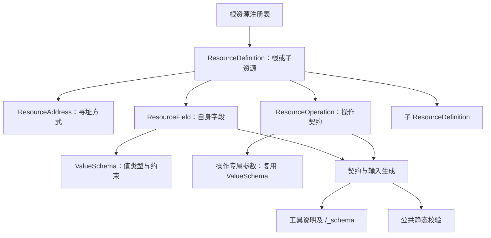
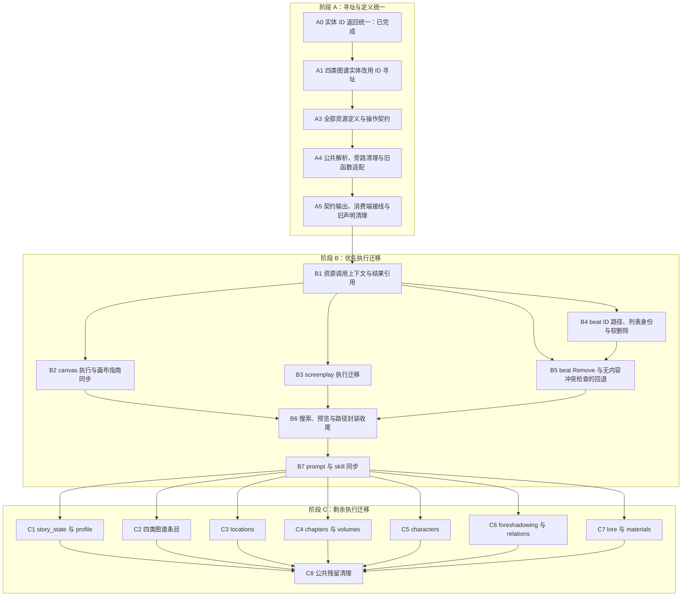

# AI 资源契约统一与执行层渐进迁移

> 适用范围：Dreaming 建议卡片及其执行器、测试已移除。本文涉及 Dreaming 的实施和验证记录仅保留为历史记录，不属于当前实现入口或验收要求；其他资源契约仍按各节约束执行。

日期：2026-09-14。状态：A0 已完成；A1 代码已完成，验证结果见第 7.1.1 节，双端手工验收待执行；A2 已取消（2026-09-15）；A3 定义层已完成，验证见第 7.1.2 节；A4 已完成，验收见第 7.1.5 节；A5 已完成、独立审核已通过，验证见第 7.1.6 节；B1 已完成、独立审核已通过，验证见第 7.1.7 节；B2 已完成、独立审核已通过，验证见第 7.1.8 节；B3 已完成、独立审核已通过，验证见第 7.1.9 节；B4 已完成、独立审核已通过，见第 7.1.10 节；B5 已完成、独立审核已通过，见第 7.1.11 节；B6 已完成、独立审核已通过，见第 7.1.12 节；B7 已完成、独立审核已通过，见第 7.1.13 节；C 未实施。

方案更新（2026-09-15）：A5 取消 typed／legacy 输入分流，统一 harness 的参数适配、值规范化和校验；整数字段统一四舍五入，资源写入字符串默认 trim，普通值数组默认去重，可空数组的显式 null 统一转为 `[]`。schema 补充枚举和字段名别名声明，不增加 trim／deduplicate 开关。具体规则见第 4.8.10 节；A5 代码与确定性验证见第 7.1.6 节，独立审核已通过。

方案更新（2026-09-16）：新增第 7.3.1 节的真实 agent 验收 prompt 及判读规则，用于覆盖确定性测试触不到的跨资源、跨工具接缝。组一已有用户执行记录；全组验收尚未完成。

核心决定：**所有资源一次统一 schema、路径解析与操作入口；现有业务函数通过明确的参数适配继续使用，canvas、screenplay 和 outline beat Remove 优先接入新执行接口。** 后续按资源替换实现，无需再次迁移 schema。

outline beat 的单资源路径将在 B4 统一使用 `outlines/{title}/beats/{beat_id}`，列表 Write 同时支持携带已有 ID 保留身份，无 ID 的项表示新建；排序由数组顺序决定。A0 仅记录已完成的实体自身 ID 返回统一。skills／items／factions／creatures 改用 ID 寻址已在 A1 实现，验证与遗留项见第 7.1.1 节。outlines／canvas 保留 name-path，lore／materials 保留名称目录层级。

现状分析基于代码提交 `4b34d7c45cb6976dae3295610d5ec9246d3b6ee4`，实体 ID 命名已按 A0 更新。A0 的执行结果见第 7.1 节，A1 的验证见第 7.1.1 节，其余任务的验收仍待执行。

## 1. 背景与约束

### 1.1 当前实现

- `_collectionSchemas` 包含资源声明，`ParsedPath` 解析路径；各工具再按 collection、作品类型和路径形状分发。
- `_CollectionSchema`、`_SubSchema` 同时支持旧式字段名列表 `legacyFields` 和由 `_ResourceField` 组成的 `fieldSpecs`。旧式声明的类型、权限、query 和操作限制分散在其他属性及 handler 中。
- `/_schema`、常驻路径说明和部分运行时校验已读取 `_collectionSchemas`，但 legacy 集合的执行能力尚未由这份声明完整表达。
- Read、Write、Edit、Create、Remove 各自存在 canvas、screenplay、outlines 等分支。仅替换字段列表不能消除这些入口对同一路径的重复解释。
- 跨作品调用取得目标作品 lease 后去掉路径前缀，再调用现有 handler；结果由 `_transformWorkValue` 按键名补前缀，并对 hint、error 中的路径词做正则替换。
- A0 已将实体自身标识统一为 `id`，路径占位符和关联字段保留资源专名；现有 schema 双轨和各工具的独立分发尚未迁移。

### 1.2 已确认的问题

| 场景 | 当前行为与影响 | 依据 |
| --- | --- | --- |
| 查询 outlines beats 契约 | 声明 Read／Create／Write／Remove，遗漏 Edit；没有区分整资源 Write、字段 Write 和列表覆盖 | [tools_schema.dart](../../lib/shared/services/ai/tools_schema.dart)、[tools_outline.dart](../../lib/shared/services/ai/tools_outline.dart) |
| `Remove outlines/主线/beats/0` | outline 删除分支用 `namePath.last` 查标题。无同名大纲时返回 not found；若另一大纲标题为 `0`，静态调用链显示会软删除那份大纲 | [tools_remove.dart](../../lib/shared/services/ai/tools_remove.dart)、[outline_service.dart](../../lib/shared/services/outline_service.dart) |
| 非法大纲深路径在工具间处理不同 | 存在标题为 a、b 的两份大纲时，`outlines/a/b` 不会进入 Write 的大纲标量分支，但 Remove 会取末段 b 查找并可能删除它。`_writeOutlineDocumentScalarField` 的前置条件要求 namePath 只有一段，不能据 first／last 的差异推断 Write 会写 a | [tools_support.dart](../../lib/shared/services/ai/tools_support.dart)、[tools_write.dart](../../lib/shared/services/ai/tools_write.dart)、[tools_remove.dart](../../lib/shared/services/ai/tools_remove.dart) |
| 查询 canvas 契约 | `canvasPathFieldSegments` 混合画布、节点、边字段，导致 `x`、`y`、`label` 等被声明为画布自身可写字段 | [tools.dart](../../lib/shared/services/ai/tools.dart)、[tools_canvas.dart](../../lib/shared/services/ai/tools_canvas.dart) |
| 查询 canvas 子资源契约 | edges 被声明可 Write，handler 实际拒绝；nodes 未列出便签正文实际支持的 Edit，创建字段也不等于更新字段 | 同上 |
| 错误后的契约引导 | `_withContractHint` 除少数错误外均追加 schema 查询，连文本匹配失败、跨作品写入拒绝也被导向字段契约 | [tools_schema.dart](../../lib/shared/services/ai/tools_schema.dart) |
| 当前作品绝对路径写入 | 写操作允许，预览和标题解析却因 `isCrossWork` 直接降级 | [tools.dart](../../lib/shared/services/ai/tools.dart)、[tool_resource_resolver.dart](../../lib/shared/widgets/ai/tools/tool_resource_resolver.dart) |
| Dreaming 卡片编辑已删除 beat | executor 按 ID 直接查表且不检查 deletedAt，再 upsert 原行，可能修改 tombstone 并将 Tip 标为已应用；整份大纲软删除后现有路径就可触发 | [dreaming_card_action_executor.dart](../../lib/shared/services/dreaming/dreaming_card_action_executor.dart)、[outline_dao.dart](../../lib/shared/database/novel_content_daos/outline_dao.dart) |

上述问题依据表中源码核对，尚未执行对应回归测试。

### 1.3 约束

1. 保留 `/` 挂载 `/works`、`/_schema` 的模型。相对路径指向当前作品；当前作品绝对路径允许写入，其他作品只允许读取。
2. 所有持久化实体的详情、listing 条目和 Create 统一返回自身 `id`，不因 name-path 而省略；路径占位符与关联字段使用资源专名。A1 将 skills／items／factions／creatures 改为 ID path；outlines／canvas 保留名称路径，lore／materials 保留名称目录层级。B4 仅将 outline beat 子资源从索引切换为 ID 并新增列表身份保留语义，不扩大跨作品写入。
3. 工具定义保持静态。`/_schema` 展示资源的静态能力及条件，不根据会话模式、作品数据或目标权限动态裁剪工具 schema。
4. 业务关系和目标类型使用明确字段，新增判断不得依赖 schemaless metadata。现有跨作品描述中的 `content_kind` 应在作用域边界转为类型化信息。
5. 保留现有业务服务、working change 和内容库引用计数缓存。全体 handler 重写不是第一阶段交付条件。
6. beat Remove 采用软删除并支持撤回。新增能力不得沿用物理删除后重建 beats 的路径；不新增数据库表、列、索引或 schema version。
7. 共享工具层覆盖桌面和移动端。预览、标题解析和审阅入口的验收必须检查两端。

`CONTEXT.md` 将 Workspace Resource Address 定义为稳定资源引用。outline beat 已有持久化 ID，Read 也已返回该 ID，本方案使其成为单拍路径的定位键；大纲标题等其他名称路径保持现状。

## 2. 目标

1. 全部现有资源使用一套显式定义；删除 `legacyFields`、默认可写／可删等推断，不保留第二套权限表。
2. `/_schema`、路径说明、公共路径解析及静态参数校验消费同一份定义；每个公开操作与现有执行入口一致，以契约测试验证。
3. 旧业务函数经参数适配即可继续运行；未迁移的资源不依赖“新实现失败后调用旧实现”的 fallback。
4. canvas、screenplay 优先直接消费解析后的资源目标；outline beat 路径使用 ID，列表覆盖保留明确传入的身份，并支持单拍 Remove、软删除、审阅与撤回。
5. 搜索、预览与执行对资源类型、字段能力和作品作用域的解释一致；结果路径处理不改变正文值。
6. 每个阶段独立可运行、可验证；后续阶段未实施时，已有契约仍准确。

非目标：全量重写业务 Service／DAO、全局修改所有资源及历史数据的身份格式、批量清理用户数据、开放跨作品写入、自动运行真实 LLM E2E，以及重做既有创作流程。

## 3. 方案选择

| 方案 | 做法 | 取舍 | 决定 |
| --- | --- | --- | --- |
| 局部修补 | 给 canvas 增加专用字段表、给 beat 标记不可删 | 修改少，但多个入口仍会分别解释能力；也不满足单个 beat 删除需求 | 不采用 |
| 全部一次重写 | schema、路径、所有 handler、搜索与预览同时重写 | 最终结构统一，但回归面和交付成本集中 | 不作为首批范围 |
| 统一定义，渐进替换执行 | 全部 schema 和公共入口统一；沿用既有 handler 和参数适配，逐步调整资源实现 | 一次核实全部契约，按资源控制实现改动 | 采用 |

适配层仅负责参数和结果转换。字段名、权限、必填项、枚举和 query 不在适配层重抄；公共入口依据资源定义校验后，通过现有 handler／分发调用业务函数。业务服务继续检查目标存在性、父子归属、引用与持久化规则。

迁移成立的前提是现有合法调用能够由新定义准确表达。遇到类型转换、字段定位、名称歧义或输入／返回类型不对称时，必须表达真实行为并加回归；不能为了统一结构静默删掉既有能力。A5 对输入兼容的明确调整以第 4.8.10 节为准，须同步静态契约、执行与测试，不再要求保留原有两套处理差异。

## 4. 资源定义与调用流程

### 4.1 定义的边界

| 概念 | 定义内容 | 生命周期 |
| --- | --- | --- |
| 资源定义 | 类型、父子关系、定位方式、适用作品类型、自身字段、listing query、搜索与操作定义 | 静态 |
| 操作定义 | 目标是集合／资源／字段，输入和返回形状、必填项、值域与条件；执行函数继续由现有 handler／分发负责 | 静态 |
| 已解析目标 | 作品作用域、资源类型、父资源定位信息、字段；需要数据定位时补充真实 ID | 单次调用 |
| 调用上下文 | 当前与目标作品身份、类型、服务引用、现有执行上下文和本次操作 | 单次调用；不另建连接池 |
| 操作结果 | 明确标记的资源引用、listing 条目、业务 payload 和错误信息 | 单次调用 |

这些是工具层内部模型，不新增持久化实体。schema 描述操作契约，现有 handler／分发负责执行；通过注册检查和实际调用测试验证一致性，不在 schema 中新增 binding 字段或另建函数映射层。

身份命名遵循 [tools_path.md](../../.agents/rules/tools_path.md)：实体详情、listing 条目、文件夹自身及子条目、Create 返回统一携带真实 `id`，与寻址方式无关。`path` 用于工具寻址，`id` 用于稳定身份和业务引用。关联字段与查询作用域继续使用 `episode_id`、`character_id`、`work_id` 等名称；字段原值和纯目录索引不额外附加实体 ID。

| 资源 | 最终寻址方式 | 自身 ID 返回 |
| --- | --- | --- |
| skills／items／factions／creatures | A1 改为 `skills/{skill_id}`、`items/{item_id}`、`factions/{faction_id}`、`creatures/{creature_id}` | 统一 `id` |
| outlines／canvas | 保留 `outlines/{title}`、`canvas/{name}` | 统一 `id` |
| lore／materials | 保留多级名称路径及文件夹，例 `materials/人物资料/主角设定` | 文档和文件夹均返回 `id` |
| 其他已按 ID 寻址的实体及子资源 | 保持既定方式；outline beat 的索引迁移仍归 B4 | 统一 `id` |

GraphSearch、关系创建和画布引用沿用已有 type／ID 参数；Read／Create 提供其所需 ID，不新增 path 引用参数、`_referenceCollections` 映射或另一套引用定位接口。A1 的寻址方式调整复用已有 schema 的 itemType 和 handler，把名称查询改成按 ID 查询并检查类型归属；名称只承担显示和 search 查询，重命名后资源地址不变。此前“name-path 不返回自身 ID”和“所有资源都改 ID path”的提议均不再适用。当前代码已统一 ID 返回，四类实体已改用 ID 寻址。

输入、资源读取结果、字段读取结果分别定义。比如 layout 的 Read 返回布局摘要，Write 接受 `"auto"`；near／direction 等创建或摆位参数不能自动成为节点可读属性。数值类型必须容纳画布坐标的小数，不能只沿用剧本的 integer 类型。

### 4.2 路径匹配

路径按资源层级匹配。解析 `canvas/主线图/nodes/节点1/x` 时，依次匹配画布、节点集合、节点、节点字段；`x` 不会成为画布字段。

定义支持 ID、名称和层级名称等定位方式，按第 4.1 节确定的资源边界使用；不为四类图谱实体保留名称寻址别名。A 阶段迁移现状时保留尚未切换的 beat 索引规则，B4 同时替换其定义、执行和路径消费端为 ID；最终不保留 beat 索引寻址分支。字段只在所属资源层级匹配。名称恰好等于字段名、目录名包含保留词、超深路径等边界必须保留现有明确语义或返回明确错误，不能通过“取最后一段”猜测目标。

全部入口消费一次公共解析的结果。旧业务函数需要 `id`、`namePath`、`field` 时，从结果中转换；不把原始路径交回另一套解析器重新决定操作范围。实体加载后的真实 ID 在本次修改中保持一致，跨异步审批边界还需重新检查目标状态。

大纲不支持多级标题路径。比如已有 a、b 两份大纲，`outlines/a/b`、`outlines/a/b/status`、`outlines/a/b/beats` 均须在公共解析阶段返回 `invalid_path`，不得截取首段或末段后操作其中一份。合法的大纲字段及 beats 子资源按已声明层级匹配，和 lore／materials 支持多级名称路径的规则分别表达。

### 4.3 操作和权限

```text
全部资源定义 ──→ /_schema、路径说明、字段说明
      │
      ↓
工具输入 → 作品作用域与路径解析 → 操作权限、静态输入校验
                                      │
                               已解析目标 + 操作
                                      │
                     ┌────────────────┴────────────────┐
                     ↓                                 ↓
             canvas / screenplay 新执行器       参数适配 → 现有业务函数
                     └────────────────┬────────────────┘
                                      ↓
                         业务服务 / working change
                                      ↓
                         结果适配与统一路径输出
```

资源的固有能力与本次调用权限分别检查。支持 Write 的资源在跨作品作用域中仍不可写；注册新操作不能绕过会话模式、当前作品限制和目标归属检查。

以下为完成优先资源迁移后的能力要求，尚未实现的能力不提前发布到第一阶段契约中。

| 目标 | Create | Write | Edit | Remove |
| --- | --- | --- | --- | --- |
| outlines 集合／大纲 | 集合创建大纲 | status、start_chapter_num 字段路径 | title、content | 单份大纲软删除 |
| outlines beats 列表 | 插入一拍，返回 ID 路径 | `value` 数组整体覆盖；带 ID 保留身份，无 ID 新建，`[]` 清空 | 不支持 | 不支持删除列表 |
| 单个 outline beat | 不在单资源路径创建 | 按 beat_id 定位后的 status、chapter_count 字段路径 | title、content | 按 beat_id 删除指定一拍 |
| canvas 集合／画布 | 集合创建画布 | name、description；layout、open 使用各自字段契约 | 无画布自身文本 Edit | 单张画布沿用既有行为 |
| canvas nodes | 集合创建节点 | 仅声明 handler 实际支持的更新字段，区分节点类型和摆位参数 | 便签 content | 单个节点及既有边处理 |
| canvas edges | 集合创建边 | 不支持 | 不支持 | 单条边 |

完整字段清单以迁移后的代码定义为真源，表中不复制所有字段。这里要求特别区分整资源写入、字段写入和列表覆盖，不能由“存在可写字段”推导出三者全部支持。

数组写入的通用规则只在 `tools_write.dart` 的 `_writeDescription` 中说明一次，覆盖 `value` 和 `fields` 中的数组：

> 数组写入提交完整的目标列表，未保留的项从列表中移除，空数组清空列表。实体对象逐项按 id 保留身份，省略 id 的项新建；引用 ID 列表只调整引用，不删除被引用实体。追加或局部修改时，先 Read，再合并后提交。

资源 schema 声明元素类型、身份字段、引用目标和具体校验约束；`/_schema`、字段 description 和 bundled skill 不重复这段通用行为。B4 完成 outline beats 的 ID 保留实现时同步发布统一说明；第 5 节记录其身份校验与落库要求。

### 4.4 旧实现接入

复用 `_buildResourceHandlers` 中现有参数适配的形态，由现有分发调用对应业务函数，不在 schema 中增加函数绑定。read／write／edit／create／remove 都要经过公共入口；只改 Read 的适配不足以关闭旁路。

区分两类适配：A5 的公共输入兼容将模型参数规范化为符合 schema 的值，是持续保留的 harness 能力；旧业务函数的执行适配只把已解析目标和规范化值转换成该函数所需参数，随 B／C 的执行迁移删除。A5 不清理具体 handler 内部的重复转换或校验，只验证它们对规范化后的输入不再改变结果；这些重复处理随对应 B／C 任务清理。后续任务中的“移除参数适配”仅指旧执行适配，不能同时移除数字字符串、四舍五入、JSON 和别名等公共兼容能力。

可保留的是业务读写函数，现有参数适配本身不构成迁移完成。outline 的二次路径解析必须在 A4 清理：公共入口一次决定资源类型、集合／单资源／字段目标、父大纲定位、beat 定位和字段名，handler 接收已解析目标或已定位的大纲／beat，不再接收路径字符串后自行判断层级。

| 入口 | A4 必须处理的旁路 |
| --- | --- |
| `tools_outline.dart` | `_handleEditOutline` 不再 split 原路径或 indexOf beats；`_writeOutlineBeats` 不再裁剪 namePath；`_replaceOutlineBeats`、`_editOutlineDocument`、`_editOutlineBeat` 改收明确目标，不再拼回字符串后用 namePath.last 找父大纲 |
| `tools_read.dart` | `_readOutline`、`_readOutlineBeatPath` 移除 indexOf beats、按段数猜字段和独立字段表，消费公共匹配结果与字段定义 |
| `tools_support.dart` | 删除 `_isOutlineBeatListing`、`_isOutlineBeatResource`、`_isOutlineBeatScalarFieldPath`、`_isOutlineDocumentScalarFieldPath` 等字符串谓词，以及 `_outlineBeatScalarWriteField`、`_outlineBeatScalarWriteIndex`、`_outlineBeatFieldReadName` 中的再次解析；Create 合法性、错误契约、Read 分类和 listing 路径同步消费公共目标 |
| `tools_resource_search_support.dart` | 删除基于 namePath.contains beats 的 `_isOutlineBeatPath`；`_looksLikeResourceFieldPath` 与 beat 遍历不再按段数或关键词猜资源类型 |
| `tools_replace.dart` | `_isReplaceTargetField` 不再 split 路径并 contains beats，直接读取公共目标的字段 Edit 能力 |

A4 保留现有 beat 索引地址时，索引只在公共解析／定位阶段处理，随后绑定到当前大纲中的真实 beat；handler 不再次解释索引。B4 切换公共定位策略为 beat_id，不能把 A4 应清理的解析器拖到 B4 或 B6。数组内容解析 `_parseOutlineBeats` 属于输入值处理，可以保留并在 B4 实现 ID 保留规则。

公共路径及权限旁路按 A4 收口；A5 在第 4.8.10 节统一公共输入规范化与校验。现有 handler 内对规范化值无影响的重复转换和校验允许暂时保留，随 B／C 的执行迁移删除，不作为 A5 的代码清理范围；业务专属条件继续保留。结果适配必须明确区分业务内容和资源引用，不扫描任意 JSON 字符串猜路径。

### 4.5 跨作品、搜索和预览

- 相对路径与当前作品绝对路径解析为同一目标。目标作品类型从明确的作品描述获取；不可判定时返回错误，不回退为当前作品类型。
- 继续复用内容库缓存及引用计数 lease。第一阶段不要求调整会话级 lease 缓存；更长生命周期的影响列入第 8 节。
- 已解析目标和结果引用保留 workId。优先资源迁移阶段接通统一序列化，覆盖 path、listing、GraphSearch 关系路径和 episode 引用；删除 `_transformWorkValue` 的递归键名修补及 hint／error 的正则替换。
- Glob 根据资源定义和实际 listing 遍历；Grep 读取明确可搜索的原始文本字段；Replace 复用字段 Edit。保留现有扫描预算、分页与截断语义，relations 继续明确引导 GraphSearch。
- 预览与执行共享目标和参数规则，资源标题解析能识别当前作品绝对路径。审批后执行重新验证目标存在性、归属和内容版本；beat 重排不改变已定位的 ID。

### 4.6 错误与创作引导

公共校验产生的字段、路径、query、类型、枚举、必填项错误携带对应契约入口。文本匹配失败、权限拒绝、取消和资源不存在保留各自处理建议，不无差别追加 schema 查询。

A5 删除 `_outlineBeatWriteHint` 及“beats 无 schema，保留手写例外”的注释，字段权限与引导从公共解析命中的具体资源节点生成。`_editFieldNotEditableError`、`_writeScalarFields`、`_editableFieldList` 需支持子资源节点，不能只传 collection=outlines 后读取父大纲字段，否则 beat 的 chapter_count 会遗漏，父大纲的 start_chapter_num 又会被错误列入。

Edit 指向仅支持 Write 的字段时，继续返回 `use_write_for_scalar` 并给出对应字段路径；可 Edit／Write 的字段清单及只读、未知字段判断均由该节点的操作定义提供。`tools_outline.dart` 不再维护 status／chapter_count、title／content 的另一份权限分支和手写清单。

按错误来源分类，覆盖 `unknown_field`、`unknown_collection`、`invalid_fields`、`invalid_path`、`read_only_field`、`invalid_enum`、`missing_required_fields`，以及现有 `invalid_status`、query 等具体校验错误。

A5 将已被各类资源共用的 `_screenplayError` 改名为 `_resourceError`，放入通用错误构造代码并同步调用处；只调整职责命名，不改变错误码与返回形状。`_screenplayException` 等剧本业务异常转换继续保留专属名称。

跨作品错误按失败层级区分，保留现有错误码，新增 `work_unavailable` 只表示一个指定作品的内容访问失败：

| 错误码 | 触发边界 | 返回路径与处理方向 |
| --- | --- | --- |
| `cross_work_unavailable` | 当前工具上下文没有 CrossWorkAccess，尚未开始列作品或获取目标内容库 | 原请求的作品入口；说明当前上下文不可跨作品访问，不引导查询字段契约 |
| `works_unavailable` | CrossWorkAccess 存在，但 `/works` 的作品列表获取失败 | `/works`；说明发现列表暂不可用，不据此推断某个作品不存在 |
| `work_not_found` | 指定 ID 不存在、已删除，或不属于可访问的已建立作品（如 draft） | `/works/{work_id}`；引导重新 Read `/works` 选择有效目标 |
| `work_unavailable` | 获取指定有效作品的内容失败，包括数据库路径缺失、文件缺失、连接／打开／迁移失败；获取过程的未分类异常也按访问失败处理 | `/works/{work_id}`；说明目标内容暂不可用，不伪装成 not found，也不引导查询字段契约 |

`CrossWorkResolver.acquire`、`_withCrossWork` 的异常转换和 `_readWorksListing` 同步遵循此边界，保留真实异常日志。已有明确错误码的 `CrossWorkAccessException` 保持其分类；工具层兜底 catch 不再把未知获取失败统称为 `work_not_found`。`tool_manager_disposed` 继续表示工具生命周期已结束，不并入上述错误。

A5 将 `_withContractHint` 改为仅给明确的路径／参数契约校验失败追加 schema 引导，其他错误默认保持原 hint。上述四个作品访问错误均不追加 `Read /_schema`，也不追加任何集合契约路径；无需每新增一个运行时错误码再维护跳过名单。B1 在新增 `work_unavailable` 时验证完整工具返回链路，不能只测试 resolver 的错误码。

prompt／skill 同步范围见第 6 节。原作摘要可先用于定位，区间确认后需要证据时按原作工作路径读取对应章节；资料冲突需说明来源并询问用户，不自动把导入摘要或原文任一方设成无条件优先。

### 4.7 Read 资源列表的返回字段

A2 已于 2026-09-15 取消。按资源名称改列表键主要改善字段可读性，但需要同步出口、契约、提示和大量测试，收益不足以支撑本次调整；取消前仅做了读取检查，没有修改产品代码。

Read 资源集合、子资源集合、目录及契约索引继续使用现有 `entries` 返回，内部过滤、排序、分页和搜索遍历也保持现状。不新增按资源命名的出口转换或 `listing.resultKey` 配置。现有 `entries[].path`／`entries[].id` 引导与历史工具结果无需迁移，Run 保持既有契约。

A3 至 A5 及 B 阶段沿用这一返回结构，仍需保证条目身份、路径、分页及业务字段原值正确。

### 4.8 A3 统一 schema 的详细设计

本节确定 A3 的结构及 A4／A5 的接入方式。**A3 定义层、A4 公共解析接入已完成（2026-09-15），A5 已完成、独立审核已通过**；验证及尚未接通的执行边界见第 7.1.2 节。命名中的下划线表示工具 library 内部类型，不是新增公开 API。继续在 `tools.dart` 注册资源、在 `tools_support.dart` 定义结构及通用访问方法、在 `tools_schema.dart` 生成可读契约；不引入新的配置文件、持久化表、schema 注册服务或引用类型映射。

#### 4.8.1 唯一真源与对象关系

采用一棵资源定义树，根资源与子资源使用同一种 `_ResourceDefinition`，替代 `_CollectionSchema`／`_SubSchema` 的两套字段容器。保留一个根注册表 `_resourceDefinitions`；父定义直接持有子定义，不另建手写的路径表、字段权限表或集合→引用类型表。



字段是否可用于某个操作只写在该字段上；操作目标与输入输出约束写在操作定义中，实际执行继续使用现有 handler／分发。根资源是否支持 Create 由 singleton 语义决定，不另存 createTool／creatable／supportsCreate 开关。字段 Write 不自动开放整个集合 Write，创建字段的数量也不能用来判断是否支持 Create。

新增结构是内部声明与调用值对象，替换现有结构，不增加用户设置、开关、数据库实体、服务或第二个注册源。整体改动超过 8 个文件；对应阶段范围仍按第 6.2 节执行。

#### 4.8.2 `_ResourceDefinition`：资源节点

| 成员 | 内容与规则 |
| --- | --- |
| `segment` | 该节点在路径里的固定段名，例如 canvas、nodes、outlines、beats；根注册表的键必须与根 segment 一致 |
| `description` | 资源整体用途；不重复字段说明或操作参数 |
| `address` | `_ResourceAddress`，明确单例、ID、单段名称、层级名称或过渡期索引寻址 |
| `group` | shared／novel／screenplay，沿用现有作品类型边界；子节点沿用父节点分组，不再独立配置相矛盾的分组 |
| `hidden` | 沿用现有常驻说明的可见性；只控制常驻文档曝光，不影响操作授权及按需读取 `/_schema` |
| `fields` | `Map<String, _ResourceField>`，包含该资源自身的值字段及明确可寻址的虚拟字段；不混入子资源字段或 near 等普通操作参数。字段名由 map key 承担，不在字段对象中重复存 name |
| `children` | 直接子资源定义；不能把子资源字段平铺进父 fields |
| `listing` | 可列表化资源的配置；返回沿用 `entries`，不新增 `resultKey`，见第 4.7 节 |
| `operations` | 按 `(tool, target)` 唯一登记 `_ResourceOperation`，field 目标包含具体字段名；Write／Edit／Remove 未登记即不支持。Create 项由非单例资源性质要求提供，单例禁止提供，不作为另一份创建能力开关 |
| `itemType`／`documentType` | 保留现有 handler 定位所需信息及含义，不新增 storageBinding 对象或引用映射；不由它推导权限，不输出给模型 |

`_ResourceAddress` 的模式与必备信息：

- `singleton`：当前作品只有唯一的一份资源，没有实例定位段，也不支持 Create，例如 profile、story_state、screenplay。其余现有根集合支持创建条目；无需再逐个声明 createTool。子资源按自身资源性质判断，不继承父资源的 singleton；字段及全局目录入口不当作可创建的实体集合。
- `id`：声明 `itemToken`，例如 skill_id、node_id；不能从 token 字符串截取／猜测业务类型。
- `name`：声明 `itemToken` 与 `nameField`，例如 canvas 的 name、outlines 的 title；只消耗一个名称段，不能贪婪接收多级路径。
- `hierarchicalName`：用于 lore／materials；读取文件夹的直属成员与读取文档分开，目录结构不被当作任意子资源语法。
- `index`：仅作为 B4 之前 outline beat 现有寻址方式的显式表示；B4 切成 ID 后删除这个不再使用的分支，不为旧数字路径保留兼容别名。

字段名、子资源段名和目录名的歧义交由 A4 的公共解析处理；handler 不再次 split 原路径。A3 注册的仍是 A1 后的现有合法路径，不提前发布 B4 的 beat ID 路径。

#### 4.8.3 `_ValueSchema`：值类型、约束与描述

`_ValueSchema` 使用明确的值类型：string、integer、number、boolean、object、array。`number` 接受有限小数，不能用 integer 表示画布坐标。object 的属性使用命名输入／输出属性定义，array 必须声明元素 schema；不再以 objectList 仅检查“元素是 Map”而不描述元素内容。

每个值 schema 只携带适用的约束：nullable、enumValues、minimum／maximum、对象属性、数组元素及数组身份语义。对象属性默认不自动扩大为任意 JSON；确有任意字典输出的现有资源应显式声明相应值类型，不把它用来承载额外权限或业务路由。

- **字段含义**写在 `_ResourceField.description`；操作专属参数含义写在参数自身的 description；资源用途写在资源 description。
- 不再维护 `fieldDescriptions`。`/_schema`、常驻字段说明和静态 tool 参数提示读取同一处 description。
- description 可以为空，特别是 id、title、name；空值不生成空字符串说明，不因为没有说明隐藏合法字段。
- 枚举、范围、必填及互斥由结构化定义输出，不在 description 里再抄一份规则。
- 资源字段的通用值 schema 由 Read 和同形状输入共享；操作输入与输出形状不同时显式声明操作输入 schema，不能把输入类型强行当成返回类型。
- 数组复用被引用子资源的元素字段定义；例如 outlines.beats 与 beat 子资源共用字段类型，不能手写第二套 beat 对象结构。投影时按 Read／Create／Write 分别取允许字段。
- `id` 的类型统一为 string；是否能在某种数组输入中提供既有 ID由该输入的身份规则决定，不能把“资源自身 ID 只读”误解为“任何输入都不允许 id”。

#### 4.8.4 `_ResourceField`：字段只声明一次

| 成员 | 内容与默认规则 |
| --- | --- |
| `value` | 通用 `_ValueSchema`，描述该字段值；必须明确声明类型，不用“未填写则所有输入都按 string”兜底 |
| `description` | 字段含义，默认空 |
| `read` | 可选读取策略：是否进入详情、是否进入列表投影、是否允许独立字段路径；缺省表示不作为输出字段 |
| `create` | 可选 `_FieldInputUse`；存在才允许进入 Create 输入，包含该操作内的 required、默认值及必要的输入 schema 差异 |
| `write` | 可选 `_FieldInputUse`；存在才允许 Write，另列允许整资源 fields 更新和／或字段 value 写入的目标范围 |
| `edit` | 可选文本编辑策略；存在才允许精确文本 Edit，可附静态的目标条件，例如仅便签 content；必须为文本值 |
| `query` | 可选过滤策略；存在才允许作为列表 query 参数，注明匹配方式和 query 值规范化；不因此允许写入 |
| `search` | 可选搜索用途：短文本检索与正文检索分别声明；Glob 的资源遍历和 Grep／Replace 的文本目标不再维护字段名单副本 |

读取策略把“实体详情含此字段”和“可执行 `/字段名`”区分开。例如 id 可以进入详情和列表，但只有现有行为支持时才公开 `/id` 字段路径；不能因为补了 id 就增加新的字段读取 API。

`_FieldInputUse` 的必填是**操作局部**概念：创建所需 title 不会变成每次 Write 都必须提供 title。字段 value 写入时，顶层 `value` 是否必须存在由该输入形状决定，不重复声明成资源必填字段。未提供与显式 null 必须区分；nullable 不等于 optional。

读取值的 nullable 不能自动代表 Write 接受 null。输入与读取类型不同时，用 `write.value` 明确声明实际 Write 输入；例如章节 content 读取可空，但写入要求字符串，清空传 `""`。字段路径 `value` 与整资源 `fields` 的行为不同时，再用 `write.resourceValue` 声明整资源输入差异；例如 skills.content 的字段 value 不接受 null，整资源 fields.content 仍按现有行为接受 null 并清空。两者分别生成对应操作的输入契约，不扩大执行能力，也不把既有 null 清空改成拒绝。

该要求同样适用于整资源 Write：未声明 nullable 的输入收到显式 null 时必须拒绝，规范化不能把它转换成空字符串或空数组后放行。已用 `resourceValue` 声明的 null 清空行为继续保留；章节正文使用 `""`，情绪和事件数组使用 `[]` 清空。

默认值只在对应操作输入使用处声明。缺省没有默认值时保持未提供，交由现有业务行为处理；A3 不通过补默认值改变“未传”“空字符串”“null”的既有差异。已有合法的数值字符串、枚举别名和 fields JSON 规范化保留在明确的输入适配中，适配后按 canonical schema 校验；不得把新的静态类型校验变成收紧已有合法调用的隐性改动。

#### 4.8.5 `_ResourceOperation`：操作目标、输入与执行

| 成员 | 内容与规则 |
| --- | --- |
| `tool` | Read／Create／Write／Edit／Remove 中的明确操作；不用任意工具名字符串兼作“能否创建”开关 |
| `target` | listing、resource、field(fieldName) 三种目标；field 目标必须引用具体字段。不同 tool／目标分别声明，不互相推导支持 |
| `input` | 输入形状：无业务输入、Create fields、Write resource fields、单字段 value、Edit 文本参数、显式数组 value；字段部分从 `_ResourceField` 的操作使用声明生成 |
| `parameters` | 只属于此次操作、不是资源字段的参数定义，如 near／direction、Remove force／recursive；使用同一 `_ValueSchema`，不塞进资源 Read 输出 |
| `constraints` | 该操作的跨字段静态约束，以及可描述的已加载目标条件；例如 atLeastOne、互斥、成组提供、条件必填 |
| `missingTarget` | 默认报错；只有现有 lore／materials Write 自动建文档等已支持行为可声明创建处理。不能因为 Create 存在就自动让 Write 创建 |
| `result` | 返回形状及资源引用位置：实体投影、列表、字段原值或操作专属结果；输入形状与返回形状分开 |

字段操作的目标键包含字段名，因此 Write layout 与 Write open 可以各自有不同的输入与结果契约，不会争用同一个 Write field 插槽。普通字段允许用一个模板从字段操作策略展开操作契约；展开结果只读，不能再手写另一份字段名单。模板与显式字段操作若覆盖同一个目标，注册时报重复，不能靠覆盖优先级选行为。

操作的字段输入由同一字段定义投影产生。例如 Create fields 来自字段的 create 使用声明，再合入 Create 专属 parameters；不再额外手写 createFields。参数与字段重名视为定义错误，不能由 map 合并顺序决定覆盖谁。空输入操作依然可以声明并执行，不能根据字段数量判断是否支持。

显式数组操作使用子资源输入投影引用：outlines beats 的 Write listing 指向 beats 字段的数组输入定义；不会因此允许 Write 所有资源列表。`listingWriteField` 原有的“引用同一数组定义”作用保留为该操作 input 的引用，不再作为资源上另一个启用 Write 的开关。

`constraints` 采用有限的结构化规则，而不是新增表达式语言：

- `atLeastOne`：例如 Write 画布至少提供 name 或 description。
- `mutuallyExclusive`：例如 chapter_id 与 scene_id；有区别的“至多一个”与“必须选一个”不能混用。
- `requiresTogether`：成组参数必须一起出现，仅在现有契约已有此要求时使用。
- `requiredWhen`：例如创建 reference 节点时 ref_type／ref_id 必填；判据来自规范化输入。
- `targetRequirement`：例如 Edit 节点 content 只允许已加载的 sticky 节点；判据来自已定位业务对象，不扫描 metadata。

输入计数约束的 `presence` 默认为 `provided`，要求键存在、值非 null 且字符串非空白；`present` 只要求键存在，字段值仍独立通过类型、nullable 和枚举校验。画布及节点的整资源 Write 为 `atLeastOne` 显式选择 `present`，并在契约输出中标明，允许用空字符串清空说明或便签文本；创建引用节点的 `requiredWhen` 仍使用 `provided`，仅给 null 或空白引用不能满足必填条件。

这些规则同时驱动校验和契约说明，不能再给 handler 抄一份条件表。资源存在性、ID 归属、名称冲突、数据状态和写入原子性仍由既有 Service／DAO 验证；schema 不尝试替代数据库状态相关的业务校验。不能从支持的 value 类型或属性名字猜测操作能力。

#### 4.8.6 Edit 显式字段路径、singleton 与现有执行入口

**2026-09-15 用户确认：删除 `defaultEditField`／`defaultField` 配置及 Edit 省略字段的能力。** Edit 只声明 `field(fieldName)` 目标，不再声明 resource／listing 目标。例如必须使用 `Edit outlines/主线/content`，`Edit outlines/主线` 返回 `missing_field`；章节、角色、资料、单拍、画布节点与 singleton 均遵循相同规则。顶层额外传 `field` 不能代替完整字段路径。显式传入未知或不可编辑字段时沿用对应错误，不回退到另一个字段。

原默认字段仅用于让模型直接复用 Read 的资源路径，省去补字段名；它不是独立业务能力。多文本字段资源中，默认 biography／setup 等选择不直观，还要求执行与预览各处同步维护。当前 Edit 参数已要求字段路径，因此统一显式路径、删除默认配置，不保留兼容别名或另一个默认开关。

省略字段的请求不修改业务数据、不产生 working change，也不自动生成某个字段的 diff 预览。合法 Edit 的执行、预览与变更记录使用请求明确指定的字段。Write 仍允许既有整资源 fields 更新；其单字段文本预览从实际提交的字段取值，多字段更新不再任选一个默认字段拼接单字段 diff。A4 继续收口路径解析，但不再实现默认字段补全。

`createTool` 在后续 schema 整理时删除，**当前代码不在本轮修改**。当前 21 个作品内根资源中，profile／story_state／screenplay 三个 singleton 不支持 Create，其余 18 个根集合支持创建；因此创建能力直接复用 singleton 语义。`/_schema`、创建字段查询、Create 错误提示和 Write 的创建引导统一读取这一判断，不改用另一个名称的布尔开关，也不改用 binding 是否存在来推断。

非 singleton 的 Create 操作定义只描述创建目标、输入和返回形状，不是第二个支持开关；漏写必要的输入契约应作为定义错误，不能把非 singleton 静默变成“不支持 Create”。isReadOnly 仍只讨论修改能力，relations 不允许 Write／Edit 但可以创建关系；不能把它等同于 singleton。Write 是否允许创建缺失文档仍是独立的操作行为，沿用现有 lore／materials 例外。

不在新 schema 中增加 `binding` 字段。执行继续复用 `_buildResourceHandlers` 的 readFn／writeFn／editFn 及 Create／Remove 的现有分发；A4 让这些入口消费公共解析结果，A5 用契约与行为测试校验它们一致。其他操作的 `isReadOnly`／`removable` 配置按操作契约收口，不从字段数量或否定开关扩大权限。

每个调用最终进入一个已有 handler／业务函数；参数适配继续沿用现有机制。B 阶段按资源修改这些 handler，使其直接消费已解析目标，不另建 operation→function 的映射表。不得在新实现失败后回退调用旧实现。

现有 handler／分发消费以下单次调用结构；这些对象不进入 schema 的静态内容，也不写入数据库：

| 调用结构 | 成员与责任 |
| --- | --- |
| `_ResourceCallContext` | 当前／目标作品身份、作品类型、现有服务与 working overlay 引用、模式及调用来源；复用已有 lease，不创建第二份资源连接缓存 |
| `_ParsedResourceTarget` | 命中的资源定义、父子定位段、目标种类、具体字段和请求路径；Edit 必须显式提供字段，保留明确作品作用域 |
| `_LocatedResourceTarget` | 已解析目标、真实 resourceId／父资源身份和现有业务对象；由现有资源定位逻辑产生；仅明确创建操作允许携带待创建地址而没有现存对象 |
| `_ResourceOperationResult` | 业务返回值、成功／失败状态及明确的结果资源引用；重命名／创建操作提供实际结果目标，不能用旧请求路径覆盖新路径 |

定位函数消费已解析的定位段，不重新解析 raw path；执行函数消费已定位对象或 ID，不在 handler 中再猜名称和字段。根列表或纯派生单例不强行创建不存在的实体 ID。旧函数需要 id／namePath／field 时由现有适配函数显式传入，不能让静态 schema 自己持有当前数据库或用户实体。

A3 定义上述边界，A4 用现有调用作用域提供最小上下文并接入；B1 再将跨作品及结果引用的存量隐式传递收口，不能把 A4 已公开操作运行所必需的上下文拖到 B1。没有新执行器的资源仍使用同一个旧业务适配入口。

#### 4.8.7 旧配置到新定义的逐项对照

| 旧配置 | 最终归属／替代方式 |
| --- | --- |
| `fields`／`legacyFields`／`fieldSpecs` 双轨 | 仅保留资源的 fields 定义 map；读取字段名列表由 read 策略生成，不允许 legacy 分支 |
| `fieldDescriptions` | `_ResourceField.description`；参数说明归参数自身 |
| `fieldValueKinds` | `_ValueSchema`；补齐 number、对象与数组元素结构，不留默认推断表 |
| `nullableFields` | 相应值／输入 schema 的 nullable |
| `enumFields` | 字段或参数值 schema 的 enumValues；引用现有枚举常量，不复制常量内容 |
| `editableFields` | 字段 edit 策略；需要名单时只提供只读 getter／生成结果 |
| `readOnlyFields` | 删除；从字段操作策略得到读写能力。Create 可输入但后续不可修改是合法情况，不能被“只读”统统拦掉 |
| `requiredFields` | 对应 Create／Write 输入使用处的 required；组合必填使用操作 constraints |
| `queryableFields` | 普通字段 query 策略生成；search 等虚拟条件归 Read listing 的 parameters，不伪造成资源字段 |
| `createOnlyFields` | 不出现在实体输出的 Create parameters；确实也是输出字段时使用其 create 策略 |
| `createFields`／`createFieldsOverride` | 从字段 create 使用声明与操作 parameters 生成；删除独立可写名单 |
| `defaultEditField`／`defaultField` | 删除配置及对应功能；Edit 仅支持显式字段路径 |
| `createTool` | 删除，根资源创建能力由 singleton 语义决定；Create 操作项只描述输入、目标和结果，不再提供第二个开关 |
| `isReadOnly`／`removable` | 是否存在对应目标的 Write／Edit／Remove 操作，不再按否定开关推断 |
| `createExclusive`／`writeExclusive`／`exclusiveFields` | 对应操作的 constraints；不跨操作套用一份互斥列表 |
| `listingWriteField` | Write listing 的数组输入引用，不再承担操作授权 |
| `idPlaceholder`／`usesNamePath`／`isSingleton`／`itemToken` | 收入 address；其中 itemToken 只描述路径占位名，不改变实体自身 id 字段 |
| `itemType`／`documentType` | 归现有存储／handler 绑定，保留定位所需信息，不新增 `_referenceCollections` 对照表 |
| 集合／子资源 `hidden` | 保留在资源定义，只影响常驻曝光；不新增字段 hidden 开关来隐藏 id 契约 |

原有需要列表的消费者可以读取从定义生成的 getter，但不得再接受外部手工传入一份名单。getter 不允许在新定义为空时退回 legacy 配置。

#### 4.8.8 示例：画布与节点

画布定义使用 name 地址，nameField=name、itemToken=name。children 仅含 nodes 和 edges；两者分别使用 node_id／edge_id，列表返回键均为 entries。画布及其子资源保持当前 hidden 行为。

| 画布自身字段 | 值与读取 | 输入能力 |
| --- | --- | --- |
| id | string；详情／列表返回 | 不允许调用方改写 |
| name | string；详情／列表／字段路径 | Create 必填；Write 画布 fields 及现有 name 字段路径 |
| description | string；详情／列表／字段路径；可用于短文本 search | Create 可选；Write 画布 fields 及 description 字段路径 |
| node_count／edge_count | integer；详情／列表派生结果 | 不允许输入或修改 |
| layout | Read 返回现有布局摘要 object | 仅 Write layout 字段操作接受枚举字符串 auto；不进入 Create 或 Write 画布 fields |
| open | 不作为 Read 字段 | 仅 Write open 字段操作接受 true；定义为可寻址的只写虚拟字段，不进入资源详情或 listing 输出 |

画布显式声明 Read listing、Read resource、已有 Read field、Create listing、Write resource、已有 Write field 和 Remove resource。Write resource 至少包含 name／description 之一；不声明画布自身 Edit。name 改名后返回实际新路径，不能把输入的旧名称路径当作结果真源。

节点的 Read 输出字段、Create 参数和可更新字段分别投影。下表中的限制描述绑定实际 handler 行为，不用于扩大功能：

| 节点字段／参数 | 归属和约束 |
| --- | --- |
| id | 节点自身字段，详情及列表只读；不受父画布 name 寻址影响 |
| type | 节点字段；Create 必填，使用 canvasNodeTypeReference／canvasNodeTypeSticky 现有枚举；创建后不随意改变 |
| ref_type／ref_id | 节点字段及 Create 输入；reference 时必填，引用类型使用现有 canvasNodeRefTypes，实际目标由 CanvasService 校验；不新增引用路径参数 |
| title／content／color | 按现有 sticky／reference 行为声明 Create、Write 及目标条件；Edit 只声明 sticky content。reference 的缓存标题处理沿用现有输入适配，不因声明迁移变成拒绝原先可接受的输入 |
| x／y／width／height | number 值，接受小数；读出、创建及更新能力按当前 handler 分别声明，不混入画布字段 |
| col／row | 网格坐标的输入／输出定义；只在现有支持的节点操作开放，不从 x／y 的存在推导新能力 |
| near／direction | 操作专属摆位参数，不出现在节点 Read 字段中；合法方向及现有别名规范化复用已有实现 |

节点显式声明 Create listing、Read listing／resource／现有 field、Write resource／现有 field、Edit content、Remove resource。Edit 和 content Write 的目标条件必须检查实际节点类型。节点的 Read 返回位置，不代表 Write listing 支持位置数组覆盖。

边声明 Create listing、Read listing／resource／现有 field、Remove resource；**不声明 Write／Edit**。source_node_id／target_node_id 是 Create 所需的节点关联 ID，字段 schema 复用现有 ID 类型；引用存在性、同画布归属和重复边限制留在 CanvasService。

#### 4.8.9 示例：大纲与 beats 列表

大纲使用 name 地址，nameField=title、itemToken=title。大纲详情和列表返回 id；title／content 的 Edit 能力与 status／start_chapter_num 的 Write 能力各自声明，Edit 必须显式使用 title／content 字段路径。创建大纲的 title 必填，不能因此要求每次更新状态时也提供 title。

beats 是子资源，并通过大纲 beats 数组字段共享元素定义。字段的唯一声明位置包含 id、title、content、status、chapter_count 及现有读取需要的其他字段；列表／详情投影与数组输入按操作选择，不能将父大纲 start_chapter_num 放进单拍字段提示。

- A3 至 A5 注册的是当前 beat 索引地址。Read listing、Read resource／field、Create listing、Write listing、现有 Write／Edit 字段分别有明确绑定；单拍 Remove 在 B5 前不声明。
- Write beats listing 的 input 显式是整个 beat 数组，类型来自共享元素定义，不由“beat 有可写字段”推导。A3 不提前发布 B4 尚未实现的 ID 保留与软删除行为。
- B4 切换地址为 beat_id，同批替换数组身份处理与相关绑定；Read／Write／Create 共用同一元素类型。其 ID 归属、重复、缺失及恢复规则遵循第 5 节。
- B5 完成单拍 Remove 实现并声明操作后才在契约中公开该操作。
- description 放在对应字段上，例如 chapter_count 描述该拍覆盖的章节数量。数组整体覆盖行为由 Write tool 统一说明，不在每个资源字段中重复一遍。

#### 4.8.10 输入、调用结果与 `ok` 的边界

全局工具输入保持现有外壳：Create 的 path／fields，Write 的 path／value／fields，Edit 的 path／old_text／new_text／all 等不因内部 schema 重构新增顶层参数。资源专属输入由命中操作生成，静态 tool schema 不按用户数据或会话状态裁剪。

`ok`、path、error_code、error、hint、取消／跳过标记属于公共工具结果协议，不进入每个资源的 fields。资源定义只声明业务输出及资源引用位置；执行和结果适配不得递归扫描任意正文字符串猜测路径。

A4 接入时保留旧 handler 的成功／失败形状并交由既有错误归一化处理；A5 让契约输出与公共结果分类使用一致规则：显式 ok=false、非空错误、取消或跳过不能被当成成功；成功时缺少 ok 的旧 handler 结果仍能正确识别，不根据 created／updated 是否为 true 判断调用成败。公共响应出口统一产生供模型、日志及 UI 消费的 ok；handler 不必各自补齐。updated=false 可以是成功的无变化，业务字段不被 ok 取代。工具结果摘要中“只有 ok==true 才成功”的现有分歧与该出口同批对齐。

这项收口复用现有 `normalizeToolFailureResult` 和 Agent 工具结果事件链路，不新建另一种成功／失败 envelope，不把 schema 拆成每种资源一套 ok/error 定义。Run 等非资源工具的业务 payload 保持，公共分类不得改写其 exit_code 或部分成功明细。

过渡实现中，`_prepareResourceInput` 按剧本专属资源与其他资源选择 strict／非 strict，后续以 `_ResourceInputCompatibility.typed / legacy` 表达这一差异。两者已经共用资源定义，但类型转换、未知字段、可选 Create 字段的 null 处理及顶层错误码仍有差异。这里的 legacy 是仍在使用的输入策略，与第 4.8.7 节已删除的 `legacyFields` 声明双轨不是同一概念。

**A5：统一输入兼容、规范化、校验与输出（2026-09-15 更新，代码已完成、独立审核已通过）。** 本节替代此前“保持两类资源合法输入集合、未知字段策略、顶层校验错误码及单字段拒绝非字符串行为不变”的要求。harness 负责兼容模型常见的输入表达偏差，最终值仍须满足资源定义；不再维护 typed／legacy 模式或按作品类型选择转换规则。

统一流程为：参数形式适配 → 按目标 schema 规范化值 → 收集全部静态校验问题 → 全部通过后执行。Create、单字段 Write 与整资源 Write 对同一字段使用相同的值规范化规则；Create 必填与 Write 局部更新等操作语义继续由定义表达。模型看到的 tool schema 保持静态，声明标准输入类型，不新增兼容模式参数或运行时 schema 裁剪。

| 目标类型 | 标准输入 | 统一兼容规则 |
| --- | --- | --- |
| integer | `7` | 接受数字及数字字符串，解析后统一四舍五入：`7.2 → 7`、`7.8 → 8`、`"7.8" → 8`；半整数按 Dart `round()` 向远离零的方向取整。小数本身不报错，章节 tension 不再有独立取整规则 |
| number | `7.5` | 接受数字及数字字符串，保留小数；画布坐标等不套用整数取整 |
| boolean | `true`／`false` | 接受布尔值、忽略首尾空白和大小写的 `true/false`、`yes/no`、`1/0` 字符串，以及数字 `1/0`；无法识别的值报错，不默认变成 false |
| string | `"正文"` | 接受字符串，数字和布尔可转成字符串；对象、数组不转成正文；统一去除首尾空白，包括正文，内部空白保持。实体 ID、路径及引用仍遵循其既有身份和寻址契约，不套用普通文本转型和枚举格式修正 |
| array | `["紧张", "决绝"]` | 接受真实数组或 JSON 数组字符串；按元素 schema 递归规范化、逐项校验。普通值数组默认按规范化后的完整值去重，保留首次出现顺序；带实体身份的数组不去重，重复 ID 按身份约束报错。不再保留 emotion 的顿号分隔文本等字段专属数组简写 |
| object | `{"title":"标题"}` | 接受真实对象或 JSON 对象字符串，复用现有 JSON 修复能力；解析后仍检查字段、类型与约束，不丢弃非法字段后假报成功 |
| enum | 标准枚举值 | 标准值直接接受；字符串枚举统一兼容首尾空白、大小写、驼峰、空格和连字符，以及 schema 声明的 enumAliases。规范化必须命中合法标准值；拼写近似只提供建议，不自动选值 |
| null | 按字段 nullable 声明 | 显式 null 与未提供分别处理；所有允许 null 的数组统一规范化为 `[]`，其他可空类型保留 null；未提供字段不补值。取消“legacy Create 的可选 null 自动跳过校验”；不允许 null 时按必填／类型规则报告问题 |

数字解析后先检查有限值，再按目标类型规范化并检查字段范围；不能因输入带小数而拒绝，也不能把越界值截到最大／最小值。所有资源及各写入入口遵循同一标准。规范化只处理目标 schema 要求的结构，不把本应作为正文的 JSON 文本重新解释为对象。

字符串 trim、普通值数组去重和可空数组 null 转空数组均为公共默认行为，不提供开关，不判断资源名或字段名。去重比较规范化后的完整值：数组按顺序比较，对象按键值结构比较，不以对象实例身份或某个业务键代替完整值。任一元素校验失败必须报告，不能先丢弃非法元素再返回成功。上述默认规则作用于 Create／Write 的资源输入，不处理 Read 返回的原始值、历史快照或 Edit 的精确匹配文本。

**schema 的最小扩展：**

- `_ValueSchema` 增加 `enumAliases`，声明别名到标准枚举值的映射，默认空；复用现有合法枚举清单和别名表。相同枚举语义共用声明，不按 collection／field 在公共流程中分派 resolver。
- `_ResourceField` 增加字段名 `aliases` 声明，默认空；由资源字段定义投影到 Create、Write 和嵌套对象的字段解析中。字段名别名不放入 `_ValueSchema`，也不扩展为路径／实体名称别名。
- 不新增 trim、deduplicate 或数组 null 处理开关；类型、nullable、元素 schema 和既有数组身份声明足以选择上述公共行为。对模型输出的 enum 仍只列标准值，别名不会变成新的业务枚举值。
- 枚举处理顺序固定为标准值匹配 → 通用格式规范化后匹配 → 明确别名映射。`inProgress`、`IN_PROGRESS`、`in-progress`、`in progress` 均可映射到已有标准值 `in_progress`；“主角”、`main` 经声明映射到 `protagonist`。字符串格式转换与别名查找共用一套规则，不能在 handler 外重新堆一组资源特判。无法唯一确定值时，返回合法值及纠正建议。

**emotion 仅统一声明：** 章节和场景共用可空字符串数组定义，元素最小长度为 1。元素 trim、普通值去重、null 转 `[]` 均来自公共默认规则，空标签由最小长度校验拒绝，不再增加 emotion 专属规范化逻辑。未提供字段表示不修改，`[]` 或 null 表示清空；handler 收到 `[]` 后沿用现有清空路径。同步章节 Write 的 nullable 输入声明，不改具体 handler 或业务 Service。

**参数入口统一：**

- Create 标准使用 path／fields，兼容合法资源字段放在顶层；复用同一字段名和类型定义，不给剧本另设严格外壳。
- 单字段 Write 标准使用 value，兼容 fields.value、fields 中的目标同名字段；整资源 Write 使用 fields。story_state 已有对象 value 简写保留在参数形式适配中，伏笔可空字段遵循共同 null 规则。
- 同一字段重复提供时，先分别规范化；结果相同则接受，不同则报告 conflicting_fields。显式 null 不作为“尝试其他来源”的信号，不能靠固定优先级悄悄覆盖冲突值。
- 未知字段、只读字段统一报告问题并给出合法字段提示；取消“部分字段写入成功，其他字段仅列入 ignored_fields”的资源差异。空对象 Write 统一报告没有提供可写字段。

**校验与错误输出统一：**

- 复用 `_ResourceInputIssue` 收集字段／路径、问题种类和约束。先检查字段是否提供，再按 nullable 规范化，最后检查值域和组合约束：缺失必填字段，或不允许 null 的必填字段收到 null 时，只报一次 required 并跳过该字段后续类型检查；可空数组显式 null 转为 `[]`，视为已提供，再校验数组约束。其他字段继续校验；嵌套对象和数组错误定位到具体字段或元素。
- 输入校验问题全部是 required 时，顶层使用 missing_required_fields；其他输入校验失败统一使用 invalid_fields，具体 unknown_field、read_only_field、invalid_enum、invalid_integer、conflicting_fields 等原因放入 validation_errors。同步 schema 说明、错误消费端和测试，移除从旧顶层 invalid_status 等错误码反推字段的依赖。
- 同一出口生成 validation_errors、字段约束及 schema hint，沿用现有结果 envelope。路径／操作权限错误和运行时失败保留其业务分类；运行时失败不进入静态校验问题列表，也不追加无关 schema 引导。
- 预览与执行使用同一份规范化结果。A5 保持具体 handler 实现，验证已有数字转换、枚举纠正、数组解析及校验对这份输入不再改变结果；内部重复处理留到 B／C 清理。业务服务仍检查实体存在性、归属及写入条件。任一公共校验失败时，业务数据和 working change 均不写入。

**实施与验收：** 删除 `_ResourceInputCompatibility` 和 `_prepareResourceInput`／错误出口的 typed／legacy 分流，将 `_normalizeLegacyResourceValue` 中保留的能力归入统一规范化流程。同步 `_resolveWritePayload`、`_resolveCreateFields`、`_screenplayFields`／`_screenplayWriteFields`、画布与大纲参数入口；仅删除枚举而保留入口差异不算完成。资源的操作权限、寻址和 query 范围仍由定义决定，不因取消输入模式而扩大。

本轮 A5 的产品代码范围是公共参数入口、规范化、校验、资源定义及结果消费；参数入口函数即使位于资源专属文件中，也只调整取值和接入公共流程。具体 handler 的业务读写、内部转换与校验、working change 编排、Service／DAO 均不在本轮改动范围。画布 handler 的执行迁移与重复处理清理归 B2，剧本归 B3，大纲结合 B4，其余资源归 C1。A5 验收要求统一输入能经现有 handler 正确执行，不能把行为不一致留到后续再解决，也不能以新增资源专属 fallback 掩盖不一致。

跨资源、跨入口使用同一组输入做对照，覆盖整数小数及数字字符串的四舍五入、数值保留小数、布尔别名、正文首尾 trim 与内部空白保留、JSON 容错与递归数组、普通值数组结构去重与实体数组重复 ID 拒绝、字段／枚举别名及格式转换、重复来源冲突、未提供／null／空值、可空数组清空、缺失字段单次报错及错误不写入。现有测试中依赖特殊取整、保留正文首尾空白、普通数组重复值、emotion 分隔文本、忽略字段、单字段拒绝数字文本或旧顶层校验错误码的预期，按本节标准明确更新。该项归 A5，不拖到 B／C，不新增数据库结构或模式开关；预计涉及工具定义、公共校验、各入口及测试，超过 8 个文件。第 7.1 节此前通过的测试只记录当时行为，不作为本节新标准已实现的证明。

#### 4.8.11 注册检查与执行顺序

注册检查在构建工具管理器时完成，并以确定性测试覆盖；错误直接报告具体资源、操作、字段，不静默降级：

1. 根 segment、兄弟子资源 segment、每个节点的 `(tool, target)` 唯一（字段目标含字段名）；树无环，寻址信息完整。
2. singleton 不声明 Create，非 singleton 的 Create 契约完整；各操作与现有 handler／分发的真实行为一致。不能靠字段数量补出能力，也不为此新增 schema binding 字段。
3. 每个字段操作策略至少有对应目标操作；Edit 必须是具体字段目标且值为文本，不允许 resource／listing Edit。
4. 输入投影引用的字段／子资源真实存在；资源字段与专属参数不重名；互斥和条件规则只引用其输入或显式目标属性。
5. 枚举、默认值和范围与值类型一致；必填与可空分别检查；array 声明元素 schema，引用既有 ID 的规则与新增项规则不混用。
6. 资源列表沿用 entries；目录／契约索引保持既有结构，纯索引不强制带实体 ID。
7. 公开能力不越过当前实施阶段；不能在 A3 声明 B5 才有的 beat Remove。
8. A5 新增的 enumAliases 目标必须属于对应 enumValues；标准值及别名在通用格式规范化后不能指向不同值。字段别名不得与同级其他字段名或别名冲突。普通值数组与实体身份数组沿用已有身份声明区分，不新增去重开关，不以去重掩盖重复 ID。

A4 的公共执行顺序固定为：模式与作品权限检查 → 路径结构匹配 → 查找目标操作 → 既有输入规范化 → 静态值／组合校验 → 必要的资源加载与归属验证 → 目标条件检查 → 现有 handler／分发执行 → 统一结果输出。预览与执行使用同一目标和校验定义；执行时仍重新验证可能变化的资源状态。以创建路径为目标时，定位结果可以表示明确的待创建地址，不能用“加载失败”自动切成创建操作。

#### 4.8.12 文件落点、替换顺序与验收

- **A3**：在 `tools_support.dart` 落地 `_ResourceDefinition`、address、field、value、input use、operation 及有限 constraints；在 `tools.dart` 建立全部根及子资源定义，对照现有业务入口核实契约；为定义树和注册不变量补 `tools_schema_test.dart`。沿用 A1 寻址和现有 entries 列表结构，不在这一阶段改变业务默认值。
- **A4**：改接 `tools_read/create/write/edit/remove.dart`、`tools_outline.dart`、`tools_canvas.dart`、`tools_screenplay.dart` 及资源搜索／预览入口。已解析目标和调用上下文仅为单次调用值，不新增 Service。删除第 4.4 节列出的二次解析及重复静态校验；保留必要的旧业务参数适配。
- **A5**：按第 4.8.10 节统一参数适配、值规范化、校验及错误出口，删除 typed／legacy 分流；`tools_schema.dart` 与 `tools_support.dart` 的说明／hint 生成只读取新定义，删除旧配置成员、构造参数、旧 getter fallback 和手写能力清单。同步公共工具结果分类的使用处，覆盖 `agent.dart`、logging／trace hooks、session persistence 和工具卡状态，保持取消／跳过语义。
- A3 至 A5 作为一个完整可交付单元。实现中可以分步改文件，但交付时必须只剩一套定义；不能把“暂时双写两套字段表”标为完成。

验收必须同时覆盖定义和真实操作：

| 场景 | 通过标准 | 测试落点 |
| --- | --- | --- |
| 旧配置去重 | 第 4.8.7 节所有旧字段成员和 fallback 消失；仅允许从唯一字段／操作定义生成同名局部变量或 getter | tools_support／tools_schema／tools 声明扫描与 tools_schema_test |
| Edit 显式字段 | 省略字段返回 missing_field，数据与 working change 不变，不生成默认字段预览；显式合法字段正常执行，未知或只读字段不回退 | tools_edit_field_path、tools_outline、tools_canvas、tools_item_path、tools_schema 测试 |
| 字段与操作独立 | 非 singleton 的无参数创建不因字段为空被禁止；singleton 有可写字段仍不支持 Create；未声明 Remove 不自动开放；字段 Write 不自动开放列表 Write | tools_schema 及真实工具拒绝用例 |
| 类型和必填 | 按第 4.8.10 节统一整数四舍五入、数值保留小数、nullable 与未提供、Create 必填与 Write 局部更新；缺失字段只报一次 required，其他错误仍完整收集 | canvas、create、screenplay、input_compatibility、write_null_contract、read_query 测试 |
| 条件输入与目标状态 | reference 必填引用字段，sticky content 可编辑，引用节点不可 Edit；输入兼容按第 4.8.10 节统一，不改变资源权限和身份规则 | tools_canvas 测试 |
| 输入与输出差异 | layout 输入 auto、输出摘要；near／direction 不成为资源字段；id 可读与特定数组可携带既有 id 分别准确 | tools_schema、canvas、screenplay 测试 |
| 元数据与说明 | 字段 description 只有一处；空 id 描述不输出空说明；hidden 不屏蔽按需契约或改变授权 | tools_schema 及 bundled_control_skills 测试 |
| 结果状态 | 缺 ok 的成功、显式失败、无变化成功、取消／跳过在 Agent、trace、恢复与 UI 中一致；字段正文中的业务键不被当作顶层协议 | Agent、session persistence、tool_error_normalize 及工具卡已有测试 |

所有测试按项目要求串行运行。新增结构不涉及代码生成或数据库 migration；若实际实现碰到带生成注解的文件，再按其对应规则执行生成。A3 的定义与受影响业务回归见第 7.1.2 节；A4 公共解析接入已完成，验收见第 7.1.5 节；A5 的统一输入规范化、结果分类及消费端接线已完成并通过独立审核，开发验证见第 7.1.6 节；未执行的双端手工与真实 LLM 验收仍须单独记录。

## 5. outline beat 的身份、列表覆盖与 Remove

### 5.1 单拍路径使用 ID

单拍路径为 `outlines/{title}/beats/{beat_id}`，字段路径为 `outlines/{title}/beats/{beat_id}/{field}`。Read、标量 Write、Edit、Remove、Glob／Grep／Replace、预览和标题解析统一使用 beat_id；作品绝对路径仅在外层增加 `/works/{work_id}`。

- Read 列表和单拍、Create 返回真实 ID 及对应 path。模型直接复制返回路径，不能把 ID 当索引或自行生成 ID。
- 加载包含 working change 的当前大纲后，按 beat_id 查找并校验该拍属于路径中的大纲。插入、重排、删除其他拍均不改变其地址；大纲名称路径的重命名行为仍沿用现状。
- `index` 仅表示 Read 列表的当前位置和 Create 的插入位置，不再是单拍定位键，也不是可 Write 的身份字段。整体排序由列表 Write 的数组顺序决定。
- 旧数字索引路径明确返回 `invalid_path`，提示 Read 父列表取得 ID 路径；不做索引兼容或自动转换。合法 ID 未命中目标大纲返回 `beat_not_found`，不得按 ID 全局查询后修改另一大纲的拍。

### 5.2 列表 Write 的身份规则

当前 `_parseOutlineBeats` 对每项调用 `createBeatDraft`，忽略输入 ID。若仅把 DAO 改成软删除同步，每次整体覆盖都会软删全部旧行并创建一套新 ID。因此列表解析、schema 和 DAO 必须在 B4 一起修改。

| `Write outlines/{title}/beats` 的数组项 | 行为 |
| --- | --- |
| 携带当前大纲有效 beat 的 `id` | 保留 ID 与创建时间，按传入内容更新，按数组顺序排列 |
| 省略 `id` | 创建新 beat，由系统生成 ID；不按位置、标题或内容猜测旧身份 |
| 当前有效 beat 的 ID 未出现在数组中 | 软删除该拍 |
| `id` 重复、空值、类型错误、不存在、已删除或属于其他大纲 | 整次拒绝，不修改数据、不新增 working change |
| 空数组 `[]` | 软删除当前所有有效拍，保留大纲 |

带 ID 仍是完整列表覆盖，不是逐字段 patch；字段默认值按操作契约保留，输入转换沿用 A5 的第 4.8.10 节标准。A5 负责数组及元素值的规范化，B4 负责身份、归属、新建和软删除；ID 不做数字取整或普通文本强转，实体数组不去重或丢弃非法项。校验基于包含 working change 的当前有效列表，既有待审阅拍可以按 ID 更新。新建 ID 只生成一次，并写入 working change 快照；落库、接受和撤回不得再次生成。

Read 已返回 ID，正常编辑或重排应先 Read，再带原 ID 回写。ID 逐项判断：带 ID 的项保留身份，无 ID 的项各自新建；原有拍未被任何输入项的 ID 引用时软删除。只有整个数组都不带 ID，才会全部换新并增加一整套软删除记录。输入中带相同 ID、内容和顺序的重复 Write 应为无变化，不新增记录或 working change。

创建大纲也调用 `_parseOutlineBeats`，迁移时要区分操作语义：Create 大纲及 Create 单拍的身份始终由系统生成，传入 `id` 明确拒绝。只有对已有大纲的列表 Write 可以引用其当前有效 beat ID；内部撤回使用可信快照恢复已删除 ID，不开放给普通 Write。

### 5.3 单拍 Remove

1. 支持 `Remove outlines/{title}/beats/{beat_id}`，目标是该大纲中具有指定 ID 的一拍。
2. 只接受完整的单资源路径；列表路径和字段路径返回 `invalid_path`，不得落入删除整个大纲的分支。
3. 从包含既有 working change 的大纲按 ID 定位目标，移除后连续更新剩余 sortOrder，保留其他 beat 的 ID、正文、状态与 chapter_count。
4. 沿用 beats 字段的真实前后快照，标记工具来源为 Remove，复用现有 working change 审阅与回退。审阅单位仍是 beats 字段，不新增单拍审阅单元、专属卡片或执行前 diff preview。
5. 成功结果保留被删除目标的 ID 路径，并给出父列表路径和删除后的数量。其他拍的 ID 路径保持有效，需要最新顺序时再 Read 列表。
6. 合法 ID 路径的目标缺失遵循现有 `force` 语义；旧索引路径和其他非法路径不因 `force` 放行。同一删除请求再次提交不会删除另一拍；目标已删除时，普通调用返回 not found，`force=true` 返回 missing 成功且不产生新的修改。

`start_chapter_num` 和剩余 beat 的 chapter_count 保持原值，后续 beat 的派生章节范围随列表顺序重新累计；删除 beat 不删除真实章节。删除最后一拍和唯一一拍均为合法操作。

Remove 沿用现有仅提供 path 的 preview 回调，mode 权限检查保持在 preview 之前。执行成功后由 working change 的真实快照提供审阅数据，不额外调用 `_previewWrite` 读取或构造一份预览快照。

### 5.4 软删除与恢复

当前 `OutlineDao.replaceBeats` 会物理删除该大纲的全部 beat 行后重新插入。`saveOutline` 和 working change 应用经过此方法；Dreaming 卡片的 outline_beat 分支还直接 select／upsert `outlineBeats`，因此它不是全部写入入口。B4 必须同时处理列表同步和单拍更新。

将此方法改为事务内按 ID 同步：缺失的当前有效行写入 deletedAt，保留行更新内容和排序，新行插入，恢复旧快照时以相同 ID 恢复有效状态。保留创建时间，校验已有 ID 属于同一大纲，不覆盖其他大纲记录。

**任何已有 ID 属于其他大纲时，该次大纲写入或恢复事务整体失败。** 校验包含已软删除行，不能只查有效列表后把其他大纲的 tombstone 当作新 ID。所有 ID 在修改父大纲、beats 或变更记录前完成校验；不跳过违规项、不部分保存，也不替换为新 ID。`saveOutline` 的父大纲更新和 beat 同步必须在同一事务中，不能先保存标题后再因 beat 校验失败留下部分结果。

普通列表 Write 按第 5.2 节拒绝非法 ID，工具返回 `invalid_fields` 并说明违规项；不会新增或改写 working change。UI／Dreaming 调用同一归属校验，失败不显示保存成功或标记 Tip 已应用。只为明确的新建项生成 ID，现有 `_normalizeBeatIds` 不得用于把重复 ID 或归属错误静默修正成新对象。

历史恢复允许恢复同一大纲中已软删除的 beat，仍不能占用其他大纲的 ID。快照 ID 归属非法时，该大纲的恢复整体失败，当前数据、原 working change／commit 状态保持，且不留下已提交的反向改动；不得通过换 ID 伪造恢复成功。这是身份与数据有效性校验，不属于第 5.5 节取消的内容冲突检测。

使用现有 deletedAt 列，不新增 schema migration、不清理历史记录。此改动影响现有大纲保存、插入、编辑、整体替换和撤回，需要一起回归。UI 内存编辑状态的删除行为不因此改成另一路落库。

桌面链路为 `OutlineBeatDialog`／`OutlineEditor` 返回 draft，经 `novel_editor.dart` 的 `outlineBeatsChanged`、`queueOutlineDraftSave` 保存；移动端由 `MobileOutlineBeatEditorPage` 返回 draft，经 `outline_editor_page.dart` 的本地列表、自动保存及退出冲刷调用 `saveOutline`。UI 删除一拍同样会生成 tombstone，不能只用 service 测试代表两端保存链路已通过。

移动端当前新拍返回空 ID，父页直接放入本地 beats 列表。B4 必须在新拍进入本地列表时赋予一次生成的稳定 ID，后续编辑、重排、自动保存和退出冲刷沿用该 ID；不能依赖每次 `saveOutline` 再为同一内存拍生成 ID。桌面已有新拍 ID 生成机制，编辑既有拍时继续保留 ID 和创建时间。

持久化访问统一收敛到 `OutlineDao`：列表同步由 `replaceBeats` 负责，普通单拍更新通过有效目标更新方法完成，不要求单拍编辑重写整个列表。Dreaming 改经 `OutlineService` 调用此入口，事务内校验 beat 存在、未删除，且父大纲仍有效；只更新指定业务字段和 updatedAt，保留身份、排序、创建时间及删除状态。更新须约束有效行并检查命中结果，不用 upsert 复活目标，也不修改 tombstone。

卡片失效时返回失败，Tip 保持未应用，beat 的内容与时间戳均不变化。父大纲删除、beat 删除、目标不存在及异步操作期间被删除均遵循这条规则。普通编辑入口不提供恢复已删除项的选项；B5 的历史回退仍使用明确的快照恢复路径。

### 5.5 回退不做内容冲突检测

当前 `OutlineBeatDraft.toJson` 包含 createdAt、updatedAt、deletedAt，`replaceBeats` 落库会更新时间戳；而 `rollbackChange`、`rollbackTurn` 用当前字段序列化结果与 change.newText 比较，按行回退也有预期文本比较。因此，即使没有后续业务编辑，beats 快照的时间戳差异也可能阻断 committed 回退。`rollbackCommit` 已直接恢复历史目标，没有这道内容差异检查，各入口行为需要统一。

**回退按用户选定的历史目标恢复，不再因当前内容与快照不同而返回 conflicted，也不再弹出覆盖后续修改的二次确认。** 这适用于单条改动、整轮、按行回退及提交回退；按行回退的目标仍由既有选中行规则合成。回退范围内的后续编辑会被历史目标覆盖，范围外资源不受影响。

- B5 移除回退方法中的内容冲突判断、`overwriteNewerEdits` 开关，以及调用方的冲突收集、二次确认和覆盖重试分支。保留目标不存在、状态不适用、引用限制、事务失败等真实错误处理。
- 正常 Write／Edit 的 `expectedCurrentText` 并发检查、会话写入保护保持有效。取消的是用户主动回退的内容差异阻断，不删除 working change 的通用失败状态。
- active 撤回恢复该条 oldText；committed 回退恢复对应提交项的 oldText，并沿用反向改动记录。原改动的回退状态正确落库，重复调用不产生第二次修改。
- 本次保留快照中的时间戳，用于恢复创建时间等记录信息；不为绕开冲突检查更改 JSON 格式或重写历史快照。B4 的“相同内容 Write 无变化”和 B5 的“已在目标状态则无操作”按 ID、业务内容及顺序判断，忽略存储维护的时间戳差异。

B5 的“撤回恢复原 ID 和内容”同时覆盖 active 撤回和 committed 回退。验证必须构造跨不同时间点的写入、接受与回退，以及接受后又有手工编辑的情况，不能只测 active reject 或依赖时间戳恰好相等。

### 5.6 双端大纲编辑验收

以下 UI 保存行为归 B4，与 DAO 变更一起交付。使用隔离作品和内容库，通过真实页面操作触发保存；数据库断言同时检查有效列表和已删除行。

| 场景 | 桌面入口 | 移动端入口 | 通过标准 |
| --- | --- | --- | --- |
| 新建并连续保存 | beat 弹窗确认、编辑器保存队列 | beat 编辑页保存返回、父页自动保存 | 新拍进入本地列表已有非空 ID，重存后 ID 不变，无重复行或多余 tombstone |
| 编辑已有拍 | 弹窗修改标题、正文、状态、章节数 | 子页编辑后保存返回父页 | 仅目标内容按输入变化，目标 ID、创建时间及其他拍身份保持 |
| 重排 | 大纲列表拖动排序 | 父页 reorderBeats | 顺序及派生章节范围正确，所有 ID 保持，不产生删除记录 |
| 删除中间或唯一一拍 | 列表删除，经 onOutlineChanged 入保存队列 | 父页 deleteBeat，经自动保存落库 | UI 和重开后的列表移除目标，目标行仍在且 deletedAt 已设置；其余拍有效、无意外恢复 |
| 取消编辑 | 关闭新增／编辑弹窗 | 返回时不提交编辑结果 | 不改变父列表和数据库，不创建或删除记录 |
| 快速连改并离开 | 连续编辑／删除后切换资源或关闭页面 | 自动保存触发前离开父页 | 最终输入落库，旧保存任务不覆盖新状态；重开后顺序与内容一致，已删拍不复活 |

B5 另在两端验证历史回退恢复原 beat ID、内容和顺序。不能用 B4 的服务层恢复测试替代 B5 的 UI 回退验收。

## 6. 实施与改动清单

### 6.1 阶段及交付边界

| 阶段 | 内容 | 完成条件 |
| --- | --- | --- |
| A0：实体 ID 返回统一（已完成） | 全部实体统一返回 id，含 name-path 文档和文件夹；同步说明、规则与测试 | 实体详情／listing／Create 返回身份一致，文档 Read ID 可用于画布引用 |
| A：寻址与全部定义统一 | A1 四类图谱实体改用 ID 寻址；A3 至 A5 统一 schema、公共解析、校验和操作绑定 | A1 独立交付；A3 至 A5 作为完整定义迁移交付，保持 A1 契约和现有列表结构 |
| B：优先执行迁移 | canvas、screenplay 直接使用解析目标；beat ID 路径、列表 ID 保留、Remove 与软删除；跨作品结果、搜索和预览接入；保留 entries 列表返回字段；prompt 补齐 | 优先资源能力和作用域验收通过；B4 发布 ID 路径及列表规则，B5 发布 Remove |
| C：其他执行实现替换 | 按 C1 至 C7 分批迁移剩余 14 个集合，C8 清理公共残留；仅移除旧执行参数适配及重复静态处理，保留 A5 公共输入兼容 | 每批可独立合并并通过自身回归；不改变统一 schema、公共工具参数及兼容规则；详见第 6.2.1 节 |

A1 独立交付；A2 已取消；A3 至 A5 是一次完整可交付的定义迁移，不能把“只转换所有字段列表”单独宣称为完成。A 中 beat Remove 尚未实现，契约明确不支持，公共入口拦住误删路径。B 完成新操作后再发布对应能力。C 可以长期按需求推进，旧业务函数适配不构成第二套 schema。

范围明显超过 8 个文件。测试随所属阶段交付，不拆成最后才补的独立阶段。A0 已完成；A1 的四类实体寻址已实现，验证结果见第 7.1.1 节；其余任务待实施。

### 6.2 Task Graph

图中节点为实施任务，箭头表示依赖。A0 已完成，作为 A1 的基线。A2 已取消，不再作为后续任务的依赖，保留编号以便追溯。A3 直接依赖 A1；A3 至 A5 以 A1 契约和现有列表返回结构为基线，作为完整交付单元，未完成 A5 不发布半迁移的 schema。B 阶段按依赖拆分交付，每个任务同时提交自身测试，已交付功能不依赖后续任务才能运行。



| 任务 | 状态 | 内容与产出 | 依赖 | 随任务完成的验证 |
| --- | --- | --- | --- | --- |
| A0 | 已完成 | 全部实体统一返回 id，含名称路径文档与文件夹；同步工具说明、规则和测试；现有寻址方式保持 | 无 | 身份返回及文档画布引用已验证，记录见第 7.1 节；不包含未实施的寻址方式调整 |
| A1 | 已实现，手工验收待执行 | skills／items／factions／creatures 改为 ID path；同步声明、CRUD、搜索、预览、双端消费端和新 working change 路径；outlines／canvas／lore／materials 保留 name-path；不新增引用接口或映射 | A0 | 改名后地址稳定、跨类型及无效 ID 拒绝、旧名称路径不 fallback；完整工具链及新 working change 接受／回退通过，历史边界按第 6.4 节验收 |
| A2 | 已取消 | 保留现有 entries 列表返回；取消原因见第 4.7 节 | 无 | 未修改产品代码，无新增验收项 |
| A3 | 定义层已完成；完整迁移待 A4／A5 | 按第 4.8 节建立统一资源树、字段值／输入使用定义、操作契约及其与现有执行的对应关系；逐项替换第 4.8.7 节旧配置，覆盖全部 21 个集合及子资源；沿用 A1 契约和 entries 列表结构 | A1 | 定义注册检查及第 4.8.12 节场景通过；显式 Edit 字段、操作目标、字段投影、条件必填、小数与数组身份可表达 |
| A4 | 已完成，验收见第 7.1.5 节 | 将 CRUD 接到公共解析、权限和静态输入校验；清理 outline 的 Edit／Write／Read、support 谓词及搜索／Replace 旁路，以及 Remove 的 `.agents/rules` 不可达分支；以明确目标适配业务函数 | A3 | 合法操作通过；非法路径不写入；标题为 beats 的大纲不被误判；不同入口匹配同一目标；业务 handler 无二次路径解析；Remove 的规则死分支无残留 |
| A5 | 已完成，独立审核已通过 | `/_schema`、路径及字段说明、hint、搜索与预览改接统一定义；删除第 4.8.7 节旧配置及权限副本；按第 4.8.10 节删除 typed／legacy 分流，统一输入兼容、值规范化、校验问题及公共结果分类；仅对契约校验失败添加 schema hint | A4 | 契约与执行一致；旧成员／fallback 无残留；beat hint 不混入父字段；运行时错误不追加 schema；成功、失败、无变化、取消／跳过分类一致；整数统一四舍五入，跨资源和写入入口对同类输入产生一致结果，校验错误准确且无写入 |
| B1 | 已完成，独立审核已通过 | 将资源作用域和结果引用显式传递；明确结果适配；按第 4.6 节区分上下文缺失、列表失败、目标不存在和内容访问失败 | A5 | 四种作品错误在完整工具链返回正确码和路径，均无 schema hint；当前作品两种路径一致；未知类型不回退；业务正文不变 |
| B2 | 已完成，独立审核已通过 | canvas、nodes、edges 直接消费解析目标与操作定义，替换执行适配及路径特判，清理 handler 内已由 A5 公共流程覆盖的重复转换和校验；同批同步 canvas-composition-guide 的路径、字段和操作说明，保持 canvas hidden | B1 | 父字段不混入子资源字段；边 Write 拒绝；便签 Write／Edit、layout／open、坐标和归属通过；指南示例与契约及执行一致 |
| B3 | 已完成，独立审核已通过 | screenplay 的季、集、beat、scene、element 直接消费解析目标及 A5 已规范化、校验通过的输入，复用 ScreenplayService，替换旧执行适配，清理 handler 内暂留的重复转换和校验 | B1 | 以 A5 输入契约为基线，CRUD 与原始文本读取通过；清理前后结果一致，不重新引入独立兼容规则；跨作品不继承当前季集；错误目标不冒充空 listing |
| B4 | 已完成，独立审核已通过 | 同步迁移 beat ID 路径、列表身份与 DAO 软删除；Dreaming 接入有效目标更新；双端 UI 新拍稳定 ID 与保存链路同步；发布 Write tool 统一数组规则 | B1 | 工具身份与拒绝用例通过；Dreaming 不改已删目标；第 5.6 节双端新增、编辑、排序、删除、取消、连续保存和离开冲刷通过 |
| B5 | 已完成，独立审核已通过 | 按 beat_id 接入单拍 Remove、审阅及撤回；统一回退为直接恢复历史目标，移除内容冲突检查及双端二次确认；同时公开 Remove 能力 | B1、B4 | active 与 committed 均恢复原 ID 和内容；时间戳变化不阻断；后续编辑按历史目标覆盖；重复回退无新修改；ID 归属、force 和误删保护通过 |
| B6 | 已完成，独立审核已通过 | Glob／Grep／Replace 和预览直接使用资源目标；标题解析支持当前作品绝对路径；移除递归键名补前缀与 prose 正则替换 | B2、B3、B5 | 搜索命中、原值、预算和截断正确；返回路径可重新 Read；GraphSearch 与 episode 引用正确；双端标题、预览、审阅与撤回验收通过 |
| B7 | 已完成，独立审核已通过 | 更新 orchestrator、story-continuity 和 fanfic 引导，说明作品发现、原作读取、跨作品事实与 ID 边界 | B6 | 文案引用已实现的路径和能力；无失效路径；保留取材区间确认；不把导入摘要或原文设为无条件优先 |
| C1 | 待实施 | 迁移 story_state、profile 的 singleton 执行，先完成 story_state，再完成 profile | B7 | 字段读写、精确 Edit、元数据保存和非法 Create／Remove 拒绝；保留各自可写范围 |
| C2 | 待实施 | 迁移 skills、items、factions、creatures 共用的条目执行，移除旧 structured entry 适配 | B7 | 四类分别覆盖 CRUD、类型归属、软删除、改名后 ID 路径、搜索和审阅回退 |
| C3 | 待实施 | 迁移 locations 执行，保留名称唯一性及业务写入规则 | B7 | CRUD、重复名称拒绝、字段编辑、目标缺失、搜索与 working change |
| C4 | 待实施 | 迁移 chapters、volumes 执行，保留章卷定位、归卷、排序和发布状态限制 | B7 | 章卷混用拒绝、创建默认归属、移入／移出卷、分析字段、已发布章节写入边界和撤回 |
| C5 | 待实施 | 迁移 characters 执行，清理重复枚举和字段转换，保留文本 staging、头像与标签直写边界 | B7 | 角色／性别兼容、首登场引用、头像文件处理、标签清空、普通字段审阅回退及失败行为 |
| C6 | 待实施 | 迁移 foreshadowing、relations 执行及相关 Create／Remove 分发，复用现有关系服务 | B7 | 伏笔状态及位置、小说／剧本归属、关系读取／创建／删除、Write／Edit 拒绝和跨作品边界 |
| C7 | 待实施 | 迁移 lore、materials 的文档执行，保留多级 name-path、目录创建及 Write 创建行为 | B7 | 嵌套目录、文件夹拒绝写入、同级重名、重命名、内部 ID 与返回路径、搜索和撤回 |
| C8 | 待实施 | 清理 C1 至 C7 完成后已无调用方的公共适配、重复转换 helper 和死分支，核对所有资源注册 | C1 至 C7 | A5 公共兼容保留，canvas／screenplay／outlines 不回退；公共路径、结果、搜索、预览和回退回归通过 |

交付检查点：

- **A0 已完成**：实体自身 ID 返回统一，含 name-path 文档、文件夹、大纲、画布及 ID 子资源；规则与对应测试同步。现有路径保持，四类实体改用 ID 寻址不属于 A0。
- **A1 完成条件**：四类实体改用 ID 寻址及消费端、新 working change 验收通过；outlines／canvas 和 lore／materials 继续使用名称路径。历史兼容范围见第 6.4 节。
- **A2 已取消**：保留现有 entries 返回，不新增列表键配置或出口改名；后续定义迁移及结果封装遵循第 4.7 节。
- **A 完成**：A1、A3 至 A5 及各集合回归全部通过，系统使用一套 schema，四类实体的 ID 寻址验收通过；第 4.4 节列出的 outline 旁路已在 A4 清理，搜索和 Replace 同步使用公共目标，现有业务读写函数可继续工作；beat Remove 尚未公开。
- **B 分批交付**：B1 的过渡结果适配只转换已知返回结构，不产生新权限规则或失败 fallback；B2、B3、B5 分别替换对应绑定，其他资源保持可用。B4 必须将 ID 路径、列表输入身份、DAO、Dreaming 写入及必要消费端适配一起交付，避免列表全量软删或失效卡片继续改 tombstone。B4 的既有操作可独立使用，B5 在其后新增 Remove；B6 做统一接口收尾，不能承担 B4 已发布路径才能工作的必要修改。
- **B2 同批交付边界**：画布执行迁移与 `canvas-composition-guide.md` 的操作说明一起验收，不能等 B7 再更新。A0 已同步的 id 命名沿用；本批核对创建、读取、更新的字段边界以及操作能力。
- **B4 双端交付边界**：`outline_service_test.dart` 通过不足以完成 B4；桌面保存队列与移动端父子编辑页、自动保存和离开冲刷必须完成第 5.6 节验收。UI 保存问题不能拖到 B6 的工具预览任务处理。
- **B 完成**：B1 至 B7 全部通过，统一结果输出已覆盖新执行器和剩余适配，旧路径修补移除；beat Remove、列表返回字段、双端消费端及引导文案一致。
- **C 单项完成**：该资源原有适配已删除且回归通过。无需等待其他资源迁移，不增加第二套 schema。

所有 Flutter 测试串行运行。图中的并列依赖表示任务没有先后要求，不表示可以并行执行 Flutter 测试。具体文件和函数落点见第 6.3 节，验收命令与场景见第 7 节。

### 6.2.1 C 阶段分批执行计划

拆分日期：2026-09-15。C1 至 C8 均未实施。按熟悉项目的单人开发估算，包含对应测试、审查与修正，合计约 8 至 13 人日；不是实测工时。预算不包含 A／B 遗留手工验收、真实 LLM E2E 或新业务需求。

建议按 C1、C2、C3、C4、C5、C6、C7、C8 顺序推进。C1 至 C7 只依赖已完成的 B7，资源之间没有强制先后关系，可按业务需求调整。每批单独提交，测试和必要消费端修正随批交付；即使停止后续批次，已交付资源和未迁移资源也必须继续可用。C8 只处理最后无调用方的公共残留，不能承接前面批次运行所必需的接线或测试。

#### 执行边界

- 所有批次直接消费公共解析目标、操作定义及 A5 已规范化的输入，复用现有业务服务和 working change 机制。沿用现有分发，不在 schema 添加函数绑定，不新增通用执行框架、Service、公开工具、配置或依赖。
- 每批同时检查 Read／Create／Write／Edit／Remove 中该资源已有的入口，以及内部 Read 调用、Glob／Grep／Replace 和预览调用方。只调整 handler 签名或删掉转发类，不算完成。
- 可删除的是已由公共流程覆盖的字段权限、类型、枚举、字符串和数组静态处理。实体存在性、软删除状态、资源类型、名称唯一性、关联归属、发布状态、审批后的目标复查及正常写入并发保护继续保留。删除共享 helper 前检查全部调用方，仍被未迁移资源使用的留到最后一个调用方迁移时处理。
- 保留 A5 的数字字符串、四舍五入、JSON、别名、trim、数组去重及 null 规则，Edit 精确文本不引入 trim。保持 schema、公共参数、entries、分页、错误分类、结果路径及业务正文原值，不引入失败后调用旧实现的 fallback。
- 不改变数据库 schema、业务删除与历史恢复语义。C6 不包含第 8 节另列的关系校验修复；若发现迁移必须改变公共契约或业务写入语义，单独说明影响并确认范围，不并入清理。回退本批代码应可恢复既有执行方式，无需数据迁移；不回退 A／B 已交付的身份和软删除机制。

#### 各批落点与预算

产品文件基目录为 `lib/shared/services/ai/`，下表中的工具测试位于 `test/shared/services/ai/`。C 整体涉及超过 8 个文件；优先在既有文件内修改，不为每个资源强制新建文件。各批都要检查 `tools.dart` 注册与内部调用、`tools_support.dart` 的对应适配，以及 `tools_read/create/write/edit/remove.dart` 中该资源的分支；没有支持的操作不新增能力。

| 批次 | 预算（人日） | 重点落点 | 本批专项测试 |
| --- | --- | --- | --- |
| C1 | 0.5 至 1 | `_StoryStateResourceHandler`、`_ProfileResourceHandler` 及对应读写函数；先用 story_state 完成最小资源迁移 | `tools_story_state_test.dart`、`tools_write_novel_metadata_test.dart` |
| C2 | 1 至 1.5 | `_StructuredEntryResourceHandler`、`_editTitledEntryAdapter`、`_readItem`、`_writeItem`、`_handleCreateItem`；保留四类共享业务实现 | `tools_item_path_test.dart`、`tools_resource_links_test.dart`、`tools_create_test.dart`、`tools_remove_test.dart` |
| C3 | 0.5 至 1 | `_LocationResourceHandler`、`_readLocation`、`_writeLocation`、`_editLocation`、`_handleCreateLocation` 及 Remove 分支 | `tools_unique_title_test.dart`、`tools_create_test.dart`、`tools_remove_test.dart`、`tools_edit_field_path_test.dart` |
| C4 | 1.5 至 2.5 | `_ChapterResourceHandler` 的章／卷绑定、对应 CRUD、`_writeChapterAnalysisField`；保留标题前缀处理和创建时默认归卷 | `tools_volume_routing_test.dart`、`tools_create_test.dart`、`tools_read_query_test.dart`、`tools_read_pagination_fidelity_test.dart`、`tools_remove_test.dart` |
| C5 | 1 至 2 | `_CharacterResourceHandler`、角色 CRUD、`_writeCharacterTags`、`_writeCharacterAvatarPath`；保留文件服务边界 | `tools_character_profile_test.dart`、`tools_write_avatar_test.dart`、`tools_unique_title_test.dart`、`tools_create_test.dart`、`tools_remove_test.dart` |
| C6 | 1 至 1.5 | `_ForeshadowingResourceHandler`、`_RelationResourceHandler`、伏笔 CRUD、关系 Create／Remove 与 `tools_graph.dart` 中直接协同函数 | `tools_graph_test.dart`、`tools_create_test.dart`、`tools_remove_test.dart`、`tools_enum_validation_test.dart`、`tools_cross_work_test.dart` |
| C7 | 1 至 1.5 | `_DocumentResourceHandler`、文档读写与 Edit、`_handleCreateDocumentResource`、`_ensureDocumentFolderPath`、`_createDocument`；区分展示 name-path 与变更记录中的实体 ID | `tools_design_test.dart`、`tools_unique_title_test.dart`、`tools_resource_links_test.dart`、`tools_create_test.dart`、`tools_remove_test.dart` |
| C8 | 1 至 1.5 | `_buildResourceHandlers`、公共适配与 helper 的剩余引用、`tools_resource_search_support.dart` 和预览接线；保留仍承担业务职责的函数 | `tools_schema_test.dart`、`tools_canvas_test.dart`、`tools_screenplay_test.dart`、`tools_outline_test.dart`，以及下面的公共回归矩阵 |

上表是现有测试落点，不代表每个细分场景已有断言。各批在相关文件补齐能验证目标、落库和失败无写入的缺口；不新增仅镜像签名或转发结构的测试。若修改业务服务实现，按直接调用方补跑对应服务测试。

#### 随批验收

1. 对迁移资源验证合法读取与写入、字段路径与整资源输入、精确 Edit、已声明的 Create／Remove、目标缺失或已删除、错误资源类型和非法输入。比较实际落库目标与数据、working change、返回 ID／path 和错误分类；不能只断言成功。
2. 按适用字段验证 A5 输入基线：数字及枚举兼容、别名与重复来源冲突、JSON、trim、数组去重、显式 null／空数组与未提供字段的差异。使用 `tools_input_compatibility_test.dart`、`tools_write_null_contract_test.dart`、`tools_enum_validation_test.dart`、`tools_schema_test.dart`，保留已有正确断言。
3. 验证列表为空、过滤、排序、分页和字段读取；Glob 返回路径可 Read，Grep 命中与无匹配正确，Replace 只改允许的字段。使用 `tools_read_query_test.dart`、`tools_read_pagination_fidelity_test.dart`、`tools_glob_test.dart`、`tools_grep_test.dart`、`tools_replace_test.dart` 和 `tools_resource_links_test.dart`。
4. 验证当前作品相对／绝对路径一致，外部作品写入仍被拒绝，预览与执行一致，业务正文不被改写。沿用 `tools_cross_work_test.dart`；涉及变更记录的资源运行 `test/shared/services/working_overlay_test.dart`，剧本路径受影响时补跑 `test/shared/services/working_overlay_screenplay_test.dart`。
5. 检查桌面与移动端对标题、预览、审阅、撤回的共享消费。每批对适用入口做双端代表性手工抽查，C5 额外覆盖头像选择与失败路径；如没有可运行设备，记录未验收平台和替代测试，不把共享工具测试描述成整页验收。仅发现必要的接线差异时修改对应 UI，不顺带重做页面。
6. 串行运行专项与受影响公共测试，使用 `fvm flutter test --concurrency=1 --timeout=60s <测试文件路径>`；静态分析使用 `fvm flutter analyze <实际修改的 Dart 文件路径>`。仅在修改生成源时按项目规则生成并检查 diff。完成后运行 `git diff --check`，扫描本批旧适配和重复处理的调用残留，记录实际命令、通过／失败结果及未执行项。

C8 对上述公共矩阵运行整文件回归，并补跑 canvas／screenplay／outlines，确认删除共享代码没有影响 B 阶段资源。C1 至 C7 的专项测试若未受 C8 改动影响，不要求机械重跑；出现新变更、失败或未解风险时再扩大范围。每批的测试证据独立记录，不累计重叠用例数，不用 C8 的结果补称前面批次已通过验收。

### 6.3 文件改动

以下列出后续任务的改动。A0 已修改 `tools.dart`、`tools_support.dart`、`tools_screenplay.dart`、`tools_cross_work.dart`、`tools_canvas.dart`、`tools_read.dart`、`tools_outline.dart`、`tools_resource_search_support.dart` 及五组工具测试，并更新 [tools_path.md](../../.agents/rules/tools_path.md) 和 [画布构图指南](../../assets/bundled_skills/canvas-composition-guide.md)。后续迁移沿用已统一的 id，不恢复类型前缀字段作为实体自身标识。A1 已同步四类 ID-path 的 schema、读写 handler、预览与共享消费端，搜索复用既有 ID 分支；实施验证见第 7.1.1 节。

#### [tools.dart](../../lib/shared/services/ai/tools.dart)

- `_collectionSchemas`：迁移全部 21 个现有集合及子资源，逐项核对真实能力；覆盖 profile、story_state、chapters、volumes、characters、foreshadowing、locations、skills、items、factions、creatures、lore、outlines、materials、canvas、relations、screenplay、seasons、episodes、beats、scenes。
- `_buildResourceHandlers` 和工具注册：按统一定义检查操作，沿用已有分发及参数适配调用业务函数；保留静态工具定义及其缓存。
- A1 将 skills／items／factions／creatures 的声明改为 ID 寻址，并同步 `_StructuredEntryResourceHandler`、`_readItem`、`_writeItem`、`_editTitledEntryAdapter`、Create／Remove 返回路径及搜索／预览。按 ID 查询后校验 itemType 和有效状态，不把其他集合的同库 ID 当作目标；outlines／canvas／lore／materials 的名称定位保持。
- `_previewWrite`、`_previewEdit`：消费公共解析结果和操作输入；消除当前作品绝对路径的无差别降级。

#### [tools_support.dart](../../lib/shared/services/ai/tools_support.dart)

- 统一 `_CollectionSchema`、`_SubSchema` 的资源模型，移除 legacy 字段列表、重复权限属性及推断 getter。
- `ParsedPath`、`_resolveNestedResource`：以层级和定位方式解析，字段契约存在与否不再决定是否清空 namePath。
- A4 清理第 4.4 节列出的 outline 字符串谓词和字段／索引解析 helper，Create 校验、错误契约、结果分类及路径附加统一消费解析目标。
- B4 将 outline beat 的 itemToken、路径模板、定位、listing 路径和错误 hint 改为 beat_id；index 仅保留显示和插入位置语义。
- 统一类型、query、操作目标和条件的静态校验；输入与返回类型分别表达。
- `_attachResultPath`、listing 路径构造及字段说明消费同一目标与定义；保证迁移 beat 子资源后不会漏掉大纲自身字段说明。
- A5 将 `_writeScalarFields`、`_editableFieldList` 等字段能力查询改为读取命中的资源节点，覆盖集合资源及子资源，避免从父集合推导子资源权限。
- A5 按第 4.8.10 节删除 `_ResourceInputCompatibility` 和 `_prepareResourceInput` 的 typed／legacy 分流，将 `_normalizeLegacyResourceValue` 中保留的能力整理为统一规范化；整数统一四舍五入，同步 `_attachCreateErrorContract` 与顶层输入校验错误码，不提前替换 B／C 的业务执行实现。
- A5 为 `_ValueSchema` 增加 enumAliases、为 `_ResourceField` 增加字段名 aliases，补注册检查；公共规范化默认执行字符串 trim、普通值数组去重和可空数组 null 转 `[]`，不添加对应开关或 emotion 特判。
- A5 同步收口 `_resolveWritePayload`、`_resolveCreateFields`、剧本、画布及大纲参数入口的类型校验与重复来源处理，删除公共入口的 `allowsNonStringValue` 等过渡判断；以 input_compatibility、write_null_contract、story_state、screenplay、canvas、outline 测试验证统一标准。同步 emotion 输入定义，所有可空数组沿用公共 null 转 `[]` 规则，验证现有 handler 实际执行清空。

#### [tools_schema.dart](../../lib/shared/services/ai/tools_schema.dart)

- `_collectionContract`、`_nodeContract`：按实际操作绑定输出契约，区分集合、资源和字段；不以字段是否为空推断 Write。
- `_withContractHint`：A5 改为只对明确契约校验错误添加入口，运行时失败和未知错误默认不追加；保留业务错误原 hint，覆盖四种作品访问错误的完整响应测试。

#### [tools_canvas.dart](../../lib/shared/services/ai/tools_canvas.dart)

- 迁移画布、节点和边的定义及执行入口，移除混合路径字段表的真源职责。
- 分开创建参数、节点读字段和更新字段；明确便签条件、坐标类型、layout 与 open 的操作输入和返回。
- 复用 CanvasService，已有节点归属检查与业务限制保持有效。
- A4 收尾已移除 `_createCanvas`、`_createCanvasNode`、`_createCanvasEdge` 的重复 required 检查及节点颜色／方向的 handler 校验，由公共输入校验覆盖；B2 继续迁移执行适配，不恢复独立静态条件表。
- canvas 继续保持 hidden，完整字段按需从 `/_schema/canvas` 获取，操作流程与构图约定由画布指南承接；B2 同步指南，不通过增加常驻字段说明弥补遗漏。

#### [tools_screenplay.dart](../../lib/shared/services/ai/tools_screenplay.dart)

- 消费统一资源定义和 A5 已规范化、校验通过的输入，复用 ScreenplayService；B3 迁移执行适配并清理 handler 内暂留的重复转换和校验，不恢复已删除的 fieldSpecs。独立路径解析由 A4 收口，A5 只统一公共参数入口和规范化流程，具体 handler 清理由 B3 承担。
- 目标作品类型和当前集选择来自明确上下文；跨作品读取不能继承当前作品的季集选择。

#### [tools_outline.dart](../../lib/shared/services/ai/tools_outline.dart)、[tools_remove.dart](../../lib/shared/services/ai/tools_remove.dart)

- A4 将 `_handleEditOutline`、`_writeOutlineBeats`、`_replaceOutlineBeats`、`_editOutlineDocument`、`_editOutlineBeat` 及标量写入入口改为接收公共目标；移除拆路径、猜父大纲和字段的代码，保留正文替换、快照与持久化业务逻辑。
- A4 重排 Remove 分发时删除 `parsed.collection == '.agents/rules'` 及其 `agent_rules_use_run` 返回分支。该集合未注册 schema，当前调用会先在 `_contentKindGate` 返回 `unknown_collection`，后续 `_getCollectionSchema` 也无法取得定义，因此这段代码不是有效契约；不为保留它而新增集合或前移分支。规则删除继续使用 `Run command=agent-rules subcommand=delete options={name}`。验收检查 Remove 死分支无残留，并回归现有 Run 规则入口。
- A5 删除 `_outlineBeatWriteHint`、调用处的手写字段权限分支及文件顶部的无 schema 例外注释，改用资源节点驱动的公共错误生成。
- B4 将公共 beat 定位从索引切为 beat_id，Create 返回真实 ID 路径；B5 的 Remove 直接复用已统一的目标。
- `_parseOutlineBeats`、`_replaceOutlineBeats` 在 B4 按当前有效列表保留显式 ID，区分创建操作，校验重复、删除和跨大纲 ID；重复提交同一完整状态不产生修改。
- beat Remove 使用专门的目标和执行分支，复用 `_readOutlineWithWorkingOverlay` 与 beats 快照记录，保留存量 beat ID。
- 大纲 Remove 仅接受大纲资源；不存在、非法路径和 `force` 不得引向其他同名大纲。

#### [tools_read.dart](../../lib/shared/services/ai/tools_read.dart)、[tools_write.dart](../../lib/shared/services/ai/tools_write.dart)、[tools_create.dart](../../lib/shared/services/ai/tools_create.dart)、[tools_edit.dart](../../lib/shared/services/ai/tools_edit.dart)

- 全部路径操作经过公共入口，旧业务函数经显式参数转换调用；不得只迁移 Read。
- A5 将公共参数入口接到统一字段类型、规范化和校验；保留具体 handler 及业务校验，通过实际操作测试确认规范化结果能直接执行。handler 内暂留的重复转换和校验随 B／C 清理，公共兼容能力持续保留。
- A4 的 `_readOutline`／`_readOutlineBeatPath`、Edit 调用链及 Write 的 beat 分发同步消费公共匹配结果，不向旧入口传原始路径让其再次解析。
- A5 更新 `tools_edit.dart` 的 `_editFieldNotEditableError` 和注释，接收实际资源节点，删除“beats 子字段无 schema，仍手写”的过期说明。
- B4 同步修改 `_readOutlineBeatPath`、`_outlineBeatToJson` 的 ID 路径及 Write／Edit 相关提示；任何返回或示例不再把 index 拼成可执行的单拍地址。
- B4 在 `_writeDescription` 统一说明数组覆盖、实体 ID 和引用语义，替换原来只针对 outlines beats 的覆盖说明；各资源契约不重复这套规则。

#### [tools_cross_work.dart](../../lib/shared/services/ai/tools_cross_work.dart)

- 明确目标作品身份、类型与权限，复用现有缓存和 lease；`_readWorksListing`、`CrossWorkResolver.acquire`、`_withCrossWork` 按第 4.6 节统一四种作品错误边界，获取失败不得被外层 catch 改写成 not found。
- B 阶段用结构化目标和结果引用替换递归补前缀及 prose 正则改写；保留原始业务值。
- 不在本批仅为文件位置而拆出独立 CrossWorkResolver Service；如后续提取，必须遵循项目生命周期和命名规则。

#### [tools_resource_search_support.dart](../../lib/shared/services/ai/tools_resource_search_support.dart)

- 遍历能力和文本叶子来自统一定义，保留预算及截断；Glob、Grep、Replace 同步接入，不新增另一份可搜索字段表。
- A4 删除 `_isOutlineBeatPath` 的关键词判断，改写 `_looksLikeResourceFieldPath` 和 `_visitOutlineBeatPath` 的目标识别；保留现有遍历实现，但不保留独立路径语法。
- B4 先完成 beat ID 路径的必要投影，确保已有搜索返回的新路径可以执行；B6 再移除资源专属遍历适配。

#### [tools_replace.dart](../../lib/shared/services/ai/tools_replace.dart)

- A4 将 `_isReplaceTargetField` 的 outline 字符串特判替换为公共匹配结果和字段 Edit 能力，保留批量替换、失败汇总及写入逻辑。

#### [tool_resource_resolver.dart](../../lib/shared/widgets/ai/tools/tool_resource_resolver.dart)

- 标题和资源导航识别当前作品绝对路径；与预览保持一致，两端调用方同步验收。
- B4 将 `_outlineBeatIndex`／按列表下标取标题改为按 beat_id 查询；历史索引工具卡只保留原始信息，不用当前顺序猜测目标。

#### [tool_card_descriptor.dart](../../lib/shared/widgets/ai/tools/tool_card_descriptor.dart)、[tool_error_normalize.dart](../../lib/shared/services/ai/tool_error_normalize.dart)

- B4 核对 beat_index 的展示用途及旧索引错误映射，单拍目标改用 beat_id；创建时的插入位置继续保留，历史展示不转换成可执行 ID 地址。

#### [outline_dao.dart](../../lib/shared/database/novel_content_daos/outline_dao.dart)、[outline_service.dart](../../lib/shared/services/outline_service.dart)、[working_overlay.dart](../../lib/shared/services/working_overlay.dart)

- `replaceBeats` 改为按 ID 同步和软删除；`saveOutline`、beats 快照应用与恢复经过一致的事务和身份校验。
- 已有 ID 归属错误或重复时整次拒绝，不用 `_normalizeBeatIds` 换新 ID；`saveOutline` 的父记录和 beats、恢复涉及的变更状态应在对应大纲操作事务内一起成功或失败。
- B4 增加单拍有效目标更新入口，事务内检查 beat 和父大纲的删除状态、字段及状态枚举，只更新目标行；普通编辑不插入或恢复已删除项。
- 不新增表结构，不物理删除用户 beat，不把撤回转换成重新生成 ID。
- B5 移除 `rollbackChange`、`rollbackTurn`、`rollbackChangeLines` 的内容冲突判断及覆盖开关，与 `rollbackCommit` 的历史恢复语义统一；同步回退结果类型和注释，保留正常写入并发保护。
- B4／B5 判断 beats 业务状态是否相同时忽略维护时间戳；保留快照格式、ID、创建时间恢复和重复回退的状态簿记。

#### [dreaming_card_action_executor.dart](../../lib/shared/services/dreaming/dreaming_card_action_executor.dart)

- B4 将 `_applyWorkspaceFieldEdit` 的 outline_beat 分支从直接 select／insertOnConflictUpdate 改为调用 `OutlineService` 的单拍更新入口，不重复维护删除状态过滤。
- 目标失效时操作失败，`apply` 不调用 `tipDao.markAsApplied`；保留 Tip，不能把修改不可见 tombstone 描述为成功。其余 action 类型保持现有范围。
- 在 [dreaming_card_action_executor_test.dart](../../test/shared/services/dreaming/dreaming_card_action_executor_test.dart) 增加有效 beat、beat 已删除、父大纲已删除、目标缺失、非法状态和删除与应用交错的用例；验证数据和 Tip 状态，不只检查返回值。

#### 桌面大纲保存链路

- [novel_editor.dart](../../lib/desktop/pages/novel_editor.dart)：B4 核对 `outlineBeatsChanged`、`onOutlineChanged`、`queueOutlineDraftSave` 与离开页面冲刷；确保连续保存不被旧 draft 覆盖，软删除后不会被过期保存恢复。
- [outline_editor.dart](../../lib/desktop/widgets/workspace/outline_editor.dart)、[outline_beat_dialog.dart](../../lib/desktop/widgets/workspace/outline_beat_dialog.dart)：保留新增时生成 ID、编辑时继承 ID／createdAt 的约定；删除与排序只调整目标列表，确认／取消语义保持。
- 新增 `test/desktop/pages/novel_editor_outline_save_test.dart`，使用隔离内容库覆盖弹窗返回到页面保存链路，核对有效行及 tombstone；不以现有全局大纲布局测试代替持久化验收。

#### 移动端大纲保存链路

- [outline_beat_editor_page.dart](../../lib/mobile/pages/outline_beat_editor_page.dart)：B4 确保新拍确认时得到稳定 ID，已有拍保留 ID 和创建时间；取消不返回修改结果。
- [outline_editor_page.dart](../../lib/mobile/pages/outline_editor_page.dart)：核对 `openBeatEditor`、`persist`、`deleteBeat`、`reorderBeats` 和退出清理；本地列表保留持久化身份，连续／退出保存不重复生成 ID 或复活删除项。
- 新增 `test/mobile/pages/outline_editor_page_test.dart`，通过父页打开子页、返回及自动保存验证真实链路；覆盖新拍重复保存和离开前冲刷。

#### 回退调用方与文案

- [chat_session_controller.dart](../../lib/shared/services/ai/chat_session_controller.dart)：移除整轮回退的冲突收集和 onConflict 重试流程；目标恢复失败仍按现有错误边界处理。
- [recent_changes_log.dart](../../lib/shared/widgets/ai/diff/recent_changes_log.dart)：单条回退不再收集 conflicted 或请求覆盖确认。
- [pending_changes_detail_dialog.dart](../../lib/desktop/widgets/ai/diff/pending_changes_detail_dialog.dart)：按行回退直接应用选定目标，保留行选择累计和成功／失败簿记，移除冲突二次确认。
- [桌面聊天 runtime.dart](../../lib/desktop/widgets/ai/chat/runtime.dart)、[novel_chat_page.dart](../../lib/mobile/pages/novel_chat_page.dart)：同步移除回退冲突回调，两端语义一致。
- [rollback_conflict_dialog.dart](../../lib/shared/widgets/ai/diff/rollback_conflict_dialog.dart)：调用方清理后删除无用弹窗；同步删除 [locale_keys.dart](../../lib/shared/localization/locale_keys.dart) 及 [en/ai.json](../../assets/translations/en/ai.json)、[zh-CN/ai.json](../../assets/translations/zh-CN/ai.json) 中专用的 rollback_conflict 文案。

#### Prompt 与 bundled skill

- [canvas-composition-guide.md](../../assets/bundled_skills/canvas-composition-guide.md)：归 B2 同批更新。对照路径调用表、节点／边字段说明、便签正文编辑和 layout 收尾示例，明确创建参数、可读字段和可更新字段的区别。保留已有正确的“边不可 Write”和“便签局部替换用 Edit”，补明便签正文整体覆盖可用 Write，以及 layout／open 的实际输入输出。布局上推荐 col／row，与工具支持 x／y 的能力区别表述；不改动构图策略，也不重复 Write tool 的统一数组规则。
- [orchestrator.md](../../assets/prompts/agent/orchestrator.md)：保留任务驱动与作品上下文约定，补足发现入口的 content_kind 与当前作品根路径用法。
- [story-continuity/references/novel.md](../../assets/bundled_skills/story-continuity/references/novel.md)：补齐跨作品证据与当前作品事实的边界，禁止直接复用外部实体 ID。
- [story-continuity/references/screenplay.md](../../assets/bundled_skills/story-continuity/references/screenplay.md)：核对既有同类约束与新契约一致。
- [setup/references/fanfic.md](../../assets/bundled_skills/setup/references/fanfic.md)：补原作工作路径及按取材区间读取原文的方法，保留导入摘要的全局定位用途。
- 复用既有 UI 文案。若实施时新增面向用户的提示，必须同时更新 locale key 和实际 namespace 的 en／zh-CN 翻译；工具契约文案仍按 AI calling 规则维护。
- beat 路径示例和错误引导在 B4 同步，不能等 B7 才更新。数组行为统一由 Write tool 说明；扫描工具说明及 bundled skill 的旧索引地址，修改实际命中的内容，B7 负责其他跨作品创作引导。

### 6.4 兼容与回滚

A1“四类图谱实体改用 ID 寻址”是工具契约调整，不是数据迁移：只修改工具接受和返回的资源地址，以及对应的查询与消费逻辑，不搬迁业务数据、不重新生成 ID、不改变数据库结构。

A1 调整四类实体的工具寻址方式，不兼容旧名称地址，不增加标题→ID 别名、历史路径重写、数据清理或迁移表。数据库实体 ID 保持，已有业务关系与画布 ref_id 不需要转换；此寻址方式调整已实现。

历史工具卡存在一项可见的展示变化：`localizedToolPathLabel` 对无法匹配当前语法的部分路径保留原始路径文本，例如 `outlines/主线/旧目录/content`，不再根据非法层级猜测并本地化标题或字段。这不恢复旧地址的执行能力，也不改写历史消息；仍合法的路径继续使用正常标签。该行为由桌面和移动端共用的标签函数提供。

**working change 核查结论与边界：**

- 内容应用及撤回主要按 `resourceType + resourceId + field` 定位（`working_overlay.dart` 的 `_applyTextPatch`／`_revertActivePatch`），旧记录已有内部 ID，所以不能简单断言所有旧回退都会失效。
- active change 查找／合并、DAO 的 `getByResource`、按路径选取作用域、历史字段快照的 `targetByPath` 聚合仍依赖 `resourcePath`。`skills/旧标题/content` 与 `skills/{skill_id}/content` 会被当成不同键；`resourcePathAliases` 只处理前导斜杠，不把名称转换为 ID。
- 因此不兼容历史表示：四类实体的旧名称工具地址不再可调用，名称路径历史与新 ID 路径历史不做自动合并，也不新增历史 working change 适配层。现有按 resourceId 工作的能力保留，不故意使其失效；旧记录的混合恢复／作用域行为不作为新版本保证。
- 新产生的 working change、commit item、预览及审阅入口必须使用一致的 ID 路径，同一实体改名后继续合并同一字段。新记录的接受、撤回、提交回退必须回归通过。
- 切换时仍有四类实体的 active change，应在旧版本通过已有审阅操作处理完再切换，避免新旧路径同时对同一字段产生未决状态。不自动接受、回退或删除用户记录；对真实数据进行处置须另获具体授权。

A2 已取消，Read 列表返回保持 entries；无需修改历史工具结果、自定义 skill 或执行返回字段迁移。

静态定义和执行适配变更不需要数据 migration。B4 将 outline beat 单资源路径从 index 切换到现有 beat_id；不为数字路径保留索引别名。旧会话或用户 skill 中的索引调用明确报错并引导 Read 列表，不猜测其原先指向的拍，也不批量改写历史工具消息。

数据库和 working change 的 beats 快照已有 ID，无需新增字段或重写历史快照。列表 Write 继续接受无 ID 的创建项，增加的 ID 字段仅用于引用当前有效拍。寻址变更以 A1 的四类实体和 B4 的 outline beat 为准，其余资源地址保持原样；输入兼容以 A5 的第 4.8.10 节为准，不再要求保持 A5 之前的 typed／legacy 差异。B／C 的执行迁移沿用 A5 输入契约，B4 的新增列表身份语义按第 5 节验收。

A1 切换后新产生的四类 ID-path 历史也不保证能在旧版完整重放；回退代码不等于新旧 working change 路径自动兼容，不自动改写历史。阶段 A 的定义迁移通过代码回退恢复原实现，不更改业务数据。阶段 B 的 beat 软删除上线后，回退工具入口时保留 DAO 的软删除同步能力；直接恢复旧版 `replaceBeats` 会再次物理清除删除记录，不能称为无损回滚。旧版本已物理删除的 beat 不由本方案自动恢复。

## 7. 验收与评测

### 7.1 A0 已执行验证

已串行执行以下命令，162 项通过：

```sh
fvm flutter test --concurrency=1 \
  test/shared/services/ai/tools_schema_test.dart \
  test/shared/services/ai/tools_screenplay_test.dart \
  test/shared/services/ai/tools_canvas_test.dart \
  test/shared/services/ai/tools_cross_work_test.dart \
  test/shared/services/ai/tools_outline_test.dart
```

补齐大纲 beat Create 返回的 id 后，再次执行 `fvm flutter test --concurrency=1 test/shared/services/ai/tools_outline_test.dart`，40 项通过。这 40 项属于上述大纲测试的复测，不与 162 项相加。

对 A0 修改的 8 个 Dart 产品文件和 5 个测试文件执行 `fvm flutter analyze`，无 error，仍有既有 2 条 warning 和 3 条 info；这些提示所在声明与语句在基线中已存在。`git diff --check` 通过。未运行双端 UI、真实多库迁移或真实 LLM E2E；A0 完成不代表后续方案已通过验收。

A0 最终规则补充验证：名称路径文档、文件夹、子条目与 Create 返回的 ID 一致，并使用 Read 返回的文档 ID 创建画布引用。串行运行 resource_links、read_query、outline、canvas、create、remove、input_compatibility 七组工具测试；首跑 258 项通过、2 项失败，失败均为新增测试误用了画布节点不存在的 `created` 返回字段。改为现有 `ok` 契约后，整份 `tools_resource_links_test.dart` 复测 23 项通过；其余六份文件首跑共 237 项通过。此验证只覆盖已实现的身份返回，不覆盖 A1 寻址方式调整。未运行双端手工验收，未修改历史 working change 数据。

### 7.1.1 A1 实施与验证（2026-09-14）

已将 skills／items／factions／creatures 的 schema、Read／Create／Write／Edit／Remove、字段预览和工作区目标统一为 ID path。按 ID 查询沿用 DAO 的有效状态过滤，工具与标题解析检查 itemType；列表、Glob／Grep／Replace 复用现有 ID 集合分支。角色 skills 引用返回 ID 路径，GraphSearch 继续使用既有 type／id 参数。outlines／canvas／lore／materials 保持名称路径，无数据库迁移、ID 重建或历史记录改写。

新增 `tools_item_path_test.dart` 覆盖四类 CRUD、query、改名后的稳定地址、字段原值、旧名称／跨类型／缺失／软删除 ID 拒绝、非法深路径（含 force）、搜索替换、预览和工作记录。Write 与 Edit 在改名前后合并同一字段；新记录接受、active 撤回、提交回退与创建回退均已验证。隔离库中验证旧名称历史与新 ID 历史不自动合并，旧记录原有按 resourceId 回退的能力仍可用；该用例不扩张第 6.4 节的混合历史保证。没有读取或处置真实用户的 active change。

桌面与移动端通过共享的 `NovelWorkspaceSection.aiResourcePath`、`ChatSessionController._activeWorkspaceTarget` 和工具卡片标题解析消费路径。四类工作区路径不再取标题；共享标题解析验证 ID 查找、改名后重新解析、类型校验和删除后降级为原始 ID。新增跨作品用例验证目标列表、Glob 路径和写入拒绝。

已串行执行：

```sh
fvm flutter test --concurrency=1 test/shared/services/ai/tools_item_path_test.dart test/shared/models/novel_workspace_test.dart

fvm flutter test --concurrency=1 --timeout=60s test/shared/services/ai/tools_item_path_test.dart test/shared/models/novel_workspace_test.dart test/desktop/widgets/ai/tools/tool_call_card_resource_label_test.dart test/shared/services/ai/tools_create_test.dart test/shared/services/ai/tools_remove_test.dart test/shared/services/ai/tools_input_compatibility_test.dart

fvm flutter test --concurrency=1 --timeout=60s test/shared/services/ai/tools_item_path_test.dart test/shared/services/ai/tools_remove_test.dart test/shared/services/ai/tools_schema_test.dart test/shared/services/ai/tools_resource_links_test.dart test/shared/services/ai/tools_read_query_test.dart test/shared/services/ai/tools_cross_work_test.dart test/shared/services/ai/tools_glob_test.dart test/shared/services/ai/tools_grep_test.dart test/shared/services/ai/tools_replace_test.dart test/shared/services/working_overlay_test.dart test/shared/services/ai/tools_unique_title_test.dart test/shared/services/ai/tools_character_profile_test.dart

fvm flutter test --concurrency=1 --timeout=60s test/shared/services/ai/tools_item_path_test.dart test/shared/services/ai/tools_graph_test.dart test/shared/services/ai/tools_canvas_test.dart

fvm flutter test --concurrency=1 --timeout=60s test/desktop/widgets/ai/tools/tool_call_card_resource_label_test.dart
```

首跑 25 项通过、4 项失败：新增软删除用例误用已有 `deleteItem`（该服务当前物理删除），改为用 `ItemDao.softDelete` 构造 tombstone 后通过；本阶段保留原删除服务行为，未扩展删除语义。第二组 162 项通过、4 项失败，其中 Remove 的缺失目标提示已接回共享 ID 引导并在下一组通过；另外三项是下述既有 UI 断言。第三组 190 项全部通过。补齐角色技能引用测试后的第四组 107 项全部通过，其中 item_path 为 25 项；各组包含复测，不累加为独立用例总数。

工具卡片测试按项目规则补了 `rootBundle.clear()`，由此暴露三项既有断言差异：`scenes?episode_id=...` 预期“场次 · 分集”而实际为“场次”；Glob 预期 `/大纲/**` 而实际 `/大纲**`；AgentSkill 预期“加载技能”而当前文案是“使用技能”。已用提交 `336bba1ea` 的独立归档副本对照：未经隔离时 27 项表面通过，但部分本地化 Builder 未执行；仅加同样的资源缓存隔离后为 24 项通过、相同的 3 项失败。未修改这些无关展示逻辑或放宽断言。最终整文件复测为 28 项通过、相同 3 项失败；四项新增 ID 标题解析用例通过。双端真机／桌面手工验收尚未运行。

对修改的 9 个产品 Dart 文件和 7 个测试文件执行 `fvm flutter analyze`：无 error，2 条 warning 与 8 条 info；同一基线产品文件分析得到相同 10 条提示。`git diff --check` 通过。未运行真实 LLM E2E、真实多库迁移或部署切换。

### 7.1.2 A3 实施与验证（2026-09-15）

已在 `tools_support.dart` 建立统一的 `_ResourceDefinition`、地址、值 schema、字段输入使用、操作与有限 constraints；`tools.dart` 的 `_resourceDefinitions` 是唯一注册表，覆盖 21 个根资源和 4 个子资源。已删除 `_CollectionSchema`／`_SubSchema`、legacy 字段分支、`fieldSpecs` 与创建字段 override；现有调用方暂需的字段清单、创建能力等均由同一棵定义树派生；不再手写第二份配置。后续确认取消的默认 Edit 见第 7.1.3 节。

`/_schema` 已直接读取新定义，并增加区分 listing／resource／field 的操作契约。画布父字段与节点／边字段分开，布局输入 `auto` 与摘要输出分开，`open` 仅写；节点支持小数坐标，宽高不声明更新，摆位参数不混入节点输出。大纲单拍保持 index 地址且不声明 Remove；数组输入复用 beat 字段，沿用无 ID 新建语义，也保留现有整表输入可省略 title 的行为，单拍 Create 仍要求 title。剧本 cast 区分输入 ID 数组与读取角色摘要，elements 共用字段投影并保留已有 ID 输入。角色 tags 为数组，旧 Edit 实际返回非文本错误，新定义不再声明它可 Edit。

管理器构造时执行注册检查：根与子节点、操作目标唯一，地址与 Create／singleton 配套，Edit 字段有效，字段和参数不重名，约束引用有效，数组元素及身份规则完整，枚举／范围／默认值类型一致。新增契约测试遍历全部 25 个节点；行为测试补充空参数季创建、nullable 局部更新、小数坐标及数值字符串输入。列表仍返回 `entries`，未改数据库、生成源、历史 working change 或用户数据。

**本次仅完成 A3，不构成 A3–A5 完整迁移交付。** 为让旧执行入口继续工作，保留了从新定义派生的适配 getter；剧本与名称资源的原有解析入口、outline 二次解析、手写 hint、结果分类和 UI 预览接线仍按 A4／A5 处理。有限 constraints 已可表达和检查定义，但尚未统一应用于各业务入口。特别是现有画布 `_writeCanvasNode`／`CanvasService.updateNodeContent` 对 reference 的 content Write 尚未检查节点类型；新定义的 sticky 条件必须在 A4 的目标条件校验／B2 执行迁移中接通，不能用本次便签 Write 与 reference Edit 测试宣称该旁路已关闭。

实际串行执行的最终回归组：

```sh
fvm flutter test --no-pub --concurrency=1 --timeout=60s \
  test/shared/services/ai/tools_schema_test.dart \
  test/shared/services/ai/tools_outline_test.dart \
  test/shared/services/ai/tools_canvas_test.dart \
  test/shared/services/ai/tools_screenplay_test.dart \
  test/shared/services/ai/tools_create_test.dart \
  test/shared/services/ai/tools_input_compatibility_test.dart \
  test/shared/services/ai/tools_read_query_test.dart \
  test/shared/services/ai/tools_remove_test.dart \
  test/shared/services/ai/tools_item_path_test.dart \
  test/shared/services/ai/tools_resource_links_test.dart \
  test/shared/services/ai/tools_character_profile_test.dart \
  test/shared/services/ai/tools_cross_work_test.dart \
  test/shared/services/ai/tools_glob_test.dart \
  test/shared/services/ai/tools_grep_test.dart \
  test/shared/services/ai/tools_replace_test.dart

fvm flutter test --no-pub --concurrency=1 --timeout=60s \
  test/shared/services/ai/tools_schema_test.dart \
  test/shared/services/ai/tools_create_test.dart \
  test/shared/services/ai/tools_graph_test.dart \
  test/shared/services/ai/tools_unique_title_test.dart \
  test/shared/services/ai/tools_story_state_test.dart \
  test/shared/services/ai/tools_volume_routing_test.dart \
  test/shared/services/ai/tools_write_avatar_test.dart \
  test/shared/services/ai/tools_write_novel_metadata_test.dart \
  test/shared/services/ai/tools_read_pagination_fidelity_test.dart \
  test/shared/services/ai/tools_enum_validation_test.dart \
  test/shared/services/ai/prompt_token_baseline_test.dart

fvm flutter test --no-pub --concurrency=1 --timeout=60s \
  test/shared/services/ai/tools_schema_test.dart \
  test/shared/services/ai/tools_create_test.dart
```

第一组 382 项通过、1 项失败；第二组 166 项通过、1 项失败，均为 Create 测试仍断言旧的字段说明。字段的类型／范围已改由结构化契约表达，说明断言同步后，最后整文件复测 77 项全部通过。按各文件最终结果去重，共 473 项通过，包含 6 项 token 报告测试；中间遇到的字段顺序、名称路径适配及测试 Map 比较问题也已修复并复测。对实际修改的 11 个产品文件及 4 个测试文件执行静态分析，无 error／warning，10 条 info；`git diff --check` 通过。

Token 测试报告当前小说默认空上下文 system prompt 7,782 tokens、17 个工具定义 7,810 tokens，合计 15,592 tokens（项目估算器）。高于测试中历史阈值 13,970，报告用例不因此失败；未测同一环境的修改前快照，这些数字不表示本次增量。`/_schema` 为按需输出，不进入上述每轮固定工具定义预算。

改动位于桌面和移动端共用工具库，没有修改两端页面或预览入口。未运行双端手工验收、真实 LLM E2E、真实多库迁移或部署；A4／A5 的路径与预览验收仍需单独完成。

### 7.1.3 删除默认 Edit（2026-09-15）

按第 4.8.6 节的确认决定，已删除 `_ResourceOperation.defaultField`、`_ResourceDefinition.defaultEditField`、handler 构造参数及所有 Edit resource 声明。Edit 仅由字段 edit 策略展开为 field 操作；注册校验拒绝 resource／listing Edit，`/_schema` 不再输出 `default_field`。

执行层删除通用 handler、profile／story_state、大纲／单拍和画布便签的省略字段分支。具体资源路径省略字段时返回 `missing_field`；集合路径沿用其原有错误，例如 `Edit chapters` 仍返回 `missing_path`。省略字段时不根据额外的顶层 `field` 参数推断目标，不修改正文或新增 working change，不补出默认字段预览。合法字段路径继续正常编辑。

预览删除 `displayPathForEdit` 的路径补全，直接使用请求路径。Write 单字段文本预览由实际提交的 fields key 决定，不再借用默认 Edit 字段；多字段写入保留执行能力，不任选正文或标题生成单字段 diff。两个平台共用这些执行与预览回调，没有修改平台页面。

新增 `tools_edit_field_path_test.dart` 的 6 项回归，覆盖 17 种省略字段地址、额外 field 参数、拒绝时数据及 working change 不变、未知字段不回退、显式章节／大纲／单拍／便签／singleton 编辑、预览目标与内容，以及 Write 单字段／多字段预览。同步原有大纲、故事状态和四类图谱资料测试中的省略字段调用，并让 schema 测试检查所有 Edit 都是 field 目标。

实际串行执行：

```sh
fvm flutter test --no-pub --concurrency=1 --timeout=60s \
  test/shared/services/ai/tools_edit_field_path_test.dart \
  test/shared/services/ai/tools_schema_test.dart \
  test/shared/services/ai/tools_outline_test.dart \
  test/shared/services/ai/tools_story_state_test.dart \
  test/shared/services/ai/tools_canvas_test.dart \
  test/shared/services/ai/tools_item_path_test.dart \
  test/shared/services/ai/tools_screenplay_test.dart \
  test/shared/services/ai/tools_resource_links_test.dart \
  test/shared/services/ai/tools_create_test.dart \
  test/shared/services/ai/tools_input_compatibility_test.dart \
  test/shared/services/ai/tools_write_novel_metadata_test.dart \
  test/shared/services/ai/tools_cross_work_test.dart \
  test/shared/services/ai/tools_replace_test.dart

fvm flutter test --no-pub --concurrency=1 --timeout=60s \
  test/shared/services/ai/tools_edit_field_path_test.dart \
  test/shared/services/ai/tools_resource_links_test.dart \
  test/shared/services/ai/tools_cross_work_test.dart
```

扩展组 350 项通过、1 项失败，失败是集合路径错误码从 missing_path 变成 missing_field；已恢复集合原有错误约定，末组 43 项全部通过。按各文件最终结果去重，共 351 项通过。开发中的新测试 fixture 参数错误及旧测试的省略字段调用已修正并复测；未把失败执行算作通过。对本轮实际修改的 6 个产品文件和 5 个测试文件执行静态分析，无 error／warning，2 条 info。配置与兜底残留扫描、`git diff --check` 通过。未运行双端手工验收和真实 LLM E2E；未修改业务数据库或历史记录。

### 7.1.4 Write 可空输入契约修复与提交前验证（2026-09-15）

本节保留当时修复和验证的历史记录。A5 后续统一输入标准以第 4.8.10 节为准，其中 emotion 的共同可空／清空语义和字段／整资源 Write 规则尚待实施，不能沿用本节测试结果宣称新标准已通过。

复现确认：章节 content 的读取 `_ValueSchema(nullable: true)` 被未指定 value 的 `_FieldInputUse` 直接复用，导致 `/_schema/chapters` 宣称字段 Write 接受 null，而真实 `Write chapters/{id}/content` 的顶层 `value: null` 返回 missing_required_fields。新增回归先检查实际拒绝且正文不变，再断言写入契约不可空；修复前确实失败，修复后通过。

已核对并修正 35 个同类字段的 `write.value`，保持读取可空：

| 资源 | 修正字段 |
| --- | --- |
| chapters | outline、brief、content、tension、emotion、events |
| volumes | outline |
| characters | role、gender、identity、age、motivation、arc、biography、appearance、personality、description、current_state、first_appear_chapter_id、avatar_path |
| locations | description、parent_id |
| skills／items／factions／creatures | 各自 content、category |
| lore／materials | 各自 content、category |
| canvas nodes | color |

不把字段路径的拒绝规则错误套到整资源 fields：characters 上述文本／引用字段（role、gender 除外）、locations 的 description／parent_id、四类图谱资料的 content／category，仍保留已有整资源 null 处理，用 `write.resourceValue` 声明输入差异。资源 Write 的输入投影消费 resourceValue，字段 Write 消费 value，`/_schema` 分别输出对应操作契约。locations.parent_id 的非 world 必填约束仍由原业务入口执行。

伏笔的 setup／payoff／四个位置关联字段，以及剧本的 planned_episode_count、target_duration_seconds、emotion、events、场次关联字段等共 14 个既有可空 Write 字段保持原样；其中场次 beat_id／location_id／interior_exterior 仍仅允许整资源 fields 更新。可空但只读／仅创建的字段不属于本次 Write 误声明。没有为其他字段新增 null 清空能力，也没有把顶层 value 的 null 改成空串绕过校验；章节正文清空仍使用字符串 `""`。

新增 `tools_write_null_contract_test.dart` 的 5 项测试，覆盖全部 35 个声明、章节 null 拒绝与空字符串清空、四类图谱及角色的整资源 null 清空、伏笔 6 个字段、剧本 5 个字段的设置后清空，以及场次 3 个仅资源级可空字段。红绿验证实际执行：

```sh
fvm flutter test --no-pub --concurrency=1 --timeout=60s test/shared/services/ai/tools_write_null_contract_test.dart --plain-name 'nullable chapter reads do not advertise null Write input'
fvm flutter test --no-pub --concurrency=1 --timeout=60s test/shared/services/ai/tools_write_null_contract_test.dart
```

第一条在修复前 1 项失败（契约 nullable 实际为 true），第二条在修复后 5 项全部通过。随后在同一条 FVM Flutter test 命令中串行运行本节新文件、第 7.1.3 节新增的 edit_field_path，以及 schema、outline、canvas、screenplay、create、input_compatibility、read_query、remove、item_path、resource_links、character_profile、cross_work、glob、grep、replace、graph、unique_title、story_state、volume_routing、write_avatar、write_novel_metadata、read_pagination_fidelity、enum_validation 和 prompt_token_baseline，共 26 个文件、484 项全部通过。

对本次提交涉及的 12 个产品 Dart 文件和 9 个测试文件执行静态分析：无 error／warning，11 条 info。`git diff --check` 通过。Token 报告当前固定开销合计 15,589，仍超过历史阈值；该报告测试不以阈值超出判失败。未运行双端手工验收或真实 LLM E2E。此结果覆盖 A3 定义及两项后续修正，不代表 A4／A5 的公共解析、运行时条件和统一结果出口已完成。

### 7.1.5 A4 公共解析验收与收尾（2026-09-15）

A4 主实现已在提交 `21daa28eee76acd299c3340843c5f8bb9aff7c2e` 完成，本次核对方案并补齐验收。CRUD、搜索与预览均经过公共目标匹配、操作权限和现有静态输入校验；outline handler 接收已解析／已定位目标，过渡期索引在定位阶段绑定真实 beat。第 4.4 节列出的 outline 字符串谓词、二次字段／索引解析以及 Remove 的 `.agents/rules` 死分支已无残留。

现有回归覆盖 `outlines/a/b`、`outlines/a/b/status`、`outlines/a/b/beats` 在 Read／Write／Edit／Create／Remove／Glob／Grep／Replace 中一致拒绝，且两份大纲、beats、删除状态与 working change 不变；标题为 beats、title、content、0 的大纲保持合法。canvas 目标条件、显式 Edit 字段、预览与执行参数一致性及作品 ID 中的问号通配保护均已复验。

新增 `tools_run_test.dart` 的规则删除回归：`Remove .agents/rules/目标规则` 即使带 force 也返回 unknown_collection，规则与 working change 不变；随后 `Run command=agent-rules subcommand=delete options={name}` 成功删除指定规则，另一条规则保持有效。本次未修改产品 Dart 文件、数据库结构或业务数据。

验证区分两个基线，未将工作区正在进行的 A5 变更计入 A4 产品交付：

- 原工作区：`fvm flutter test --no-pub --concurrency=1 --timeout=60s test/shared/services/ai/tools_outline_test.dart`，47 项通过；随后同参数串行运行 schema、canvas、screenplay、remove、cross_work、glob、grep、replace、create、input_compatibility、write_null_contract、edit_field_path、read_query、item_path、resource_links、character_profile、graph、unique_title、story_state、volume_routing、write_avatar、write_novel_metadata、read_pagination_fidelity、enum_validation，共 24 个文件、462 项通过。
- 独立源码副本：将所有已修改产品文件及既有测试还原到上述 HEAD，隔离工作区 A5 变更；同参数串行运行 outline、canvas、edit_field_path、cross_work、schema，148 项通过。副本首次启动缺少 package_graph.json，补齐已有依赖元数据后通过，并非产品测试失败。
- 在该 HEAD 副本仅加入本次 Run 回归后，执行 `fvm flutter test --no-pub --concurrency=1 --timeout=60s test/shared/services/ai/tools_run_test.dart`，整文件 46 项通过。上述重叠测试不累加为独立用例总数。

对实际修改的 `test/shared/services/ai/tools_run_test.dart` 执行 `fvm flutter analyze --no-pub test/shared/services/ai/tools_run_test.dart`，无问题；`git diff --check` 通过。未运行双端手工验收或真实 LLM E2E。A5 的统一输入规范化、hint 与公共结果分类仍待实施；beat ID、列表身份和 Remove 能力仍分别归 B4／B5，本次没有提前发布。

### 7.1.6 A5 统一输入与结果消费端验证（2026-09-15）

A5 已完成，独立审核指出的两项 P2 已修正并通过原审核者复核。Create、Write 与预览共用参数适配及递归 schema 规范化；typed／legacy 分流已删除。整数四舍五入、数值保留小数、字符串 trim、JSON 修复、普通数组结构去重、实体／引用数组重复 ID 拒绝、可空数组 null 转 `[]` 及字段／枚举别名均有实际工具操作回归。重复来源先规范化后比较，未知／只读字段与冲突整体拒绝；静态问题统一放入 validation_errors。Edit 精确文本不参与 Create／Write 的 trim。

统一定义生成契约、字段说明与子资源 hint；公共结果分类覆盖 Agent、日志／trace、消息恢复与工具卡，保留无变化成功、取消及跳过。运行时位置不存在等错误不再因 invalid_* 错误码自动获得 schema hint。具体业务 handler 的读写、内部重复转换、Service／DAO 与 working change 编排保持原迁移边界，未实施 B／C。

全部 Flutter 测试通过 FVM 串行运行（`--no-pub --concurrency=1 --timeout=60s --reporter=expanded`）；工具卡用 `timeout 180s` 包裹进程。资源主回归 canvas、screenplay、schema、write_null_contract、create、outline、enum_validation 与 session_persistence 共 270 项通过。其余资源搜索／预览／跨作品／图谱／名称与 ID／Create／Write 消费端、Agent／trace／chat／恢复以及工具卡均已执行；中途旧契约预期与测试 fixture 问题经定点修正复验，重叠次数不累计。最终 graph 整文件 15 项通过；最后 input_compatibility 与 character_profile 整文件通过。无已知未解决失败。

静态分析覆盖 42 个修改的 Dart 文件：无 error／warning，14 条 info；`git diff --check` 通过。未修改生成注解，无需 codegen；未运行双端手工验收、真实 LLM E2E、构建或真实业务数据库操作。第 4.8.10 节新契约不能以 A3／A4 的历史验证替代；本节记录 A5 开发验证；独立审核与修正复核均已通过，审核者未重复执行测试。

独立审核修正：canvas edge 的 label／search 恢复普通字符串声明，节点 Create／Write 的 near 明确为节点引用；实际创建覆盖数字／布尔 label、规范化后相同的重复来源及 near 非字符串拒绝且不写入。重复输入来源改为逐个按属性的 required／nullable、类型、枚举与范围校验，再比较规范化值；相同问题去重，问题顺序不随来源顺序变化。两条新增回归在修复前均复现审核问题；修复后 input_compatibility 整文件 33 项通过，canvas 整文件 77 项通过。对修正的两个产品文件与两个测试文件分析，无 error／warning，5 条既有风格 info；`git diff --check` 通过。本轮未扩展 B／C；原审核者已复核通过，两项 P2 均关闭，无未解决审核问题。

### 7.1.7 B1 资源调用作用域与结果引用（2026-09-15）

开发及独立审核已完成。审核核对了完整调用链、实际返回结构、作品访问错误分类及验证日志，未发现阻断问题；审核者独立执行 `git diff --check` 通过，未重复运行 Flutter 测试。

- `CrossWorkDescriptor.contentKind` 显式承载作品类型；作用域边界转换为 `_ResourceWorkKind`，未知类型返回 `unsupported_content_kind`，不从 metadata 或当前作品类型回退。作品发现和 profile 输出的 `content_kind` 同样以显式字段为准。
- `_ResourceCallContext` 冻结当前／目标作品身份、类型、操作、内容服务、profile reader 和已有执行上下文；`ParsedPath.targetWorkId` 保留调用中的实际目标身份。当前作品相对路径和绝对路径使用同一主服务、类型与季集上下文，其他作品不继承当前季集；lease 缓存、引用计数和 dispose 语义保持。
- 有效作品的路径缺失、文件缺失、打开失败及未分类访问异常返回 `work_unavailable`；缺失、已删除和 draft 返回 `work_not_found`。上下文缺失仍为 `cross_work_unavailable`，列表发现失败仍为 `works_unavailable`，已分类异常保留原码。完整工具返回均不附加 schema 引导，原始技术异常只进入日志。
- Read／Create／Write／Edit／Remove 的过渡结果适配只序列化明确的响应引用、listing 直接条目、episode 引用和已知章节关系数组，不扫描业务 JSON 或改写正文、hint、error。Grep 的输出路径及剧本季集引导在生成处使用 `_ResourceReference`，使当前作品绝对路径可用。Glob／Grep／GraphSearch／Replace 的旧结果适配全面替换、递归修补删除和预览收尾仍归 B6；本阶段未迁移 canvas／screenplay 执行器。
- 改动位于共享工具层，桌面和移动端共用；本阶段未运行双端 UI 手工验收，相关预览和标题接入仍归 B6。未运行真实 LLM E2E；没有数据库 schema、生成源或真实业务数据改动。

实际验证（Flutter 测试均串行）：

- `fvm flutter test --concurrency=1 test/shared/services/ai/tools_cross_work_test.dart test/shared/services/ai/tools_screenplay_test.dart test/shared/services/ai/tools_grep_test.dart`：**74 个测试通过**。涵盖真实 resolver → 完整 Read 错误链、未知目标类型、当前绝对路径服务一致性、业务正文／嵌套 JSON 保真、跨作品写拒绝和 lease 生命周期。
- `fvm flutter test test/shared/services/ai/tools_cross_work_test.dart test/shared/services/ai/tools_resource_links_test.dart test/shared/services/ai/tools_input_compatibility_test.dart test/shared/services/ai/tools_write_null_contract_test.dart test/shared/services/ai/tools_schema_test.dart --concurrency=1`：**93 个测试通过**，保留 A5 的公共规范化和契约行为。
- `fvm flutter analyze lib/shared/services/ai/tools.dart lib/shared/services/ai/tools_cross_work.dart lib/shared/services/ai/tools_grep.dart lib/shared/services/ai/tools_screenplay.dart lib/shared/services/ai/tools_support.dart test/shared/services/ai/tools_cross_work_test.dart test/shared/services/ai/tools_screenplay_test.dart`：无 error／warning；退出码 1，保留 `tools_support.dart` 原有 5 条 info（4 条 `use_null_aware_elements`、1 条 `unnecessary_string_interpolations`），未作无关清理。
- `git diff --check`：通过。日志位于 `/tmp/reveric-resource-refactor-coordination/b1/`。

### 7.1.8 B2 画布执行与指南同步（2026-09-15）

开发及确定性验证已完成，独立审核已通过。审核覆盖全部 14 个修改文件，未发现需要修正的 P0–P2 问题；审核者核对实际执行日志并独立执行 `git diff --check` 通过，未重复运行 Flutter 测试。

- Read／Create／Write／Edit／Remove 及搜索内部读取统一进入 `_executeCanvas`，直接消费公共匹配目标和 `_ResourceOperation`；删除旧 `handleCanvas*` 分发与 `_isCanvas*` 层级谓词，响应沿用已解析路径并优先保留业务返回的新名称路径。搜索支持文件只更换 canvas 读取绑定，B6 的搜索／结果输出收尾仍待实施。
- 画布 handler 不再重复解析数值字符串、整数、枚举别名与 trim；A5 harness 保持。布局枚举及 `num.toDouble()` 仅转换为业务模型需要的类型。可选边标签的空串继续表示无标签（落库 null），避免清理旧可选字符串转换时改变已有结果。
- 权益门禁、节点实际类型、节点／边的画布归属、引用有效性、边语义与重复边限制保留，继续调用 CanvasService；未改 Service／DAO、数据库 schema 或真实业务数据。sticky 创建所需 content 补为公共条件必填，允许空串；这是已有 Service 约束的声明补全，不新增节点能力。父字段、边 Write 拒绝、节点更新范围及 hidden 策略保持。
- `canvas-composition-guide.md` 同批明确创建／更新／读取的字段边界，便签正文整体 Write 与显式 content Edit，边的只读／重建要求，layout／open 输入和返回，以及网格建议与像素坐标能力的区别。新增 8 条可执行示例；测试从指南正文提取真实调用，校验正文、尺寸、连线端点、布局摘要及打开响应。
- 共享工具层由桌面和移动端共用；本阶段未执行双端 UI 手工验收或真实 LLM E2E，也未提前实现 B3 至 B7／C。

实际验证（Flutter 测试均串行）：

- `fvm flutter test --concurrency=1 test/shared/services/ai/tools_canvas_test.dart test/shared/services/ai/tools_schema_test.dart`：**85 个测试通过**（`canvas-schema-final.log`）。后续补强跨画布 Read／Edit／Remove 归属与空标签保真；最终 `fvm flutter test --concurrency=1 test/shared/services/ai/tools_canvas_test.dart`：**79 个测试通过**（`canvas-final.log`）。涵盖保留字画布名、所有操作、指南实际调用、空正文、非法字段与深路径、坐标和权益。
- `fvm flutter test --concurrency=1 test/shared/services/ai/tools_canvas_test.dart test/shared/services/bundled_control_skills_test.dart`：**98 个测试通过**（`canvas-bundled-final.log`）。指南 off_grid 表述最终校准后，`fvm flutter test --concurrency=1 test/shared/services/bundled_control_skills_test.dart` 再次 **19 个测试通过**（`bundled-final.log`）。
- `fvm flutter analyze` 覆盖 9 个修改产品 Dart 文件及 3 个测试文件：无 error／warning，退出码 1；13 条既有风格 info 的命中代码均已核对 HEAD，未作无关清理（`analyze.log`）。
- 首轮编译发现搜索共享读取仍调用已删除的旧入口，修正绑定后重跑；第二轮仅新增测试把条件必填的 `fields` 误写为 `field`，修正断言后通过。失败日志保留，不计入通过结果。
- `git diff --check` 通过；canvas 内旧 handler／路径谓词／输入解析扫描无残留，业务校验与调用证据见 `/tmp/reveric-resource-refactor-coordination/b2/handoff.md`。全部日志保存在同目录。

### 7.1.9 B3 执行结果（已完成，独立审核已通过）

- Read／Create／Write／Edit／Remove 和搜索内部读取统一进入 `_executeScreenplay`，消费公共匹配目标、操作、资源类型、字段与 ID；移除旧 `handleScreenplay*` 执行绑定和 `_screenplaySegments`，不再按段数或下标重判层级。搜索支持文件只更换读取绑定，B6 收尾保持待实施。
- handler 直接读取 A5 已规范化值，移除数值解析、字符串转换／trim、数组元素类型和字段名／静态权限重复校验。保留空可选字符串的关联清除语义、Edit 后完整标题的既有业务规范，以及合并旧元素后才能判断的类型／文本／角色字段组合校验；不另建输入兼容规则。
- 保留 ScreenplayService、ScreenplayCreateOrchestrator、working overlay 的归属、引用、顺序、会话与回滚规则；没有修改 Service／DAO、数据库 schema 或业务数据。新增元素 Create 保留既有 `entries`，在同一事务内完成父对象／列表定位、working change 保存及身份回读，取得真实自身 `id` 和单元素 `path`，补齐既定实体身份返回契约。
- 增加元素完整 CRUD／原文与身份保持、错误场次归属无写入、缺失／已删场次子集合不能伪装空 listing，以及真实两库季集作用域／当前作品绝对路径写入落点的确定性测试。共享工具层同时供桌面与移动端使用，本阶段无平台特有实现改动；未执行双端 UI 手工验收或真实 LLM E2E。
- 原有两个搜索读取故障／发现后删除元素用例不再覆盖旧 handler，改在测试数据库的 `ScreenplayDao.watchScenes`／`getElementRows` 注入故障。保留错误路径、错误脱敏、26 个成功字段和 1 个失败字段、失败目标及其余落库结果的断言；不添加生产测试 hook。

实际验证（全部 FVM Flutter 测试串行，公共参数 `--no-pub --concurrency=1 --timeout=60s`）：

- `fvm flutter test --no-pub --concurrency=1 --timeout=60s test/shared/services/ai/tools_screenplay_test.dart`：**46 项通过**（`screenplay-final.log`）。
- 同参数组合运行 screenplay、input_compatibility、write_null_contract、cross_work、working_overlay_screenplay：后四个文件 **75 项通过**；剧本新加的元素 Create 身份用例在该轮失败，其余 45 项通过（`regression-final.log`）。修正为从服务保存结果读取真实 ID 后，剧本整文件复验 46 项通过；未将该次组合运行描述为整组通过。
- `fvm flutter test --no-pub --concurrency=1 --timeout=60s test/shared/services/ai/tools_create_test.dart test/shared/services/ai/tools_schema_test.dart test/shared/services/ai/tools_read_query_test.dart`：**102 项通过**（`contracts-final.log`）。
- `fvm flutter analyze --no-pub` 覆盖 8 个修改产品 Dart 文件及剧本测试文件：无 error／warning，退出码 1；8 条既有 `unnecessary_string_interpolations` info 保留，均位于只改入口绑定的 create／write／edit 文件（`analyze-final.log`）。
- 首次测试因旧公开 handler 测试 seam 已删除而编译失败，改为 DAO seam 后原 43 项全通过；身份新增用例先发现 Create 缺少 `id`，随后发现 DAO 不接受未持久化的预分配 ID，最终采用保存结果的真实 ID。未改 DAO 约束，全部失败日志保留。`git diff --check` 通过，旧 handler／segments／数值及列表解析助手在 lib／test 无残留。日志与交接位于 `/tmp/reveric-resource-refactor-coordination/b3/`。

独立审核发现并修正 1 项 P2：初版元素 Create 在 stage 内部事务提交后回读最新列表，再按创建前的插入位置取身份，可能在并发插入后返回其他元素 ID，或在并发清空后越界。修正仅在元素 Create 外包局部数据库事务，覆盖定位、stage、回读及返回身份组装；未改 DAO 新 ID 生成／归属规则或 working overlay 业务规则。

- 新增 3 项 after_element_id 定向验收：普通插入、提交后另一笔写入前插元素、提交后另一笔写入清空。测试数据库在最外层事务提交后、Create 恢复后续 await 之前，通过原 ScreenplayService 执行另一笔写入；验证返回的是本次 C 的真实 ID／path 和保存快照，且另一笔修改已实际落库。
- 同一命令 `fvm flutter test --no-pub --concurrency=1 --timeout=60s test/shared/services/ai/tools_screenplay_test.dart --plain-name 'element Create after an anchor'`：修正前 **1 项通过、2 项失败**，分别为返回错误 ID 与 RangeError（`review-race-red.log`）；修正后 **3 项全部通过**（`review-race-green.log`）。
- 最终同参数剧本整文件 **49 项全部通过**（`review-screenplay-final.log`）；`fvm flutter analyze --no-pub lib/shared/services/ai/tools_screenplay.dart test/shared/services/ai/tools_screenplay_test.dart` 无问题、退出码 0（`review-analyze.log`）；`git diff --check` 通过。其余此前已通过的无关文件未重复运行。独立审核复核已通过，本项 P2 已关闭。

### 7.1.10 B4 beat ID、列表身份与双端保存（已完成，独立审核已通过）

单拍路径现为 `outlines/{title}/beats/{beat_id}`。Read／Create 返回 ID 路径，列表保留显示 index；标量 Write、显式字段 Edit、Glob／Grep／Replace 和共享工具标题消费同一 ID。旧数字索引调用返回 `invalid_path` 并引导 Read 父列表；有效格式的 ID 不属于当前大纲时返回 `beat_not_found`。单拍 Remove 尚未公开，仍归 B5。

列表 Write 使用 `optional_existing_id`，从同一 beat 字段声明投影输入。带 ID 保留身份／创建时间，无 ID 新建，按数组顺序保存，遗漏项软删除，`[]` 清空。重复、空、错误类型、不存在、跨大纲或已删除 ID 整次拒绝，包含父记录、beats 与 working change 的快照不变；Create 大纲／单拍仍拒绝指定 ID。相同 ID、业务值及顺序的重复 Write 不写库、不新增 working change，比较忽略维护时间戳。大纲 handler 删除了已由 A5 公共输入层执行的重复字符串、数字与枚举转换；Write tool 已发布统一数组说明。

`OutlineDao` 按 ID 同步有效行与 tombstone；普通保存拒绝恢复已删除拍。`OutlineService.saveOutline` 将父记录及列表同步放在一个事务中，删除静默换 ID 的 `_normalizeBeatIds`。可信历史使用显式 `restoreOutline`／`restoreOutlineBeats` 恢复同纲身份；恢复操作与其 working change／commit 状态簿记纳入同一内容库事务，非法归属不会留下部分父字段或反向改动。本阶段保留所有 B5 的内容冲突检查、覆盖参数和确认流程。

Dreaming 单拍动作经 `OutlineService`／`OutlineDao.updateActiveBeatField`，事务中检查父子有效状态与状态枚举，只更新指定字段和 updatedAt。已删除子拍、已删除父大纲、目标缺失、非法状态及获取数据库期间发生删除均返回失败，Tip 保持 pending，拍内容不被改写。扫描 `lib/` 的 `outlineBeats`／`outline_beats` 访问点，业务表写入只在 `OutlineDao`，未新增表、列、索引、迁移或物理删除。

第 5.6 节 UI 自动验收使用真实页面、真实 SQLite 隔离库；为暴露保存交错，仅在保存事务前延迟一次真实 Service 调用：

| 场景 | 桌面 `novel_editor_outline_save_test.dart` | 移动 `outline_editor_page_test.dart` |
| --- | --- | --- |
| 新建与连续保存 | 完整 NovelEditorPage → OutlineTimelineStrip → OutlineBeatDialog → 页面保存队列，检查本地／落库 ID 一致及无多余行 | 父页打开真实子页，确认后本地列表已有非空 ID，debounce 前后 ID 一致，重复编辑保存无新行 |
| 编辑已有拍 | 弹窗修改标题、正文、状态、章节数，保持 ID／createdAt 与其他拍身份 | 子页修改同组字段，返回父页自动保存，保持 ID／createdAt |
| 排序 | 真实 timeline 排序回调经页面保存；检查 ID 顺序、无 tombstone 及实际章节范围标签 | 真实 ReorderableListView 回调经父页自动保存；检查 ID 顺序与章节数保留、无 tombstone |
| 删除中间／唯一拍 | timeline 删除经保存队列，切换资源并重开后有效列表正确、tombstone 留存 | 父页删除后 debounce 前退出／重开，空列表与 tombstone 正确 |
| 取消新增／编辑 | 两类弹窗取消均不改变数据库快照 | 两类子页返回均不提交父列表、不改变数据库快照 |
| 快速连改与离开 | 延迟第一笔真实保存，在其完成前再次弹窗编辑，释放旧保存并切换资源，重开仍是最新内容 | 延迟第一笔自动保存，在其完成前再次子页编辑；旧保存完成后立即退出，最新 dirty 仍被冲刷 |

桌面保存完成后按不可变 draft 的身份确认对应保存，读回实际持久化记录，并在异步读回后再次核对当前 draft；过期保存不再覆盖新编辑，Service 规范化后的同名标题也能正确确认，离开资源时等待大纲保存队列。移动端新增 ID 在子页确认时一次生成，父页按版本号与串行快照队列保存，退出不再读取已销毁 controller，旧保存完成不会清掉较新 dirty。

实际执行的确定性验证均使用 FVM、`--concurrency=1` 串行：

- `outline_service_test.dart`、`tools_outline_test.dart`、Dreaming executor、schema、resource_links、edit_field_path 六文件合计 **104 通过**。
- 桌面／移动新增 UI、Dreaming executor、tools_outline、共享 tool_call_card_resource_label、working_overlay 六文件合计 **143 通过**；后续新增保存延迟断言，两份 UI 又分别执行通过（桌面 **1**、移动 **2**）。
- 最终双端 UI 加 outline_service 三文件 **12 通过**，包含桌面真实章节范围标签、双端状态／章节数与延迟保存回归。
- `tools_glob_test.dart`、`tools_grep_test.dart`、`tools_replace_test.dart`、`tools_cross_work_test.dart`、`working_overlay_screenplay_test.dart`、`chat_session_controller_rollback_test.dart` 合计 **89 通过**。同轮 A5 输入兼容文件有旧地址测试迁移时的变量作用域编译错误，修正后单独运行 `tools_input_compatibility_test.dart` **33 通过**。
- 对全部 **28 个改动 Dart 文件**执行 `fvm flutter analyze --no-pub`：**0 error、0 warning，7 条既有 info**（tools_support／tools_write 未改动代码中的 null-aware／字符串插值提示，已逐项核对 HEAD 同源）；因此 analyze 退出码仍为 1，不能写成全绿。`git diff --check` 通过。

早期失败均已定位并修正：旧索引测试地址、测试查已被 Dreaming executor 关闭的同一 DB 连接、桌面必需 prompt 初始化、测试字体／语言、Save finder 命中页面和弹窗，以及 stream 拆树清理。最终测试没有跳过上述业务场景。完整运行日志和逐项矩阵保存在本机 `/tmp/reveric-resource-refactor-coordination/b4/`，不写入版本库。

独立审核提出 1 个 P2 桌面保存确认问题：输入标题与另一大纲重名时，Service 存为 `Other (2)`，仅比较输入文本的门槛不会清掉 pending，阻挡后续外部写入并在退出时用旧草稿覆盖。本次已先新增真实页面回归并实际观察红测：DB 标题 `Other (2)`／本地 `Other`，外部正文被挡，退出把正文覆盖为空；再改为按已保存 draft 身份及实际持久化结果确认，保留异步读回后的身份复核和较新 pending 保护。另一个页面内程序化大纲正文写入点同步登记同一 pending 草稿。修正后整个桌面测试文件 **2/2 通过**，同时覆盖原有可控延迟保存、同名保存后的外部更新、退出及重开；日志为 `review-red-overwrite.log`／`review-green-desktop.log`。原 reviewer 已定向复核通过，P2 已关闭，无未解决审核问题；页面及新增回归测试的窄分析无问题，审核者独立执行 `git diff --check` 通过，未重复运行 Flutter 测试。没有改动 B5 回退语义。

**未执行双端手工验收、原生构建或真实 LLM E2E。** `fvm flutter devices` 实测仅有 macOS 与 Chrome，没有连接移动设备／模拟器。本阶段已通过双端真实页面 widget 测试验证保存链路，但不把它称为真机手工验收；第 5.5 节 B5 的回退冲突语义与双端回退 UI 仍待实施。

### 7.1.11 B5 单拍 Remove 与直接历史回退（已完成，独立审核已通过）

`Remove outlines/{title}/beats/{beat_id}` 已公开到同一资源定义，使用公共 ID 定位与现有 beats 字段 working change。删除保留其他拍的 ID、正文、状态、章节数，连续重排；中间、最后与唯一一拍均软删除。返回被删 ID 路径、`parent_path` 与 `beat_count`；当前作品绝对路径同时序列化目标和父列表引用。Remove 与已存在的 Edit／Create 合并时保留原 oldText，并将最新工具来源记录为 Remove。旧数字、列表及字段路径仍拒绝；跨纲有效 ID 只作为该父纲目标缺失处理，force 不能扩大范围；重复缺失请求不新增记录。

单条、整轮、按行与提交回退直接恢复选定历史目标。已删除 `overwriteNewerEdits`、回退专属 conflicted 返回及双端冲突二次确认；正常写入 `expectedCurrentText`、剧本会话保护与通用失败状态保留。桌面按行审阅不再因后续编辑禁用，继续累计选中行；已处于目标内容时保留累计簿记。beats 的无操作判断比较 ID、业务内容与顺序，忽略维护时间戳，历史快照及原创建时间仍保留。

提交回退仅处理尚未回退的原改动；成功时原行标记 rejected，重复调用在读取／写入较新内容前退出。选定提交的字段恢复不再撤销同资源其他字段的 active 改动；各历史回退只提交明确的反向 manual change，不再经 `commitManualSave` 顺带接受同资源范围外的 AI 改动。目标缺失／归属非法／实际落库失败保持失败与事务原子性。聊天整轮恢复失败时保留消息历史并返回失败，不再截断后假装可重发。

实际串行执行（各批包含交叉覆盖，不将数量相加）：

- `fvm flutter test --concurrency=1 test/shared/services/working_overlay_test.dart test/shared/services/working_overlay_screenplay_test.dart test/shared/services/screenplay_outline_save_test.dart test/shared/services/ai/tools_outline_test.dart test/shared/services/outline_service_test.dart test/shared/services/ai/chat_session_controller_rollback_test.dart`：**168 通过**，日志 `regression-final.log`。
- `fvm flutter test --concurrency=1 --timeout=30s test/shared/services/ai/tools_outline_test.dart test/shared/services/ai/tools_schema_test.dart test/shared/services/ai/tools_cross_work_test.dart test/shared/services/ai/tools_remove_test.dart test/shared/widgets/ai/diff/historical_rollback_test.dart`：**112 通过**，日志 `contract-ui-final.log`。
- 最后补充按行重复调用无新记录的直接回归、按行无操作累计簿记后，`fvm flutter test --concurrency=1 --timeout=30s test/shared/services/working_overlay_test.dart test/shared/widgets/ai/diff/historical_rollback_test.dart`：**56 通过**，日志 `idempotent-ui-final.log`。
- 对实际修改的 19 个 Dart 文件执行 `fvm flutter analyze --no-pub ...`：**无问题**；`git diff --check` 与四份修改后的翻译 JSON 解析通过。未修改生成源，无需 codegen。

验收证据：Remove 测试覆盖 active、committed 单条／整轮／按行／commit 在不同时刻接受、后续手改后恢复原 ID／顺序／内容与创建时间，并断言重复调用不改变 beat、working change 与 commit 行；五入口的非法历史跨纲 ID 测试比较全部父纲、两侧拍及历史表，验证整次失败不留部分结果。working overlay 测试验证四入口不触碰范围外 active 字段及其状态／时间戳，缺失目标不报告成功、重复 commit 不覆盖回退后新编辑、正常 `expectedCurrentText` 拒绝仍有效。剧本回归也验证后续手改被历史目标覆盖。

新增 `historical_rollback_test.dart` 的 **5 项 widget 测试**：使用隔离内容库，真实 Remove 后从共享 `RecentChangesLog` 的桌面 bounded／移动端非 bounded 两种消费配置点击 Undo，分别验证 active／committed 恢复原拍，且无覆盖弹窗；桌面通过真实 `PendingChangesDetailDialog.showFromChanges` 验证后续手改后按行审阅仍可选并直接应用历史目标。测试准备数据使用 `tester.runAsync`，本地化每例 `rootBundle.clear()`；最初编译错误、准备数据 FakeAsync 超时和包装主题缺失均已修正，完整文件已重新通过。最终回合无翻译缺失告警。

**未执行桌面／移动端整页聊天手工验收、原生构建、真机验收或真实 LLM E2E。** 上述双端共享审阅消费配置测试及桌面真实弹窗测试，不等同于两端整页聊天或真机验收；双端聊天调用方已同步移除冲突回调并通过静态分析。完整日志与审核交接位于 `/tmp/reveric-resource-refactor-coordination/b5/`。

B5 独立审核首次提出两个 P2，修正已实现，**原 reviewer 已复核通过**：

1. active 的真正部分行回退在目标缺失时先接受了原改动。现已在提交前使用同一字段读取逻辑检查目标；缺失返回 skipped，原 working change 的状态／时间戳及所有 commit/item 行不变；接受后出现缺失历史或目标的异常也使外层事务回滚。
2. committed 的单条／整轮／部分行回退仍被同字段后续 active AI 的剧本会话锁拦截。四个历史入口现共用 `_supersedeActiveFieldChanges`，只按 `resourceType + resourceId + field` 在可信恢复事务内结束该字段 active 记录，且不重放它们的 oldText；不移除普通 stage 的会话锁或 expectedCurrentText 校验。

已先加窄复现并实际运行：`review-red-final.log` 的 **14 项中 10 失败、4 个 commit 对照通过**，失败分别为 active 部分行缺失留下提交，以及 episode outline 的单条／整轮／真正部分行、scene elements／emotion／events 的单条／整轮被会话锁阻断。修正后同一组 **14/14 通过**（`review-green.log`）。每个剧本目标同时验证跨会话普通写入与同会话 stale expectedCurrentText 仍拒绝、范围外 synopsis 的 active 状态／时间戳不变、后续同字段 active 不被错误接受为 commit，以及重复回退不新增记录；另加非法历史 scene element 身份恢复，验证恢复失败后 selected active supersession 和全部历史表一起回滚。

最终串行执行 `fvm flutter test --concurrency=1 --timeout=30s test/shared/services/working_overlay_test.dart test/shared/services/working_overlay_screenplay_test.dart test/shared/services/screenplay_outline_save_test.dart test/shared/services/ai/tools_outline_test.dart test/shared/services/ai/chat_session_controller_rollback_test.dart test/shared/widgets/ai/diff/historical_rollback_test.dart`：**181 通过**，日志 `review-regression-final.log`。对这次修正的 3 个 Dart 文件执行 FVM 窄分析无问题（`review-analyze-final.log`），`git diff --check` 通过。新增原子失败测试最初缺少异常类型 import 的编译问题已修正并经过上述全组重跑。没有新增 schema、放宽普通写入保护或扩张到 B6／C。

原 reviewer 已复核关闭 P2-1／P2-2，随后提出 P2-3：同一轮中同字段有两条 committed 历史时，逐项 supersession 会结束本次刚生成的反向记录，导致历史只保留最后一步而丢失净变化。现已让整轮回退明确保留本次生成的反向 ID，继续复用字段合并，并将待提交 manual ID 改为集合去重；既存同字段 active 的覆盖及范围外保护不变。该修正**原 reviewer 已复核通过**。

新增精确回归以不同秒级 updatedAt 固定 `zero → one → two` 的同轮提交顺序。实际红测显示一个 rejected 的 `two → one` 和一个 committed 的 `one → zero`（`review-p3-red-final.log`）；修正后为唯一 committed `two → zero`，只有一个 commit item、changeCount 为 1，回退该反向提交恢复 `two`（`review-p3-green.log`，**1/1 通过**）。最终串行运行 `fvm flutter test --concurrency=1 test/shared/services/working_overlay_test.dart test/shared/services/working_overlay_screenplay_test.dart test/shared/services/ai/chat_session_controller_rollback_test.dart`：**105 通过**（`review-p3-regression.log`）；本次两个 Dart 文件的 FVM 静态分析无问题（`review-p3-analyze.log`），`git diff --check` 通过。未扩展 Remove／UI 或 B6／C 范围。

原 reviewer 已关闭 P2-3，并要求修复同秒排序 P2-4；此前记录的“既有同时间戳边界”现已纳入 B5 修正，**原 reviewer 已复核通过**。核查发现 `updatedAt` 会受 coalesce／接受修改，commit item 的插入顺序也可能只是调用方传入的接受顺序，均不能代表字段基线先后。现在整轮回退由 `WorkingChangeDao.getBySourceTurnId` 按现有 `working_changes.rowid` 倒序读取；提交回退只查询所选关联 working change 的 `id + rowid`，按首次写入序正序选取每个字段的最早 oldText，不再使用秒级时间或随机 working／item ID。后续 coalesce 的非空原 oldText 沿用首次基线，因此它的更新时间较新不改变基线顺序；未通过正文比较推断先后，未新增 schema／字段或改变时间戳格式。

新增三项确定性回归，实际均红后绿：①同秒同字段两条 committed、随机 ID 刻意反因果排序；②同秒同 commit 的多会话同字段项，接受参数和 item ID 都与基线顺序相反；③不同会话 A／B 交错写同字段后，A 再 coalesce、updatedAt 更晚，仍恢复首次 zero 基线。均断言原行 rejected、唯一净反向快照 `two/three → zero`、重复无新改动，以及回退反向提交恢复回退前值。日志为 `review-p4-red.log`（**3 失败**）及 `review-p4-green.log`（**3 通过**）。最终 FVM 串行执行 working_overlay、working_overlay_screenplay、tools_outline、chat_session_controller_rollback 四文件：**175 通过**（`review-p4-regression.log`）；修改的三文件 FVM 分析无问题（`review-p4-analyze.log`），`git diff --check` 通过。仅改 DAO 普通查询方法，未改 `@DriftAccessor` 声明或生成结构，无需 codegen。

顺序保证限定于本内容库现有历史写入流程：working change 使用 INSERT 创建、UPDATE 合并和更新状态，当前内容库没有这些历史表的重建／重插／VACUUM 路径；查询使用本库现存行序，不缓存或输出 rowid 作为实体身份。SQLite 的隐式 rowid 可能因外部 VACUUM／表重建改变，不能当作跨任意重建的永久事件序号；若将来增加此类迁移／导入，须显式保留基线顺序，不能任意重排行。此边界依据 [SQLite rowid 官方说明](https://www.sqlite.org/rowidtable.html)，Drift 查询已结合 Context7 官方文档及锁定依赖的 `RowIdExtension` 实现核对。没有为假想迁移添加兼容层，也没有改变正常写入会话锁、expectedCurrentText、范围外 active 保护及前三项修复。

B5 最终独立审核已通过，P2-1 至 P2-4 均已关闭，无剩余阻塞项。审核者定向检查修正代码、确定性红绿证据及最新 175 项回归／三文件分析结果，并独立运行 `git diff --check` 通过；没有重复运行 Flutter 测试。前述原生／整页手工／真实 LLM 验收限制及当前内容库行序维护边界保持明确，不将其描述为已执行。

### 7.1.12 B6 开发与确定性验证

B6 开发及确定性验证已完成，独立审核结论为 **approved**。审核覆盖全部 16 个文件及共享调用链，未发现提交前必须修正的缺陷；报告位于 `/tmp/reveric-resource-refactor-coordination/b6/REVIEW.md`。本节不表示双端原生手工验收完成。

- Glob／Grep／Replace 的发现条目携带公共 `ParsedPath`，读取和 Edit 直接消费该目标；统一按资源节点的字段及 children、真实 listing 的 path 展开，删除 canvas／outline 专属遍历与 screenplay 专属 listing 遍历。省略父级 query 时，由 listing 的 `parentQuery` 和关联字段 `referenceTarget` 枚举全部季／集，保留显式 query、完整原始 listing 和现有扫描预算，不经过 Read 展示分页。补齐 outline beat 文本及剧本标题的声明式 search 标记。character 元素仍不作为文本叶子。
- 可选的 profile reader 未提供时，宽范围根搜索保持此前可用行为；显式 profile 路径或仅限定 profile 的 glob 仍报 `session_unavailable`。其他真实读取失败传播错误，目标不存在不伪装成无匹配。目录 listing 的摘要不能作为目录详情，进入目录时实际读取子条目。
- 删除 `_transformWorkValue`、`_annotateWorkResult`、`_attachRelationResultPaths` 和 `_prefixEmbeddedResourcePaths`。统一结果出口只处理明确的顶层 `path`／`episode_path`／`parent_path`、直属 listing 引用及章节关系数组；Glob matches、GraphSearch layer.relations 和 Replace failed.sample_paths 在生成处使用资源引用，Grep 在格式化路径时使用同一出口。本地 GraphSearch 保留无 work_id 的相对结果；绝对及跨作品引用带目标作品身份。正文、proof、samples、嵌套业务 JSON 和分页元信息不作递归改写。
- Write／Edit 预览复用公共目标、输入规范化和原值读取，包括剧本、当前作品绝对地址与 canvas 动态目标限制；删除十类旧 handler 中无人调用的预览方法。共享标题 resolver 先根据内容库关联的作品身份检查绝对路径，再按同一已解析目标读取标题；外部作品不会误查当前内容库。canvas 名称及 nodes／edges 标签也走共享结果。
- 修正 Grep 单字段超过 16 个匹配却未标 truncated 的问题；count 模式仍返回完整计数，files_with_matches 不把该内容限制当成截断。

开发最终回归使用 FVM 串行执行：schema、glob、grep、replace、cross_work、screenplay、canvas、outline、input_compatibility、read_query、read_pagination_fidelity、tool_call_card_resource_label 和 historical_rollback 共 **362 通过**（`develop-final-tests.log`）。最后清除死预览代码并补充显式 profile glob／剧本绝对全文预览回归后，仅重跑 Grep、screenplay 两个文件，**63 通过**（`final-narrow.log`）；两次结果有重叠，不相加计算。随后明确只搜索 string 叶子时，发现 Replace 的 skipped_fields 统计必须先覆盖不可编辑文本，再筛选 search 标记；已恢复这一顺序，最终 Replace 整文件 **13 通过**（`final-replace.log`），两处搜索文件窄分析见 `analyze-search-final.log`。现有用例同时覆盖全季集、1000 文本预算、5000 路径预算、Replace 最后目标及发现后目标删除竞态。

新增保真回归包含 `/灯光熄灭`、正文英文路径词、GraphSearch proof、Replace samples／失败绝对路径、episode 引用再次 Read、分页和当前绝对／相对预览一致。原有 nested JSON 回归保持通过。共享标题测试使用真实隔离内容库与主库关联；新增依赖的 Drift stream 需要与 UI 一样有 listener，最初仅 read 的测试挂起已通过这一调用方式修正，没有改生产生命周期或增加 fallback。

对全部 15 个修改的 Dart 文件运行 `fvm flutter analyze --no-fatal-infos`：**无 error／warning**，保留 `tools_support.dart` 中 HEAD 已有的 5 条 info（已逐条核对旧语句；`analyze-final.log`、`baseline-lints.txt`）。`git diff --check` 通过，旧递归／prose 替换、专属遍历和旧预览符号扫描为零。

日志均在 `/tmp/reveric-resource-refactor-coordination/b6/`。双端共享 `ChatMessageView → AiToolActivityGroup` 使用同一标题 resolver；桌面和移动端的最近改动均消费 `RecentChangesLog`。historical_rollback 用桌面／移动尺寸实际点击绝对工具路径产生改动的 Undo，覆盖 active／committed 身份恢复，并运行桌面按行审阅用例。这是共享 widget 与桌面 dialog 的确定性证据；**未运行 macOS／Android／iOS 原生整页手工验收或真实 LLM E2E**。无数据库 schema、生成源、真实业务数据、平台权限及 B7／C 改动。

### 7.1.13 B7 开发与确定性验证

B7 开发与确定性验证已完成，独立审核结论为 **approved**。唯一 P2（全局根遗漏 `/_schema` 入口）已修正并通过原审核者定向复核，报告位于 `/tmp/reveric-resource-refactor-coordination/b7/REVIEW.md`。修改范围限于 orchestrator、小说与剧本连续性 reference、fanfic reference，以及本方案记录。

- orchestrator 明确 `Read /` 列出全局入口 `/works` 与 `/_schema`，当前作品根为 `/works/{当前作品 id}`，当前作品绝对与相对路径指向同一资源。仅在用户要求引用、比较或改编其他作品时发现 `/works`，依据返回的 `entries`、`id`、`path` 与 `content_kind` 选择目标资源；保留任务路由、当前作品上下文和跨作品只读边界。
- 小说连续性补齐参考证据、当前正文事实及当前作品实体／章节 ID 的边界；剧本连续性在原有外部实体约束上补齐证据与伏笔位置 ID 的来源，以及资料冲突交由编排者确认的流程。
- fanfic 保留先用导入剧情梗概定位、再确认版本与取材区间的顺序。需要原文时从实际发现的原作路径读取对应章号 listing，复制章节 path 后读取 content，按 next_offset 分页；剧本原作按目标目录与剧本指南处理。摘要和原文冲突时注明双方来源并 AskUser，不将任一方设为无条件优先；采用范围与分歧点写入当前工作区时保留来源及身份边界。
- 已核对模板加载服务、bundled skill loader 和 pubspec 资源声明，两端使用同一套模板，无需新增 UI 文案或翻译。B2 的 canvas guide 保持既有交付；扫描 AI prompt、bundled skill 和 tools 源文件，旧 beat 数字／index 路径示例为零，公共数组写入行为仅在 Write tool 一处出现。

实际串行执行：

```sh
fvm flutter test --concurrency=1 --timeout=60s \
  test/shared/services/bundled_control_skills_test.dart \
  test/shared/services/ai/prompt_tool_guidelines_test.dart \
  test/shared/services/ai/chronicler_character_contract_test.dart \
  test/shared/services/ai/prompt_token_baseline_test.dart \
  test/shared/services/ai/tools_cross_work_test.dart
```

**85 项通过**，日志为 `/tmp/reveric-resource-refactor-coordination/b7/develop-tests.log`。覆盖实际 asset 加载、小说／剧本 prompt 渲染、既有连续性规则、prompt 体积观测，以及作品发现、类型、跨作品读取、权限、错误与分页契约。没有为纯文案改动新增逐字镜像测试。

审核修正补齐全局根的 `/_schema` 入口后，串行重跑 `prompt_tool_guidelines_test.dart` 与 `prompt_token_baseline_test.dart`，**39 项通过**（`review-p2-tests.log`）；此结果与前述 85 项有重叠，不相加。

最终 Token 观测：orchestrator 为 4015，system floor 为 7933，工具定义为 7919，合计 15852；现有历史水位分别产生 +1074、+1111、+851、+1882 的提示，属于测试的观测 warning，未调整基线隐藏增长。按现有估算算法直接比较 HEAD 与 B7 的 orchestrator 原始模板为 3866 → 4015，**本任务增加 149**，用于作品发现与类型边界，其余超水位不能归为 B7 新增。新增 prompt 文案的 Write punctuation gate 通过；`git diff --check` 通过。扫描与增量记录位于同目录的 `contract-scan.log`、`token-delta.log` 和 `punctuation-added.log`。未修改 Dart 或生成源，未运行 codegen 或额外静态分析。

本轮用户授权范围 A4、A5、B1 至 B7 均已完成实现、对应确定性验证与独立审核，并按任务分别提交；B7 随本节记录独立提交。**C 未实施**，其余资源的旧执行参数适配与相应重复处理按原计划保留。各阶段验证次数有重叠，不累计成唯一测试总数。未执行 macOS／Android／iOS 原生整页手工验收或真实 LLM E2E；未改变真实业务数据、数据库 schema 或平台权限，也不以模板测试宣称模型创作效果已验证。

### 7.2 后续确定性验收

A3 至 A5 除下表外，必须完成第 4.8.11 节注册检查及第 4.8.12 节详细场景；字段 description、Edit 显式字段路径、singleton／Create 契约和旧配置去重均属于交付条件。

| 范围 | 通过标准 | 测试落点 |
| --- | --- | --- |
| 全部定义 | 每个已声明操作与现有执行入口一致，singleton／Create 契约正确；不同作品上下文返回同一静态契约；legacy 推断无残留 | `tools_schema_test.dart` |
| A1 四类图谱实体改用 ID 寻址 | skills／items／factions／creatures 的 Read／Create／Write／Edit／Remove、query、Glob／Grep／Replace 和双端标题预览一致；改名后原 ID 路径有效；旧名称路径、跨类型及已删除 ID 不命中其他目标；新 working change 使用相同路径键，接受与回退正确；历史边界按第 6.4 节执行 | item 相关工具测试、resource_links、input_compatibility、remove、glob、grep、replace、working_overlay 及共享消费端测试已执行，详情见第 7.1.1 节；双端手工验收待执行 |
| 错误契约 | 对 beat 的 status／chapter_count 执行 Edit 时正确引导 Write；hint 不出现父大纲的 start_chapter_num；未知、只读和可编辑字段按实际子资源区分；手写 hint 函数及例外注释无残留 | `tools_outline_test.dart`、`tools_schema_test.dart` 及 A5 残留扫描 |
| A5 输入与校验统一 | 第 4.8.10 节待办完成，无 typed／legacy 输入分流；整数统一四舍五入，number 保留小数；字符串默认 trim、普通值数组默认结构去重、实体重复 ID 拒绝、可空数组 null 转 `[]`；枚举格式与别名、JSON、重复来源冲突在各资源与入口一致；无 trim／deduplicate 开关及 emotion 特判；required 与 nullable 按既定顺序处理，错误完整且不重复；预览与执行一致，拒绝时无写入 | `tools_screenplay_test.dart`、`tools_create_test.dart`、`tools_input_compatibility_test.dart`、`tools_write_null_contract_test.dart`、`tools_enum_validation_test.dart`、`tools_schema_test.dart`、`tools_canvas_test.dart`、`tools_outline_test.dart` 及错误消费端测试；开发验证见第 7.1.6 节，独立审核已通过 |
| A5 与 handler 边界 | 具体 handler 实现保持；公共层输出的整数、枚举、字符串及数组经现有 handler 后结果不变；各可空数组显式 null 经公共层转为 `[]` 并实际清空，未提供字段不修改；handler 内重复处理清理不作为 A5 完成条件，归对应 B／C 任务 | 产品 diff 范围检查及 input_compatibility、write_null_contract、screenplay、canvas、outline 实际操作测试 |
| 参数适配 | 每类资源的代表性合法操作成功，结果及落库正确；非法操作失败且数据不变 | 现有对应工具测试 |
| A4 解析收口 | outline 的 Read／Write／Edit／Create／Remove、Glob／Grep／Replace 使用同一资源匹配；标题为 beats、title、content、0 的合法大纲不被误认；超深路径和非法字段一致拒绝，handler 无二次拆路径 | outline、schema、remove、glob、grep、replace 测试及第 4.4 节入口扫描 |
| 大纲深路径一致性 | 同时创建 a、b 两份大纲，对 `outlines/a/b`、`outlines/a/b/status`、`outlines/a/b/beats` 使用各路径工具的有效参数调用，均返回 invalid_path；Remove 带 force 也不放行；两份大纲、beats、删除状态和 working change 均不变 | A4 的 outline、remove、glob、grep、replace 回归 |
| 寻址 | 名称等于字段名、嵌套目录、非法深度均明确；beat 返回 ID 路径，插入／重排／删除其他拍后仍定位同一目标；旧索引路径拒绝 | schema、outline、canvas 测试 |
| canvas | 父契约不含节点／边字段；边 Write 拒绝；便签 content 可 Write／Edit；引用节点限制和 layout／open 输入输出正确 | `tools_canvas_test.dart` |
| 画布指南 | 保持 hidden；指南的创建／更新字段边界与 `/_schema/canvas` 一致；节点创建、便签 Write／Edit、边更新拒绝和 layout／open 的代表性调用可由实际工具验证；构图建议不被写成 API 限制 | `tools_schema_test.dart`、`tools_canvas_test.dart`、`bundled_control_skills_test.dart` |
| screenplay | 季、集、beat、scene、element 的现有 CRUD 和原始文本读取不回退 | `tools_screenplay_test.dart` |
| beat Remove | 中间、最后、唯一一拍可删除；保留 ID、重排索引、软删除行可查询，撤回恢复原 ID 和内容 | `tools_outline_test.dart`、`outline_service_test.dart` |
| 列表身份 | 带 ID 原样回写不新增行或 working change；重排／编辑保留 ID；增删仅影响对应记录；无 ID 输入明确全量换新 | outline 工具、服务测试 |
| ID 校验 | 重复、空值、错误类型、不存在、已删除或跨大纲 ID 整次拒绝；Create 不接受指定 ID；内部撤回恢复原 ID | 同上 |
| 归属失败原子性 | 输入混合合法项、新建项和其他大纲的有效／已删除 ID，普通保存与历史恢复均整体失败；父大纲字段、两侧 beats、时间戳及 working change／commit 状态不变，不生成替代 ID；同大纲 tombstone 的合法恢复仍成功 | B4／B5 的 outline 服务、工具及 working overlay 测试 |
| 误删保护 | 同时存在主线与标题 `0` 的大纲，按 ID 删除主线一拍不影响另一大纲；旧数字路径拒绝；缺失 ID 和重复 Remove 不误删其他拍，force 只处理目标缺失 | 同上及 `tools_remove_test.dart` |
| working change | 先 Edit／Create 再 Remove 保留既有修改；删除与撤回的快照和顺序正确 | outline 工具与服务测试 |
| Dreaming beat 编辑 | 有效目标只修改指定字段；目标或父大纲已删除、缺失、非法状态及删除与应用交错时不改数据或时间戳，Tip 保持未应用；executor 不再直接写 outlineBeats | `dreaming_card_action_executor_test.dart`、outline 服务测试 |
| 桌面大纲 UI 保存 | 第 5.6 节全部场景通过，尤其是弹窗确认／取消、保存队列、删除后重开与切换资源冲刷；ID、顺序和 tombstone 正确 | B4 新增 `novel_editor_outline_save_test.dart`，桌面手工验收 |
| 移动端大纲 UI 保存 | 第 5.6 节全部场景通过，尤其是子页返回、重复自动保存、离开前冲刷；新拍 ID 不重复生成，取消不落库 | B4 新增 `outline_editor_page_test.dart`，移动端手工验收 |
| 回退语义 | active 撤回、committed 单条／整轮／按行／提交回退按选定历史目标恢复；时间戳差异和后续手工编辑不触发 conflicted；重复调用不新增改动 | `working_overlay_test.dart`、`working_overlay_screenplay_test.dart`、outline 工具测试 |
| 回退边界 | 回退范围外数据保持；目标缺失和真实写入失败不假报成功；正常写入的 expectedCurrentText 检查仍生效；双端无覆盖二次确认 | working overlay 测试、`chat_session_controller_rollback_test.dart`、双端手工验收 |
| 跨作品 | 四种作品类型组合正确；外部写入持续拒绝；当前作品绝对与相对地址行为和预览一致 | `tools_cross_work_test.dart`、双端手工验收 |
| 结果封装 | 正文中的 `/灯光熄灭`、普通英文路径词、嵌套业务内容原样保留；listing 和 episode 引用有正确 workId | cross-work、screenplay 测试 |
| 列表返回回归 | 后续解析和结果封装迁移保持 entries、条目身份、分页元信息及业务字段原值；空列表、过滤、排序、多页、子资源和跨作品路径正确；Glob／Grep／Replace 仍遍历完整资源 | 随 A3 至 A5、B6 的受影响工具测试验证，不另设 A2 验收 |
| 搜索 | 已知文本可找到；无匹配、截断和不支持可区分；Glob 路径能 Read，Replace 只改可 Edit 字段 | glob、grep、replace 测试 |
| 错误 | 打开失败报 unavailable；文本匹配和权限错误不追加无关 schema 查询；校验错误给准确契约入口 | schema、cross-work 测试 |
| 作品错误边界 | 分别注入 access 缺失、listWorks 抛错、无效／已删目标、目标文件缺失、打开／迁移失败及未分类 acquire 异常；检查对应错误码、目标路径、保留原 hint，完整工具返回不包含任何 schema 查询建议；正常字段校验仍有准确契约引导 | `tools_cross_work_test.dart`、`tools_schema_test.dart`；文件／迁移场景使用隔离测试库 |

新增回归保留在仓库内。注册完整性测试不能代替真实操作测试；契约与 handler 都返回成功但写错目标也必须能被发现。

实施时按阶段运行受影响测试，所有 Flutter 测试串行。以下是首批相关测试的执行命令：

```sh
fvm flutter test --concurrency=1 \
  test/shared/services/ai/tools_schema_test.dart \
  test/shared/services/ai/tools_outline_test.dart \
  test/shared/services/ai/tools_canvas_test.dart \
  test/shared/services/ai/tools_screenplay_test.dart \
  test/shared/services/ai/tools_remove_test.dart \
  test/shared/services/ai/tools_cross_work_test.dart \
  test/shared/services/ai/tools_glob_test.dart \
  test/shared/services/ai/tools_grep_test.dart \
  test/shared/services/ai/tools_replace_test.dart \
  test/shared/services/outline_service_test.dart
```

阶段 A 还须运行各已适配集合原有工具测试，不能只用上述优先资源测试代表全部 schema。静态分析覆盖实际修改文件；若修改生成源，按项目规则用 FVM 执行生成并检查 diff。

B2 在 canvas／schema 工具测试之外，还需串行执行 `fvm flutter test --concurrency=1 test/shared/services/bundled_control_skills_test.dart`，核对指南实际加载的操作说明和关键示例，并在 canvas 工具测试中验证代表性调用。该组指南验收已在 B2 执行，实际结果见第 7.1.8 节；A0 的 id 文案修改本身不代表 B2 已完成。

B4 已串行执行 `fvm flutter test --concurrency=1 test/shared/services/dreaming/dreaming_card_action_executor_test.dart`，并扫描 `lib/` 中 `outlineBeats`／`outline_beats` 的写入点，确认业务代码经 `OutlineDao` 访问。此测试已在 B4 执行，见第 7.1.10 节。

B4 的两份 UI 测试文件已新增并执行，验收矩阵见第 7.1.10 节。分别通过 `fvm flutter test --concurrency=1 test/desktop/pages/novel_editor_outline_save_test.dart` 和 `fvm flutter test --concurrency=1 test/mobile/pages/outline_editor_page_test.dart` 串行运行，并按项目测试规则设置超时、隔离本地化缓存和数据库生命周期。两端手工验收按第 5.6 节执行；当前均未执行，不以服务测试结果代替。

B5 已更新并串行执行以下回退测试，将原有“后续编辑导致 conflicted”的断言改为恢复指定目标，并保留正常写入冲突测试；实际结果见第 7.1.11 节：

```sh
fvm flutter test --concurrency=1 \
  test/shared/services/working_overlay_test.dart \
  test/shared/services/working_overlay_screenplay_test.dart \
  test/shared/services/ai/chat_session_controller_rollback_test.dart
```

### 7.3 AI 行为与手工验证

确定性测试验证工具契约，不证明模型会稳定选对路径。手工抽查“小说原文改编到剧本”“剧本资料供小说参考”“查询 canvas 契约后编辑便签”“删除 beat 后继续操作列表”，检查来源可追溯、引用 ID 属于当前作品、无错误原样重试。

真实 LLM E2E 仅在用户明确授权后按 e2e-evaluation skill 执行。桌面和移动端分别确认绝对路径的标题、预览、审阅与撤回，真实多库打开和迁移失败需在隔离测试库验证。

#### 7.3.1 真实 agent 验收 prompt（2026-09-16 增补，全组验收未完成）

用于在真实客户端里由 agent 实际调用工具链，验证确定性测试覆盖不到的跨资源、跨工具接缝。

**执行前提：**

- 使用新建的空测试作品，不在真实作品上执行；全部步骤产生真实落库和 working change。
- 四组 prompt 分别单独会话执行，不合并；每组失败后不重试、不换写法绕过，原样记录 `error_code` 与 error 原文。
- 未执行、中断或失败的组必须如实记录，不得以确定性测试结果代替。

**判读规则**，区分契约回归与模型选路：

| 现象 | 归类与处理 |
| --- | --- |
| 原样复制上一步返回的 path，得到 `invalid_path`／`unknown_field`／`beat_not_found`／`read_only_field` | 契约回归；按错误码定位资源定义或执行绑定 |
| 模型自行拼接或猜测的路径失败 | 模型选路问题，不计为契约回归；检查 prompt 与常驻路径说明 |
| 契约声明支持的操作被 handler 拒绝 | 契约与执行不一致，按第 7.4 节核对定义和绑定，不追加 fallback |
| 失败后模型换写法重试直至成功 | prompt 未被遵守，该步结果作废并重跑该组 |

**各组覆盖的接缝：**

| 组 | 覆盖范围 |
| --- | --- |
| 一 主链路 | 实体身份返回与引用闭环（A0／A1）、beat ID 路径与列表身份（B4）、单拍 Remove（B5）、画布执行与引用节点（B2）、C2 至 C6 各资源的 Create／Write／Edit |
| 二 搜索闭环 | Glob／Grep／Replace 与 GraphSearch 返回的路径可直接再次 Read（B6） |
| 三 负向与边界 | 显式 Edit 字段（第 7.1.3 节）、旧索引路径拒绝（B4）、大纲深路径（第 4.2 节）、统一输入规范化与校验错误码（A5）、singleton 与只读字段契约（第 4.8.6 节） |
| 四 跨作品 | 第 4.6 节四种作品访问错误、当前作品绝对与相对路径一致、外部写入拒绝（B1） |

**观察点：** agent 的汇报表；客户端日志（位置见「运行时日志位置」）记录真实入参与返回，优先于模型转述；审阅面板逐条核对 diff 目标与撤回结果，该链路模型无法观察。

**组一：主链路（立项 → 大纲 → 画布）**

```text
这是一次工具契约验收,不是创作任务。请严格按步骤执行,不要发挥。

全局规则:
- 每一步的路径和 ID 必须从上一步工具返回里原样复制,禁止自己拼接或猜测路径。
- 任何一步失败,不要重试变体、不要换写法绕过、不要继续修补。原样记下 error_code 和
  error 原文,然后继续下一步。
- 全程不要问我问题,做完一次性汇报。

步骤:
1. Read / ,记录返回的根入口。
2. Read 当前作品根,记录有哪些集合。
3. 创建一个卷,再在该卷下创建两章。每章都写 outline、brief、content、tension、emotion。
4. 创建 2 个角色、1 个地点、1 个技能、1 个物品。
5. 用上面返回的角色 ID 创建一条角色关系,再创建一条伏笔,伏笔的埋设位置指向第 3 步
   返回的某一章 ID。
6. 创建一份大纲,用一次 Write 写入 3 个 beat(不带 id)。
7. Read 这份大纲的 beats 列表,记录每一拍返回的 path 和 id。
8. 用第 7 步返回的单拍 path,Write 修改中间那一拍的 status 和 chapter_count。
9. 用第 7 步返回的单拍 path,Edit 修改这一拍的 content(精确文本替换)。
10. 把第 7 步读到的 3 个 beat 原样带 id 再 Write 一次整个列表(内容完全不变),
    记录返回。
11. Remove 最后一拍,记录返回的 path、parent_path、beat_count。
12. 再 Read 一次 beats 列表,确认剩 2 拍、前两拍的 id 没变。
13. Read /_schema/canvas ,然后创建一张画布。
14. 在画布上创建一个 reference 节点,ref_id 用第 4 步返回的角色 ID;再创建一个
    便签节点,写入正文。
15. Edit 便签节点的 content 做一次局部替换,然后 Write 一次整体覆盖。
16. 对画布执行 layout=auto。
17. Read 这张画布,确认两个节点都在、坐标已更新。

汇报格式:一张表,每行是 [步骤号 | 调用的工具和路径 | ok | 返回的 path/id |
error_code(如有)]。表后单独列出:哪些步骤的路径是直接复制上一步返回的、哪些是你
自己拼的。
```

**组二：搜索闭环**

```text
工具契约验收,严格执行,失败不重试不绕过,全程不要问我。

1. Grep 搜索刚才章节正文里出现过的一个词,记录命中的 path。
2. 把第 1 步返回的 path 原样拿去 Read,确认能读到内容。
3. Glob 列出所有章节,记录返回的 path 列表。
4. 把第 3 步任意一个 path 原样拿去 Read。
5. Glob 列出大纲下的所有 beat,把返回的某个 beat path 原样拿去 Read。
6. 用 Replace 把章节正文里的某个词替换掉,记录成功和被跳过的字段。
7. GraphSearch 查刚建的角色,记录返回的关系和 ID。
8. 用第 7 步返回的 ID 去 Read 对应资源。

汇报:每一步的 path 是否可以直接用于下一步的 Read。有任何一步「搜索返回的路径
Read 不了」,单独标出来。
```

**组三：负向与边界**

```text
工具契约验收。下面每一条都**预期会失败**,请逐条执行并记录真实的 error_code 和
error 原文。失败是正常的,不要重试、不要改写法让它成功、不要跳过。全程不要问我。

1. Edit 一份大纲但不写字段名(只给大纲路径)。
2. 用数字下标访问单拍,例如 大纲路径/beats/0 。
3. Read 一个多级大纲路径,例如 outlines/A/B 。
4. 对画布的边执行 Write。
5. 对某个只读字段(如 id、node_count)执行 Write。
6. 给某个枚举字段写一个不存在的值。
7. 给一个整数字段写 "7.8" 这个字符串。
8. 给一个不可空字段显式写 null。
9. Create 一个 singleton 资源(profile 或 story_state)。
10. Remove 一个不存在的 ID,再加 force 重试一次。
11. 在一次 Write 里同时用两种方式提供同一个字段,且值不同。

汇报格式:[序号 | 调用 | error_code | error 原文 | hint 内容]。
特别标出:哪些失败没有给出 hint、哪些 hint 指向了和这次操作无关的东西。
```

第 7 条按第 4.8.10 节应四舍五入为 8 并成功，不是报错；第 11 条应返回 `conflicting_fields`。第 2、3 条对应第 1.2 节记录的旧误删路径，必须拒绝且不改动任何大纲。

**组四：跨作品（需要至少两个作品）**

```text
工具契约验收,严格执行,失败原样记录不重试,全程不要问我。

1. Read /works ,记录每个作品的 id、path、content_kind。
2. 用返回的某个**其他**作品的 path,Read 它的章节列表。
3. 把第 2 步返回的某个章节 path 原样 Read,取到正文。
4. 尝试对那个外部作品执行一次 Write(预期被拒),记录 error_code。
5. 用 /works/{当前作品id}/... 的绝对路径 Read 当前作品的某一章,
   再用相对路径 Read 同一章,对比两次返回是否一致。
6. 用绝对路径对当前作品执行一次 Write(预期成功)。
7. Read 一个不存在的作品 id。

汇报:七步的 error_code 分别是什么;第 5 步两次返回有没有差异。
```

### 7.4 Token 与上线观察

不新增模型调用，也不增加 SubAgent。常驻说明维持按作品类型和 hidden 策略展示，完整契约仍按需读取。修正后的 `/_schema` 输出可能增加能力细节，数量随静态资源定义增长，不随作品篇幅增长；实际 token 变化需在实施后测量。

上线后沿用既有工具错误日志抽查 invalid_path、read_only、work_unavailable 及重复重试，检查是否仍有“按契约调用却被 handler 拒绝”的输入。发现后先核对定义和绑定，不追加 fallback。

## 8. 风险、已知妥协及后续责任

| 风险或边界 | 影响与处理 | 所属阶段／责任 |
| --- | --- | --- |
| schema 机械迁移 | `_SubSchema.writeFields` 只读 fieldSpecs；删兜底前必须迁完定义，否则旧能力会消失。输入转换、显式字段和 query 必须与实际调用成对核对 | A，实施者 |
| 新旧执行入口并存 | 旧函数允许保留，旧权限表和另一套路径解析不保留；所有操作经过统一入口 | A，实施者 |
| beat 路径切换 | 旧会话和用户 skill 的索引地址失效，明确报错并提示 Read；不根据当前排序猜旧目标。其他名称路径仍受重命名影响 | B4，实施者；其他资源身份迁移不在本次范围 |
| 无 ID 的列表覆盖 | 每项均表示新建，旧有效项软删除，重复调用会增加删除记录；不按位置或内容猜身份。契约要求保留已有拍时携带 Read 返回的 ID | B4 明确语义并验证；不自动清理历史记录 |
| 软删除回滚 | 恢复旧物理重建实现会清除 tombstone；回退工具入口仍保留软删除 DAO | B，实施者 |
| 失效 Dreaming 卡片写入 tombstone | 卡片生成后目标或父大纲被删除，直接 upsert 仍可能返回成功；普通单拍写入必须在 DAO 校验有效状态，失败不标记 Tip 已应用 | B4，与软删除同步交付 |
| UI 本地身份或保存顺序过期 | 移动端空 ID 新拍重复保存会不断换 ID；旧保存任务可能覆盖较新的列表。新拍在进入本地列表前生成稳定 ID，双端保存顺序及离开冲刷必须验证 | B4，第 5.6 节双端验收 |
| 用户主动回退覆盖后续编辑 | 回退范围直接恢复选定历史目标，不再根据当前内容追加冲突确认；单条、整轮、按行和提交入口采用同一语义 | B5，实施者；正常写入并发保护保留 |
| 跨作品只读是工具策略 | 共享连接可能执行 onUpgrade、beforeOpen 和 tree view 创建；不改为 query_only，避免影响 app 正常写入，错误必须如实报告 | A／B 保留机制并修错误分类 |
| lease 持有到 manager dispose | 读过一次会一直保留引用；目标被删除后缓存 lease 仍可能继续读取。尚未运行删除与并发场景验证 | 当前接受；作品删除联动由生命周期专项处理，维护者负责 |
| prose 正则改路径 | `_prefixEmbeddedResourcePaths` 会把文案中的普通英文词 chapters 等替换成作品路径；跨作品读取和当前作品绝对路径写入的结果均受影响 | A 过渡保留；B 统一结果输出后移除 |
| Glob 的问号歧义 | `_pathWorkScope`／`_stripWorkPrefix` 把 `?` 当 query；`/works/ab?/…` 可能被截成 workId `ab`。统一解析时区分查询与模式语法，拒绝 workId 通配 | A，实施者；纳入路径回归 |
| 根目录发现 | `Read /`、`Read ""` 返回 works 与 _schema；当前作品集合根通过 `/works/{currentId}` 读取 | 保留行为，B 补路径说明 |
| GraphSearch 寻址不同 | GraphSearch 用 type／id／work_id，其他读工具用资源路径 | 保留既有参数；全部实体返回 id 满足调用所需，不新增引用路径参数或集合映射 |
| CrossWorkResolver 文件归属 | 当前依赖 AppDatabase、文件 IO、RevericPaths，却位于 tools part；后续提取需遵守 Service 生命周期约定 | 本批不因分层命名单独扩大改动 |
| 外部实体 ID 写入关系 | prompt 无法代替 source／target 存在性及归属校验。`NovelContentService._validateForeshadowingPositions` 已校验当前库章节／场次与作品类型，继续保留 | 关系校验作为独立修复跟进，由维护者确定范围，不能宣称本方案已修复 |
