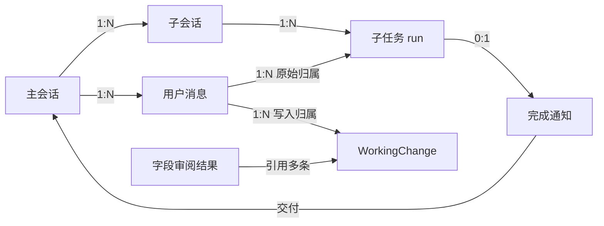
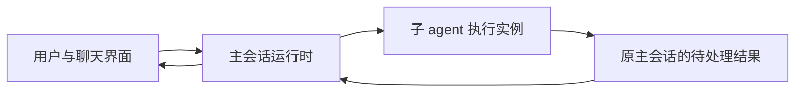
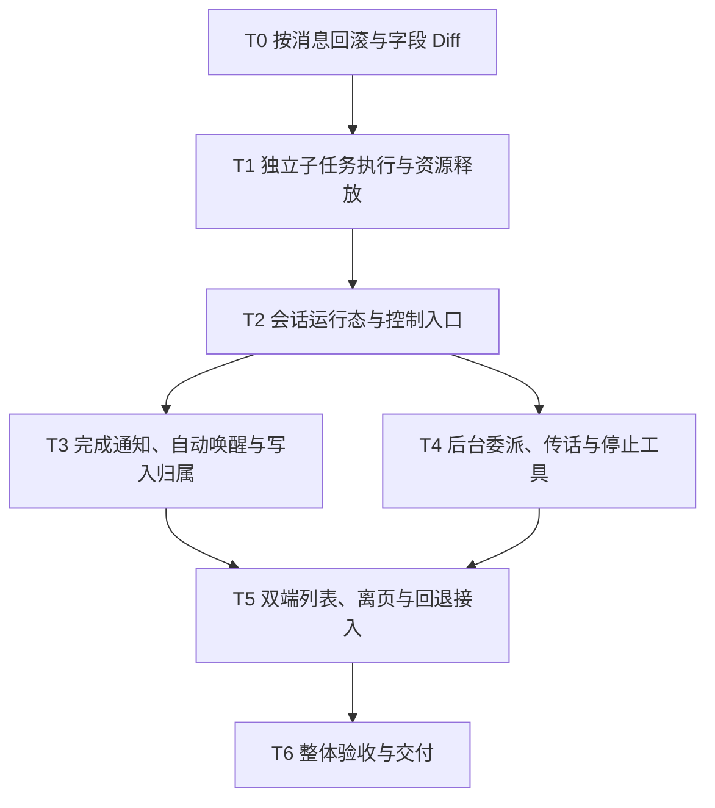

# Chat SubAgent 异步执行方案

日期：2026-09-21，更新：2026-09-22。状态：T1–T3 已完成实现与确定性回归，T4–T6 待实施；T0 本次未重新验收。本方案按[方案设计模板](template.md)的完整档组织，先交付 T0，再开发异步能力。

关联：[决策记录 ADR-0036](../adr/0036-async-subagent-completion-wakes-chat-orchestrator.md)、[领域术语](../../CONTEXT.md)。

## 1. 背景

### 现状与问题

用户与主 agent 确定第一章大纲后，希望把正文委派给写手，同时继续讨论第二章。现有 `SpawnAgent` 等待子任务结束才返回，子任务还借用父执行的取消 token、工具管理器和资源租约，不能直接改成后台 Future 后继续复用这些依赖。

目前 `AiToolManager._suppressedToolEventDepth` 是实例级状态，父子工具并发使用同一实例可能丢失主任务的开始／结束回调。停止主回复也会释放父 `AiClient` 及其工具管理器，后台子任务因此需要独立的资源所有权。

此外，现有 `WorkingOverlayService.stageTextChange` 按资源路径、source 和 session 合并 active 记录，保留首次 `sourceTurnId`。同一字段由消息 1 从 A 改成 B，再由消息 2 从 B 改成 C，可能只剩归属消息 1 的 A→C；回退消息 2 查不到这笔改动。必须先修复落库边界，再依赖轮次归属实现异步回退。

### 约束

- 同步 `SpawnAgent` 的结果、子会话复用、历史记录、trace 和用量归属保持可用。
- 桌面普通／展开聊天和移动端都覆盖后台任务控制；复用现有离页“后台执行／暂停执行”流程。
- 保留直接写入和恢复所选历史目标的语义；业务数据删除沿用项目既有规则，不新增硬删除或级联策略。
- 复用现有数据库列，不新增 schema、通用服务、运行依赖、平台后台权限或外部 worker。
- 业务判断使用有类型的运行记录，不从 session metadata 推断任务归属或调度状态。

## 2. 目标

### 目标

1. T0 修复按消息回滚：消息 1 的 A→B 和消息 2 的 B→C 分别可追溯，回退消息 2 得到 B；同一字段只显示一份可按行回退的 Diff。
2. 子任务后台执行时主对话可继续，已确认的新要求能在子任务下一次模型请求前交付。
3. 成功和失败都回到原主会话，空闲时唤醒、忙碌时安全交付，结果不丢失、不重复启动主循环。
4. 停止主回复、停止单项、全部停止和回退重发具有明确范围；离页不丢运行态，重启不自动续跑。

### 非目标

不增加章节归属、资源锁、独占写入、通用任务调度中心、跨作品全局任务页或新的后台运行设置。不新增修改次数展开、修改历史入口、来源分段或冲突处理界面。不承诺阻止多个 agent 同时修改同一内容，不做任务断点恢复。

### 成功信号

| 信号 | 验证方式 |
| --- | --- |
| 回退消息 2 后正文为 B，消息 1 的结果仍在 | T0 服务及控制器回归 |
| 第一章写作期间可完成第二章的一轮讨论 | 可控子任务集成测试＋双端人工检查 |
| 每个异步 run 的结果只交付一次，撤销后不触发唤醒 | 通知竞态测试与运行日志 |
| 停止主回复后子任务继续，全部停止后没有晚到执行 | 取消、资源租约和页面生命周期测试 |

## 3. User Stories

1. 作为作者，我希望写手写第一章时还能讨论第二章，以便持续推进创作。
2. 作为作者，我希望把讨论中确定的新要求传给正在工作的写手，以免等它完成后才发现方向不对。
3. 作为作者，我希望回退某条消息时恢复对应内容，并直接在一份字段 Diff 中按行取舍，以免理解内部的多轮记录。
4. 作为作者，我希望能单独暂停某个后台任务，或停止整个当前会话；任务失败时由主 agent 说明下一步。
5. 作为已有用户，我希望同步委派、已保存会话及原有离页选项继续工作，重启应用不会重新启动旧任务。

## 4. 解决方案

### 方案对比与决策

| 方案 | 做法 | 优点 | 缺点 | 结论 |
| --- | --- | --- | --- | --- |
| 会话持有子运行，完成主动交付 | 独立管理子任务资源，统一主会话执行入口；底层保留轮次，界面聚合字段 | 满足并行协作和明确回退，复用现有聊天与审阅入口 | 需要处理取消、收尾和通知边界 | 采用 |
| 工具内直接启动后台 Future | 继续借用父执行资源，工具尽早返回 | 局部改动少 | 停止或释放父执行后子任务失效，事件和结果易丢失 | 放弃 |
| 完成后只显示状态，等用户发消息 | 不自动唤醒主 agent | 调度简单 | 用户必须主动接回结果，不满足已确认的连续协作目标 | 放弃 |
| 数据按会话合并，或增加版本展开 UI | 前者压缩底层记录，后者让用户选择历史片段 | 列表可压缩，或保留过程可见性 | 前者丢失回退边界，后者增加当前需求不需要的交互 | 放弃；采用按轮保存、按字段展示 |

### 核心原则

- 单个主会话只有一个主执行循环，用户消息与完成通知共用入口。
- 子任务拥有独立取消、工具管理器和资源租约，执行真正结束后再释放。
- 写入归属落在真实用户消息；自动通知有独立消息 ID，不冒充新用户请求。
- 用户看见哪份字段 Diff，就按那份快照回退；展示聚合不破坏原始轮次记录。
- T0 独立交付，异步能力完成整体验收后一起开放。

### 关键假设

| 假设 | 如果不成立 | 应对 |
| --- | --- | --- |
| 应用进程仍存活，子任务可以持有资源租约 | 进程退出或系统回收后执行中断 | 不自动恢复；已保存历史仍可读 |
| 原用户消息仍在，完成通知仍有交付资格 | 已发生回退或全部停止 | 撤销通知，不改挂到最近用户消息 |
| 审阅提交时右侧快照仍有效 | 用户或其他执行已修改字段 | 刷新 Diff、清空失效行选择，使用现有反馈 |
| 新记录保留完整轮次与修改前快照 | 旧记录已跨轮合并 | 不伪造中间状态，按第 5.6 节保留已有恢复能力 |

## 5. 方案实施

### 5.1 模型设计

复用现有持久化实体，新增部分仅为有类型的内存运行／展示对象。

#### session ID 与 run ID

`session ID` 标识一段会话，`run ID` 标识其中一次任务执行，两者不能互换。写手在子会话 S1 中写第一章是 R1；之后用 `SpawnAgent(session_id: S1)` 继续修改第一章，仍沿用 S1 的上下文，但产生新的 R2。当前 `SpawnAgentHandler` 已为每次执行生成 `sub_run` ID，本方案继续使用这份身份，不另建一套执行编号。

| 身份 | 用途 | 何时变化 |
| --- | --- | --- |
| `sub_session_id` | 找到写手会话及其历史，上下文复用入口 | 新建子会话时变化；继续原会话不变 |
| `run_id` | 标识本次执行、取消对象、完成结果与去重范围 | 每次启动执行都新建，即使复用同一子会话 |
| 通知消息 ID | 标识写入主会话的独立 system_remind 消息 | 为每个 run 的完成通知分配，不复用原用户消息 ID |

所有完成回调、取消句柄和收尾动作绑定具体 run。R1 的迟到回调不能把 R2 标成完成、取消 R2 或释放 R2 的资源；仍有交付资格的 R1 结果可以按自身身份交付一次，不能仅因同一子会话已经开始 R2 就误丢弃。面向用户不增加 run ID 管理入口；工具按 session 定位当前执行后，内部操作必须绑定当次解析得到的 run，不能在异步收尾时重新指向另一次执行。

| 对象 | 内容与约束 | 生命周期 |
| --- | --- | --- |
| WorkingChange | 保留 `sourceSessionId`、`sourceTurnId`、资源字段、old/new 和状态；只合并同归属的连续写入段 | 按现有提交／回退规则持久化，不合并丢失轮次 |
| 字段审阅结果 | 当前会话、资源字段、原始记录集合与顺序、左侧基线、右侧当前内容；行选择绑定这份快照 | 随审阅及资源刷新重建，不伪造 WorkingChange 写库 |
| 子任务运行记录 | 原主会话、冻结的原 `sourceTurnId`、子会话、run、原工具 call、任务身份、执行状态、取消控制、追加消息队列及资源租约 | 会话持有；同一子会话最多一个运行实例；初始化也纳入追踪 |
| 完成通知 | run 身份、原会话／原轮次、成功结果或结构化失败、独立通知消息 ID、待交付／已交付／已撤销状态 | 只在当前进程调度；交付后以现有 system_remind 留在历史 |

子运行按“初始化中→执行中→已完成／失败”推进；取消先进入“正在停止”，执行和持久化收尾结束后才确认已取消。完成通知的资格在消费前复核；Stop All、回退和旧回调不能重新激活已撤销 run。运行记录和资源可以在收尾后释放，未消费通知仍保留必要的身份与结果，不保留已释放 client。

### 5.2 对象关系

下面是已有持久化对象与内存对象的逻辑关系，不是新增表或外键。



取消只改变执行状态，不删除子会话、历史或正文。回退复用既有数据恢复／软删除规则，不新增关系级联。历史截断后，关联 run 的通知资格失效；应用重启后内存 run 和通知队列不恢复，历史中的旧状态不能当作仍在执行。

### 5.3 关键业务流程

#### 5.3.1 T0：按消息回滚与字段 Diff

T0 可独立实现、验收和合并，即使暂不开发异步子任务，普通聊天回滚和现有审阅入口也能单独交付。

1. **按轮保留变更。** 有明确 `sourceTurnId` 的 AI 写入，只有同一资源字段、同一 source、同一 session、同一 turn 的连续修改可以合并。其他轮次或其他来源已写入后，旧 turn 再写必须新建记录；A 轮→B 轮→A 轮不能合回第一条 A 轮记录。每段冻结自己的修改前快照，复用现有字段与稳定的落库顺序，不新增 schema，也不拿随机 ID 或秒级时间戳推断先后。
2. **按消息回滚。** “回退并重发”仍撤销选中消息及其后续被截断消息的改动。一次收集受影响记录，按字段确定该范围最早的修改前目标，完成内容恢复后再截断聊天。不能只按用户消息顺序循环恢复快照，否则交错写入会恢复到错误的中间状态。是否自动接受、是否已提交不改变结果；没有改动的消息允许回滚 0 条，写入或历史保存失败则明确失败，不自动重发。
3. **按字段展示。** 摘要继续按资源显示一行；明细在资源内按字段聚合。左侧取当前会话该字段仍可审阅记录中最早的修改前内容，右侧取资源当前实际保存的内容，增删统计基于这份 Diff，不累加各轮的中间变化。底层原始记录与轮次归属完整保留，展示聚合不改写历史。
4. **按行回退所见内容。** 复用现有行 Diff 和 `computeLineAcceptResult`，将选中行恢复为左侧内容，其余保留右侧内容。操作参数必须对应这份字段 Diff 的左右快照及其原始记录集合，不能借用任意一个 `changeId` 调用旧接口。部分回退沿用现有手动反向变更记录，不改写原 AI 记录的轮次或原文；继续审阅时刷新右侧和行选择，避免旧行号套用到新内容。
5. **整体回退直接恢复目标。** 现有字段、资源或全部回退入口，对每个字段直接恢复其显示的左侧目标，在同一内容库事务内更新相关记录状态。无需逐条写回中间版本，不增加用户操作。创建、删除和结构化字段沿用既有可回滚行为及按行审阅限制，不把结构化展示行当作原始存储行。
6. **沿用历史恢复语义。** 中间有人手动编辑或其他会话修改时，右侧仍展示当前实际内容；回退恢复用户看到并选中的左侧内容，不新增来源拆分或自动合并机制。应用时校验右侧快照仍有效；若审阅期间内容变化，刷新 Diff 并清空失效行选择，沿用现有反馈，不能覆盖界面尚未展示的新内容。

接受操作继续提交对应的原始 active 记录；同一次 commit 可以包含多条记录，但不能因此丢失各自的轮次和修改前快照。共享的字段聚合结果负责展示快照、原始记录集合和稳定顺序，不伪造一条用于写库的 `WorkingChange`，也不依靠 metadata 做归属判断。

桌面摘要卡、展开聊天、明细 Diff 和移动端现有最近改动入口使用一致的资源分组与整体回退语义。移动端不新增桌面专属的明细入口或按行审阅页面。手动编辑及其他会话修改当前字段后，已有审阅视图应能刷新右侧内容。

#### 5.3.2 后台委派与工具契约

| 场景 | 行为 |
| --- | --- |
| 选择执行方式 | 主 agent 根据依赖自行决定等待结果或后台执行，用户明确要求优先 |
| 主对话继续工作 | 子 agent 运行时，主 agent 可以继续处理其他事情，用户可以发送新指令 |
| 途中调整 | 主 agent 把与任务有关的已确定变更传给子 agent；不自动同步整段主对话 |
| 指令到达子 agent | 在下一次模型请求前接收，不截断当前回复或正在执行的工具 |
| 子任务成功或失败 | 都通知原主 agent；空闲时主动唤醒，处理用户消息时在下一次模型请求前交付；自动处理结果时仅合入同归属通知 |
| 主 agent 恰好结束回复 | 仍处理已经到达的通知，不能因进入空闲状态而漏掉结果 |
| 自动唤醒后的写入 | 主 agent 后续审稿、修改归原委派的用户消息，回退该消息时一并撤销 |
| 回答用户期间接收结果 | 结果作为补充信息，主 agent 新改动归当前用户消息；子任务自身改动仍归原委派 |
| 不同委派同时完成 | 自动唤醒按原用户消息分组串行处理，同一归属的结果可以合并 |
| 子任务失败 | 主 agent 决定重试、调整任务或告知用户，框架不自动重跑整个子任务 |
| 停止主回复 | 只停止主 agent 当前执行，后台子任务继续 |
| 停止主回复后的结果 | 仍唤醒主 agent 处理结果，不自动续接被用户停止的工作 |
| 停止某个子任务 | 只停止指定子任务，其他工作继续 |
| 全部停止 | 停止当前主会话及其子任务，迟到通知不能重新触发执行；不影响其他会话 |
| 回退并重发 | 停止主请求及归属被回退轮次的子任务，等待执行真正结束、撤销相关待投递通知后，再回滚改动和截断历史 |
| 离开页面 | 复用现有“后台执行”选项；“暂停执行后退出”对应当前会话的全部停止 |
| 应用重启 | 不自动续跑 |
| 用户观察和控制 | 提供后台 agent 列表，每项可手动暂停 |

已确认只保留 `SpawnAgent`、`SendAgentMessage`、`StopAgent` 三个工具。`SpawnAgent` 沿用现有四个参数，新增 `background`：

| 参数 | 必填 | 契约 |
| --- | --- | --- |
| `agent` | 是 | 使用的子 agent 名称，取可用子 agent 列表中的名称 |
| `name` | 是 | 子 agent 实例名字，用于区分任务中的执行者；继续同一子会话时沿用原名 |
| `task` | 是 | 任务目标、必要背景、资源位置、允许修改的范围和交付要求 |
| `session_id` | 否 | 继续同一个子 agent 的已有子会话；首次委派省略，沿用已有复用校验 |
| `background` | 否 | 布尔值，默认 `false`，等待完成；`true` 后台执行，先返回任务身份 |

`run_id` 由程序为本次执行生成并返回，不是模型需要传入的参数。

| 接口 | 契约 |
| --- | --- |
| `SpawnAgent(background: false)` | 等执行结束返回现有 output 或错误 |
| `SpawnAgent(background: true)` | 子会话建立并由运行时接管后返回 `ok / status: running / sub_session_id / run_id`；启动失败直接报错 |
| `SendAgentMessage(session_id, message)` | 向当前主会话下正在执行的子 agent 追加指令，返回 accepted；accepted 只表示已接收，不表示要求已执行 |
| `StopAgent(session_id)` | 请求停止指定子 agent 当前执行；与用户列表暂停复用取消入口 |

运行中的同一子会话只持有一个执行实例。`SpawnAgent` 复用仍遵守显式 `session_id`，不自动选择“最近的写手”；运行中追加要求使用 `SendAgentMessage`，不启动第二个同会话执行。这是对会话实例的保护，不是章节写入锁。

消息与任务结束竞态：已经接收的追加指令必须在子 agent 结束前处理；若任务已结束，明确返回未接收，由主 agent 用现有 `SpawnAgent(session_id)` 继续，不能静默丢弃指令。

不新增独立的 followup 或 wait 工具。继续空闲子会话使用 `SpawnAgent(session_id: ...)`，给运行中子任务追加要求使用 `SendAgentMessage`。需要当场等待结果时用同步 Spawn；后台任务仍未完成且主 agent 没有其他工作时，可以结束当前回复等待通知，不循环查状态或发送等待请求。同步路径收取结果后不再额外触发一次后台完成通知。底层仍需等待执行收尾的能力，供取消、回退和资源释放使用，这不增加模型工具。

工具名称、参数和行为已确认。具体 tool description / 参数 description 在 T4 按本节契约与 `.agents/rules/ai-calling.md` 编写、验证；保持 schema 静态，不把运行时内部细节或重复的参数说明写进工具描述。本次仍只更新方案，未修改工具定义或提示词。

#### 5.3.3 执行、通知、取消与回退



运行态由会话层持有，不能依赖某个工具调用仍在 await，也不能依赖聊天 Widget 仍存在。每个运行项至少关联原主会话、原用户消息的 `sourceTurnId`、子会话、本次 run、原工具 call、取消控制器和追加指令队列。`sourceTurnId` 在启动时冻结；任务结束后尚未交付的通知也保留这份归属，以便回退时撤销。列表与工具卡片读取同一运行态。

主会话的“正在回复”和“有后台子任务”分别计算：后台子任务要保活并参与离页提示，但不能因此让输入框一直处于主回复忙碌状态。

子任务结束先记录结果和历史，再将带 run 身份的完成消息交回原主会话。消息包含子 agent 名称、任务身份、成功输出或结构化错误；不把全部子会话过程复制到主对话，也不伪装成用户的新要求。

同一主会话只能有一个主 agent 执行循环。通知与用户输入共用会话级执行入口：忙碌时排队，空闲时启动；自动唤醒只合并同一原用户消息下的结果，每个 run 只交付一次。排队的用户新指令保留原顺序，不能被结果通知覆盖。具体交付及写入归属按下一节执行。

“全部停止”先阻止当前这批运行继续触发主会话，再取消它们。后续用户新启动的任务属于新的执行范围，不受旧任务的迟到回调影响。取消与失败分别处理，用户停止不走失败重试路径。

通知交付与运行实例只保留在当前进程；重启不重放自动唤醒。已落库结果仍可查阅，旧记录缺少活跃运行实例时不能显示成仍在执行。

##### 子任务结果如何返回主 agent

1. **接管后台执行。** 会话运行时登记 run 并持有其完成回调；回调与资源所有权安排好后，`SpawnAgent(background: true)` 返回 `running`、`sub_session_id` 和 `run_id`。子任务继续由运行时持有，不随父工具调用结束而释放。
2. **收集最终结果。** 子执行器消费 Agent 事件流，收集 `AgentDone.finalText` 或结构化失败信息；执行流退出、历史保存收尾完成后，通过程序完成回调把结果交给原主会话。子 agent 无需调用额外的“汇报工具”，也不要求模型自己触发唤醒。
3. **登记待交付通知。** 原主会话按 run ID 登记结果，通知携带子会话、任务身份、原用户轮次、成功输出或安全的失败原因。同一 run 的重复回调不重复入队；已撤销通知不能重新取得交付资格。结果已经就绪而 Spawn 工具尚在返回时，也先入队，不能提前发起另一条主循环。
4. **送入主模型。** 主 agent 正在处理用户消息时，在下一次模型请求前把通知加入上下文；空闲时通过普通聊天执行入口启动一轮，以通知作为输入。若正在自动处理结果，仍遵守下一节的同归属合并规则。当前回复恰好结束时，由会话执行入口在收尾处再次检查队列并接力，不能依赖下一条用户消息触发。
5. **记录交付。** 通知以独立消息 ID 同步到主上下文和 `AiMessageType.system_remind` 历史；“已交付”表示通知已进入主上下文，不代表主模型已经成功处理结果。后续模型请求失败沿用正常聊天失败处理，不能通过重跑子任务制造一份新的完成结果。

模型看到的完成提醒可采用以下结构，正文直接使用子 agent 最终回复，不为返回结果额外调用总结模型。失败时改为失败状态并带错误码、可读原因，不透出底层异常对象：

```text
<system-remind type="subagent_completed">
子任务：第一章写作
子会话：sub_session_123
执行：sub_run_456
状态：完成
结果：子 agent 的最终回复。
</system-remind>
```

这里的 system_remind 是应用内已有消息类型，模型请求沿用现有提醒消息表示，不新增模型协议角色，也不把它当作用户主动发送的新要求。原始 `SpawnAgent` 调用已经返回 `running`，最终结果通过这条独立通知交付，不能给同一个 tool call 追加第二份 tool result。工具卡片可以根据运行态更新完成／失败显示，但这不等于重新投递原工具结果。

##### 完成通知与主 agent 写入归属

复用现有用户消息和 `sourceTurnId`，按触发当前主 agent 执行的用户消息归属改动，不新增数据库字段或独立的自动回合回退机制。

| 交付时的状态 | 主 agent 新改动的归属 |
| --- | --- |
| 主 agent 空闲，由完成通知启动执行 | 使用该子任务原委派用户消息的 `sourceTurnId` |
| 主 agent 正在回答用户消息，在下一次模型请求前收到结果 | 沿用当前用户消息的 `sourceTurnId`；完成通知不切换归属 |
| 主 agent 正在自动处理完成结果 | 同归属结果可在下一次模型请求前合入；不同归属结果继续排队，当前执行结束后另起一轮 |

子任务自身的 `sourceTurnId` 始终保持启动时的值。主 agent 在处理结果期间再次委派任务时，新子任务冻结当时主执行的归属。以实际交付时的状态为准：通知到达时主 agent 虽然忙碌，但用户轮次已在消费前结束，则按空闲唤醒处理；仅排队、尚未被接收的用户消息不改变当前归属。已接收的新用户消息仍按现有下一轮入口切换 `sourceTurnId`，之后主 agent 的改动归新消息。

自动唤醒按原主会话和原用户消息分组，各组按首次通知入队顺序串行处理。同组可合并成功与失败结果；不同原用户消息的结果不合并为同一自动执行。原消息已被回退时，对应通知按回退规则撤销，不改挂到最近一条用户消息上。

例如，用户先委派“写第一章”，再讨论第二章。写手完成时主 agent 已空闲，自动审稿产生的第一章修改归“写第一章”，与写手改动一起回退。如果主 agent 仍在回答第二章的问题并在下一次模型请求中使用了写手结果，主 agent 本轮新改动归第二章的用户消息，写手自己的改动仍归第一章的原委派。

完成通知使用已有 `AiMessageType.system_remind` 保存，分配独立消息 ID，包含任务身份和结果，在模型上下文中标明为子任务完成通知。执行链分别传递通知消息 ID 与写入归属 `sourceTurnId`：不能把原用户消息 ID 复用为新消息 ID，也不能为自动唤醒插入一条普通用户消息。忙碌接收和空闲唤醒均保持内存上下文与持久化消息一致；重新加载只恢复历史，不重放通知启动执行。回退继续通过已有用户消息 ID 查找改动，通知自己的 ID 不作为回退轮次。

##### 回退并重发

回退会撤销用户消息及其改动，不能沿用只停止主回复的范围。复用 `ChatSessionController.rollbackTurnAndPrepareResend` 的会话历史修改守卫，按以下顺序处理：

1. 进入守卫后，暂停该会话的新发送、子任务启动及完成通知交付。已经开始初始化的子任务也必须受运行记录追踪；启动接管和通知消费都要检查守卫，不能在异步初始化返回后绕过它。
2. 若主请求仍在执行，取消并等待它真正结束；即使主请求已空闲，也继续检查后台子任务。从收尾后的最新会话消息中收集本次将截断的用户轮次。
3. 按原主会话和 `sourceTurnId` 找出受影响的 run，先撤销其通知交付资格，再请求取消。范围同时包含初始化中、执行中、收尾中的任务，以及已经完成但通知仍待交付的任务。已经排入唤醒流程的通知在实际消费前也必须复核资格。
4. 等待受影响任务的初始化、工具执行和终态持久化收尾完成，再通过 T0 的批量回退入口恢复这些轮次涉及字段的目标、截断并保存会话历史。发出取消信号不算结束；确认执行体结束前不得回滚，也不得把“准备重发”当作成功返回。
5. 释放历史修改守卫。被保留的较早轮次子任务继续运行，它们在守卫期间到达的通知继续排队，守卫释放后再交付；被撤销的旧 run 不能因守卫释放或用户重发而重新获得交付资格。

无法确认任务已结束、回滚失败或历史保存失败时，明确报告失败，不自动重发，也不自动恢复已经取消的任务。两端共用此入口，不各自增加一套回退取消逻辑。这项保护不增加资源锁，也不改变不同任务修改同一正文时现有的冲突处理。

##### 子任务资源与工具事件隔离

每个后台子任务独立持有 `ProviderClient`、`AiToolManager` 及它们所需的资源租约。复用现有工具配置组装逻辑创建实例，父子任务及不同子任务之间不共享工具管理器实例。原因是当前 `AiToolManager._suppressedToolEventDepth` 为实例级计数器：子任务用 `emitToolEvents: false` 执行工具时，会影响共享实例上的主任务回调。

子任务工具管理器绑定子任务的执行上下文和活动回调，不绑定主任务的工具卡片回调或 `activeToolExecutions` 计数。子任务活动仍通过 `onSubAgentEvent` 更新对应 run；主任务的工具开始、结束事件必须成对交付。正文写入沿用原 `sourceSessionId` / `sourceTurnId`，Todo 和子会话历史继续归属子会话。

资源所有权在后台启动成功返回前交给对应 run。底层 HTTP 或数据库连接可以共享，但子任务必须持有独立的有效租约；工具管理器借用的跨作品资源也随子任务收尾释放。初始化失败时释放已取得的资源；成功、失败或取消时，在执行流、工具和持久化收尾后统一释放一次。停止主回复、切换主模型或销毁主任务的 `AiClient` 只释放主任务资源，不得提前销毁子任务仍在使用的工具管理器或租约。

#### 5.3.4 后台 agent 列表

以下为最小 UI 建议，不是已确认的设计稿。

- 当前聊天输入区域上方放一条可折叠的“后台运行 · N”区域，独立于消息列表滚动。桌面侧栏、展开聊天和移动端都提供相同能力。
- 展开后逐行显示 agent 名称、任务摘要、当前活动、查看详情入口及“暂停”按钮，复用现有头像和子会话详情。
- “暂停”沿用已有产品语义：停止本次执行、保留已保存的会话和内容，不是冻结网络请求并从原字节位置恢复。后续继续通过主对话委派完成。
- 点击暂停后显示“正在停止”，直到执行真正结束；不能点击后立即假装已经停止。建议用户手动停止的任务不由 AI 自动恢复，也不把取消当失败自动重试。
- 运行项完成、失败或停止后退出运行列表，历史和结果仍在原工具卡片、子会话中查看。没有运行项时不占空间。
- 列表提供“全部停止”，范围明确包含当前主会话及其子任务；输入框原停止按钮只停止主回复。
- 初版建议只列当前主会话的子 agent，切换会话后展示对应列表，不建立跨作品的全局管理页。
- 复用主题、间距和图标系统；文字状态不只靠颜色区分。新按钮和标题走现有中英文 i18n。

### 5.4 改动清单

以下按文件列实施位置；T0 与后续异步任务共享文件时顺序整合。总范围超过 8 个文件，不为此新增通用 Service 或运行开关。

#### `lib/shared/services/working_overlay.dart`

- **T0** `stageTextChange`、`_getActiveWorkingChange`：只合并同 session／turn 的连续同字段写入；跨轮再返回原轮时新建记录，保留每段基线。
- **T0** `rollbackTurn` 及批量回退入口：一次接收待截断轮次集合，按字段确定最早目标，在同一内容库事务中恢复并更新记录，避免按轮循环覆盖到错误中间态。
- **T0** `rollbackChangeLines` 及字段回退入口：使用聚合后的左右快照与原始记录集合计算目标；保留单记录调用能力；部分回退仍写手动反向变更，整组恢复每字段只写一次。
- 接受与提交保留各原始记录的归属；创建、结构化字段和已有历史恢复规则继续适用。

#### `lib/shared/database/novel_content_daos/working_change_dao.dart`

- **T0** 扩展按 `sourceTurnId` 集合读取及稳定写入顺序查询；复用现有插入顺序能力，不能用随机 ID 或秒级时间排序替代。
- 保持 `watchSessionChanges` 的会话范围，返回独立原始记录，不在 DAO 中压平轮次。

#### `lib/shared/services/working_change_summary.dart`

- **T0** 增加纯字段分组与净变化计算，产出原始记录集合、最早基线和展示所需摘要；不负责数据库写入。
- `lineDelta` 对展示的左右内容计数，不累加中间轮次的增删。

#### `lib/shared/providers/novel_providers.dart`

- **T0** 在现有 `sessionChanges` 读取链上组合字段当前内容及聚合结果；手动修改和其他会话写入同字段时也能刷新右侧。
- 资源订阅留在 provider，纯聚合留在摘要工具；不增加整页轮询。

#### `lib/shared/widgets/ai/diff/recent_changes_log.dart`

- **T0** `countChangeGroups`、`_loadResolvedChanges`：继续按资源显示摘要及计数，不因新增轮次记录重复显示资源。
- `_rollback`、`_rollbackAll`：调用统一字段恢复入口，传完整原始记录范围，不任取一条 changeId 代表整组。

#### `lib/desktop/widgets/ai/diff/pending_changes_detail_dialog.dart`

- **T0** `PendingChangesDetailItem`、`_resolveChanges`、`_resolveGroup`、`_FileDetail`：资源内每字段一份 Diff，原始记录与字段展示对象分开。
- `_ChangeFieldDiff`、`setLinesRejected`、`applyMarkedLineRollbacks`：行选择绑定字段快照，复用 `computeLineAcceptResult`；应用后刷新右侧，失效选择不能作用于新内容。
- `acceptChanges`、`rollbackChanges`：操作覆盖聚合对应的原记录；失败沿用现有反馈。不给界面增加历史展开、修改次数或来源分段。

#### `lib/desktop/widgets/ai/diff/pending_changes_summary_card.dart`

- **T0** 保留摘要 chrome、“查看明细”及折叠入口，计数继续使用资源口径；把同一份聚合读取结果交给明细和共享列表。

#### `lib/shared/utils/line_accept.dart`

- **T0** 复用 `computeLineAcceptResult`、行键和布局判定算法；更新“行键只绑定单条 WorkingChange”的契约说明，使其绑定一份不可变左右快照。
- 不放宽现有纯新增／纯删除、结构化字段的按行审阅限制。

#### `lib/shared/services/ai/chat_session_controller.dart`

- **T0** `rollbackTurnAndPrepareResend`：一次传递全部受影响轮次，内容恢复成功后再截断并保存历史；失败不自动重发。
- **T3** 用户输入与完成通知使用同一会话执行入口，保留排队消息顺序和下一轮归属切换。
- **T5** 回退守卫接入子运行：先停止并等待主请求，撤销受影响 run 通知并等子任务收尾，再调用 T0 的批量回退；不能只检查主回复是否忙碌。

#### `lib/shared/services/ai/spawn_agent_handler.dart`

- **T1** `SpawnAgentHandler.run` 拆出单次子运行的启动、执行、终态持久化与释放；同步入口等待该执行对象完成，保留原结果和复用契约。
- `subToolContext` 冻结原会话／轮次；子任务拥有独立 client、工具管理器、取消控制器及租约，禁止并发回退到父 client。
- **T2／T4** 暴露传话、取消和等待收尾能力；初始化、结束与 accepted 消息竞态有明确结果，不能接受后静默丢弃。

#### `lib/shared/services/ai/chat.dart`

- **T1** 复用工具配置组装创建子任务独立 `AiToolManager`，避免实例级事件屏蔽影响父任务。
- `AiClient.dispose` 仅释放自己拥有的资源；子任务租约由其 run 在工具与持久化收尾后释放一次。

#### `lib/shared/agent/agent.dart`

- **T1** 在下一次模型请求前及准备结束时消费子任务追加消息，保证已 accepted 的要求不会被结束边界遗漏。
- **T3** 支持显式完成通知输入，区分通知消息 ID 和写入归属；不把结果文本当普通用户输入重复插入原用户 ID。
- 保留模型响应和正在执行工具的完整性，不因通知或传话直接中断它们。

#### `lib/shared/providers/ai_providers.dart`

- **T2** `AiChatRuntime`：持有会话执行、子运行和通知控制，主回复 busy 与后台任务数量分开；按任务取得和释放保活。
- `cancelRequest`／`cancel` 对接 Stop Reply 与 Stop All 的明确范围；旧 request/run 收尾不能释放或清空新执行资源。
- **T3／T5** `tryBeginSessionMutation` 等历史修改守卫覆盖启动与通知消费；普通 `registerAskUser`、会话消息状态在后台唤醒时仍可用。

#### `lib/shared/providers/spawn_agent_run_providers.dart`

- **T2** 按原主会话持有有类型的子运行与待交付结果；同一子会话不能同时持有两个执行实例。
- `SpawnAgentActiveRun.apply`／`clear` 与实际 run 收尾对齐，不能在后台 Spawn 工具刚返回时清空活动；列表与工具卡片消费同一运行态。
- 提供单项取消、全部停止、按被回退轮次撤销通知和等待收尾的共享入口。

#### `lib/shared/services/ai/chat_turn_runner.dart`

- **T0** 核对 `_maybeAutoCommitTurn`、`AgentNextTurnApplied` 等提交与下一轮边界，提交不抹平各轮记录。
- **T1** `getOrCreateChatAgent` 中的子 client resolver 和 Spawn 工具封装改用独立子运行；移除父工具返回即释放子活动的假设。
- **T3** `runTurn` 分开接收输入消息 ID 与 `sourceTurnId`；完成通知按 system_remind 同步内存与历史，空闲唤醒复用普通聊天的 AskUser 语义，不能使用自动回答的 headless 入口。
- 完成通知与用户输入遵循单主循环、实际交付边界、原轮次分组与已撤销通知过滤。

#### `lib/shared/services/ai/tools_subagent.dart`

- **T4** 按第 5.3.2 节扩展静态 schema：`background` 默认 false，新增 `SendAgentMessage`、`StopAgent` 契约。
- 工具及参数说明对应前后台返回值、accepted 与停止请求的真实含义，不复述内部实现细节。

#### `lib/shared/services/ai/tools.dart`

- **T4** 注册新增工具及定义，保持静态 schema；控制工具仅供主聊天调度，不进入子 agent 默认可用工具集。
- 会话身份由执行上下文校验，不能靠模型传参跨会话控制；资源写入继续走既有工具与 working overlay。

#### `lib/shared/services/ai/chat_agent_tool_dispatcher.dart`

- **T4** `ChatAgentToolDispatcher.executeTool` 包装后台 Spawn、传话和停止，统一调用 T2 入口。
- 同步 Spawn 只返回最终结果，不额外触发后台完成通知；后台启动失败显式返回失败。

#### `lib/shared/providers/ai_mode_processing.dart`

- **T5** 会话处理态包含仍在运行的子任务及待处理完成结果；主回复结束不能提前触发“全部完成”。
- 保持已有前台可见状态与后台通知机制，不新增调度中心或平台权限。

#### NEW: `lib/shared/widgets/ai/chat/background_agents.dart`

- **T5** 实现共享的当前会话后台列表，展示身份、任务摘要、活动、详情、暂停及全部停止；不自建执行状态。
- 暂停后展示真实 stopping 状态，运行终态后退出列表，无运行项时不占空间。

#### `lib/desktop/widgets/ai/chat/panel.dart`

- **T5** 在现有输入区域上方组合共享列表；普通侧栏与展开聊天采用同一入口和控制行为。
- 主停止按钮只停止当前回复，不以子任务运行态锁住输入框。

#### `lib/desktop/pages/novel_editor.dart`

- **T5** `handleProcessingExit`／`pauseActiveAiSession`：后台执行保留主子任务；暂停退出映射当前会话 Stop All，其他会话不受影响。

#### `lib/mobile/pages/novel_chat_page.dart`

- **T0** `_RecentChangesSheet` 与共享聚合、当前内容刷新及整体回退保持一致，不新增桌面专属审阅页面。
- **T5** 接入共享后台列表和三种停止范围，`handleProcessingExit` 使用同一会话控制逻辑。

#### `lib/shared/localization/locale_keys.dart`

- **T5** 复用已有详情／暂停文案键；为后台运行数量、正在停止、全部停止以及新增工具名称补齐需要的 locale key。

#### `assets/translations/en/ai.json`

- **T5** 与 locale key 同步维护对应英文标题、状态、操作和工具显示名。

#### `assets/translations/zh-CN/ai.json`

- **T5** 与英文键同步维护中文文案。AI 工具说明和通知 prompt 的技术契约留在提示词／schema 层，不与界面翻译重复维护。

#### 测试与生成文件

- **T0** 扩展 `working_overlay_test.dart`、`chat_session_controller_rollback_test.dart`、`historical_rollback_test.dart`、`change_labels_test.dart`；先实际运行跨轮合并回归的失败结果，再修复。
- **T1–T4** 扩展 `test/agent/agent_test.dart`、`spawn_agent_handler_test.dart`、`spawn_agent_message_persistence_test.dart`、`spawn_agent_run_providers_test.dart`、`ai_chat_background_lifecycle_test.dart`、`chat_turn_runner_characterization_test.dart`、`tools_schema_test.dart`、`prompt_tool_guidelines_test.dart`。
- **T4** 新增 `test/shared/services/ai/chat_agent_tool_dispatcher_test.dart`，验证后台返回、传话／停止路由、同步兼容和跨会话拒绝。
- **T5** 新增 `test/shared/widgets/ai/background_agents_test.dart`，验证共享列表和停止状态；补运行期间回退与离页的控制器／生命周期回归，实测桌面普通／展开聊天和移动端。
- 修改生成源后执行项目 codegen 并审查实际 `.g.dart`／Drift 生成差异；不手工修改生成文件。

### 5.5 Task Graph

以下是开发依赖图；第 5.3.3 节中的图描述运行时消息流。T1–T3 的实现与验证记录见本节末尾；T4–T6 待实施，T0 本次未重新验收。



| 任务 | 内容 | 依赖 | 验证 |
| --- | --- | --- | --- |
| **T0 按消息回滚与字段 Diff** | 第 5.3.1 节定义的独立回滚修复：按轮保留记录、字段聚合展示、现有按行及整体回退适配 | 无 | T0 验收表全部满足，包含已实际运行的失败回归用例及修复后的通过结果；双端现有审阅入口可用 |
| **T1 独立子任务执行与资源释放（已完成）** | 在 `spawn_agent_handler.dart`、`chat.dart` 和 `agent.dart` 中拆出单次子任务执行对象，由它持有独立 client、工具管理器、取消控制器、资源租约和追加指令队列；暴露传话、取消及等待执行收尾的能力，冻结原会话／原轮次身份 | T0 | 现有同步 SpawnAgent 结果、持久化和复用行为保持；主子工具事件互不干扰；父执行结束或资源销毁不影响子任务；初始化失败、成功、失败、取消都正确释放资源；已接收的追加消息不在结束边界丢失。扩展 `spawn_agent_handler_test.dart` 和 `test/agent/agent_test.dart` |
| **T2 会话运行态与控制入口（已完成）** | 在 `ai_providers.dart`、`spawn_agent_run_providers.dart` 中持有运行项、待交付结果及任务保活；提供按 run 控制单项、Stop Reply、Stop All 和按被回退轮次停止并等待的共享入口；主回复 busy 与后台运行分开，初始化中的 run 也受追踪 | T1 | 同一子会话只有一个运行实例；单项停止不影响其他任务；Stop All 先撤销通知资格再取消；回退守卫阻止新启动和通知交付；只通过 command 发起、没有 UI watcher 时仍能收尾并释放保活；旧回调不影响新执行。扩展 `spawn_agent_run_providers_test.dart`、`ai_chat_background_lifecycle_test.dart` |
| **T3 完成通知、自动唤醒与写入归属（已完成）** | 将通知接入 `ChatSessionController`、`ChatTurnRunner` 和 Agent 的模型请求边界；与用户输入共用单个主执行入口；实现空闲唤醒、忙碌交付、结束边界补处理、按原消息分组、system_remind 持久化和显式 `sourceTurnId` | T2 | 空闲／忙碌／最后一段回复中到达的结果均只交付一次；成功失败均可通知，用户消息不被覆盖；同一主会话不并发启动两个主循环；原轮次已撤销的通知不能执行；普通 AskUser 语义保留；按本方案三种交付状态验证落库归属。扩展 `chat_turn_runner_characterization_test.dart`、`chat_session_controller_rollback_test.dart` |
| **T4 后台委派、传话与停止工具** | 在 `tools_subagent.dart`、`tools.dart`、`chat_agent_tool_dispatcher.dart` 接入本方案的 `background` 参数、`SendAgentMessage` 和 `StopAgent`；使用 T2 的共享入口，工具控制限定当前主会话下的子任务；保留静态 schema 和同步默认行为 | T2 | 同步调用仍等待最终结果且不重复通知；后台调用在运行时接管后返回真实 session/run 身份；传话 accepted 不伪称已执行，结束竞态明确拒绝；停止只确认取消请求，终态由真实收尾更新；其他会话和子 agent 不能越权控制；工具及参数说明与返回契约一致。扩展 `spawn_agent_handler_test.dart` 和工具 schema／dispatcher 的最窄测试 |
| **T5 双端列表、离页与回退接入** | 共享后台运行列表接入桌面普通／展开聊天与移动端；列表及工具卡片读取 T2 同一运行态；主停止按钮、单项暂停、全部停止接入共享控制；`ai_mode_processing.dart` 和双端离页流程保留后台任务；回退重发先完成 T2 的停止收尾，再调用 T0 的批量回滚 | T3、T4 | 列表展示真实状态，暂停期间显示正在停止；输入框不因子任务独占 busy；切换页面或会话不丢任务；后台运行／暂停退出行为符合已确认范围；回退后无受影响 run 的迟到写入或唤醒；主回复结束不误报整组完成；应用重启不续跑。补共享列表、离页及回退竞态测试，并实测两端 |
| **T6 整体验收与交付** | 对照 T0 与全功能验收表完成集成验证，检查生成文件、静态分析、同步路径回归和资源收尾；整理实际通过／失败结果及交付范围 | T5 | 相关 Flutter 测试串行通过，受影响代码静态分析通过，桌面普通／展开聊天和移动端验收完成；停止、回退、写入归属及通知竞态均有确定性回归覆盖；未实施或未验证的项目不能标为完成 |

T0 单独交付。T1–T5 是一个异步功能批次内的开发任务，T3 与 T4 在依赖满足后可以分开推进；它们不是承诺可分别发布的阶段。T6 完成后才整体开放异步能力，不能提前发布只有启动、没有完成通知或停止能力的半成品，也不为拆任务新增运行开关或兼容路径。

各任务在自己的完成标准满足后再交给下游，测试随任务编写和运行，不集中拖到 T6。跨任务涉及同一文件时顺序整合；Flutter 测试始终串行。工具描述文案按第 5.3.2 节的接口约定在 T4 落地；T5 沿用既有组件实现列表，不额外创建 mockup 项目或新增设置页。

主依赖链为 T0→T1→T2→T3／T4→T5→T6。若异步能力延期或撤回，T0 保留；T1–T5 的未完成工作留在同一功能批次内，不把未通过 T6 的部分描述为已交付。

#### T1 实施记录（2026-09-21）

- `SpawnAgentHandler.start` 返回单次 `SpawnAgentRun`，冻结原会话、原轮次、子会话、run、call 和任务身份。`started` 表示启动接管结果，`result` 等待执行、持久化与释放；`sendMessage` 明确返回是否接收，`cancel` 请求取消。同步 `run` 等待同一执行对象，并在等待期间桥接父取消。
- `AiClient` 复用工具配置，为每个 run 创建独立 client、工具管理器和 HTTP 租约；跨作品租约归对应工具管理器。父工具回调与计数不进入子管理器。初始化失败明确返回错误，不退回父 client；资源统一在收尾后释放。
- `AgentMessageInbox` 在模型请求前、正常结束前消费追加指令，进入结束钩子前关闭接收入口。执行器消费完整事件流，等待工具、Agent `onEnd` 和历史保存；保存期间取消也会记录取消终态。用量与 trace 固定使用子任务启动时的模型和身份。
- 已运行：`spawn_agent_handler_test.dart`、新增 `spawn_agent_resources_test.dart`、`spawn_agent_message_persistence_test.dart`、`chat_turn_runner_characterization_test.dart` 与 `test/agent/agent_test.dart`。覆盖同步结果和复用、父子事件两种结束顺序、父释放后的子读写和跨作品读取、启动／执行失败、取消与持久化等待、旧 run 不影响新 run、追加消息的请求与结束边界。全部通过；受影响 Dart 文件静态分析通过。
- 本次没有修改生成源、schema、工具描述、工具参数或双端 UI。桌面与移动端共用上述执行链。会话运行项保活、通知、后台工具和页面控制仍由 T2–T5 接入；未进行真实模型和 UI 人工验收，不能将 T1 标为异步功能已交付。

#### T2 实施记录（2026-09-22）

- `AiChatRuntime` 持有 `SpawnAgentSessionRuns`，从初始化开始登记原会话、原轮次、子会话、run、call 和任务身份；同一子会话只允许一个在途 run。`subAgents` 状态与主请求 busy 分开，运行项及待处理结果保活 runtime 和父会话消息；消费或撤销最后一项后释放。子 client 仍由 T1 的 run 收尾释放。
- 提供按 run 传话、单项取消、等待收尾、Stop All，以及历史修改守卫内的 `stopTurns`。Stop All 先统一撤销通知资格，再取消并等待主子执行；Stop Reply 和切换主模型保留后台 run。同步 Spawn 改走同一登记入口并保留父取消传播，仍只返回最终结果。
- 初始化完成后进入模型执行前重新检查守卫；被回退轮次可以取消并完成持久化收尾，较早轮次等待守卫释放后继续。运行中较早轮次不被停止，其完成结果可在守卫期间排队，实际消费须再次核对资格。
- 后台成功／失败结果按 run 入队，保留原轮次与独立通知消息 ID；初始化失败直接返回，同步结果与取消结果不额外通知。队列不保留 client，不从持久化历史恢复。T3 尚未接入通知落库、模型输入和自动唤醒。
- 活动状态绑定 run，真实收尾后才清空。新增回归实际发现并修复了 provider 失效重建时复用旧保活链接的问题：Riverpod 保留 Notifier 实例，因此子任务租约、父会话订阅及活动回调放在各次 `build` 的作用域内。旧 run 收尾不会清空新活动或释放新任务保活。
- 已串行运行 `spawn_agent_run_providers_test.dart`、`ai_chat_background_lifecycle_test.dart`、`spawn_agent_resources_test.dart`、`ai_chat_family_test.dart`、`spawn_agent_handler_test.dart`、`spawn_agent_message_persistence_test.dart`、`chat_turn_runner_characterization_test.dart`、`chat_session_controller_rollback_test.dart`。覆盖无 UI watcher、初始化／持久化期间取消、重复启动拒绝、跨会话隔离、传话、待投递结果撤销、连续 run 和 provider 重建；全部通过。受影响 Dart 文件静态分析通过；定向 codegen 已执行，两个 `.g.dart` 仅更新 provider hash。
- 本次没有修改 schema、工具 schema／description、提示词或双端 UI。T2 的运行时与控制入口由双端共享；回退控制器的 `stopTurns` 调用、列表及离页流程完整接入仍属 T5。未运行真实模型或 UI 人工验收，异步功能尚未开放。

#### T3 实施记录（2026-09-22）

- `AiChatRuntime` 调度待交付结果，用户发送／重试的异步准备及排队接力占用同一会话入口。自动唤醒等待主执行体真正收尾，按首个待交付结果的原用户轮次串行处理；主回复停止后，子任务结果仍可独立唤醒。通知调度持有临时租约，无 UI watcher 也能执行并在收尾后释放，不从持久化历史恢复调度。
- `ChatSessionController` 的自动执行复用普通 `ChatTurnRunner`，保留交互式 AskUser。普通排队消息也由 runtime 持有，自动执行收尾和离页后均能接力；已接收的新用户消息仍通过原下一轮入口切换归属。离页后的自动执行不调用已卸载宿主的界面回调。
- `Agent.process` 增加显式完成通知输入，在模型请求前、请求准备结束及正常回复结束边界消费结果。自动输入不创建普通用户消息；`ChatTurnRunner.runTurn` 分开传递输入消息 ID 与 `sourceTurnId`。回答用户期间交付沿用当前用户归属，自动处理期间只合入同归属通知；新用户消息被实际接收后，后续写入归新消息。
- 每条结果以独立 ID 写入 `system_remind`，内存上下文、持久化历史及重载内容一致。先移除空 assistant 占位再记录通知，保证通知排在其回复之前。通知保存失败会使当前执行明确失败并阻止该次模型请求，不重跑子任务或重复交付已消费结果。撤销、原消息缺失及历史修改守卫均在消费时复核；守卫在空执行收尾期间释放也能恢复仍有效的通知。
- 新增确定性回归覆盖成功／失败通知、忙碌／最后一段回复／Agent 收尾到达、同归属合并和异组串行、已接收与仅排队用户消息、AskUser 等待、Stop Reply、Stop All、回退撤销、无 UI watcher、通知保存失败、重载顺序及真实 working overlay 写入回滚。自动审稿与子任务写入随原委派用户消息一并恢复。
- 已通过 FVM 串行运行 `test/agent/agent_test.dart`、`chat_turn_runner_characterization_test.dart`、`chat_session_controller_rollback_test.dart`、`spawn_agent_run_providers_test.dart`、`ai_chat_background_lifecycle_test.dart`、`ai_chat_family_test.dart`、`spawn_agent_handler_test.dart`、`spawn_agent_resources_test.dart`、`spawn_agent_message_persistence_test.dart`，共 239 项全部通过。受影响的 5 个源文件及 2 个测试文件静态分析通过。定向执行 `fvm flutter pub run build_runner build`（过滤 `ai_providers.g.dart`、`spawn_agent_run_providers.g.dart`）；生成差异仅为 `AiChatRuntime` hash。
- 本次未修改 schema、工具 schema／description 或双端 UI；新增通知文本为共用 AI 提示文本。桌面与移动端共用该执行链。T4 的后台工具契约、T5 的列表／离页与运行中回退完整接入、T6 的整体验收仍待实施；未运行真实模型或双端 UI 人工验收，异步功能尚未整体开放。

### 5.6 Migration 与历史兼容

- 应用库 `schemaVersion` 保持 33，内容库保持 18；不新增列、表、索引、约束或迁移，不需要补数据脚本。
- `background` 缺省 false，旧工具调用继续同步执行；保留已有子会话历史与显式 session 复用。
- 已经跨轮合并的旧记录没有中间快照，不能靠重填 turn ID 恢复。旧记录保留现有快照恢复能力，不猜测拆分；新写入按 T0 保存边界。
- 新增运行记录和调度状态仅存在内存；重启只读已落库历史，不重放通知，不把缺少活跃实例的旧状态显示为仍在运行。
- 异步能力延期或撤回时保留已独立交付的 T0，恢复同步委派和原取消路径即可；不删除业务数据。不得回退到会重新跨轮合并的新写入逻辑。

### 5.7 上线后验证

沿用现有日志和 trace，不新增监控服务或业务表。记录会话／run／call／归属身份与状态转换，不记录用户正文来充当诊断索引。

| 指标／日志 | 目的 | 异常信号 | 观察时机 |
| --- | --- | --- | --- |
| 子任务启动、取消、终态、资源释放 | 检查执行与租约配对 | run 无终态、终态后仍持有资源、重复释放 | 每次后台任务收尾及首轮上线抽查 |
| 完成结果排队、交付、撤销、唤醒 | 检查结果只交付一次且进入原会话 | 同一 run 重复交付、撤销后唤醒、结果交错归属 | 首轮上线抽查及相关错误排查 |
| 回退范围、恢复结果、历史保存失败 | 区分无改动与真实恢复失败 | 有记录却未恢复、失败后仍截断、回退后迟到写入 | 每次回退及失败排查 |
| 现有用量 trace | 观察自动唤醒和上下文重读成本 | 无新结果却连续唤醒、因轮询产生重复请求 | 第 7 节样本及首轮上线抽查 |

以上是运行正确性验证；模型是否合理选择后台委派按第 7 节评测，不从一次成功 trace 推断整体质量。

## 6. 验收标准

### 6.1 T0

| 类别 | 标准 | 验证方式 |
| --- | --- | --- |
| T0 | **消息 1：A→B，消息 2：B→C，两轮均未提交**：底层保留两轮；回退消息 2 得到 B；从原始两轮状态回退消息 1 及后续得到 A | 服务／运行态确定性回归 |
| T0 | **同轮连续修改、跨轮再返回原轮修改**：同轮连续修改可合并；A 轮→B 轮→A 轮保持独立段，整体回退得到最早目标而非中间版本 | 服务／运行态确定性回归 |
| T0 | **自动接受开／关、已提交／未提交混合**：按消息回退结果一致，记录归属不因提交改变 | 服务／运行态确定性回归 |
| T0 | **同一字段跨多轮修改**：摘要仍只列一个资源，明细只有一份该字段 Diff，统计为展示的净变化 | 服务／运行态确定性回归 |
| T0 | **聚合 Diff 按行回退及再次回退**：只恢复选中行，其他行保持右侧内容；多次操作不复活先前已退回的行，原轮次归属不变 | 服务／运行态确定性回归 |
| T0 | **聚合字段、资源或全部回退**：恢复左侧目标并同步相关记录状态；重复操作不重复制造反向改动 | 服务／运行态确定性回归 |
| T0 | **中间包含手动或其他会话修改**：展示真实当前内容；恢复所选历史目标，不出现额外分段或修改历史入口 | 服务／运行态确定性回归 |
| T0 | **审阅期间字段再次变化**：刷新右侧，旧行选择不能应用到新内容 | 服务／运行态确定性回归 |
| T0 | **创建记录、结构化字段、资源缺失、写入失败**：保持已有恢复规则与按行限制；失败不伪报成功、不截断未完成回退的聊天 | 可控执行顺序的失败／竞态回归 |
| T0 | **桌面普通／展开聊天、移动端最近改动**：资源计数、字段内容刷新及整体回退结果一致 | Widget 回归＋双端人工检查 |

### 6.2 异步功能

| 类别 | 标准 | 验证方式 |
| --- | --- | --- |
| 异步功能 | **第一章写作时讨论第二章**：第一章仍在跑，主 agent 可以完成一轮新讨论 | 服务／运行态确定性回归 |
| 异步功能 | **同步调用**：等待并返回最终结果，不额外唤醒一次 | 服务／运行态确定性回归 |
| 异步功能 | **途中追加修改要求**：写手后续模型请求收到要求；结束竞态不静默丢消息 | 服务／运行态确定性回归 |
| 异步功能 | **主 agent 忙碌、空闲、刚结束**：都能交付结果；不截断当前操作，不并发启动两个主循环 | 服务／运行态确定性回归 |
| 异步功能 | **多个结果和用户消息同时到达**：结果不丢不重复，用户消息顺序保留，结果只进入原会话 | 可控执行顺序的失败／竞态回归 |
| 异步功能 | **空闲时收到完成通知并自动修改正文**：写手与主 agent 的自动修改均归原委派用户消息，回退原消息能一并撤销 | 服务／运行态确定性回归 |
| 异步功能 | **回答新用户消息时接收较早委派的结果**：主 agent 后续修改归当前用户消息，写手修改仍归原委派；通知不修改当前执行归属 | 服务／运行态确定性回归 |
| 异步功能 | **不同原用户消息的任务同时完成**：各组串行自动执行，组内可合并，组间写入归属互不混用；自动执行期间到达的异组通知继续排队 | 可控执行顺序的失败／竞态回归 |
| 异步功能 | **通知跨越回复结束或新用户消息接收边界**：以实际交付时的状态确定归属，未接收的排队消息不抢占归属，已接收的新消息开启自己的归属 | 可控执行顺序的失败／竞态回归 |
| 异步功能 | **完成通知落库与重新加载**：通知有独立消息 ID、类型为 system_remind，不新增或覆盖普通用户消息；历史可恢复，改动仍按真实用户消息回退，重载不触发自动执行 | 服务／运行态确定性回归 |
| 异步功能 | **同一子会话连续执行 R1、R2**：session ID 不变、run ID 不同；R1 的迟到完成／取消／资源释放不影响 R2，有效的 R1 结果只按 R1 身份交付一次 | 可控执行顺序的身份与资源回归 |
| 异步功能 | **后台 Spawn 返回与最终结果交付**：初始调用只返回一次 running；程序完成回调自动入队，最终结果作为独立 system_remind 进入模型，不要求子 agent 调用汇报工具，不追加第二份 tool result | 工具返回、Agent 请求消息与持久化历史断言 |
| 异步功能 | **子任务失败**：错误交给主 agent，框架不重跑整项任务 | 可控执行顺序的失败／竞态回归 |
| 异步功能 | **停止主回复**：子任务继续；完成后可唤醒，但不自动恢复被停止的工作 | 可控执行顺序的失败／竞态回归 |
| 异步功能 | **主子工具交错执行**：主工具开始后子工具进入执行、主工具先结束，以及相反顺序下，主事件均成对交付，主工具计数最终归零，子事件只进入对应 run | 可控执行顺序的失败／竞态回归 |
| 异步功能 | **停止主回复或切换主模型时子任务仍在执行**：子任务后续读写及跨作品读取继续可用；父资源释放不影响子任务，子任务终态后资源只释放一次；启动失败也不泄漏租约 | 可控执行顺序的失败／竞态回归 |
| 异步功能 | **列表暂停单项**：目标停止，其他任务继续，列表显示真实状态 | Widget 回归＋双端人工检查 |
| 异步功能 | **全部停止或暂停退出**：当前会话的主子执行都停止，迟到回调不能再次启动执行 | 可控执行顺序的失败／竞态回归 |
| 异步功能 | **主回复已结束、后台写入中回退重发**：等待受影响子任务的在途写入真正结束后才回滚；回退后不再出现该 run 的写入或唤醒 | 服务／运行态确定性回归 |
| 异步功能 | **回退与子任务初始化、完成通知同时发生**：初始化中的 run 不能绕过守卫启动；已完成、排队中及已进入交付流程的受影响通知都不能启动执行 | 可控执行顺序的失败／竞态回归 |
| 异步功能 | **回退后仍保留较早轮次**：较早轮次的子任务继续，通知在守卫期间排队，释放后交付；不影响其他会话 | 服务／运行态确定性回归 |
| 异步功能 | **回退等待、数据回滚或历史保存失败**：显式失败，不自动重发，不恢复被取消任务，也不恢复其已撤销的通知资格 | 可控执行顺序的失败／竞态回归 |
| 异步功能 | **切换页面、会话、桌面展开模式**：列表与运行态对应，后台任务不因 Widget 销毁丢失 | Widget 回归＋双端人工检查 |
| 异步功能 | **退出并重启**：不自动续跑，也不重放后台通知启动主 agent | 服务／运行态确定性回归 |
| 异步功能 | **用量与写入归属**：子任务 trace、费用、原发起消息的写入归属保持正确 | 服务／运行态确定性回归 |

### 6.3 验证命令与人工检查

先运行新增失败回归，修复后再运行所在文件；以下为相关文件验收命令，均通过项目锁定 SDK 串行执行。新测试文件在所属任务实现时创建；这些命令在本次方案重排中未执行。

```bash
fvm flutter test --concurrency=1 test/shared/services/working_overlay_test.dart test/shared/services/ai/chat_session_controller_rollback_test.dart

timeout 300 fvm flutter test --concurrency=1 test/shared/widgets/ai/diff/historical_rollback_test.dart test/shared/widgets/ai/diff/change_labels_test.dart

fvm flutter test --concurrency=1 test/agent/agent_test.dart test/shared/services/ai/spawn_agent_handler_test.dart test/shared/services/ai/spawn_agent_message_persistence_test.dart test/shared/providers/spawn_agent_run_providers_test.dart test/shared/providers/ai_chat_background_lifecycle_test.dart

fvm flutter test --concurrency=1 test/shared/services/ai/chat_turn_runner_characterization_test.dart test/shared/services/ai/tools_schema_test.dart test/shared/services/ai/prompt_tool_guidelines_test.dart test/shared/services/ai/chat_agent_tool_dispatcher_test.dart

timeout 300 fvm flutter test --concurrency=1 test/shared/widgets/ai/background_agents_test.dart

fvm flutter analyze lib/shared/services/working_overlay.dart lib/shared/services/working_change_summary.dart lib/shared/services/ai lib/shared/agent lib/shared/providers/ai_providers.dart lib/shared/providers/spawn_agent_run_providers.dart lib/shared/providers/ai_mode_processing.dart lib/shared/providers/novel_providers.dart lib/shared/database/novel_content_daos/working_change_dao.dart lib/shared/widgets/ai lib/shared/utils/line_accept.dart lib/shared/localization/locale_keys.dart lib/desktop/widgets/ai lib/desktop/pages/novel_editor.dart lib/mobile/pages/novel_chat_page.dart
```

修改生成源时先执行 `make codegen` 或 `fvm flutter pub run build_runner build`，核对生成 diff 后再跑测试。Widget 测试沿用真实主题与中英文资源；使用真实翻译 loader 时在 `setUp` 清理 `rootBundle` 缓存。

人工检查覆盖桌面普通聊天、展开聊天、移动端：同字段多轮修改的聚合 Diff、桌面按行回退、两端整体回退、子任务运行时继续发送、单项停止、Stop Reply、Stop All、后台离页和重进。资源与竞态验证用可控制完成顺序的假 client／工具，不依赖真实模型恰好制造竞态。

T1–T3 已完成实现与各自的确定性回归，详见第 5.5 节实施记录。T0 本次未重新验收；T4–T6、真实模型实验及异步 UI 验证尚未完成。

## 7. 评测

### 评测对象与输入

评测主 agent 对等待／后台执行的选择、途中传话、结果整合和失败处理；不以正文文学质量评价本次运行时改造。输入使用无真实用户数据的固定创作样本：“写第一章，同时讨论第二章”、明确要求等待、写作中确认人物必须存活、写手失败、用户暂停任务。

| 场景 | 输入 | 期望 | 判定方式 |
| --- | --- | --- | --- |
| 独立任务可后台执行 | 委派第一章写作并继续讨论第二章 | 主对话可推进，写手结果完成后由主 agent 整合 | fake 工具轨迹确定性验收＋正常产品路径人工抽查 |
| 用户明确要求等待 | 要求先完成核验再继续 | 遵守等待要求，不提前给依赖结果的结论 | 工具参数／调用轨迹＋人工核对 |
| 途中追加确定要求 | 写作中确认人物必须存活 | 主 agent 传递相关要求，子任务后续请求收到 | 队列测试＋真实模型样本人工核对 |
| 完成结果整合 | 写手返回完成结果或结构化失败 | 主 agent 核验、说明或继续行动，不把 accepted 当完成，不机械转发报告 | 主会话回复与工具轨迹人工检查 |
| 用户停止 | 主回复停止、单项暂停或全部停止 | 执行范围符合第 5.3 节，旧结果不能绕过撤销 | 确定性取消测试；人工确认模型不误称任务仍在运行 |

### 自动化与人工边界

- 生命周期、队列、取消、跨会话隔离、写入归属和落库以确定性测试作为阻断条件。
- T6 在正常产品路径人工抽查各场景，记录实际模型、输入、工具轨迹和结果；出现违反明确用户要求、错误宣称完成或越过停止范围时不能交付。
- 后台选择比例、文案风格、总 token 作为观察结果，不设置未经测量的质量百分比，也不新增 LLM judge 或评测服务。
- 本节只是评测设计；本次未运行真实 LLM 评测。单独的真实模型批量评测按用户明确请求执行。

## 8. Token 成本

以下是调用结构估算，不是已测量费用。设 H 为当次主会话有效上下文，R 为本批结果／错误通知，S 为新增工具 schema，O 为该次主回复输出。

| 维度 | 估计 | 说明 |
| --- | --- | --- |
| T0 | 新增模型调用 0，token 增量 0 | 回滚与字段 Diff 为确定性代码 |
| 工具定义 | 每次携带工具的请求增加固定 S | 新增两项控制工具和 background 参数；准确 token 在 T4 用最终 schema 测量 |
| 空闲自动唤醒 | 首次请求输入约 H＋R＋S，输出约 O | 每个实际交付批次至少一次请求；后续工具循环沿用现有 Agent 行为 |
| 忙碌交付 | 下一次已有请求增加 R | 通知本身不启动第二个主循环；可能影响后续工具调用次数 |
| 多任务完成 | 同原轮次同时到达可合并；不同原轮次分别处理 | 分散完成可能多次读取主上下文，无轮询调用 |
| 子任务 | 原任务成本＋追加要求引发的后续请求 | 不复制整段主对话，不新增专用总结模型调用；沿用已有上下文压缩 |

量级示例：若 H 为 8,000 token、R 为 1,000、O 为 500，一次独立唤醒约为 9,000＋S 输入和 500 输出。这只是给定输入规模的计算例，不代表默认窗口、实际用量或新增预算上限。同步委派原本也需要主 agent 处理结果，不能把每次唤醒都算成相比现状净新增一次调用。

模型沿用用户选择及子 agent 配置，不自动降档。历史增长继续受现有模型窗口与压缩机制约束；大量任务／反复失败可能增加总请求数，本方案不新增任务总 token 上限。通过不轮询、不重复交付、同归属批次合并控制额外成本；现有 trace 记录实际用量。失败不自动重跑整个子任务，也不静默切换父 client 或其他模型；网络不可用时展示失败，本地 T0 功能及确定性测试不依赖模型网络。

## 9. 风险

| 风险 | 触发条件 | 影响 | 对策 |
| --- | --- | --- | --- |
| 轮次归属被合并覆盖 | 同字段多轮未提交或 A→B→A 交错 | 按消息回滚漏改或恢复错误版本 | T0 保存连续写入段，按完整范围确定字段目标，覆盖 active／committed 混合回归 |
| 聚合展示与操作不一致 | 把整组 Diff 的行键交给单条 changeId | 回退内容与界面不同 | 同一字段快照贯穿展示、计算和保存，提交前核对右侧 |
| 子资源提前释放／事件干扰 | 父停止、模型切换、离页或共用工具管理器 | 子任务失败、主工具计数不归零 | T1 独立资源与事件回调，T2 保活，收尾后释放一次 |
| 完成通知重入或遗漏 | 最后一段回复、多个完成、取消同时发生 | 双主循环、丢结果、旧任务复活 | 单会话入口、结束边界检查、run 去重与撤销资格复核 |
| 回退时仍有迟到写入 | 只发取消信号就恢复内容 | 已回退正文又被改写 | 先阻止启动／交付并等相关执行和持久化收尾，再调用 T0 |
| 旧数据缺少中间快照 | 升级前跨轮合并已发生 | 无法恢复未保存的中间状态 | 不伪造迁移，保留已存历史恢复能力；见已知妥协 |
| 模型误用工具或过度委派 | 模型忽略契约、反复重试 | 行为偏离与成本增长 | 静态清晰 schema、运行时身份校验、失败明确返回、T6 人工抽查及现有用量 trace |

## 10. 已知妥协

| 妥协 | 原因与影响 | 升级触发与后续方向 |
| --- | --- | --- |
| 旧合并记录不能重建全部轮次 | 中间快照已丢失；只能恢复现存历史目标 | 若另有可靠历史来源，再设计显式导入／恢复工具，不自动猜测补数据 |
| 不做进程重启续跑 | 第一版复用应用内执行，不引入 worker 或持久调度；进程退出会中断任务 | 只有明确需要跨进程执行时另行设计持久运行模型 |
| 不阻止重叠写入 | 用户已选择不引入资源所有权与锁；多个任务可能修改同字段 | 出现实际冲突需求时另行决定协作约束；当前保留所选历史目标恢复语义 |
| 子会话过程主要在结束时保存 | 复用现有持久化路径，崩溃可能丢失尚未落库的过程 | 需要崩溃恢复保证时再增加增量持久化，不把当前方案描述成已具备 |
| 不展示逐轮修改历史 | 当前目标是直接审阅最终字段内容；底层记录保留但不增加浏览入口 | 只有明确提出历史浏览需求时再设计，不影响本次按消息及按行回退 |
