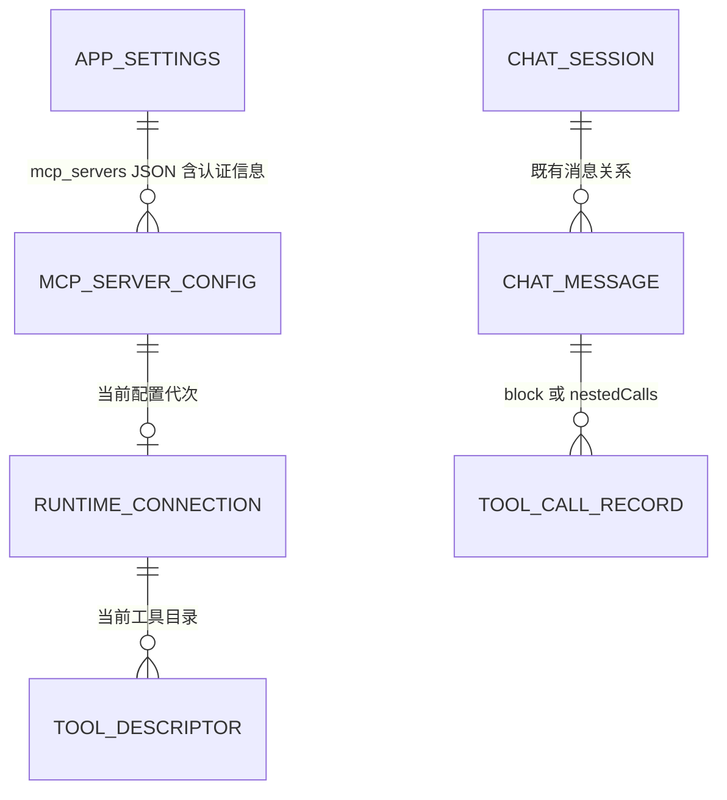
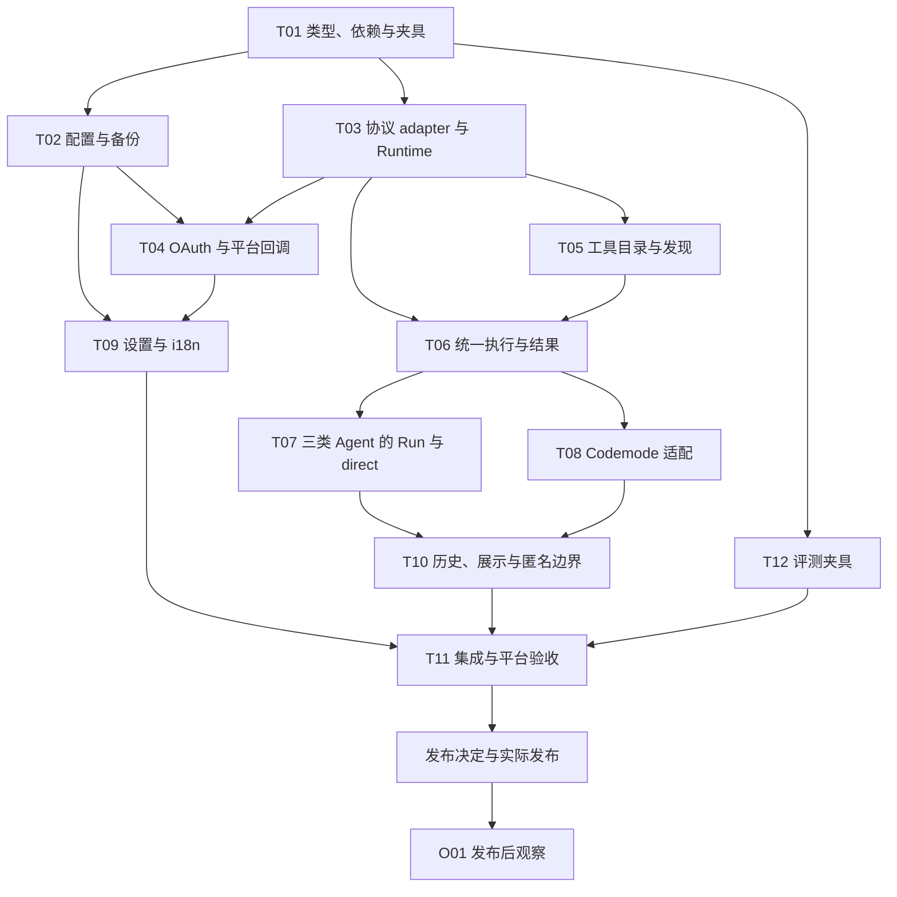

# MCP Client 与 Agent 工具接入方案

> 档位：按 [方案设计模板](template.md) 完整档编写，跨模块、配置存储与 AI 工具行为变更。
> 状态：产品范围与调用接口已确认，尚未实现；新增任务和验证均为实施计划。
> 调研日期：2026-10-02；方案整理：2026-10-03；讨论结论更新：2026-10-29。
> 首版：direct 与 Reveric deferred；deferred 经 Run mcp 或 Codemode 发现和调用，搜索不注册模型工具。
> 观测：使用本地调用记录和受控任务验证，不新增业务埋点或管理端依赖。

## 1. 背景

用户配置一个 MCP server 后，Agent 能知道它提供哪类能力，查询真实工具定义，再组合调用内置工具和 MCP 工具。例如，先检索外部笔记，再将需要的资料写入小说工作区；中间检索结果留在脚本内，模型只接收后续判断需要的内容。

本方案替代 [AI Chat Codemode 方案](ai-chat-codemode.md) 中“仅限九个本地数据工具”和“禁止经工具联网”的范围限制，依据是用户本次明确要求。继续复用现有 FJS 引擎、子调用记录、hooks、取消和本地 working changes 机制。

### 1.1 职责边界

本方案分为三层，MCP Client 可以独立于 Codemode 工作：

| 层次 | 职责 | 依赖 |
| --- | --- | --- |
| MCP Client | 配置、认证、连接、协议交互、远端工具发现与调用 | Dart MCP SDK、应用设置、平台生命周期 |
| Agent 工具接入 | 合并工具目录，提供 Run mcp 与 direct，统一调用来源、结果和记录 | MCP Client、现有 Agent 调用管线 |
| Codemode 适配 | 提供脚本发现函数，并通过统一 tools 对象组合调用 | Agent 工具目录和执行接口 |

工具目录、结果契约和 MCP 连接由前两层持有。Codemode 只适配这些能力，不拥有连接、认证或独立的 MCP 执行逻辑。实现以当前代码为基线，保留既有内置工具及 Run 子命令的脚本行为，不在本文展开 Codemode 现状。

### 1.2 约束

复用 Dart/Flutter、FJS、Agent hooks、消息持久化与应用设置。MCP 配置及认证信息统一保存到应用主 SQLite 数据库的 `app_settings` 表，不接入系统安全存储。MCP 连接由应用容器共享，配置采用软删除。

支持平台为 Windows、macOS、Android。Windows/macOS 支持 stdio 与 Streamable HTTP，Android 仅支持 Streamable HTTP；macOS 通用 stdio 以非沙盒分发为前提。

用户配置并启用服务，即允许聊天 Agent、子 Agent 和 council 使用该服务的全部工具，新发现工具自动可用。首版不做 MCP 工具权限、勾选授权或逐次审批；OAuth 属于远端身份认证，仍保留。其他会话模式和内置工具规则保持原样。

模型侧 Run、Codemode 定义保持静态；用户已明确允许 direct 随服务目录改变具体工具声明。deferred 不借搜索改变声明。本文只更新方案，不修改 Dart、平台配置或工具 description 源码。

## 2. 目标

### 2.1 可验证目标

1. Windows/macOS 配置本地和远程服务，Android 配置远程服务，均能发现并调用工具。
2. 聊天 Agent、子 Agent、council 使用同一套 MCP 目录和执行接口；配置启用后无需额外授权。
3. `deferred` 不让首条聊天等待 MCP 初始化；`direct` 只等待对应服务，合计最多 10 秒。指定服务的发现或调用只等待目标服务，全局搜索明确报告部分结果。
4. 两个会话使用相同配置时只创建一条初始化任务，取消一个会话不关闭另一会话的连接。
5. 模型请求自动携带已启用 MCP 服务的名称和用途摘要；Run 与 Codemode 定义不随目录变化，deferred 搜索不增加顶层工具。服务摘要变化与 direct 声明变化的缓存代价分别验证。
6. 每次 MCP 调用经过 Agent hooks，只执行和记录一次，并保留来源会话、父调用、远端执行状态和内容完整性。
7. 认证信息只用于连接和认证，不进入提示词、工具目录、工具业务参数、普通日志或匿名上报。
8. 三个平台完成适用的 OAuth 登录、回调、刷新和注销；Android 浏览器往返不丢失进程内仍有效的授权事务。
9. 历史查询结果可恢复，压缩后可重新发现；恢复不自动重放调用，也不重新启用已停用服务。

### 2.2 首版范围与非目标

首版交付以下能力：

- stdio、Streamable HTTP、无认证、Bearer token、自定义 Header、OAuth 登录与 token 刷新。
- 多服务设置、连接检查、工具发现与调用、进度、超时、取消和调用记录。
- direct 直接声明工具；deferred 使用 Run mcp 或 Codemode。两种模式都可通过 Run 或脚本调用。
- Codemode 保留既有内置工具及 Run 子命令行为，增加 `WebSearch`、`WebFetch` 和 MCP 工具，全部通过 `tools[name](args)` 调用。
- 服务发现使用 `listMcpServers()`，工具发现使用 `listTools()`、`searchTool()`、`describeTool()`；模型不写脚本时使用 Run mcp 的对应子命令，不新增独立 ToolSearch。
- 仅支持 Tools 的文本和结构化结果，其他内容明确标为不支持；本地诊断与受控验收不依赖业务统计服务。

Resources、Prompts、多模态输出和依赖 elicitation 的交互不在首版范围。客户端直连用户配置的 MCP 服务，Node、Python、uv 等运行环境由用户提供。

### 2.3 成功信号

| 信号 | 验证方式 |
| --- | --- |
| 桌面本地+远程、移动远程均能发现并调用 | T03/T04/T11 的 transport 和平台验收 |
| 三入口同目录、同结果，deferred 无动态注册 | T06-T08 的确定性测试与实际请求载荷 |
| 恢复、取消、超限和配置提交不产生错误副作用 | T02/T10 的故障注入和第 6 节回归 |
| 用户能配置、完成任务并再次使用 | 第 5.8 节受控任务与自愿反馈；样本不足时标明无法判断 |

## 3. User Stories

1. 作为桌面作者，我希望配置本地或远程资料服务，再让 Agent 检索并写入工作区，避免手工在应用间搬运资料。
2. 作为移动端作者，我希望使用同一套远程工具发现和调用方式，并能完成浏览器 OAuth 登录，避免移动端只能查看配置却不能使用。
3. 作为用户，我希望取消、超时或输出过大时知道外部操作是否已经执行，避免重复写入或误以为取消等于撤销。
4. 作为返回旧会话的用户，我希望查询历史仍可阅读，失效工具能明确报错并重新发现，恢复会话不会自动重放操作。
5. 作为管理服务连接的用户，我希望停用保留凭据、删除清除凭据，修改认证信息失败时保留原配置。
6. 作为维护者，我希望三个调用入口共用目录、结果和记录契约，能用协议替身复现故障，并区分模型选错工具、服务执行失败和内容交付不完整。

## 4. 解决方案

### 4.1 方案比较与决策

| 方案 | 做法 | 决策 |
| --- | --- | --- |
| direct + Reveric deferred | 每个服务选择直接声明，或经 Run mcp / Codemode 按需发现和调用 | 首版采用，默认 deferred |
| 搜索后注册式 deferred | 搜索后向模型注册独立工具，并保存加载集合 | 不支持，不列入后续必交付 |
| 全部 direct | 所有工具常驻模型声明 | 大目录增加输入，保留逐服务选择 |
| 只提供 Codemode | 所有外部工具都要求写脚本调用 | 不采用，Run mcp 与 direct 可独立工作 |
| Node sidecar | TypeScript SDK 加常驻外部进程 | 不采用，使用 Dart SDK 窄适配层 |

以下是确认后的产品范围：

| 项目 | 结论 |
| --- | --- |
| 平台 | Windows、macOS、Android；桌面支持 stdio/HTTP，Android 支持 HTTP |
| Agent 范围 | 聊天 Agent、子 Agent、council；其他模式保持现状 |
| 使用许可 | 用户配置并启用服务即允许调用全部工具；新发现工具直接可用，不做 MCP 权限或审批 |
| 配置存储 | 应用主库 `app_settings` 的 `mcp_servers` JSON，认证信息随配置保存，不用系统安全存储 |
| 服务描述 | 默认采用服务端 description；配置中的可选 description 可补充具体用途或覆盖默认描述；没有描述也可使用 |
| 摘要注入 | 类似 AgentSkills，在聊天 Agent、子 Agent、council 的 system prompt 中注入已启用且当前平台适用的服务名称与用途；具体工具定义按需查询 |
| 连接时机 | 固定后台连接，应用容器内共享，不提供连接时机选项 |
| 暴露方式 | 每个服务可选 direct/deferred，默认 deferred；Codemode 是调用入口，不是第三种 exposure |
| 模型发现 | Run mcp 支持 list/search/describe/call，不提供独立 ToolSearch |
| 脚本发现 | `listMcpServers()`、`listTools({mcpServer})`、`searchTool(query, options)`、`describeTool(name)` |
| 脚本调用 | 内置与 MCP 工具统一通过 `tools[name](args)` 或 `tools.xxx(args)` 调用 |
| 服务命名 | 服务名称唯一，不设置独立 ID，不提供重命名及历史/凭据迁移 |
| 工具名称 | MCP 使用 `mcp__<server>__<tool>`；list/search、describe、Run call、direct 和脚本共用 name |
| 会话保存 | 查询和执行输出沿现有消息保存，不增加目录快照或已加载工具集合 |
| 认证与内容 | 无认证、Bearer、自定义 Header、OAuth；Tools 仅文本与结构化结果 |
| 真实服务联调 | 属于实现后的验证，不要求用户开工前提供服务、账号或凭据 |

用户已允许 direct 作为模型侧静态工具规则的限定例外，接受其目录变化带来的缓存代价。deferred 不适用此例外，搜索不能改写工具列表。服务端工具 description 保持原文，Codemode 接口文案按第 5.3.9 节更新。

### 4.2 客户端选型

截至调研日期，已通过 pub.dev 页面、API 和发布归档核对以下信息：

| 包 | 发布版 | 本次判断 |
| --- | --- | --- |
| [mcp_dart](https://pub.dev/packages/mcp_dart) | 2.4.2 | 支持 stdio、Streamable HTTP、OAuth 接口、取消和进度；覆盖 2026-07-28 并兼容初始化式旧协议，推荐 |
| [dart_mcp](https://pub.dev/packages/dart_mcp) | 0.5.2 | Dart 团队维护，但发布说明仍标记 experimental，缺少内置 Streamable HTTP 和认证，不满足双端范围 |
| [mcp_client](https://pub.dev/packages/mcp_client) | 2.2.1 | 两种传输和 OAuth 均有，当前协议支持至 2025-11-25，作为备选 |

`mcp_dart 2.4.2` 发布于 2026-09-03，SDK 要求 Dart `^3.4.0`，与项目声明的 `^3.8.0` 相容。直接依赖为 `crypto`、`http`、`meta`；尚未在本项目执行依赖解析，不能据此宣称已经可以构建。

该库是社区实现，尚未获得 MCP 官方 SDK Tier 认定。发布源码中存在 conformance、跨语言互通和 Flutter 测试，但本轮没有执行这些测试。生产采用基线固定为 2.4.2 并检查 lockfile，升级单独验证。使用 SDK 默认双协议协商策略，协商失败明确报错；不自行伪造兼容响应。

官方 TypeScript SDK 加常驻 Node 进程会新增打包、IPC 和移动端差异，本方案不采用。MCP 协议直接由 Dart SDK 处理，Reveric 适配层只负责连接所有权、目录与结果适配，不重写协议。

### 4.3 采用边界

后台连接与模型工具暴露分开。连接由应用容器管理，direct 每次请求按当前目录重建声明，deferred 只查询和路由，不维护搜索后加载集合，也不使用 Provider 原生 `defer_loading` 或增量声明字段。

内置工具和 MCP 工具放在同一个脚本 `tools` 对象下。MCP 名称含稳定服务标识，目录显式保存来源与远端原始名称，不通过解析名称推断路由。此调用方式参考 pi 的 MCP 工具适配与 Codemode 调用链；保留本方案自己的发现 API、结果预算和错误约定，不照搬 pi 的权限、临时文件或搜索后注册机制。

全局搜索返回已就绪目录及未就绪名单。只要存在待连接或失败服务，就标记 `complete: false`，避免一个慢服务拖住全部检索。

### 4.4 关键假设与原则

| 前提 | 不成立时的影响 | 处理与验证 |
| --- | --- | --- |
| server 可用文本或结构化 Tools 完成任务 | 依赖 Resources、Prompts、elicitation 或多模态的服务只能部分可用 | 设置与结果明确不支持，见第 10 节；握手成功不代表完整可用 |
| macOS 继续非沙盒分发 | 通用外部命令 stdio 不再受支持 | 保留第 5.3.2 节分发约束，改变分发方式时重新设计 |
| SDK 与锁定 Flutter 可解析、构建 | OAuth 或传输无法落地 | T01 先完成依赖解析，T03/T04 完成真实 transport 与回调验证，不用多 SDK 静默兜底 |
| 历史工具信息可能过期或被压缩移出 | 模型可能需要再次查询 | 固定发现入口始终可用，执行按当前服务状态和 schema 校验 |

实施原则：配置和认证信息统一保存；内部工具目录与模型声明分开；三个调用入口共享执行管线；外部调用不自动重放；配置与用户业务数据保留软删除语义。

## 5. 方案实施

### 5.1 模型设计

#### 5.1.1 配置存储模型

配置保存到应用主 SQLite 数据库的 `app_settings` 表，key 为 `mcp_servers`，value 为带 `formatVersion` 和服务列表的 JSON。它是应用级配置，跨小说和会话共享，不新增 Drift 表或 schema version。

| 字段 | 语义 |
| --- | --- |
| `formatVersion` | 配置格式版本，初始为 1；未知版本拒绝加载，保留原始值 |
| `name` | 唯一服务名称，同时作为配置标识；不另设服务 ID，不提供重命名操作 |
| `description` | 可选用途说明；非空时优先使用，否则采用服务端 description；两者都没有时省略 |
| `enabled`、`deletedAt` | 启用状态、软删除时间；删除条目不可连接 |
| `transport` | `stdio` 或 `streamable_http`，采用类型明确的配置分支 |
| `exposure` | `deferred` 或 `direct`，默认 deferred；只决定模型声明方式 |
| stdio 参数 | `command`、`args`、`cwd`、环境变量名称和值 |
| HTTP 参数 | `url`、Headers 名称和值、`authMode`、Bearer token；authMode 为 none/bearer/headers/oauth |
| OAuth 参数 | 可选 clientId、scopes、桌面 callbackPort；token、有效期及 issuer/resource 绑定随配置保存 |
| `connectTimeoutSeconds` | 初始化总期限，默认 15 秒 |
| `callTimeoutSeconds` | 单次工具调用总期限，默认 60 秒，不因进度无限延长 |

配置与认证值一起保存，不增加凭据引用、版本化存储 key、回收队列、工具授权列表或审批设置。OAuth 的 PKCE verifier、state 由 SDK 的进程内授权 transport 持有，回调归属由 coordinator 管理，不保存到配置。

#### 5.1.2 身份、目录与结果模型

服务名称就是配置标识，连接和工具目录按名称查找，不增加独立服务 ID。创建时检查名称唯一，并拒绝规范化后产生相同 MCP 命名空间的名称，比如 docs-api 与 docs_api。已有配置可以修改连接参数、描述和启用状态，但不修改名称；需要换名时删除旧配置，再用新名称配置，不迁移旧 OAuth 登录状态。

工具名称由服务名称和远端原始工具名生成：`mcp__<server>__<tool>`。字符规范化、长度缩减和工具名称碰撞采用确定性哈希，满足 Provider 限制并可直接作为 JavaScript 属性名。不同名称的服务生成不同工具名称，不承诺换名后保持原调用名称。

比如目录返回 `name: "mcp__notes__search"`，Run call、describeTool、direct 声明都使用该名称；脚本调用 `tools.mcp__notes__search(args)` 或 `tools[name](args)`。不另建 callKey、modelToolName 或 MCP 专用脚本路径。内置工具名称保持原样，名称分配同时检查与内置工具的冲突。

目录显式保存 `source`、`server`、原始工具名、统一 name、description、原始 input/output schema、annotations 和 definitionVersion。原始远端工具名仅用于 adapter 向对应服务发起协议调用；annotations 保留为描述信息，不驱动权限或审批。

| 对象 | 所有者与生命周期 |
| --- | --- |
| `McpServerConfig` | Settings Orchestrator 保存到 app_settings；认证信息属于同一配置 |
| `McpConnectionState` | 应用 Runtime 持有服务名称、配置代次、连接状态、服务端描述和规范化错误 |
| `McpToolDescriptor` | Runtime 当前目录的只读条目，不作为会话快照持久化 |
| `McpCallResult` | 结果 adapter 创建，执行状态与内容完整性独立，见第 5.3.11 节 |
| 工具调用记录 | 宿主创建 callId、parentCallId、sourceSessionId、source、server、原始工具名、执行与副作用状态，沿现有 block/nestedCalls 保存 |

连接状态为 disabled、disconnected、connecting、ready、needs_auth、error。停用或软删除为 disabled；Android 后台断开为 disconnected；认证缺失为 needs_auth。单次请求超时不等于整个连接停用。

连接参数和认证变化增加配置代次，使旧初始化、通知与 OAuth 回调失效；description、exposure 的变更只更新目录或声明，不重新连接。每次 Codemode 执行按工具绑定 definitionVersion，晚就绪工具在首次发现或调用时绑定；定义改变后拒绝执行旧绑定，返回 `mcp_tool_changed`。无关工具的变化不使整段脚本失效。

### 5.2 ERD 与数据生命周期



这是逻辑关系，不新增外键、级联、表或索引。Runtime 和工具目录仅在内存中存在；历史输出沿普通消息保存。停用、删除和工具移除均不删除历史记录，也不触发远端业务数据删除。调用记录只保存当时的服务名和工具名，不关联或追踪最新配置，不支持因名称变化重写历史。历史记录不能用于重新启用服务或重放调用。

### 5.3 关键业务流程

```text
Windows/macOS/Android 设置
          |
          v
Settings Orchestrator -> app_settings.mcp_servers（含认证信息）
          |
          v
应用级 MCP Runtime -> 每个服务的 SDK client / transport
          |
          v
Agent 工具目录（内置 + MCP）与统一执行接口
          |
          +-- Run mcp / direct（聊天 Agent、子 Agent、council）
          |
          +-- Codemode 发现函数 / tools[name](args)
                       |
                       v
               Agent hooks / Dispatcher -> MCP adapter
```

MCP Runtime 不依赖 Codemode，目录与执行接口也不放在 Codemode 目录内。Runtime 由应用级 keep-alive Provider 持有连接、初始化任务、配置代次和通知；Provider 发布不可变状态快照。Codemode 仅消费目录和执行接口，继续沿用各 Agent 原有的脚本入口开放范围。

聊天 Agent、子 Agent、council 均获得 Run mcp 与 direct 接入。子 Agent 不需要另行勾选 MCP 工具；council 的 MCP 能力不能被现有内置工具白名单遗漏。为 council 接入 Run 时仅开放 mcp 命令及对应 help，不顺带开放其他 Run 命令或内置写入工具。其他会话模式不接入 MCP。

内部可调用目录与模型可见声明分别提供接口。deferred 工具可被 Run 和脚本调用，但不因而进入模型工具列表；保留现有 allToolDefs 的语义，避免把内部目录直接当作模型声明。direct 工具同样可通过 Run 或脚本调用。

#### 5.3.1 配置保存、编辑与删除

配置、Headers、环境变量和 token 由 Settings Orchestrator 在同一 `mcp_servers` 设置值中提交。编辑、OAuth 刷新提交与注销通过串行读改写避免覆盖其他服务；数据库提交成功后再发布新配置。保存失败保留原持久化配置，不宣称保存成功。

URL 不接受 user-info；认证值放在认证字段、Headers 或环境变量中，不嵌入命令参数。配置不增加 connectionMode、lazy、autoConnect 或工具授权字段。服务启用后，其全部工具均可使用。

停用保留认证信息，停止新调用、关闭连接并取消该服务的登录/刷新事务。删除在一次设置提交中写入 `enabled: false`、`deletedAt`，清空 Bearer、OAuth token、Headers 值和环境变量值，保留配置墓碑和历史调用。先阻止在途回调写回，再提交删除；提交失败报告删除失败，按持久化配置恢复运行态，不留下独立的凭据清理任务。重新配置服务需重新填写认证信息，不自动迁移旧 token。

OAuth 刷新提交前核对服务是否仍启用以及配置和授权事务代次。若远端已轮换 refresh token 而本地保存失败，则要求重新登录，不把旧 token 标记为仍有效。

OAuth access token、refresh token、有效期及认证绑定直接保存在对应服务配置中，不另建 OAuth 凭据文件。认证信息随主库保存，因此完整数据库备份也包含这些值。恢复时保留配置内容但将所有 MCP 条目停用，不自动启动备份中的命令或连接远端；用户检查并启用后恢复使用。MCP JSON 不走 app_settings 的通用字符串路径替换，只对明确的路径字段做类型化处理，URL、token、Headers 和命令参数保持原值。

#### 5.3.2 平台行为与分发前提

桌面端支持本地 command 与独立 args，不把用户配置拼成 Shell 字符串。连接检查显示找不到程序、工作目录无效、进程退出和协议失败的区别。GUI 启动时的 PATH 可能与终端不同，设置允许指定可执行文件绝对路径；Windows 命令启动适配必须单独验证，不能用 macOS 成功推断 `npx.cmd` 可用。子进程不继承完整应用环境，只传必要运行环境及该 server 配置的变量。首版不承诺自动安装运行环境。

macOS 当前采用非 App Sandbox 配置：`DebugProfile.entitlements` 与 `Release.entitlements` 均未声明 `com.apple.security.app-sandbox`，Xcode 项目分别引用这两份文件，也未设置 `ENABLE_APP_SANDBOX`。因此当前配置下，loopback 监听和 stdio 启动用户配置的外部进程不受 App Sandbox 限制；Release 缺少 `com.apple.security.network.server` 不构成监听障碍，无需为本方案补该 entitlement。这里是配置层面的确定结论，进程路径、运行环境和 OAuth 回调仍按第 6 节做功能验收。[Apple 网络监听 entitlement 说明](https://developer.apple.com/documentation/bundleresources/entitlements/com.apple.security.network.server)

macOS 通用 stdio 接入以非沙盒分发为前提。若以后启用 App Sandbox，或转向要求 App Sandbox 的 Mac App Store 分发，本方案中启动用户任意配置的 Node、Python、uv 或其他外部命令的 stdio 能力不再属于受支持范围；该分发版本须禁用这类 stdio 配置与启动入口，并重新设计本地接入方式，远程 Streamable HTTP 仍按沙盒网络权限配置。沙盒允许经过打包、签名并继承沙盒的辅助进程，因此此约束限定于本方案的通用外部命令模式，不表示 stdio 协议或所有子进程在沙盒内都不可用。[Apple App Sandbox 要求](https://developer.apple.com/documentation/security/protecting-user-data-with-app-sandbox)、[沙盒内嵌命令行工具](https://developer.apple.com/documentation/xcode/embedding-a-helper-tool-in-a-sandboxed-app)

移动端只提供远程配置，桌面 stdio 条目在移动端显示“仅桌面可用”且不执行。网络访问经 Dart SDK，由平台现有网络权限承载；若必须新增权限，逐个平台核对 manifest、plist、entitlements。远程推荐 HTTPS，HTTP 地址按用户显式配置处理，不在 HTTPS 失败时自动降级。

#### 5.3.3 初始化、共享与释放

1. 读取配置不建立连接。首次进入 AI 功能，或用户执行连接检查时，触发已启用 server 的后台连接；并发初始化上限为 4。此时机固定，不提供用户选项。
2. 连接完成后拉取所有 `tools/list` 分页并发布目录，不能只读取第一页。`deferred` 不阻塞首轮请求；direct 首轮声明等待见第 5.3.7 节，发现和调用的目标等待见第 5.3.6 节。
3. 同一 server、同一配置代次复用一条初始化 Promise 和 client。已断开连接在下一次实际使用时重建；初始化失败记录状态，禁止无限后台重试。
4. 连接缺失、认证失败、服务停用、工具不存在各自返回明确错误。一个 server 失败不阻止另一个 server 成功。
5. 取消单次调用只发送该请求的取消信号；server 是否接受取消不能等同于操作是否已经生效。
6. 停用、删除或编辑连接配置时，先禁止新调用，再关闭旧 client。退出应用统一关闭；切换小说或聊天页面不关闭共享连接。
7. 移动端进入后台时停止新工具调用并取消当前 MCP 工具请求、关闭工具连接；回到前台且 AI 功能处于活动状态时重新建立。OAuth 授权事务独立保活，浏览器登录切换不触发事务取消。对可能已发送的外部写入标记结果未知，禁止恢复时自动重放。

协议声明只包含实际实现的 client 能力。首版不声明 sampling、elicitation、MCP Apps 或实验性 Tasks；依赖这些能力的 server 明确标为不支持，不能自动接管用户模型、弹出未设计的交互或伪造成功响应。

#### 5.3.4 OAuth 登录与凭据生命周期

OAuth 是首版能力，适用于远程 HTTP 服务。采用授权码 + PKCE 流程，客户端直连服务提供方的认证端点，不建设 Reveric 登录服务，也不收集用户在服务提供方的账号密码。stdio 继续使用环境变量传递凭据。

认证发现与 token 使用遵循 [MCP 认证规范](https://modelcontextprotocol.io/specification/2026-07-28/basic/authorization)。登录按钮、何时打开浏览器和保存后的连接行为属于客户端交互，不是协议规定的 UI。

##### 如何识别需要登录

| 配置或服务响应 | 客户端行为 |
| --- | --- |
| 已配置 Bearer 或认证 Header | 按配置发送；认证被拒时提示检查凭据，不自动换成 OAuth 或覆盖用户 Header |
| 未预置认证值，服务允许访问 | 正常发现和调用，无登录入口 |
| 未预置认证值，服务返回认证挑战 | 按挑战及规范的发现路径读取 protected-resource metadata，再读取授权服务 metadata；不能只凭 HTTP 401 就判定 OAuth 可用 |
| 明确选择 OAuth，或发现到可用 OAuth 流程 | 缺少可用 token 时进入 needs_auth，提供登录入口；缺少 clientId 等必要信息时指出要补充的字段 |
| metadata 无效、缺少必要端点或服务不支持该流程 | 返回具体配置/兼容性错误，不提供一个必然失败的浏览器登录动作 |

未预置认证值的 HTTP 配置可以在发现 OAuth 后由用户点击登录，保存时将该服务认证方式设为 OAuth。后台发现不弹浏览器、不自动注册客户端；SDK 给出的授权 URL 先作为待登录信息保存，只有用户点击登录才打开。已有 token 失效且无法刷新时，同样回到需要登录状态，模型调用立即返回认证诊断，不占用脚本期限等待用户。

##### SDK 与应用的分工

已核对 mcp_dart 2.4.2 发布归档中的 `lib/src/client/streamable_https.dart`，接线使用以下接口，不自行重复实现授权码协议：

| 部分 | 负责内容 |
| --- | --- |
| SDK 的 StreamableHttpClientTransport | 解析 Bearer 挑战、发现资源和授权服务 metadata、处理客户端注册、生成 PKCE/state、构建授权 URL、交换 code、发送 Bearer token |
| `oauth/provider.dart` | 实现 OAuthAuthorizationCodeProvider：提供 clientId/redirectUri/scopes；tokens() 返回当前可用 token，saveTokens() 通过设置 Orchestrator 保存；redirectToAuthorizationUrl() 把 URL 交给 coordinator |
| `oauth/coordinator.dart` | 管理用户发起的一次登录、5 分钟期限、取消与服务配置归属；保持授权用 transport 存活，协调刷新去重和注销 |
| `oauth/callback.dart` | Windows/macOS loopback 接收器和 Android deep-link 分发；核对目标回调 URI，提取 code/state/iss 或用户拒绝错误 |
| 设置 UI | 展示连接中、需要登录、正在登录、已连接和失败状态，提供登录、取消、重试及退出登录操作 |

SDK 在调用前向 provider 请求 tokens()，不会替应用持久化 token 或自动完成刷新。刷新由 provider/coordinator 使用已发现并绑定的 token endpoint 完成；设置 Orchestrator 统一保存。SDK 默认限制跨域 OAuth 端点，adapter 的 oauthUriValidator 必须基于经过校验的服务 metadata 和 issuer 绑定处理合法的独立认证域名，不使用无条件放行，也不要求用户额外填写端点白名单。此接线用跨域认证测试覆盖。

##### 用户登录与回调

1. 用户保存并启用服务后进行连接检查，或在列表手动重试连接。粘贴和解析配置只更新本地编辑态，不启动服务。
2. 确认可使用 OAuth 时显示“需要登录”。用户点击登录后，准备本次回调接收器并启动 SDK 授权流程。已有 clientId 使用已有注册；没有 clientId 且服务支持动态注册时，由 SDK 注册。无法自动注册时，设置页展示实际回调地址和 clientId 输入，不要求普通用户手工填写授权端点或 token 端点。
3. coordinator 将服务名称、当前连接配置、SDK 授权 transport 与本次登录绑定，打开系统浏览器。PKCE/state 由 SDK 生成和持有，应用不再生成另一套。浏览器中的账号登录和授权由服务提供方完成。
4. 回调先核对本地事务仍有效及 URI 归属，再调用原授权 transport 的 `finishAuthRedirect(code, state: state, issuer: iss)`，由 SDK 校验 state/issuer 并交换 token。回调只消费一次；用户拒绝、过期、事务取消或配置已变化时结束本次登录，不保存 token。
5. SDK 调用 saveTokens()，将 access token、可选 refresh token、有效期及 issuer/resource 绑定保存到应用主库 app_settings 的 mcp_servers 配置。保存成功后重新连接并获取工具列表；失败如实报告，不展示已登录。服务端可能不签发 refresh token，不把它当必填字段。
6. provider 在请求前检查 token 有效期；有 refresh token 时按服务绑定刷新，同一服务同一时间只发起一次刷新。刷新响应省略新 refresh token 时保留旧值；若返回轮换值，则保存新值后再发布。没有 refresh token 或刷新被拒时回到 needs_auth，不反复尝试。
7. 只有明确未执行的认证拒绝允许刷新后重试一次；网络中断或结果未知的工具调用不自动重放。用户退出登录时先取消本地事务、关闭对应连接，再清空 OAuth token；旧刷新结果不能写回。服务提供撤销端点时尝试撤销并分别报告远端结果，本地退出不依赖远端成功。

用户可见错误与 Agent 工具诊断分开：UI 提示“凭据无效”“需要重新登录”“回调地址不被服务接受”等可操作原因；工具结果保留脱敏后的 HTTP 状态、OAuth 错误和发现失败原因。

删除 server 复用上述授权失效和 OAuth 撤销规则，并按第 5.3.1 节清空该 server 配置中的全部认证值，包括非 OAuth 的 Header、Bearer 和环境变量值。远端撤销失败不阻止本地清理；本地清除不等于远端 token 已撤销，结果分别报告。

桌面端复用 `url_launcher` 打开系统浏览器，通过 Dart loopback listener 接收 `http://127.0.0.1:<port>/mcp/oauth/callback`；默认临时端口，手动注册场景可指定固定端口。listener 仅绑定 loopback，登录结束、取消和过期均释放端口。macOS Debug/Profile/Release 当前均未启用 App Sandbox，loopback 监听不要求补充 `network.server`；Release 未声明该 entitlement 不阻塞本方案。若未来启用沙盒，则重新配置监听权限并遵守第 5.3.2 节的分发约束。

移动端采用 `app_links` 接收 `ai.reveric://mcp/oauth/callback`，严格匹配 scheme、host 和 path。应用启动早期订阅回调，覆盖热启动与冷启动；冷启动后若原内存事务已丢失，明确提示重新登录，不接受孤立 code。Android 增加定向 intent filter，并按插件要求处理 Flutter 默认 deep-link 路由，避免回调被消费两次。桌面使用 loopback，不额外注册移动端 scheme。

`app_links 7.2.1` 要求 Dart `^3.12.0`、Flutter `>=3.44.0`。当前 FVM 实际为 Flutter `3.49.0-1.0.pre-193`、Dart `3.14.0-271.0.dev`，版本范围满足；接入时同步将项目声明的最低 Dart 提升至 3.12，并补充 Flutter 最低版本约束，仍须完成依赖解析和各平台构建。新增包仅用于移动 OAuth 回调，桌面使用现有系统浏览器及 Dart HTTP 能力。[插件文档](https://pub.dev/packages/app_links)

授权事务及其 SDK 授权 transport 由 OAuth coordinator 持有，不随工具连接的移动端后台清理而释放；用户取消、超时、停用、删除或修改连接/认证配置时才结束；仅修改 description 或 exposure 不结束 OAuth 事务。授权回调由客户端与所选 MCP 服务直接协作。授权服务不接受所配置回调或要求特定客户端注册时明确显示原因，不声称可以绕过服务方要求。[MCP 授权规范](https://modelcontextprotocol.io/specification/2026-07-28/basic/authorization)

#### 5.3.5 服务与工具发现

模型请求自动携带 MCP 服务摘要，采用 AgentSkills 的渐进发现方式。复用 `PromptFragments.availableSkills()` 的分块组织方式，增加独立的 MCP 摘要片段，放在 system prompt 的能力目录区域，与 skills 摘要相邻。聊天 Agent、子 Agent（包括 SpawnAgent 与 slash 入口）及 council 使用同一摘要构建逻辑；没有适用服务时不输出该片段。

片段列出已启用、未删除且当前平台适用的全部 MCP 服务，包含服务名称和有效 description，按服务名称排序。每项 description 最多 250 字符，名称保留完整；不把查询接口的 4096 字符分页规则套到注入摘要上。连接状态、进度、transport 参数、认证值、完整 instructions 和工具 schema 不注入，避免运行态变化反复改写摘要。服务尚未连接时也列出名称，已有用户描述则一起提供；不为获取服务端 description 阻塞 deferred 首轮请求。

片段格式示例：

```xml
<available_mcp_servers>
  <mcp_server>
    <name>notes</name>
    <description>搜索和读取个人笔记。</description>
  </mcp_server>
</available_mcp_servers>
```

名称和描述作为数据转义后插入，不解释其中的标记。片段附固定指引：根据服务用途选择外部能力，使用 Run mcp list/search/describe 获取具体工具，或在 Codemode 中使用 listTools/searchTool/describeTool；连接状态与最新目录可通过 Run mcp list 或 listMcpServers 查询。服务摘要帮助模型选择下一步，不代替工具定义。

每次模型请求前，从当前配置与已获取的服务端描述生成摘要快照；新会话、子 Agent 启动、会话恢复和压缩后均使用同一规则。服务新增、删除、启停或有效描述变化在下一次请求生效；后台首次获得服务端描述也可更新下一次请求。一次请求进行中不修改其 prompt，不插入额外历史消息。仅连接状态变化、工具搜索或工具列表变动不改变服务摘要。

Run mcp list 与 listMcpServers 的查询结果比注入片段更完整，包含服务名称、有效 description、连接状态、transport 与 exposure。description 优先取用户填写的非空内容，否则取连接后获取的服务端 description；两者都缺失时省略，不强制填写，也不猜测服务用途。服务端 instructions 与 description 分开保留，可在查看该服务工具时返回使用指引，不把 instructions 当作每个工具的描述重复注入。

Run 的 `server` 参数与脚本的 `mcpServer` 参数均使用配置中的唯一服务名称，精确匹配，不接受额外 ID 或模糊匹配。未提供筛选表示全部可用服务或工具；空字符串属于无效筛选，省略字段才表示不筛选。

列表支持 cursor 分页，每页最多 4096 字符，单个服务的 description 最多 250 字符，按服务名与工具名排序。工具摘要至少包含 name、description、source、definitionVersion；MCP 工具另含 server，值为配置中的服务名称。完整 schema 由 describe 获取。查询返回的信息沿工具消息保存，不向模型提供配置中的认证值。

#### 5.3.6 Codemode 脚本 API

| API | 返回与行为 |
| --- | --- |
| `listMcpServers(options?)` | 返回已启用 MCP 服务的摘要与连接状态；options 支持 cursor，不必等待全部连接就绪 |
| `listTools(options?)` | 返回工具摘要；options 支持 mcpServer 和 cursor，省略 mcpServer 列出当前可用的内置与 MCP 工具，指定后仅列该服务工具，并返回该服务的 instructions（若有） |
| `searchTool(query, options?)` | 搜索工具；options 支持 mcpServer、source、limit；source 为 builtin/mcp，省略则搜索两者；默认 limit=8，最大 20 |
| `describeTool(name)` | 返回统一 name、完整 description、原始 input/output schema 与 definitionVersion；name 直接使用发现结果 |
| `tools.<name>(args)` / `tools[name](args)` | 统一调用内置和 MCP 工具；MCP 名称为 `mcp__<server>__<tool>` |
| `text(value)`、`return` | 只把输出内容带回对话，保留 128 KiB 脚本总输出预算 |

MCP 调用可以使用 `tools[name](args, {definitionVersion})` 显式绑定查询到的版本；该选项由宿主消费，不混入远端业务参数。内置工具继续使用现有签名。tools 对象是只读宿主桥，脚本不能修改名称映射或执行 server 提供的代码。

`listMcpServers` 返回 `{servers, truncated, nextCursor?}`；服务列表来自配置，连接状态是摘要字段，不因有未连接服务就隐藏该条目。`listTools` 和 `searchTool` 返回 `{tools, complete, pendingServers, failedServers, truncated, nextCursor?}`；listTools 支持续页，searchTool 按 limit 返回最相关结果，不提供搜索 cursor，截断时可缩小 query 或限定服务。pendingServers/failedServers 的条目含服务名称和状态，失败项提供有界且脱敏的诊断。指定服务的 listTools 可另含 instructions。

指定 mcpServer 时只等待目标服务；describe 与调用根据 name 在目录中保存的身份定位服务，也只等待目标服务。全局 list/search 返回当前可用目录，有未就绪或失败服务时 `complete: false`；超过分页或 limit 时另标 `truncated: true`。服务明确存在但尚未就绪时，不能把零匹配解释为该服务没有能力。`source: "builtin"` 与 mcpServer 同时提供时报参数错误。

搜索采用确定性本地检索，不增加 embedding 或模型请求；索引名称、服务用途、工具摘要和 schema 字段名，覆盖英文词元和中文连续片段。名称匹配优先，同分按服务名与工具名排序。

第一次发现工具并把定义带回模型：

```javascript
text(await listMcpServers());
text(await listTools({ mcpServer: "notes" }));
const matches = await searchTool("检索笔记", { mcpServer: "notes", limit: 3 });
text(matches);
if (matches.tools.length > 0) {
  text(await describeTool(matches.tools[0].name));
}
```

后续脚本使用实际返回的名称和参数。以下假设发现结果为 `mcp__notes__search`，且参数要求 query：

```javascript
const result = await tools.mcp__notes__search({ query: "人物设定" });
text(result);
```

也可用 `tools[name](args)` 动态调用。脚本内查询但未输出的 schema 不进入模型上下文；未知工具通常需要发现一轮、执行一轮，不承诺脚本能自行理解任何 schema 并构造参数。

未显式传 definitionVersion 时，MCP 参数按当前 schema 校验，同时遵守该脚本已经绑定的定义版本。校验失败不发送请求；历史名称不保证历史定义仍有效；同名重新配置时以当前配置为准，历史记录不触发配置恢复或自动重放。

#### 5.3.7 Run、direct 与 deferred

Run 保持现有 `command/subcommand/options` schema，`command: "mcp"` 支持：

| subcommand | options | 行为 |
| --- | --- | --- |
| `list` | 可选 server、cursor | 不指定 server 列服务，对应 listMcpServers；指定 server 列该服务工具，对应 listTools({mcpServer: server}) |
| `search` | 必填 query，可选 server、limit | 搜索 MCP 工具；省略 server 跨服务搜索，指定时只搜索该服务 |
| `describe` | 必填 name | 查看工具完整定义，与 describeTool 共用实现 |
| `call` | 必填 name、arguments，可选 definitionVersion | 调用 MCP 工具；name 已包含稳定服务标识，无需再传 server；arguments 原样作为业务参数 |

帮助使用 `Run help mcp`，不新增 `mcp help`，不改写 Run 顶层 description。模型服务管理操作仍放在设置界面，不在首版命令中提供配置增删改。

```json
{
  "command": "mcp",
  "subcommand": "search",
  "options": {"server": "notes", "query": "检索笔记"}
}
```

搜索返回的 name 可以直接用于调用：

```json
{
  "command": "mcp",
  "subcommand": "call",
  "options": {
    "name": "mcp__notes__search",
    "arguments": {"query": "人物设定"}
  }
}
```

Run mcp 的 describe/call 仅接受 MCP 来源的 name，不借通用目录开放内置工具。脚本里的 MCP 调用统一使用 tools[name]，Run mcp 子命令不再增加一套脚本转调路径；其他既有 Run 子命令的脚本访问规则保持原样。

| 模式 | 模型可见内容 | 调用方式 |
| --- | --- | --- |
| deferred | 固定 Run 与各 Agent 已有的 Codemode 入口 | list/search/describe 后，经 Run mcp call 或脚本 tools[name] 调用 |
| direct | 固定入口，加上该服务当前可用工具定义 | 直接调用具体工具，也可使用 Run 或脚本 |

两种模式的 MCP 可调用范围相同；搜索不改变模型侧工具列表，不创建已加载集合。direct 在会话首次请求或恢复后的首次请求前，合计最多等待目标服务 10 秒；未就绪服务本次不声明，状态可通过 list 查询。后续请求按当前目录确定性排序并重建声明，流式响应中不改变本次快照。

执行时再次检查服务启用状态和定义版本；停用立即阻止新调用，定义与本次声明不一致则返回 `mcp_tool_changed`。切换 direct/deferred 只改变下一请求的声明，不改变工具身份或重建未变的连接。

原始 input schema 是参数校验真源，Provider 声明转换不能丢弃 `$defs` 后留下悬空 `$ref`，也不能静默删除组合约束。接线时复用 SDK 可用的校验能力，覆盖本地引用和组合 schema；SDK 或 Provider 不支持的结构必须返回明确兼容性诊断，不能伪装成完整支持，也不自动切换 exposure。外部引用不自动联网解析。direct 无法表达某个工具时明确标记该工具的声明错误并让 list/describe 可查，其他工具继续可用；校验无法完成的工具不发送调用。

缓存验收比较实际 Provider 请求，分开观察服务摘要和工具定义。服务摘要内容不变时，排序和序列化保持稳定；搜索、连接状态变化以及单纯工具目录变化不改变 deferred 的工具定义或服务摘要。服务新增、删除、启停或有效描述变化会更新 system prompt，可能影响缓存，纯 deferred 也接受这一成本。direct/混合配置还需单独记录具体工具声明变化。历史消息不因摘要更新被重写，序列化一致不等于保证缓存命中。

#### 5.3.8 会话保存与恢复

| 状态 | 所有者与保存方式 |
| --- | --- |
| 服务配置与认证信息 | 应用主库 app_settings.mcp_servers |
| 连接、当前目录、版本绑定、OAuth 待处理事务 | Runtime、单次执行或 OAuth coordinator 的内存 |
| 模型看到的查询与调用结果 | Run、direct 工具结果，或 Codemode text/return，沿现有消息与 block 保存 |
| MCP 服务摘要 | 请求前由配置和已获取的描述构建，随 system prompt 使用；不作为历史目录快照保存 |
| direct 当前声明 | 请求前从当前配置与目录重建，不保存为已加载集合 |
| 外部操作事实 | 顶层或嵌套记录中的来源、服务身份、执行状态与副作用状态 |

不增加 Session 目录快照、已加载工具字段，也不转存到 metadata。保留 system 消息过滤，恢复和压缩后重新注入当前服务摘要；工具被删除或服务离线后，历史调用仍能展示并向 Provider 序列化，不因当前目录缺失而丢弃。

恢复历史不重放调用。停用服务拒绝新调用，工具消失返回不存在，schema 变化要求重新 describe；不猜名称、不补参数、不自动重试写入。压缩移出旧工具定义后，固定发现入口仍可重新查询。

#### 5.3.9 Codemode 文案

源码描述随相应能力落地。code 字段的类型、必填条件和字段描述保持原样，既有内置工具说明和错误约定继续保留。工具描述开头使用：

> 运行 JavaScript，组合调用内置工具和已启用 MCP 服务的工具，只把需要的结果带回对话。使用 `await listMcpServers()` 查看 MCP 服务，`await listTools({mcpServer: "服务名称"})` 列出该服务的工具，`await searchTool(query, options)` 搜索工具，`await describeTool(name)` 查看完整定义。所有工具统一通过 `await tools[name](参数)` 或 `await tools.xxx(参数)` 调用，名称使用发现结果中的 name。通过 `text()` 或 `return` 输出需要的内容；脚本不能直接访问网络、文件或加载模块。

固定使用指引为：

> 需要组合多个工具调用，或筛选、计算和整理结果时，使用 Codemode。需要 MCP 能力时，可先列服务或搜索工具，再查看定义并调用。单次发现和调用也可使用 Run mcp，帮助见 Run help mcp。

这些是本次讨论确认的接口文案，不根据实时目录生成工具描述。服务端 description 保持原文，提示词不随界面 locale 翻译。各发现函数的参数与返回契约见第 5.3.6 节，由固定帮助完整提供。

#### 5.3.10 执行边界与副作用

首版不做 MCP 工具权限和逐次审批。用户配置并启用服务后，聊天 Agent、子 Agent、council 均可调用其工具，包括新发现工具；仍需检查服务状态、平台适用性、连接和 schema。OAuth 验证服务端身份及 token，不作为本地工具勾选授权。

内置工具继续使用现有模式、输入与 Run 子命令边界；MCP 接入不扩大其他内置工具的能力。工具来源由目录显式记录，不能因为外部工具也叫 Write 或具有相同字段就套用本地 working change 规则。

Codemode 的 MCP 子调用经 Agent.runToolCall 和组合 dispatcher；Run mcp 与 direct 也沿 Agent hooks 进入同一 MCP 执行接口。宿主创建来源会话、父子调用身份，脚本不能指定其他会话。统一处理一次 hooks、执行一次、记录一次，不因入口包装产生重复外部调用。

本地 mutation 继续跟踪 working change。外部调用记录 source=mcp、server、原始工具名、executionState 与 effectStatus，不虚构本地撤销。未发送的调用可记无副作用；远端失败也可能已产生部分副作用，无法核实时记 unknown，不能仅凭 succeeded/failed 推导是否发生写入。

#### 5.3.11 统一 MCP 调用结果

`result_adapter.dart` 生成同一个类型化调用结果，供 direct、`Run mcp call` 和 `tools[name]` 使用。发现接口仍使用第 5.3.6 节的查询结果，不套用调用执行状态。调用结果序列化字段固定如下：

| 字段 | 契约 |
| --- | --- |
| `ok` | 必填布尔值；仅 `executionState: "succeeded"` 为 true，不表示内容完整或所有外部副作用都已核实 |
| `executionState` | 必填：`not_started` 表示确定未向 server 发起工具调用；`succeeded` 表示收到合法的成功结果；`failed` 表示收到明确失败结果或协议拒绝；`unknown` 表示请求可能已发出但未取得可判定的结果 |
| `content` | 必填数组，默认 `[]`；仅保留 MCP 文本项 `{type: "text", text: string}`，保持顺序，不把文本自动解析成 JSON |
| `structuredContent` | 可选 JSON 对象；server 返回时保持其业务结构，缺失则省略，不用空对象伪造，也不展开到结果顶层 |
| `contentComplete` | 必填布尔值；收到的内容全部交付时为 true，存在省略、截断或请求结果未知时为 false；确定未发起且无结果内容时为 true |
| `contentIssues` | 必填数组，正常为空；元素为 `{code, contentTypes?}`，code 为 `unsupported_content`、`result_too_large`、`output_budget_exceeded` 或 `result_unavailable`；不携带被省略的原文或 base64 |
| `error_code`、`error` | 仅 `ok: false` 时提供，分别为稳定错误码和有长度上限的说明；保留脱敏后的远端实际错误码、消息与必要命令诊断，UI 另行转换；内容不完整不能往顶层填 error，以免现有归一化逻辑将成功调用判成失败 |
| `recovery` | 可选恢复建议；结果未知时提示先核实外部状态，禁止自动重放；内容不完整时说明省略原因及可用的查询/分页方式，不建议重复写入 |
| `cancelled`、`rejected` | 可选现有控制标记，仅为 true 时输出；取消与执行状态分别记录，已发送后取消且结果未知仍是 `executionState: "unknown"` |

完整文本、结构化数据、业务中的 `ok/error` 等字段只放在 `content` 或 `structuredContent` 下，不参与顶层状态判定。MCP `isError: true` 映射为 `ok: false`、`executionState: "failed"`、`error_code: "mcp_tool_error"`；保留有界的错误内容和部分结果，但失败不代表远端没有副作用。服务停用、参数或版本校验失败且未调用 server 时为 `not_started`，沿用对应的拒绝/校验错误码；工具请求可能已经发出后的断线、超时或无法解析的响应为 `unknown`，分别使用 `mcp_connection_lost`、`mcp_timeout`、`mcp_invalid_response`。未知结果同时带 `contentComplete: false` 和 `result_unavailable`。

direct 直接返回该结果；Run 在同一结果外增加既有 `command`、`exit_code`、`duration_ms`，其中 exit_code 按 ok 取 0 或 1，不覆盖执行状态。Codemode 在 `ok: true` 时 resolve 该对象，在 `ok: false` 时保持 reject 契约，Error 带现有 `error_code/error/recovery` 和完整但有界的 `result`；未捕获时保留在 `tool_error.result`。结果字段命名、状态判定和内容预算不得由三个入口各自重新实现。

调用来源、服务名称、工具身份、调用 ID 与副作用状态由宿主写入现有顶层或嵌套调用记录，不从远端结果推断。`executionState: "failed"` 或 `"succeeded"` 均不能单凭状态推导副作用为 none/confirmed，沿用第 5.3.10 节的显式事实记录规则。

#### 5.3.12 内容限制与超大结果

图片、音频和 resource link 不进入首版结果正文，不自动抓取链接，也不把 base64 当文本塞进上下文；省略时写入 `unsupported_content` 和实际未呈现类型。server 已报告成功时保留 `ok: true`、`executionState: "succeeded"`，仅设置 `contentComplete: false`，不得把展示能力不足改成执行失败。

首版采用两层 UTF-8 JSON 字节预算：MCP 调用结果进入 JS 或其他入口适配前上限为 512 KiB；direct/Run 的单次模型可见结果上限为 32 KiB，Run 包装字段计入预算。Codemode 保留整段脚本 `text/return` 合计 128 KiB 预算，脚本可在较大的内存结果中筛选后输出。

归一化结果超限时，先保留完整的宿主状态、错误分类与内容问题说明，再整体省略 `structuredContent`；仍超限则按顺序保留能容纳的文本，最后一项按 Unicode 字符边界截断，并省略剩余项。结构化对象不得截成无效 JSON，也不返回缺字段但看似完整的对象。设置 `contentComplete: false`，512 KiB 层使用 `result_too_large`，32 KiB 模型结果层使用 `output_budget_exceeded`；状态字段和省略说明必须保留。诊断文本同样受预算限制，记录与 UI 只保存有界预览，不把超限原文另塞进 metadata、日志或历史。

若已收到并成功解析 server 的成功响应，超限后的结果仍为成功，Codemode resolve 而不 reject。例如：

```json
{
  "ok": true,
  "executionState": "succeeded",
  "content": [],
  "contentComplete": false,
  "contentIssues": [{"code": "result_too_large"}],
  "recovery": "The operation succeeded, but its result was omitted because it exceeded the size limit. Do not repeat the write; use a separate query if verification is needed."
}
```

若传输或解析层在取得完整结果前因超限中断，无法判断远端执行结果，则记录 `ok: false`、`executionState: "unknown"`、`error_code: "mcp_result_unavailable"`，内容问题标记 `result_too_large` 与 `result_unavailable`，不得报告确定失败或自动重试。该结果预算不等于 HTTP 解析前的硬内存隔离；stdio 保留 SDK 默认 10 MiB 单消息保护，HTTP 大响应的解析峰值仍须实测。

脚本自行 `text/return` 超过总预算时，保留现有 `codemode_resource_limit` 脚本错误，不静默截断任意脚本输出；已完成 MCP 子调用的 succeeded 状态保持不变。Codemode 总结果与调用卡保留完成数量和有界子调用事实，提示输出交付失败不代表外部操作失败，禁止据此自动重跑脚本。取消发生前已经收到的成功结果也不能被统一改写为未知或失败。

#### 5.3.13 取消、期限与匿名上报

首版继续串行执行脚本内工具，避免同时改并发语义。取消后停止排队的新调用，对在途 MCP 请求发送取消并结束本地等待。已发送的工具调用超时或断线时不自动重试，也不自动重跑脚本；读取和重新查询目录可以重试，带副作用的调用由模型先核实实际状态。

脚本执行总期限调整为 180 秒，连接与每次 MCP 请求仍分别受 15 秒、60 秒上限约束；继续保持内存、源码、参数和第 5.3.12 节的输出限制。

匿名上报不能复用原始 MCP 工具名、server 名称和参数。给执行上下文增加显式工具来源，由 TraceHook 发送固定类别与规范化错误码；内部目录查询出的 schema、脚本源码、输入与结果不得进入匿名载荷。需要同步核对 `_dispatchTool` 异常路径，不能只在最终 UI 结果中脱敏。

#### 5.3.14 对话运行期间修改服务

服务配置由应用共享。变更作用于所有正在使用该服务的聊天、子 Agent 和 council，不影响其他 MCP 服务，也不直接终止整个对话。

| 配置操作 | 当前调用 | 后续行为 |
| --- | --- | --- |
| 删除或停用 | 停止该服务排队的新调用，取消在途等待并关闭旧连接 | 旧工具调用返回明确的服务不可用或工具不存在；下一模型请求移除相应摘要和 direct 声明 |
| 修改 URL、启动命令、参数或认证配置 | 关闭旧连接，取消旧连接上的调用与登录事务；旧回调不得写回新配置 | 保存成功后按新配置连接，后续新调用使用新目录；不把旧调用自动转发到新目标 |
| 修改 description | 当前连接和工具调用不变 | 下一模型请求更新服务用途摘要 |
| 切换 direct/deferred | 当前连接和已发调用不变 | 下一模型请求更新声明方式，两种模式的 Run/脚本调用能力不变 |
| 换服务名称 | 不提供重命名操作；删除旧配置时按删除规则处理 | 用新名称新增配置，重新连接和认证；生成新工具名，不提供旧名称别名或凭据迁移 |

结果按调用事实保存：未向服务发送的调用记 not_started；已经收到合法成功结果的调用保持 succeeded；请求可能已发送、关闭时仍未获得可判定结果的调用记 unknown。取消不等于远端撤销，未知结果不自动重试，已完成的记录不被后续配置变更改写。

正在生成回复的模型仍使用本次请求开始时的摘要与声明快照，不中途改 prompt。它随后发起旧工具调用时，执行入口检查当前配置，返回明确错误或定义变化诊断，由模型决定重新发现或继续回答。后续模型请求再使用最新摘要和声明。

Codemode 中的失败按工具 reject 契约交付。脚本可以 catch 后处理，未捕获则结束本次脚本；不因服务变更直接取消整个 Agent，也不自动重跑脚本。已完成的其他子调用仍保留真实结果。

换名后的历史继续显示原服务名和工具名。比如删除 docs、新增 notes 后，新调用使用 `mcp__notes__search`；对话中的 `mcp__docs__search` 不自动映射过去，需要重新发现。

### 5.4 改动清单

预计超过 8 个文件，新增 MCP Runtime、设置编排与 OAuth 协调。以下路径为实施目标，尚未创建；工具发现和执行保持在 Codemode 之外。

| 文件或区域 | 改动 |
| --- | --- |
| `pubspec.yaml`、`pubspec.lock` | 接入 mcp_dart 2.4.2、app_links 7.2.1，核对最低 SDK 与依赖解析；不添加安全存储依赖 |
| 新增 `lib/shared/models/mcp/config.dart`、`call_result.dart` | 配置 JSON 与统一结果模型，认证信息属于配置，不建独立凭据引用模型 |
| 新增 `lib/shared/services/mcp/client_adapter.dart`、`runtime.dart` | SDK 窄适配、stdio/HTTP、目录分页、共享初始化、通知、代次和取消 |
| 新增 `lib/shared/services/mcp/settings_orchestrator.dart` | 原子保存配置、串行 OAuth token 提交、停用与软删除 |
| 新增 `lib/shared/services/mcp/oauth/provider.dart`、`coordinator.dart`、`callback.dart` | SDK OAuth 接线、授权事务、刷新注销、桌面 loopback 与 Android 回调 |
| 新增 `lib/shared/providers/mcp_providers.dart`，修改 `main.dart` 与 AppLifecycleWatcher | 应用级所有权、早期回调订阅、退出与 Android 前后台生命周期 |
| `android/app/src/main/AndroidManifest.xml` | OAuth deep-link；同时检查 Windows/macOS 的适用配置，不改其他平台 |
| `lib/shared/services/backup_service.dart` | MCP JSON 走类型化恢复分支，保留配置值但全部停用，避免通用路径替换破坏认证值 |
| 新增 `lib/shared/services/ai/tool_catalog.dart`、`tool_search.dart` | 合并目录、稳定名称、服务筛选、list/search/describe；tool_search 仅为共享检索实现，不注册模型工具 |
| 新增 `lib/shared/services/ai/mcp/run_command_handler.dart`，修改 `tools_run.dart` | mcp list/search/describe/call 与 Run help mcp，保持顶层 schema；遵守已有 Run 子命令注册约定 |
| 新增 `lib/shared/services/mcp/tool_dispatcher.dart`、`result_adapter.dart` | 统一执行、原始 schema 校验、结果状态与预算、调用来源 |
| `lib/shared/agent/agent_tool_dispatcher.dart`、`agent.dart` 与 `client/` 下适配器 | 区分模型声明和可调用目录，接入 direct；保留原始 schema 并处理 Provider 兼容，尤其 client/json_schema.dart |
| `lib/shared/services/ai/chat_turn_runner.dart`、`chat_agent_tool_dispatcher.dart`，子 Agent 与 council 执行入口 | 三类 Agent 共享 MCP；council 只增加 MCP 所需命令，其他内置工具范围不变 |
| `lib/shared/services/ai/codemode/prelude.dart`、`runtime.dart`、`orchestrator.dart`、`tool.dart` | 四个发现函数、统一 tools 桥、晚就绪工具与版本绑定、Error.result、显式外部结果；保留既有 Run 行为 |
| `lib/shared/models/ai_nested_tool_call.dart`、`ai_message_block.dart`、`services/ai/agent_message_mapping.dart` | 显式 MCP 来源、执行与副作用状态；旧内置历史保持可读 |
| `lib/shared/services/ai/prompts/use_cases/chat_prompt_use_case.dart`、`prompt_fragments.dart`、`session_persistence.dart` | 固定发现指引与 MCP 服务摘要片段，三类 Agent 在请求前重建摘要；查询输出按普通消息保存，不增加目录快照或加载集合 |
| `lib/shared/agent/hooks/trace_hook.dart`、`lib/shared/services/ai/tool_error_normalize.dart` | MCP 来源脱敏，保留给 Agent 的实际诊断，检查异常路径不泄露凭据或业务内容 |
| 新增 `lib/shared/widgets/settings/mcp/section.dart`、`server_editor.dart`，接入桌面设置与移动设置 | 服务配置、可选用途覆盖、连接/OAuth 操作；不增加工具授权或凭据回收 UI |
| 共享工具调用卡与 Codemode 详情组件 | 展示服务来源、执行未知与内容不完整；不为外部写入显示本地撤销 |
| locale_keys、en/zh-CN 的 settings 与 ai 翻译 | 配置与结果 UI 文案；动作复用 common，提示词不做 i18n |

实现时读取直接调用方和现有测试，不按本文中的概念名盲目新增重复实现。新增源码遵循 Dart 文件头、目录与表单规则；需要生成代码时按项目要求执行 codegen。本方案不创建 mockup。

测试覆盖新增 MCP adapter/runtime/settings/OAuth、共享目录、Run 与 direct、三类 Agent 接线、Codemode 桥，以及既有备份、消息、trace 和共享 UI。详细验收见第 6 节。

### 5.5 Task Graph

任务按层组织。下图是实现依赖，不代表每个任务都能独立发布。MCP Client 与 Run/direct 可以在 Codemode 适配之前完成验证；首版发布仍需关闭所有适用验收项。



| 任务 | 内容 | 完成证据 |
| --- | --- | --- |
| T01 | 固定 config、descriptor、call result 与 adapter 契约，接入依赖和确定性夹具 | 依赖解析、模型编解码与基础参数校验通过，不只留下接口占位 |
| T02 | Settings Orchestrator、认证值保存、软删除和备份恢复 | 保存失败不覆盖旧配置，跨服务更新不丢失，恢复全部停用且认证值不被路径替换 |
| T03 | stdio/HTTP、共享初始化、分页、通知、代次、取消与生命周期 | 实际本机进程和 HTTP 测试通过，跨会话取消不关闭共享连接 |
| T04 | SDK OAuth provider/transport 接线、认证识别、浏览器回调、刷新注销与 token 提交 | 覆盖 Bearer 401 与 OAuth 发现的区分、独立认证域、登录取消、无 refresh token 与刷新去重；Windows/macOS loopback 和 Android 回调按第 6 节验收 |
| T05 | 基于服务名称的工具命名、服务描述、list/search/describe | 名称唯一性、规范化冲突、工具碰撞、部分目录、晚就绪与停用场景覆盖 |
| T06 | MCP dispatcher、schema 校验、统一结果和预算 | 三入口状态一致，$defs/$ref 与组合 schema 不失真，超限不重判已成功调用 |
| T07 | Run mcp、Run help mcp 与 direct，接入聊天/子 Agent/council 及服务摘要注入 | 三类 Agent 首轮均能看到摘要，后台描述到达后下一请求更新；无额外 MCP 审批，其他模式及 council 内置能力不扩大 |
| T08 | 四个脚本发现函数、统一 tools 对象、版本绑定和错误结果 | 内置与 MCP 可组合调用，失败 reject、不完整成功 resolve，既有 Run/取消行为回归通过 |
| T09 | 共享设置、连接/OAuth 操作和中英文 UI | 桌面与 Android 配置流程通过，未提供 description 仍可保存和使用 |
| T10 | 顶层/子调用历史、来源、结果展示与匿名脱敏 | 重启与压缩恢复可用，历史不重放，查询未输出的 schema 不进入模型历史 |
| T12 | 第 7 节夹具与判定表、效果观察格式 | 合成任务可运行，记录任务/平台/版本及结果，不包含用户内容 |
| T11 | 串行回归、互通、平台构建与验收 | 第 6 节逐项记录结果；未执行的真实服务、平台或模型验证明确标记 |
| O01 | 实际发布后观察 | 按第 5.7/5.8 节记录实际样本、异常和修复，不把计划当成效果 |

客户端实现负责人负责 T01-T12，平台验收由具备对应环境的负责人完成。共享文件按任务分工，Flutter 测试与 codegen 始终串行。无需在开始实现前要求用户提供 MCP 服务账号；开发先使用可控服务，实际互通在具备目标服务和凭据后进行。

### 5.6 Migration 与兼容

本方案使用现有设置与消息存储，不预设 Drift schema 变更。若实现需要修改生成源，按实际变化执行 codegen；若需要数据库迁移，先核对最新正式发布 tag。

| 载体 | 默认与兼容行为 |
| --- | --- |
| app_settings 的 mcp_servers key | 不存在视为空配置，不连接；首次保存 formatVersion=1；格式损坏或版本未知时保留原值并报错，不用空配置覆盖 |
| 新服务 | 默认 deferred，表单保存时明确 enabled；启用即可使用全部工具，新发现工具直接可用 |
| 认证信息 | 随服务配置保存；编辑与 token 刷新串行提交，不存在跨存储引用迁移 |
| 顶层 block 与 nestedCalls JSON | 新 source 缺省 builtin，MCP 身份字段可空；旧内置记录无需回填，损坏历史只作展示不能用来路由 |
| Session | 不增加目录快照或已加载工具列，继续过滤 system 消息；恢复与压缩后重建服务摘要，direct 按当前目录重建 |
| 备份恢复 | 旧备份没有 MCP key 时正常恢复；含 MCP 配置时保留值但全部停用，不自动执行命令或重放调用 |

后续更改已发布配置字段含义时升级 formatVersion 并提供转换；本轮不为不存在的旧 MCP 配置实现迁移。

回退时停用 MCP、恢复工具接线，同时保留配置与调用历史。优先保留新历史的读取能力；旧二进制可能在重存消息时丢失新增展示信息，不能承诺双向无损，降级前保留备份。代码回退不能撤销远端已经执行的操作。

### 5.7 上线后验证

发布前由 T11 保存确定性验收基线和平台/版本，发布后 D1-D7 由客户端负责人每天检查，D7 由发布负责人复核。这里只定义运行健康度，业务价值口径见第 5.8 节。

| 观察项与来源 | 异常信号 / 最低样本 | 行动 |
| --- | --- | --- |
| 本机连接与调用阶段日志 | 初始化超过配置期限仍无终态；连续 3 次相同规范化错误 | 检查 transport、认证和代次，暂停受影响配置；不重试结果未知的调用 |
| 受控计数器 server 与调用 ID 对照 | 任何自动重复写入，阈值 0 | 阻断发布或立即停用 MCP，保留调用证据并修复重放路径 |
| 配置与 OAuth 状态 | 保存失败仍显示成功，或迟到刷新覆盖新配置，阈值 0 | 核对串行提交和配置代次，修复后用故障注入重验 |
| 实际 Provider 请求与模型 usage | deferred 搜索改变声明或服务摘要；摘要/direct 无变更却持续改变排序 | 区分预期摘要更新与无意义变化，对比请求与历史前缀；缓存命中率作为独立实测值 |
| 历史与调用卡 | succeeded 被输出错误改成 failed、停用后仍调用、旧会话无法加载，阈值 0 | 停用相应入口并修复；保留历史，不删除用户业务数据 |

本地日志只记 transport、阶段、耗时、调用 ID 和规范化错误码，不记 URL 中的凭据、脚本、完整参数或结果。T10 验证匿名链路只接收固定来源类别与错误码。用户反馈中的敏感内容不自动采集；跨平台缺失日志或样本不足标记无法判断。

### 5.8 业务效果验证

使用第 7 节的合成任务、受控 MCP server 和自愿反馈，比较配置成功、调用结果、任务完成、耗时与 Token 用量。记录样本范围、平台和模型，缺失数据标为未知，不推算用户留存或全量转化率。

本方案不新增业务埋点、配套管理端或远程漏斗。可选匿名诊断沿用应用的地址配置与用户同意开关，只发送经核对的错误分类，不采集工具参数、脚本或结果。

## 6. 验收标准

### 6.1 功能与兼容矩阵

| 场景 | 通过条件 |
| --- | --- |
| 平台与 transport | Windows/macOS 的 stdio/HTTP、Android 的 HTTP 发现与调用成功；Android 不执行 stdio |
| macOS 分发 | 签名后的 Debug/Release 产物验证通用 stdio 与 loopback；App Sandbox 分发不暴露通用 stdio |
| 配置持久化 | 应用级 mcp_servers 含认证值，保存失败保留旧值；停用保留认证，删除原子软删除并清空认证值，迟到刷新不能写回 |
| 备份 | 含 MCP 的主库备份可恢复，条目全部停用，认证值和 URL 不被路径替换，无自动执行 |
| OAuth 正常流程 | 三个平台完成适用的授权码、PKCE、回调、刷新和注销；手动 client ID 与动态注册均覆盖 |
| OAuth 异常 | 错误 state/issuer、重复/过期回调被拒，刷新去重；后台浏览器往返保留事务，冷启动缺事务要求重登 |
| OAuth 识别与交互 | 普通 401 不直接触发 OAuth；预置 Bearer/Header 不被自动覆盖；粘贴不连接，后台不弹浏览器或自动注册，点击登录后才进行交互流程 |
| OAuth SDK 接线 | PKCE/state 使用 SDK 同一事务，回调调用 finishAuthRedirect；独立认证域可完成发现，无 refresh token 可正常登录，刷新省略新 refresh token 时保留旧值 |
| Agent 范围 | 聊天 Agent、子 Agent、council 均能 list/search/describe/call 和使用 direct；无 MCP 工具勾选或审批；其他模式不新增 MCP |
| council 与子 Agent | MCP 不被内置静态白名单遗漏；council 不额外开放其他 Run 或内置写入，子 Agent 共享连接但保留独立调用来源 |
| 服务摘要 | 聊天、子 Agent 和 council 首轮自动注入适用服务的 name/description；用户描述优先，服务端描述缺失不阻塞首轮；不含状态、凭据、instructions 或工具 schema |
| 摘要更新与恢复 | 新增、删除、启停、有效描述变化在下一请求生效；流式响应中不改 prompt；恢复/压缩后重新构建，搜索或连接状态变化不改摘要 |
| list 与搜索 | Run list 无 server 列服务、有 server 列工具；server/mcpServer 仅接受配置名称，创建时拒绝重名与规范化冲突，空筛选报错 |
| 脚本发现 | listMcpServers/listTools/searchTool/describeTool 与 Run 共用目录；分页、limit、完整性和晚就绪处理一致 |
| 统一名称 | list/search、describe、Run call、direct 与 tools[name] 使用同一个 name；不同服务的同名工具不冲突；换服务名称按删除旧配置、新增配置处理，工具名随新名称生成 |
| direct/deferred | direct 首轮等待合计不超过 10 秒；deferred 不阻塞首轮，搜索不注册模型工具，两种模式均可经 Run/脚本调用 |
| schema | $defs/$ref、组合 schema 不被声明转换静默删除；不支持的结构有明确诊断，参数失败不发送，版本变化拒绝旧绑定 |
| 统一执行与结果 | 三调用入口执行状态一致，仅包装与交付预算不同；每个外部调用执行和记录一次，并经过 Agent hooks |
| 多会话共享 | 同配置只初始化一次，取消 A 不关闭 B；停用服务后所有会话的新调用均被拒绝 |
| 运行中变更 | 多会话同时调用时覆盖删除、停用、修改连接和认证配置；未发送/成功/未知按事实区分，其他服务继续可用，Agent 不被整体取消 |
| 说明与模式修改 | 在途调用不受 description/exposure 修改影响；旧请求快照不变，下一请求更新摘要或声明 |
| 换名 | 删除旧配置、新增不同名称配置后工具名更新；旧调用不自动映射、新配置不继承 OAuth 登录，历史保留原名 |
| 工具变化 | 新发现工具直接可用；移除或定义变化不被旧脚本误调用，无关工具更新不取消整个脚本 |
| 中英文发现 | 中文用途和英文工具名称均可命中，无匹配不猜工具名称；部分目录不被当成完整目录 |
| 缓存 | deferred 的固定入口与服务摘要不因搜索改变；服务摘要更新和 direct 定义更新分别测量缓存代价，不宣称 deferred 的 system prompt 永远不变 |
| 历史与压缩 | 模型可见查询落库并恢复，未输出 schema 不进入模型历史；已删除工具的历史仍可序列化，恢复不重放 |
| 取消与副作用 | 已发送而结果未知的调用标 unknown；排队调用停止，不自动重放或虚构远端撤销 |
| 内容边界 | 业务 ok/error 不覆盖宿主状态；不支持类型、超大结果、脚本输出超限不把已确认成功改成失败 |
| 大结果 | 结构化对象整体省略，文本按 Unicode 边界截断，结果保持合法 JSON；传输/解析提前中断记 unknown |
| 生命周期 | 应用退出无残留子进程，Android 前后台断开/恢复可追踪，旧配置回调不能覆盖新状态 |
| 诊断与隐私 | Agent 获得脱敏后的实际错误码、消息和诊断，UI 独立转换；日志及匿名载荷不含认证值或业务内容 |
| 现有功能 | 内置读写、Run 脚本访问、hooks、working changes、128 KiB 输出和历史恢复回归通过 |

确定性测试使用可控 server，不使用用户业务数据。平台实测和真实服务互通分别记录，不能用单元测试替代。

### 6.2 命令与平台验收

实现后的命令按顺序执行，Flutter 测试必须串行：

```bash
fvm flutter pub get
make codegen
fvm flutter test test/shared/services/mcp/
fvm flutter test test/shared/providers/mcp_providers_test.dart
fvm flutter test test/shared/services/ai/codemode/
fvm flutter test test/shared/services/ai/chat_agent_tool_dispatcher_test.dart
fvm flutter test test/shared/services/ai/prompt_tool_guidelines_test.dart
fvm flutter test test/shared/services/ai/tool_search_test.dart
fvm flutter test test/shared/services/ai/mcp/
fvm flutter test test/shared/agent/mcp_tool_exposure_test.dart
fvm flutter test test/shared/services/ai/mcp_agent_scope_test.dart
fvm flutter test test/shared/agent/trace_hook_test.dart
fvm flutter test test/shared/services/backup_service_test.dart
fvm flutter test test/shared/services/anonymous_outbox_service_test.dart
fvm flutter test test/shared/widgets/ai/codemode_tool_test.dart
fvm flutter test test/shared/widgets/settings/mcp/
fvm flutter analyze lib/shared/services/mcp lib/shared/services/ai/mcp lib/shared/services/ai/codemode lib/shared/services/ai/tool_catalog.dart lib/shared/services/ai/tool_search.dart lib/shared/agent lib/shared/providers/mcp_providers.dart lib/shared/widgets/settings/mcp
git diff --check
```

`make codegen` 仅在涉及生成源时运行，并检查生成 diff。新增测试路径是实施交付项，实施前按仓库现状核对；命令是计划，未在本轮执行。真实翻译资源的 Widget 测试须在 `setUp` 清理 `rootBundle` 缓存。

真实联调用自建的可控 stdio/HTTP 测试 server，提供确定性查询、计数器写入、延迟、失败、分页与目录变化场景，避免访问用户业务数据。SDK 双协议分支分别验证；另选用户实际使用的 server 做互通验收，不将同库 client/server 测试当成跨实现证明。

OAuth 使用可控授权服务覆盖 metadata 发现、动态注册、手动 client ID、token 交换与旋转，开发测试不依赖第三方账号。真实互通在实现后具备目标服务时进行；确需账号或 client ID 时由用户在应用内填写，不写入仓库，也不作为开工前置条件。macOS Debug/Release 与 Windows 验证 loopback，Android 真机验证浏览器往返和深链回调。按平台分别执行 `fvm flutter build macos`、`fvm flutter build windows`、`fvm flutter build apk`；签名安装后的回调另行实测。缺少环境或真实服务时如实记录未验证，不将测试替身视为真实互通。

### 6.3 交付记录

每个任务记录实际修改文件、命令、结果、失败复现和未执行项。依赖解析、SDK 互通、真机回调、真实模型评测和线上业务效果是不同证据，不相互替代。T11 对照矩阵逐项关闭确定性实现项；模型评测只有获准并实际完成才记录结果，O01 的发布后指标不能提前标为达成。

本轮是方案重整，只做文档检查，不运行上述实现命令、真实模型或用户 MCP 服务。

## 7. 评测

评测对象是发现准确性、参数构造、入口选择、失败恢复和多步任务完成；不评判小说文学质量，也不把协议握手测试当成模型业务质量。输入仅使用仓库内合成笔记、虚构人物资料和可控 server，不使用用户业务数据。

| 场景 | 输入与夹具 | 期望 | 判定 |
| --- | --- | --- | --- |
| 查资料后写入 | 合成 notes.search 返回固定 3 条；指定将其中 1 条写入测试工作区 | 选中正确工具与记录，内置写入只发生一次，输出足以核对 | server 调用日志与工作区差异确定性检查；模型选参另人工复核 |
| 两个同名工具 | 两服务均提供 search，描述明确不同用途 | 根据 server 身份选对目标，无别名碰撞 | 调用目标确定性检查 |
| 中文与英文检索 | 固定 20 组中英文等义 query，目录含干扰工具 | 目标在默认前 8 条，停用服务的工具不出现；匹配集稳定 | 本地搜索测试自动判定 |
| schema 变化与恢复 | describe 后修改定义；另保存并重新加载会话 | 旧版本调用被拒绝或当前参数校验失败，模型重新 describe；历史不自动执行 | 替身与恢复测试自动判定，模型恢复策略人工复核 |
| 慢服务与停用 | 一个服务延迟/离线，另一个可用；停用目标服务 | 部分结果明确，不误报能力不存在，不调用已停用服务 | 超时/调用计数自动判定 |
| 取消或超大写入结果 | 计数器写入后取消/断线；另一轮返回超限成功结果 | 结果未知与成功不完整区分，写入计数不因恢复或报错自动增加 | 计数器、结果状态与调用卡自动判定 |
| direct/deferred 混用 | 同任务分别以纯 direct、纯 deferred、混合配置执行 | 功能结果一致；搜索不注册工具；只有 direct 变更声明 | 实际请求载荷与结果自动比较 |

T12 为每类建立 fixture ID、输入、预期调用身份、参数约束和 pass/fail 判定；T11 执行所有确定性用例。状态误判、调用停用服务、重复写入、凭据泄露等保护项容忍值为 0，不用平均分掩盖。

真实模型评测仅在用户明确要求后运行。获准后选择实际配置的一种目标 Provider/model，固定版本、参数、工具目录与输入，每类 5 次；配置三种暴露组合的场景共 15 次，其余六类共 30 次，合计 45 次，逐次记录完成、调用身份、参数错误、重试、耗时和 usage。目标任务完成至少 90%，保护项全部满足；模型版本、样本或预算不够时保留实际数量，不将计划次数记为已跑。

协议、服务状态、存储、预算和声明稳定性由自动化覆盖；是否合理选择外部能力、是否理解结果未知、输出是否足够支持后续动作由人工检查。模型文字风格和真实缓存命中量只作观察。没有运行真实模型评测时，交付报告可陈述确定性测试通过，必须明确 AI 行为质量未验证；不因编写本节而自动调用付费模型。

## 8. Token 成本

默认 deferred 模式复用 Run 与 Codemode，增加固定发现指引与自动注入的服务摘要。服务摘要常驻输入，成本随启用服务数量增长；具体工具目录按需查询，每次目录页最多 4096 字符，schema 经 describe 输出后才进入消息，未知工具可能增加搜索、查看定义的往返。direct 的常驻输入随已启用服务的工具数量增长；deferred 的工具定义成本不随搜索结果数量增长，但已输出的查询内容仍占上下文。成本按纯 deferred、direct 与混合配置分组，具体 token 数随 tokenizer 测量，不把字符数等同 token。

以下为待测公式和控制边界，不是实测 token 数。令 F 为固定入口/指引的 token，S 为服务摘要 token，D 为已声明 direct 工具的总 token，Q 为查询结果 token，R 为执行后保留输出 token；T12/T11 用实际 tokenizer 与 Provider usage 记录数值。

| 维度 | 相对现状的变化 | 控制与测量 |
| --- | --- | --- |
| 单次模型输入 | Run/Codemode 固定发现指引 F + 服务摘要 S；direct 额外增加 D | 分别记录纯 deferred/direct/混合请求；S 随服务数量增长，每项描述最多 250 字符；D 随工具数量和 schema 大小增长，不静默隐藏服务或 direct 工具 |
| 未知工具的调用次数 | Codemode 合并 search+describe 通常需要发现一轮、执行一轮；Run search → Run describe → Run call 可需三轮工具往返 | 这是常见路径而非次数保证；参数已知可直接调用，模型反复搜索单独计数 |
| 上下文增长 | 只增长实际输出的 Q+R，随保留历史累计；脚本未输出中间结果不计入模型上下文 | 目录页 4096 字符，脚本总输出 128 KiB，direct/Run 单次结果 32 KiB；字符/字节不直接换算 token，压缩后允许重新发现 |
| 输入与结果大对象 | JS 桥单次结果 512 KiB，模型输出按第 5.3.12 节压缩交付 | 结构化对象不伪造局部完整性；失败和重试的模型消耗计入任务总成本 |
| 模型档位 | 首版沿用用户当前 Provider/model，不自动切换廉价模型 | 搜索为本地检索，无 embedding/额外模型；降档属于后续单独评测 |
| 失败与离线 | 外部服务失败不阻断内置本地工具，返回明确错误；未知外部调用不重试 | 合成夹具验证可离线运行，真实 OAuth/远程工具仍需网络，不宣称完全离线 |

每个评测任务记录首次请求与续轮的输入/输出、缓存读写 token、总轮数和总耗时；Provider 不给 usage 时标记未知，不用客户端字符数伪造。以相同任务、目录和模型比较入口成本，不能把 direct 的常驻 D 与 deferred 的一次查询 Q 放在不同任务上比较。真实缓存命中取实测。纯 deferred 保持工具声明固定，搜索不改写服务摘要；服务配置或有效描述更新仍可能改变 system prompt，缓存成本单独记录。

## 9. 风险

| 风险 | 触发条件 | 影响 | 对策 |
| --- | --- | --- | --- |
| SDK 不兼容 | 目标 server 协议/认证与 SDK 不互通 | 连接或调用失败 | adapter 保持窄，用真实 server 互通决定上线；核心失败重新评估选型，不叠多 SDK 静默兜底 |
| 大目录或大结果 | 分页多、单响应超过预算 | 发现延迟、内存峰值或交付不完整 | 分页、搜索上限和有界结果；HTTP 解析峰值实测，不把已成功操作改成失败 |
| 本地进程环境差异 | GUI PATH 缺依赖、Windows 启动入口不同 | stdio 无法启动或残留进程 | 分平台验收，给出修复位置，不自动安装运行环境 |
| macOS 分发变化 | 启用 App Sandbox 或上 Mac App Store | 当前通用 stdio 不再受支持 | 禁用该模式，重新设计本地接入与网络权限 |
| 写入响应丢失 | 请求已发送后断线、超时或取消 | 无法判断远端副作用 | 记录 unknown，不自动重试，不承诺远端回滚 |
| 发现信息不足 | 描述缺失或中文 query 未匹配 | 模型选错服务或误报无能力 | listMcpServers/listTools 和中文检索；服务描述可由用户补充，不凭名称猜测 |
| 共享连接串扰 | 取消一个会话、编辑配置后旧回调到达 | 误关其他调用或发布旧目录 | request 级取消、当前启用状态检查和配置代次隔离 |
| OAuth 回调差异 | 服务拒绝移动 scheme 或要求固定注册 | 无法登录或恢复登录 | 动态注册与手动 client ID 并存，明确报错，不伪造授权 |
| 摘要与 direct 缓存开销 | 服务摘要或 direct 工具定义发生变化 | system prompt 或工具声明改变，输入增大 | 稳定排序，逐项描述有界；两种变化分别测量，deferred 也有摘要更新成本 |
| deferred 术语混淆 | 实施误采用搜索后加载工具的行为 | 额外声明与会话状态 | 契约与测试禁止搜索注册、loaded 集合和原生 deferred 字段 |

最脆弱的假设是目标 server 能通过已支持的认证流程和文本工具契约完成有价值的任务。OAuth 已进入首版；必须依赖 elicitation、Resources、Prompts 或图片/音频结果的 server 不在首版能力范围，不能仅因握手成功就标为完整可用。

## 10. 已知妥协

| 首版接受的限制 | 原因与影响 | 升级触发与方向 |
| --- | --- | --- |
| Tools 仅文本与结构化内容 | 控制首版协议与 UI 范围；Resources、Prompts、多模态和依赖 elicitation 的服务不能完整使用 | 目标用户的必需服务依赖这些能力时，另做内容和交互链路设计 |
| macOS stdio 仅非沙盒分发 | 用户配置的外部运行环境不适合当前沙盒方案；Mac App Store 版本不能直接照用 | 决定上架或开启沙盒时，禁用通用 stdio 并重新设计本地接入 |
| direct 可能增加上下文和缓存开销 | 用户明确要求直接调用；工具数量与 schema 大小影响每轮输入 | 实测上下文超限或成本不可接受时，用户改用 deferred；不自动改模式 |
| 串行脚本工具、固定预算 | 保留已有执行与取消语义；多次慢请求可能达到 180 秒脚本期限 | 有受控性能证据证明串行是瓶颈后，单独设计并发和副作用顺序 |
| 移动端后台断开工具连接 | 不依赖系统长期后台执行；OAuth 事务仅在进程仍存活时保留 | 需要后台任务时另做系统能力适配；冷启动缺失授权事务仍要求重登 |
| 不恢复历史工具声明快照 | 避免引入搜索后注册式加载集合；direct 恢复按当前目录，历史 schema 不保证仍可调用 | 只有明确需要历史执行环境重现时再设计，不自动重放旧操作 |
| 不自动安装本地运行环境 | 避免跨平台安装、更新和供应链成本；用户需自行提供命令 | 支持量证明配置门槛不可接受时再评估受控分发，不后台下载安装 |

这些限制不会通过 fallback 静默绕开；第 6 节记录实际能力和未验证平台，第 7 节记录未运行的模型评测。

## 附录 A. 调研证据与本轮验证

- [mcp_dart 发布元数据](https://pub.dev/api/packages/mcp_dart)、[2.4.2 发布归档](https://pub.dev/api/archives/mcp_dart-2.4.2.tar.gz)。
- [dart_mcp 包说明](https://pub.dev/packages/dart_mcp)、[mcp_client 包说明](https://pub.dev/packages/mcp_client)。
- [MCP SDK 列表](https://modelcontextprotocol.io/docs/sdk)、[Anthropic 缓存说明](https://platform.claude.com/docs/en/agents-and-tools/tool-use/tool-use-with-prompt-caching)、[对话中途工具变更](https://platform.claude.com/docs/en/build-with-claude/mid-conversation-system-messages)。
- [MCP 授权规范](https://modelcontextprotocol.io/specification/2026-07-28/basic/authorization)、[app_links](https://pub.dev/packages/app_links)。
- OAuth 接线核对：只读下载 mcp_dart 2.4.2 发布归档，检查 `lib/src/client/streamable_https.dart` 中的 OAuthAuthorizationCodeProvider、tokens/saveTokens、finishAuthRedirect 和端点校验；未将依赖安装到项目，未执行登录或刷新联调。
- macOS 权限依据：核对 `macos/Runner/DebugProfile.entitlements`、`Release.entitlements` 与 `macos/Runner.xcodeproj/project.pbxproj`，当前未启用 App Sandbox；Apple 对监听权限、App Store 沙盒要求及辅助进程的说明见第 5.3.2 节。此次未构建或运行签名产物，不将配置核对描述为实际调用测试通过。
- pi 对照：阅读本地 checkout 的 `packages/coding-agent/src/extensions/mcp/tools.ts`、`extensions/codemode/execute.ts` 和 `test/suite/agent-session-mcp.test.ts`，采用其统一名称与 `tools[name]` 调用方式；未运行 pi 测试。
- 服务描述字段参考 [MCP Implementation](https://modelcontextprotocol.io/specification/2026-07-28/schema#implementation)，description 与 instructions 均可选，分别用于用途摘要与使用指引。
- 本次工作仅更新方案文档；未安装依赖、修改 Dart/平台配置、连接用户 MCP server、执行 Flutter 测试或运行真实模型评测。
