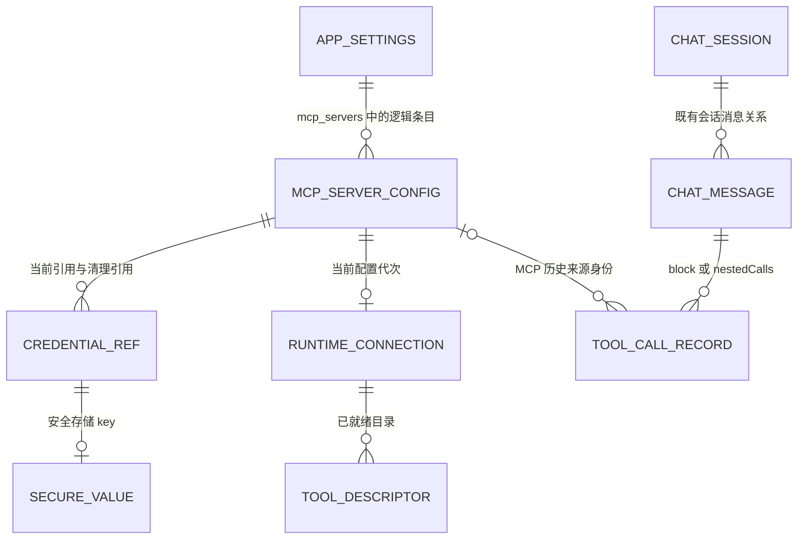
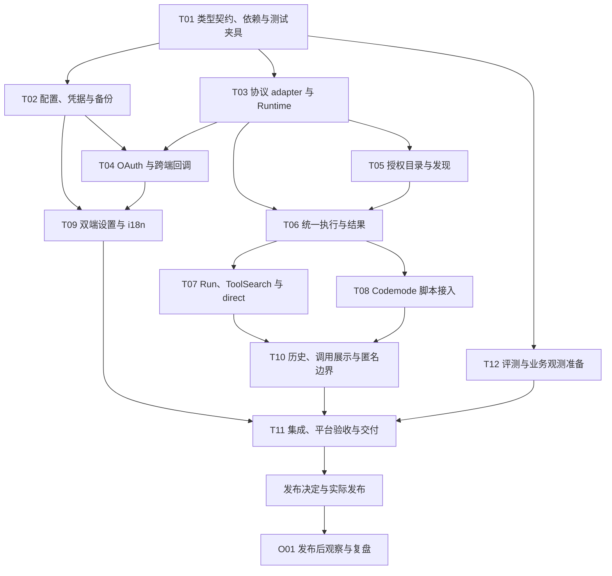

# MCP Client 与 Codemode 工具接入方案

> 档位：按 [方案设计模板](template.md) 完整档编写，跨模块、配置存储与 AI 工具行为变更。
> 状态：产品范围与调用接口已确认，尚未实现；新增任务和验证均为实施计划。
> 调研日期：2026-10-02；方案整理：2026-10-03。
> 首版：direct 与 Reveric deferred（Codemode + Run mcp + ToolSearch）；不支持搜索后注册式搜索后注册工具。
> 观测：使用本地调用记录和受控任务验证，不新增业务埋点或管理端依赖。

## 1. 背景

用户配置一个 MCP server 后，Agent 能知道它提供哪类能力，查询真实工具定义，再组合调用内置工具和 MCP 工具。例如，先检索外部笔记，再将需要的资料写入小说工作区；中间检索结果留在脚本内，模型只接收后续判断需要的内容。

本方案替代 [AI Chat Codemode 方案](ai-chat-codemode.md) 中“仅限九个本地数据工具”和“禁止经工具联网”的范围限制，依据是用户本次明确要求。继续复用现有 FJS 引擎、子调用记录、hooks、取消和本地 working changes 机制。

### 1.1 当前实现与缺口

当前工程尚未依赖 MCP SDK。`AgentToolDispatcher` 已提供工具定义和执行接口；Codemode 经 `Agent.runToolCall()` 执行子调用，可以复用 hooks 和错误归一化。

需要调整的现状：

- `codemode/tool.dart` 写死九个本地工具，`orchestrator.dart` 同时用该白名单和 Agent 的 `allowedTools` 过滤调用。
- `codemode/prelude.dart` 实际只注入 `tools`、`text`，尚未提供旧方案中提到的 `ALL_TOOLS`、`describeTool` 或搜索能力。
- Codemode 的写入结果归类依赖本地工具名及 `updated`、`removed` 等字段，不能套到外部工具。
- Codemode 当前串行执行子调用，整段脚本默认限时 60 秒；网络工具接入需要明确连接等待和执行预算。
- `Agent._toolResultEvents()` 当前将 Map 编码为文本；数据模型支持 `ImageBlock` 不等于 MCP 图片已经能正确进入完整结果与历史恢复链路。
- `session_persistence.dart` 过滤 system 消息；MCP 查询结果应沿普通工具消息保存，不依赖动态 system 内容恢复目录。
- `tools_run.dart` 已有固定 `command/subcommand/options` 契约和 help 路由，新增 `mcp` namespace 可以复用，Run 顶层 schema 和描述无需变化。

### 1.2 约束

复用现有 Dart/Flutter、FJS、Agent hooks、消息持久化、应用设置和系统安全存储。MCP 连接由应用容器共享，用户业务数据继续软删除；凭据删除与业务数据删除分开处理。桌面与移动端必须同步检查，macOS 通用 stdio 以非沙盒分发为前提。

仓库要求模型侧工具 schema 保持静态；用户已明确授权 direct 作为限定例外。deferred 使用固定入口，不能借搜索改变声明。内置写入的 `codemodeHasExternalInput` 防线保留。本文只改方案，不修改 Dart、平台权限或工具 description 源码。

## 2. 目标

### 2.1 可验证目标

1. 桌面配置一个本地 server、一个远程 server，两者均可被同一脚本发现和调用；移动端完成同样的远程调用。
2. `deferred` 不让首条聊天等待 MCP 初始化；`direct` 只等待对应 server，所有目标合计最多 10 秒。指定服务的查询或调用只等待目标服务，全局搜索返回已就绪目录和明确的部分结果状态。
3. 两个会话使用相同连接配置时只创建一条初始化任务，取消一个会话不关闭另一会话的连接。
4. Codemode、Run、ToolSearch 的模型侧 schema 保持固定；`deferred` 目录和搜索不改变顶层工具列表。`direct` 按当前配置和授权声明工具，目录变化可能改变缓存前缀，不能将固定入口的缓存性质推广到混合配置。
5. 每次 MCP 子调用经过统一权限检查与 Agent hooks，并保留来源会话、父调用和结果状态。
6. 凭据不会进入提示词、脚本工具目录、调用参数、普通日志或匿名错误上报。
7. 桌面与移动端完成 OAuth 登录、回调、刷新和注销；浏览器授权导致的移动端后台切换不丢失仍有效的授权事务。
8. 会话重启后可依据历史查询结果继续调用；压缩移出目录或 schema 后可以重新发现。恢复不自动重放调用，历史信息不能恢复已撤销的权限。
9. 配置与调用可通过本地诊断和受控测试核验，日志不包含凭据或业务内容。

### 2.2 首版范围与非目标

以下范围作为一个完整功能交付：

- stdio、Streamable HTTP、无认证、Bearer token、自定义 Header、OAuth 登录与 token 刷新。
- 多 server 管理、连接检查、工具发现、工具调用、进度、超时、取消和调用记录。
- Codemode 同时组合现有九个数据工具、`WebSearch`、`WebFetch` 和已授权的 MCP 工具。
- `direct` 直接声明获准工具；`deferred` 通过 Codemode、`Run mcp`、固定 `ToolSearch` 发现和使用。搜索不激活新的模型侧工具，所有调用入口使用同一授权目录与执行管线。
- 仅适配文本和结构化结果；其他内容类型必须明确标为不支持，不能静默丢弃后报告完整成功。
- 交付本地诊断与受控验收，不依赖配套业务统计服务。

Resources、Prompts、多模态输出明确排除在首版之外，不新增对应发现、读取、选择或渲染入口。客户端直连用户配置的 MCP 服务；所需 Node、Python、uv 等运行环境由用户提供。产品决策汇总见第 4.1 节。

### 2.3 成功信号

| 信号 | 验证方式 |
| --- | --- |
| 桌面本地+远程、移动远程均能发现并调用 | T03/T04/T11 的 transport 和平台验收 |
| 三入口同授权、同结果，deferred 无动态注册 | T06-T08 的确定性测试与实际请求载荷 |
| 恢复、取消、超限和凭据清理不产生错误副作用 | T02/T10 的故障注入和第 6 节回归 |
| 用户能配置、完成任务并再次使用 | 第 5.8 节受控任务与自愿反馈；样本不足时标明无法判断 |

## 3. User Stories

1. 作为桌面作者，我希望配置本地或远程资料服务，再让 Agent 检索并写入工作区，避免手工在应用间搬运资料。
2. 作为移动端作者，我希望使用同一套远程工具发现和调用方式，并能完成浏览器 OAuth 登录，避免移动端只能查看配置却不能使用。
3. 作为用户，我希望取消、超时或输出过大时知道外部操作是否已经执行，避免重复写入或误以为取消等于撤销。
4. 作为返回旧会话的用户，我希望查询历史仍可阅读，失效工具能明确报错并重新发现，恢复会话不会自动重放操作。
5. 作为管理服务连接的用户，我希望停用保留凭据、删除清除凭据，修改凭据失败时保留原配置，并能重试未完成的清理。
6. 作为维护者，我希望三个调用入口共用授权、结果和记录契约，能用协议替身复现故障，并区分模型选错工具、服务执行失败和内容交付不完整。

## 4. 解决方案

### 4.1 方案比较与决策

| 方案 | 做法 | 收益与代价 | 决策 |
| --- | --- | --- | --- |
| direct + Reveric deferred | 每个 server 选择直接声明，或固定 Codemode / Run / ToolSearch 入口 | 兼顾直接调用与批量编排；需要统一授权和记录；direct 接受缓存变化 | 首版采用 |
| 搜索后注册式 deferred | 搜索后向模型注册独立工具，并恢复加载集合 | 模型可直接按 schema 调用，但增加 Provider 和历史声明恢复复杂度 | 不支持，不列入后续必交付 |
| 全部 direct | 所有工具常驻模型声明 | 路径短，但大目录增加每轮输入，目录变化影响缓存 | 不作为默认；保留逐服务 direct 选择 |
| 只提供 Codemode | 只让模型写脚本发现和调用 | 固定入口简单，但缺少用户已要求的 Run 单次调用、搜索工具和 direct | 不采用 |
| Node sidecar | 用 TypeScript SDK 加常驻外部进程 | 增加打包、IPC 和移动平台差异 | 不采用，使用 Dart SDK 窄适配层 |

取舍以用户最后确认的 direct/deferred 定义为准。Codemode 是调用入口，不额外增加第三种 exposure。以下决策表是本方案唯一产品范围清单。

| 项目 | 结论 | 状态 |
| --- | --- | --- |
| 平台 | 桌面端支持 stdio、Streamable HTTP；macOS 通用 stdio 依赖非沙盒分发；移动端支持 Streamable HTTP | 已确认 |
| 连接配置 | 用户管理 server、地址或启动命令、连接参数和认证信息 | 已确认 |
| Codemode 范围 | 支持获准的内置工具和 MCP 工具，不以是否联网划分可用性 | 已确认 |
| SDK | `mcp_dart 2.4.2`，通过窄适配层接入 | 技术建议 |
| 连接时机 | 固定后台预连接，不提供连接时机选项；连接在应用容器内共享 | 已确认 |
| 工具暴露方式 | 每个 server 可选 `direct`、`deferred`；`deferred` 为固定 Codemode、Run mcp、ToolSearch 入口组合 | 已确认，替代原三种模式定义；默认 `deferred` 延续固定入口优先 |
| 脚本 API | MCP 使用 `mcp.tools.xxx`；新增全局 `searchTool`、`describeTool`；内置工具保留 `tools.xxx` | 已确认 |
| 会话保存 | 查询和执行输出复用现有消息保存，不新增 MCP 目录快照或已加载工具字段 | 已确认 |
| 认证 | 首版支持无认证、Bearer、自定义 Header 和 OAuth | 已确认 |
| 能力范围 | 首版仅支持 Tools 的文本与结构化结果；不支持 Resources、Prompts、多模态 | 已确认 |
| Codemode 文案 | 按第 5.3.9 节同步已确认的脚本接口，随对应能力一起修改 | 已确认接口与修改方向 |

用户明确要求首版支持 direct，因此将 direct 声明随当前目录和授权变化记录为模型侧静态工具规则的限定例外，并接受其缓存代价。deferred 始终使用固定定义，不适用此例外；不得借搜索结果改写工具列表，也不授权任意改写既有工具描述或业务 schema。

### 4.2 客户端选型

截至调研日期，已通过 pub.dev 页面、API 和发布归档核对以下信息：

| 包 | 发布版 | 本次判断 |
| --- | --- | --- |
| [mcp_dart](https://pub.dev/packages/mcp_dart) | 2.4.2 | 支持 stdio、Streamable HTTP、OAuth 接口、取消和进度；覆盖 2026-07-28 并兼容初始化式旧协议，推荐 |
| [dart_mcp](https://pub.dev/packages/dart_mcp) | 0.5.2 | Dart 团队维护，但发布说明仍标记 experimental，缺少内置 Streamable HTTP 和认证，不满足双端范围 |
| [mcp_client](https://pub.dev/packages/mcp_client) | 2.2.1 | 两种传输和 OAuth 均有，当前协议支持至 2025-11-25，作为备选 |

`mcp_dart 2.4.2` 发布于 2026-09-03，SDK 要求 Dart `^3.4.0`，与项目声明的 `^3.8.0` 相容。直接依赖为 `crypto`、`http`、`meta`；尚未在本项目执行依赖解析，不能据此宣称已经可以构建。

该库是社区实现，尚未获得 MCP 官方 SDK Tier 认定。发布源码中存在 conformance、跨语言互通和 Flutter 测试，但本轮没有执行这些测试。生产采用基线固定为 2.4.2 并检查 lockfile，升级单独验证。使用 SDK 默认双协议协商策略，协商失败明确报错；不自行伪造兼容响应。

官方 TypeScript SDK 加常驻 Node 进程会新增打包、IPC 和移动端差异，本方案不采用。MCP 协议直接由 Dart SDK 处理，Reveric 适配层只负责连接所有权、目录、权限及结果，不重写协议。

### 4.3 采用边界

采用“后台连接与模型工具暴露分开”“共享目录”“每个子调用走原有管线”。连接由应用容器管理，复用现有消息存储；direct 工具每次按当前配置重建，deferred 只查询和路由，不引入搜索后加载集合、动态工具声明事件重放或 JSONL 存储。本文的 `deferred` 是产品术语，不表示 Provider 的原生 `defer_loading` 能力。

搜索可以返回已就绪目录及明确的未就绪名单，防止一个慢 server 拖住所有检索。部分结果必须有 `complete: false`，不能伪装成完整目录。

### 4.4 关键假设与原则

| 前提 | 不成立时的影响 | 处理与验证 |
| --- | --- | --- |
| server 可用文本或结构化 Tools 完成任务 | 依赖 Resources、Prompts、elicitation 或多模态的服务只能部分可用 | 设置与结果明确不支持，见第 10 节；握手成功不代表完整可用 |
| macOS 继续非沙盒分发 | 通用外部命令 stdio 不再受支持 | 保留第 5.3.2 节分发约束，改变分发方式时重新设计 |
| SDK 与锁定 Flutter 可解析、构建 | OAuth 或传输无法落地 | T01 先完成依赖解析，T03/T04 完成真实 transport 与回调验证，不用多 SDK 静默兜底 |
| 历史工具信息可能过期或被压缩移出 | 模型可能需要再次查询 | 固定发现入口始终可用，执行按当前授权和 schema 校验 |

实施原则：配置和凭据分别存储；模型声明与调用授权分别判断；三个入口共享执行管线；外部调用不自动重放；用户业务数据保留软删除语义。

## 5. 方案实施

### 5.1 模型设计

#### 5.1.1 配置存储模型

首版配置使用显式 Dart 模型，在现有 `app_settings` 的 `mcp_servers` key 集中编解码；不新增 Drift 表或 schema version。JSON 为该设置的版本化契约，不借用业务对象的 metadata 做关联。

| 字段 | 语义 |
| --- | --- |
| `formatVersion` | 配置格式版本，初始为 1；未知版本明确拒绝加载 |
| `id`、`name`、`description` | 稳定身份、界面名称、模型可见的简短能力摘要 |
| `enabled`、`deletedAt` | 启用状态与软删除时间；删除先停用并软删除配置，同时清理该 server 的安全存储凭据，不新增硬删除 DAO |
| `transport` | `stdio` 或 `streamable_http`，使用类型明确的配置分支 |
| `exposure` | `deferred` 或 `direct`，默认 `deferred`；前者只通过固定入口发现和调用，后者额外向模型声明获准工具 |
| stdio 参数 | `command`、`args`、`cwd`、环境变量名称与凭据引用 |
| HTTP 参数 | `url`、Header 名称与凭据引用；`authMode` 为 `none`、`bearer`、`headers` 或 `oauth` |
| OAuth 参数 | 可选 `clientId`、`scopes`、桌面 `callbackPort`；需要手动注册的 server 使用用户填写的 client ID，客户端不内置共享 secret |
| `connectTimeoutSeconds` | 初始化总期限，建议 15 秒 |
| `callTimeoutSeconds` | 单次工具调用总期限，建议 60 秒，不因进度无限延长 |
| `allowedTools` | 用户选定的原始工具名列表；新发现工具不会自动取得授权 |
| `credentialCleanupRefs` | 本机待清理的安全存储引用列表，默认空；用于凭据替换、写入失败和删除后的幂等回收，不含凭据原文，不从备份恢复 |

#### 5.1.2 身份、目录与结果模型

- server 使用不可变 ID；显示名称可修改。MCP 工具身份由 server ID 和原始工具名组成。
- MCP 脚本调用使用 `mcp.tools.<callKey>(input)`；`callKey` 为稳定的 `<serverKey>__<toolKey>`，`serverKey` 从不可变 server ID 派生。字符清理、长度缩减或碰撞采用确定性哈希，不依赖显示名称或连接完成顺序。发现结果返回准确的 `callKey` 和完整 `name`，模型不自行拼接。原始工具名只在协议 adapter 内用于调用。
- 内置工具保留 `tools.<name>(input)`。目录以 `source`、server ID、原始工具名显式记录路由身份，脚本路径只作为查表键，不通过拆分名称推断授权或业务关系。
- direct 模型工具名称使用 `mcp__<callKey>`，遵守各 Provider 的名称长度和字符限制；与 `mcp.tools.<callKey>` 指向同一显式身份。发现结果可提供 `modelToolName`，但只有当前请求确实声明时才可直接调用，不能由该字段推断已加载。
- 目录保存原始 description、input schema、output schema、annotations 和本地授权状态。annotations 是 server 提供的提示，不能自行授予权限。
- 每次 Codemode 执行按工具绑定只读 `definitionVersion`；已就绪工具在脚本开始时绑定，晚连接的目标在首次查询或调用时绑定。执行前核对当前定义和授权，脚本内定义改变时返回 `mcp_tool_changed`，不执行旧参数。无关工具变化不使整个脚本失效。跨脚本默认按当前 schema 校验；调用方可携带查询得到的版本显式要求一致，见第 5.3.6 节。
- 连接配置变更增加连接代次，旧初始化任务或通知不得覆盖新状态。

除 server 配置外，实施使用以下显式对象；这是模型关系，不要求新增数据库表。

| 对象 | 核心字段与所有者 | 生命周期与不变量 |
| --- | --- | --- |
| `McpServerConfig` | 第 5.1.1 节字段；Settings Orchestrator 保存到 app_settings | ID 不变，name 可改；deletedAt 非空即禁止连接；所有格式校验在 Dart 完成 |
| `McpCredentialRef` | serverId、credentialVersionId、字段标识、存储 key；凭据仓库 | 不含原文，新 key 不覆盖有效旧 key；待回收引用不得作为当前授权 |
| `McpConnectionState` | serverId、配置代次、连接状态、规范化错误；应用 Runtime | 同一 server/代次最多一个初始化任务与活动 client，不跨会话取消整个连接 |
| `McpToolDescriptor` | source、serverId、原始工具名、callKey、definitionVersion、description、input/output schema、annotations | Runtime 当前目录的只读条目；不保存为 Session 目录快照 |
| 会话授权视图 | sourceSessionId、当前模式及允许的工具身份 | 派生状态，执行前重新计算；查询结果不能授予权限 |
| `McpCallResult` | 第 5.3.11 节固定结果字段 | 结果适配层创建，执行状态与内容完整性独立 |
| 工具调用记录 | callId、parentCallId、sourceSessionId、source、serverId、原始工具名、执行状态、effectStatus | 宿主创建；保存在现有消息 block 或 nestedCalls，禁止从名称前缀或 metadata 推断身份 |

连接状态采用 `disabled`、`disconnected`、`connecting`、`ready`、`needs_auth`、`error`。启用后进入 connecting；成功为 ready，认证缺失为 needs_auth，其他初始化失败为 error；显式重试或下一次实际使用可再次连接。停用或软删除为 disabled；移动后台关闭连接为 disconnected。清理失败属于设置操作状态，不另造一个可调用的连接状态。

每次配置代次变化使旧连接与回调失效。单次请求状态和 OAuth 事务状态见第 5.3 节，不将请求超时直接写成整个共享连接停用。

### 5.2 ERD 与数据生命周期



这是逻辑 ERD，不新增 SQLite 外键、级联、表或索引。Runtime 与目录只在内存中存在；每次会话调用按当前 server 配置和授权过滤目录。

- 软删除 server 关闭连接、清空运行目录并回收凭据，但保留配置墓碑与历史调用。删除、停用或改名均不级联删除会话消息。
- 当前引用与清理引用不能同时使同一 key 成为可用凭据。清理允许引用对应值已不存在，按幂等成功处理。
- 会话与消息使用已有小说归属和软删除规则；不为 MCP 增加新的会话级删除语义。外部系统数据不属于本地级联范围。
- 历史记录引用 server 的稳定身份；即使服务已删除或工具已移除，记录仍可展示，不能据此重新连接或恢复授权。


### 5.3 关键业务流程

```text
桌面设置 / 移动设置
          |
          v
MCP 配置 Notifier ------ 凭据存储
          |
          v
应用级 MCP Runtime ---- 每个 server 的 SDK client / transport
          |
          v
会话工具目录：内置工具 + MCP 工具 + 当前授权
          |
          +---- 模型可见定义：固定 Codemode / Run / ToolSearch + direct 工具
          |
          +---- searchTool / describeTool / mcp.tools.xxx
                       |
                       v
          Codemode / Run mcp / direct -> Agent 调用管线 -> 组合 Dispatcher
                                              |
                                内置 handler / MCP adapter
```

连接 Runtime 由应用级 keep-alive Provider 拥有，不放到页面、Widget 或单次 Codemode 执行里。连接、初始化 Promise、目录缓存、连接代次和通知订阅均由 Runtime 持有；Provider 状态只发布不可变快照。它有运行态，因此命名为 Runtime，不包装成违反现有约定的有状态 Service。

每个会话生成独立授权视图。内部注册、执行授权、模型可见工具是三个概念：注册到目录不代表能调用；脚本能调用不代表必须把 schema 注册给模型。保留现有 `allToolDefs()` 的语义，新增明确的脚本目录接口，禁止把所有 MCP 定义混入它而意外暴露给模型。

模型继续看到原有内置工具与固定 Codemode、Run、ToolSearch 入口；仅 `direct` 服务的获准工具进入模型侧声明。`deferred` 服务的具体工具只进入内部授权目录和查询结果，搜索或查看定义不改变暴露模式。Codemode 的 `mcp.tools.xxx` 直接进入共享执行管线，模型单次调用使用 `Run mcp` 或已声明的 direct 工具。

Codemode 是调用与编排入口，不再作为独立的第三种 exposure 值。`direct` 服务同样可被固定入口搜索和调用；exposure 只决定是否直接声明给模型，不能扩大授权。

#### 5.3.1 配置保存、凭据替换与删除

Header 值、环境变量值和 token 全部放在平台安全存储，目录和普通设置只存引用。URL 不接受 user-info，带凭据的参数必须移入认证配置；命令参数中不支持内嵌凭据，改用环境变量。复用现有 `flutter_secure_storage` 平台配置，不复用 WebDAV 的业务凭据 key。

配置中不增加 `connectionMode`、`lazy` 或 `autoConnect`。所有已启用且当前平台可用的 server 都按同一后台初始化策略连接，exposure 不控制连接时机。

配置与凭据替换由设置 Orchestrator 编排。安全存储 key 按 server ID、不可复用的凭据版本 ID 和字段标识隔离；修改凭据时写新 key，不原地覆盖仍被旧配置引用的值。所有配置提交、凭据写入、OAuth 刷新提交与清理走同一串行通道，避免清理任务删掉正在提交的新凭据。

替换 token、Header、环境变量或认证方式采用以下顺序：

1. 分配本次新增的凭据引用，先将它们加入该条目的 `credentialCleanupRefs` 并持久化，当前有效引用保持原样。记录失败则不写任何新凭据；该记录用于进程中断后的回收。
2. 将新值写入安全存储。部分写入失败时保持原配置和原凭据有效，按记录清理本次新 key；清理失败保留引用供重试，不记录凭据原文。
3. 在一次 `mcp_servers` 设置提交中切换新配置和有效引用，从清理列表移除本次已启用的新引用，将不再使用的旧引用加入清理列表。未修改的凭据继续复用，不因字段顺序变化而重写。提交失败时只回收新 key，旧凭据仍有效。
4. 提交成功后使旧连接和授权代次失效，取消旧事务并切换 Runtime，随后清理旧 key。删除 Header、环境变量或切换认证方式同样回收失去引用的凭据；保存成功后的清理失败单独报告，不回滚新配置。
5. 设置页提供清理重试，初始化时恢复处理清理列表。每次删除前重新读取当前配置，确认引用属于该 server 且未被任何未删除配置使用；引用不存在视为已清理。成功后才从列表移除，更新列表失败时下次重复清理仍安全。

OAuth 刷新结果写入前重新检查配置和授权代次，迟到结果不得提交。刷新采用相同的新 key 与提交规则；若服务已轮换 refresh token 而本地持久化失败，则要求重新登录，不能声称旧 token 仍然有效。凭据回收只删除本机安全存储项，不隐式撤销仍在使用的新远端授权。

删除 server 时，配置记录保留并写入 `enabled: false`、`deletedAt`，同时永久清除该 server 在安全存储中的 Bearer token、OAuth access/refresh token 及附属授权状态、自定义 Header 值和环境变量值。凭据按 server 隔离，不与其他条目共享存储 key；清理不影响其他 server、聊天历史或外部业务数据。单纯停用保留凭据，删除则清除；删除说明须明确凭据不可随配置恢复，恢复条目后必须重新填写或授权。

删除由同一 Orchestrator 串行编排：先阻止新调用、使连接和授权代次失效、取消登录/刷新事务并关闭连接，再保存软删除配置，并在同一次提交中把全部当前凭据引用加入 `credentialCleanupRefs`、清空有效引用，成功后清理安全存储。配置保存失败时不清除凭据，报告删除失败。凭据清理失败或进程中断时，已软删除条目保持停用，保留清理所需的凭据引用；设置页显示清理未完成的条目并提供重试，应用初始化时重试幂等清理。不得把部分清理报告为全部完成，也不得重新启用服务；恢复条目前须完成旧凭据清理，迟到的回调或刷新结果不能写回。

现有备份会包含主库，恢复时还会批量重写 `app_settings.value` 中的路径。MCP 设置不能走通用字符串替换：单独按字段处理，恢复后的条目全部停用并要求重新检查连接与授权，安全存储凭据不随数据库备份迁移。本机恢复也不自动启动备份中的命令。恢复时清空备份携带的有效凭据引用和清理列表，不执行备份中的清理指令；替换本机配置前读取本机现有引用与待清理项，将经本机配置确认的引用作为本次替换产生的清理列表一并保存，避免导入备份造成孤立凭据或删除其他配置的凭据。

#### 5.3.2 平台行为与分发前提

桌面端支持本地 command 与独立 args，不把用户配置拼成 Shell 字符串。连接检查显示找不到程序、工作目录无效、进程退出和协议失败的区别。GUI 启动时的 PATH 可能与终端不同，设置允许指定可执行文件绝对路径；Windows 命令启动适配必须单独验证，不能用 macOS 成功推断 `npx.cmd` 可用。子进程不继承完整应用环境，只传必要运行环境及该 server 配置的变量。首版不承诺自动安装运行环境。

macOS 当前采用非 App Sandbox 配置：`DebugProfile.entitlements` 与 `Release.entitlements` 均未声明 `com.apple.security.app-sandbox`，Xcode 项目分别引用这两份文件，也未设置 `ENABLE_APP_SANDBOX`。因此当前配置下，loopback 监听和 stdio 启动用户配置的外部进程不受 App Sandbox 限制；Release 缺少 `com.apple.security.network.server` 不构成监听障碍，无需为本方案补该 entitlement。这里是配置层面的确定结论，进程路径、运行环境和 OAuth 回调仍按第 6 节做功能验收。[Apple 网络监听 entitlement 说明](https://developer.apple.com/documentation/bundleresources/entitlements/com.apple.security.network.server)

macOS 通用 stdio 接入以非沙盒分发为前提。若以后启用 App Sandbox，或转向要求 App Sandbox 的 Mac App Store 分发，本方案中启动用户任意配置的 Node、Python、uv 或其他外部命令的 stdio 能力不再属于受支持范围；该分发版本须禁用这类 stdio 配置与启动入口，并重新设计本地接入方式，远程 Streamable HTTP 仍按沙盒网络权限配置。沙盒允许经过打包、签名并继承沙盒的辅助进程，因此此约束限定于本方案的通用外部命令模式，不表示 stdio 协议或所有子进程在沙盒内都不可用。[Apple App Sandbox 要求](https://developer.apple.com/documentation/security/protecting-user-data-with-app-sandbox)、[沙盒内嵌命令行工具](https://developer.apple.com/documentation/xcode/embedding-a-helper-tool-in-a-sandboxed-app)

移动端只提供远程配置，桌面 stdio 条目在移动端显示“仅桌面可用”且不执行。网络访问经 Dart SDK，由平台现有网络权限承载；若必须新增权限，逐个平台核对 manifest、plist、entitlements。远程推荐 HTTPS，HTTP 地址按用户显式配置处理，不在 HTTPS 失败时自动降级。

#### 5.3.3 初始化、共享与释放

1. 读取配置不建立连接。首次进入 AI 功能，或用户执行连接检查时，触发已启用 server 的后台连接；并发初始化上限为 4。此时机固定，不提供用户选项。
2. 连接完成后拉取所有 `tools/list` 分页并发布目录，不能只读取第一页。`deferred` 不阻塞首轮请求；direct 首轮声明等待见第 5.3.7 节，发现和调用的目标等待见第 5.3.6 节。
3. 同一 server、同一配置代次复用一条初始化 Promise 和 client。已断开连接在下一次实际使用时重建；初始化失败记录状态，禁止无限后台重试。
4. 连接缺失、认证失败、工具无权限各自返回明确错误。一个 server 失败不阻止另一个 server 成功。
5. 取消单次调用只发送该请求的取消信号；server 是否接受取消不能等同于操作是否已经生效。
6. 停用、删除或编辑连接配置时，先禁止新调用，再关闭旧 client。退出应用统一关闭；切换小说或聊天页面不关闭共享连接。
7. 移动端进入后台时停止新工具调用并取消当前 MCP 工具请求、关闭工具连接；回到前台且 AI 功能处于活动状态时重新建立。OAuth 授权事务独立保活，浏览器登录切换不触发事务取消。对可能已发送的外部写入标记结果未知，禁止恢复时自动重放。

协议声明只包含实际实现的 client 能力。首版不声明 sampling、elicitation、MCP Apps 或实验性 Tasks；依赖这些能力的 server 明确标为不支持，不能自动接管用户模型、弹出未设计的交互或伪造成功响应。

#### 5.3.4 OAuth 登录与凭据生命周期

OAuth 是首版必交付能力，使用 SDK 的授权发现与 code 交换接口，应用负责用户交互、回调归属和安全存储。实现授权码流程、PKCE S256、随机 state、issuer/resource 绑定，以及并发刷新去重。认证只适用于 HTTP server，stdio 继续使用进程环境变量。

1. 后台预连接遇到授权要求时转为 `needs_auth`，结束本次连接等待并显示登录入口，不自动弹浏览器。模型调用返回可操作的认证状态，不等待用户登录占用脚本期限。
2. 用户发起登录后，根据 protected-resource metadata 和授权服务元数据确定授权端点；已有 client ID 优先，否则在服务支持时使用动态客户端注册。不支持自动注册时展示准确回调地址，用户在授权服务注册后填写 client ID。
3. 应用创建独立授权事务，绑定 server ID、配置代次、issuer、resource、redirect URI、state、PKCE verifier 和 5 分钟期限，再打开系统浏览器。普通连接的 15 秒期限不适用于等待用户登录。
4. 回调必须对应仍有效的本地事务，验证 URI、state 和返回的 issuer 后才交换 code。相同回调仅消费一次；错误 state、过期回调、已注销事务以及配置已变化的回调均拒绝。
5. 将 access token、refresh token、过期时间和授权绑定信息写入安全存储后重连，读取工具目录。凭据按 server、issuer 和 resource 隔离，不转发 Reveric 账号或 AI Provider 的 token。
6. 过期前刷新；同一授权只有一条刷新任务，旋转后的 refresh token 保存成功后才发布新状态。刷新失败需要重新登录时显示 `needs_auth`，不无限重试。只有明确未执行的认证拒绝可以在刷新后重试一次，网络超时等结果未知场景不重放工具调用。
7. 注销先使当前授权代次失效，停止该 server 的新调用并关闭连接，再清除本地凭据；迟到的刷新结果不能重新写回。若授权服务提供撤销接口，则尝试撤销并如实展示远端结果，本地注销不依赖它成功。

删除 server 复用上述授权失效和 OAuth 撤销规则，并按第 5.3.1 节清除该 server 的全部安全存储凭据，包括非 OAuth 的 Header、Bearer 和环境变量值。远端撤销失败不阻止本地清理；本地清除不等于远端 token 已撤销，结果分别报告。

桌面端复用 `url_launcher` 打开系统浏览器，通过 Dart loopback listener 接收 `http://127.0.0.1:<port>/mcp/oauth/callback`；默认临时端口，手动注册场景可指定固定端口。listener 仅绑定 loopback，登录结束、取消和过期均释放端口。macOS Debug/Profile/Release 当前均未启用 App Sandbox，loopback 监听不要求补充 `network.server`；Release 未声明该 entitlement 不阻塞本方案。若未来启用沙盒，则重新配置监听权限并遵守第 5.3.2 节的分发约束。

移动端采用 `app_links` 接收 `ai.reveric://mcp/oauth/callback`，严格匹配 scheme、host 和 path。应用启动早期订阅回调，覆盖热启动与冷启动；冷启动后若原内存事务已丢失，明确提示重新登录，不接受孤立 code。Android 增加定向 intent filter，iOS 增加 URL scheme，并按插件要求处理 Flutter 默认 deep-link 路由，避免回调被消费两次。桌面使用 loopback，不额外注册移动端 scheme。

`app_links 7.2.1` 要求 Dart `^3.12.0`、Flutter `>=3.44.0`。当前 FVM 实际为 Flutter `3.49.0-1.0.pre-193`、Dart `3.14.0-271.0.dev`，版本范围满足；接入时同步将项目声明的最低 Dart 提升至 3.12，并补充 Flutter 最低版本约束，仍须完成依赖解析和各平台构建。新增包仅用于移动 OAuth 回调，桌面使用现有系统浏览器及 Dart HTTP 能力。[插件文档](https://pub.dev/packages/app_links)

授权事务及其 SDK 授权 transport 由 OAuth coordinator 持有，不随工具连接的移动端后台清理而释放；用户取消、超时、停用或修改 server 时才结束。授权回调由客户端与所选 MCP 服务直接协作。授权服务不接受所配置回调或要求特定客户端注册时明确显示原因，不声称可以绕过服务方要求。[MCP 授权规范](https://modelcontextprotocol.io/specification/2026-07-28/basic/authorization)

#### 5.3.5 模型发现入口

模型看到固定 Codemode、Run、ToolSearch 工具，并看到已就绪 direct 服务的获准工具声明。Codemode 描述说明 `searchTool`、`describeTool` 和 `mcp.tools.xxx`；Run 沿既有 help 机制介绍 `mcp` 命令；ToolSearch 提供不用写脚本的搜索。间接调用先查询真实定义，再使用返回的准确路径和参数，不猜测工具名。

服务摘要来自用户配置，通过 `listNamespaces()` 或 `Run mcp list` 查询返回。服务目录与 schema 不写入动态 system prompt，也不在后台连接成功时自动注入消息。搜索、查看定义和执行结果随模型可见的工具结果保存，历史内容保持原样。

服务目录单次查询最多返回 4096 字符，单个摘要最多 250 字符，按稳定 ID 排序；超限返回 `truncated` 和 `nextCursor`，查询入口支持 `cursor` 续取。server 描述和工具内容都是外部数据，不赋予修改宿主权限的权力。

#### 5.3.6 Codemode 脚本 API

| API | 返回与行为 |
| --- | --- |
| `listNamespaces(options)` | 异步返回内置分类与获准 MCP 服务的 ID、用途和连接状态，支持 `cursor`；不返回凭据 |
| `searchTool(query, options)` | 异步搜索获准的内置和 MCP 工具，返回匹配列表；支持 `source`（`builtin` 或 `mcp`，省略则搜索两者）、`serverId`、`limit`，默认 8、最大 20 |
| `describeTool(name)` | 异步返回确切调用路径、description、input/output schema 和工具定义版本；`name` 直接使用搜索结果，如 `tools.Read` 或 `mcp.tools.s7a2__search` |
| `tools.<name>(input)` | 保留内置工具调用方式，如 `tools.Read(input)`；动态选择时使用 `tools[name](input)` |
| `mcp.tools.<callKey>(input, options)` | 调用 MCP 工具，如 `mcp.tools.s7a2__search(input)`；动态选择时使用 `mcp.tools[callKey](input)`。可选 `options.definitionVersion` 要求与查到的定义一致，不发送给 MCP server；结果留在脚本内 |
| `text(value)`、`return` | 保留现有输出方式与 32 KiB 总预算 |

`searchTool`、`describeTool` 是 Codemode 全局函数，名称使用单数，不提供 `searchTools` 别名。两者只查询目录，不执行目标工具，也不改变模型侧工具列表。`mcp.tools` 与内置 `tools` 使用独立、只读的宿主桥；禁止把 MCP 工具复制到 `tools` 下，脚本也不能修改路由表。

搜索返回 `{ tools, complete, pendingServers, failedServers }`。每个匹配项含 `source`、`name`、`callKey`、摘要和 `definitionVersion`，MCP 项另含 `serverId`；`name` 是传给 `describeTool` 的完整路径，`callKey` 是对应 `tools` 对象的属性键。`serverId` 只用于 MCP 过滤，与 `source: "builtin"` 同时传入时报参数错误。未知工具、无权访问和连接失败均返回明确错误，不猜测最接近的工具并代调。

先搜索并将定义带回模型：

```javascript
const matches = await searchTool("检索笔记", { source: "mcp", limit: 3 });
text(matches);
if (matches.tools.length > 0) {
  text(await describeTool(matches.tools[0].name));
}
```

下一次脚本使用已返回的真实调用路径和参数。下面仅假设查询结果恰为 `mcp.tools.s7a2__search`，并且 schema 要求 `query`：

```javascript
const result = await mcp.tools.s7a2__search({ query: "人物设定" });
text(result);
```

查询结果只有经 `text()` 或 `return` 输出后才进入模型上下文和普通会话消息。脚本内部查到但未输出的 schema 不自动追加给模型；嵌套调用详情用于审计，不能替代模型可见结果。

首版搜索采用确定性本地检索，不增加 embedding 请求或模型调用。索引包括名称、摘要、schema 字段名；覆盖英文词元和中文连续片段，名称匹配优先，分数相同时按稳定身份排序。分词不能只保留 ASCII 词元。

指定 `serverId` 时只等待目标 server；`describeTool` 和 `mcp.tools` 调用同样只等待目标服务，在连接期限内完成。跨 server 搜索返回已就绪目录及 `pendingServers`、`failedServers`，只要有未就绪或失败项便标记 `complete: false`。匹配数量超过 `limit` 时另标 `truncated: true`，不与连接完整性混淆。用户请求明确指向未就绪服务时，模型应报告该服务状态，不能把部分目录的零匹配当作能力不存在。

查询定义可能需要一次额外模型往返：第一次输出匹配工具的 schema，下一次才能可靠生成调用参数。参数已知时可以在同一脚本内组合查询和执行；不声称任何未知工具都能一次脚本自动正确调用。

版本校验属于宿主调用选项，不能混入 MCP 工具的业务参数。携带 `definitionVersion` 时，不匹配则拒绝并返回 `mcp_tool_changed`；未携带时用当前 schema 校验参数，校验失败不发送请求。历史同名工具不代表历史定义仍有效，重新创建 server 会产生新 ID 和新调用键。

#### 5.3.7 direct、deferred 与缓存边界

首版支持以下两种 server 暴露方式，默认 `deferred`。本文中不加限定的 deferred 均指 Reveric 的定义。

| 模式 | 模型可见内容 | 调用路径 | 缓存行为 |
| --- | --- | --- | --- |
| `deferred` | 固定 Codemode、Run、ToolSearch 定义 | 搜索和 describe 返回信息，再经 `mcp.tools.xxx` 或 `Run mcp call` 执行 | 搜索和目录变化不改变模型侧工具列表 |
| `direct` | 固定入口，加上该服务所有获准工具的完整声明 | 模型直接调用，或使用同一套固定入口 | 工具、schema、授权或模式变化会改变模型工具列表，可能重建缓存 |

不支持搜索后注册式 deferred：搜索结果不会注册成下一轮可直接调用的模型工具，也没有会话级已加载集合。Provider 原生 deferred 或增量声明不在本方案范围内，不作为后续必交付项。

固定模型工具命名为 `ToolSearch`；它与 Codemode 全局函数 `searchTool` 分属模型工具层和脚本层，共用检索实现。ToolSearch 参数为必填 `query`、可选 `serverId`、`limit`，限定 MCP 目录，默认 8、最大 20。搜索包含当前授权的 direct/deferred 工具，不只搜索尚未声明的工具；结果格式与脚本搜索一致，只返回身份、摘要、版本和完整性状态。详细 schema 通过 `Run mcp describe` 或 `describeTool` 查询，搜索本身不会执行或激活工具。

Run 保持已有 `command/subcommand/options` schema。`command` 为 `mcp` 时支持以下动作；`Run help mcp` 返回动作说明和参数契约，不动态改写 Run 的 description。

| subcommand | options | 行为 |
| --- | --- | --- |
| `list` | 可选 `cursor` | 返回获准 MCP 服务的身份、用途和连接状态，与 `listNamespaces` 的 MCP 部分一致 |
| `search` | 必填 `query`，可选 `serverId`、`limit` | 复用 `searchTool`，限定 `source: "mcp"`；只发现，不加载模型侧工具 |
| `describe` | 必填 `name` | 接收搜索返回的完整 MCP 调用路径，复用 `describeTool` |
| `call` | 必填 `name`、`arguments`，可选 `definitionVersion` | 按目录显式身份调用当前 MCP 工具；`arguments` 原样作为业务输入，版本只用于宿主校验 |

例如模型可以通过 `{"command":"mcp","subcommand":"search","options":{"query":"检索笔记"}}` 查询，然后使用返回的名称 describe/call。脚本直接使用 `mcp.tools.xxx`，不通过 `tools.Run` 间接执行。两个入口共用目录、schema 校验、连接等待和权限规则，调用事实只能记录一次，不重复执行或生成两份外部操作记录。

`direct` 在会话首次请求或恢复后的首次请求前，合计最多等待当前 direct 服务 10 秒；超时未就绪的服务本次不声明工具，其状态仍可经固定入口查询。下一次模型请求前从当前目录与授权重新计算 direct 声明，按稳定身份排序；不在模型流式响应期间更改本次声明快照。执行时授权撤销立即生效；本次声明对应的定义已变化则拒绝旧参数调用，返回 `mcp_tool_changed`。

从 direct 改为 deferred 时，下一请求移除对应直接声明，固定入口仍可访问当前获准工具；从 deferred 改为 direct 时，按上述就绪与授权规则声明。模式切换不改变工具身份或授权，不重新连接配置未变的 server。只有 direct 声明路径可以改变具体工具集合，搜索永远不能。

缓存验收比较各 Provider 实际请求中的工具定义与历史消息前缀。纯 deferred 配置下，目录变更只体现在后续查询或执行结果中；混合或 direct 配置下，标记直接声明变化及其缓存代价。两种模式均不按目录改写 system prompt 或历史消息，压缩允许建立新的上下文边界。实际缓存命中率仍受 Provider、最小长度和 TTL 等影响，序列化一致不等于保证命中。

#### 5.3.8 会话保存与恢复

| 状态 | 所有者与保存方式 |
| --- | --- |
| server 配置与授权工具列表 | 应用设置的类型化 `mcp_servers` 契约 |
| token、环境变量和 Header 值 | 平台安全存储 |
| 连接、工具目录、查询版本绑定 | 应用 Runtime 或单次执行内存，重启后按当前配置重建 |
| 模型看到的查询与调用结果 | ToolSearch、Run、direct 工具结果，或 Codemode 的 `text/return` 输出，沿现有消息与 block 保存 |
| direct 当前声明 | 每次请求从当前配置、授权和就绪目录重建，不保存为会话已加载集合 |
| 外部操作事实 | 顶层或嵌套调用记录的显式来源、工具身份、参数与执行结果状态，不作为恢复调用权限的依据 |

`ai_chat_sessions` 不新增 `mcpServerSnapshot`、`mcpLoadedTools`，也不把这些状态转存到 metadata。保留现有 system 消息过滤，不为 MCP 引入完整提示词与工具声明重放。恢复历史消息只恢复模型曾看到的信息；实际调用必须重新检查当前配置、授权、连接和 schema。

direct 不承诺恢复历史时刻的工具声明快照，恢复后以当前声明为准；历史 direct 调用及结果仍保留。工具已不存在时也要能显示和向 Provider 序列化历史调用结果，不能因为当前目录缺失而丢弃历史消息。

历史查询结果可供模型继续构造参数，但不是当前目录的真源。服务停用或工具撤权立即拒绝调用；工具消失返回不存在；参数不符合当前定义时明确要求重新 describe，禁止改名猜测、参数补齐或自动重试写入。历史调用和嵌套详情均不因恢复会话而重放。

上下文压缩可以移出旧目录与 schema，固定入口及其发现规则仍保留，模型需要时重新查询。脚本内部未输出的 schema 不承诺跨轮记忆；无需维护额外的“已加载”集合。验收同时覆盖重启恢复和压缩后恢复，不能仅验证内存中连续两轮调用。

#### 5.3.9 Codemode 文案

用户已确认扩大 Codemode 能力与原描述修改，本次明确指定 `mcp.tools.xxx`、`searchTool`、`describeTool` 并要求更新方案，以下按这些接口同步文案。本轮只更新文档，源码描述随发现和执行能力一起落地。`Codemode` 的 `code` 字段类型、必填条件和字段描述保持现有内容；保留现有内置工具结果说明、输出限制及错误约定。

工具描述开头替换为：

> 运行 JavaScript，组合调用当前获准的内置工具和 MCP 工具，只把需要的结果带回对话。使用 `await listNamespaces()` 查看能力分类，`await searchTool(query, options)` 查找工具，`await describeTool(name)` 查看参数与结果定义。内置工具通过 `await tools.xxx(参数)` 调用，MCP 工具通过 `await mcp.tools.xxx(参数)` 调用，使用查询返回的准确名称。只将后续判断需要的信息通过 `text()` 或 `return` 输出；脚本不能直接访问网络、文件或加载模块。

工具使用指引替换“组合多个本地工具调用”为：

> 需要组合多个工具调用、根据前一步结果继续操作，或用代码筛选、计算和整理返回结果时，优先使用 Codemode。需要外部能力时，先用 `searchTool` 搜索并用 `describeTool` 查看定义，再通过 `mcp.tools` 调用；单次查询或调用也可使用 `Run mcp`。

`searchTool`、`describeTool` 的参数、返回与限制采用第 5.3.6 节契约，通过固定帮助提供，不按目录状态改写。MCP server 原始 description 保持原文，也不因 locale 生成多份 AI 提示词。

#### 5.3.10 权限与副作用

Codemode 可调用目录由工具来源、会话模式和显式授权计算，不再用“是否联网”作为拒绝条件。首版开放原有九个工具、`WebSearch`、`WebFetch` 及用户选择的 MCP 工具。递归 Codemode、交互式 `AskUser`、子 Agent 生命周期控制和通用 `Run` 仍保持原有入口，避免把这次 MCP 接入扩大成全部编排接口迁移；后续工具按自身语义加入同一目录。

保留 `codemodeHasExternalInput` 及 orchestrator 执行前的检查，仅对显式来源为内置工具、且属于 `codemodeWriteToolNames` 的调用生效。扩大工具目录不放宽内置写入工具的输入边界。现有检查拒绝 `avatar_path`、`fields.avatar_path`（含 JSON 字符串形式的 fields），以及写入 `/avatar_path` 时 `value` 中的 HTTP/HTTPS 地址，防止本地头像导入成为隐式网络入口；它并非禁止所有本地路径，正文中的普通 URL 也不在此检查范围内。MCP 工具即使同名或参数含 `avatar_path`，也不套用这条内置工具规则，仍按 MCP 授权与 schema 校验。

Codemode 的每个 MCP 子调用都经 `Agent.runToolCall()` 和组合 dispatcher；模型发起的 `Run mcp call` 和 direct 调用沿各自 Agent 调用管线进入同一 MCP dispatcher。宿主创建父子调用身份，脚本无法指定其他会话。只有获准的 direct 工具进入模型侧 `allowedTools`；所有入口还须核对 MCP 授权目录，不能仅检查 Run/Codemode 顶层可用就放行外部工具。每次实际外部调用保留一次权限检查、hooks 处理与调用记录。

现有本地 mutation 继续跟踪 working change。外部调用保存显式来源 `mcp`、server ID、原始工具名、请求状态及副作用状态，不从 `_metadata` 或工具名前缀推断业务身份。`isError: true` 映射为明确失败；网络错误、协议错误与工具业务错误分别归类。未确认副作用的操作按 `unknown` 记录，不虚构本地 working change 或撤销按钮。

#### 5.3.11 统一 MCP 调用结果

`result_adapter.dart` 生成同一个类型化调用结果，供 direct、`Run mcp call` 和 `mcp.tools.xxx` 使用。发现接口仍使用第 5.3.6 节的查询结果，不套用调用执行状态。调用结果序列化字段固定如下：

| 字段 | 契约 |
| --- | --- |
| `ok` | 必填布尔值；仅 `executionState: "succeeded"` 为 true，不表示内容完整或所有外部副作用都已核实 |
| `executionState` | 必填：`not_started` 表示确定未向 server 发起工具调用；`succeeded` 表示收到合法的成功结果；`failed` 表示收到明确失败结果或协议拒绝；`unknown` 表示请求可能已发出但未取得可判定的结果 |
| `content` | 必填数组，默认 `[]`；仅保留 MCP 文本项 `{type: "text", text: string}`，保持顺序，不把文本自动解析成 JSON |
| `structuredContent` | 可选 JSON 对象；server 返回时保持其业务结构，缺失则省略，不用空对象伪造，也不展开到结果顶层 |
| `contentComplete` | 必填布尔值；收到的内容全部交付时为 true，存在省略、截断或请求结果未知时为 false；确定未发起且无结果内容时为 true |
| `contentIssues` | 必填数组，正常为空；元素为 `{code, contentTypes?}`，code 为 `unsupported_content`、`result_too_large`、`output_budget_exceeded` 或 `result_unavailable`；不携带被省略的原文或 base64 |
| `error_code`、`error` | 仅 `ok: false` 时提供，分别为稳定错误码和有长度上限的说明；内容不完整不能往顶层填 error，以免现有归一化逻辑将成功调用判成失败 |
| `recovery` | 可选恢复建议；结果未知时提示先核实外部状态，禁止自动重放；内容不完整时说明省略原因及可用的查询/分页方式，不建议重复写入 |
| `cancelled`、`rejected` | 可选现有控制标记，仅为 true 时输出；取消与执行状态分别记录，已发送后取消且结果未知仍是 `executionState: "unknown"` |

完整文本、结构化数据、业务中的 `ok/error` 等字段只放在 `content` 或 `structuredContent` 下，不参与顶层状态判定。MCP `isError: true` 映射为 `ok: false`、`executionState: "failed"`、`error_code: "mcp_tool_error"`；保留有界的错误内容和部分结果，但失败不代表远端没有副作用。权限、参数或版本校验失败且未调用 server 时为 `not_started`，沿用对应的拒绝/校验错误码；工具请求可能已经发出后的断线、超时或无法解析的响应为 `unknown`，分别使用 `mcp_connection_lost`、`mcp_timeout`、`mcp_invalid_response`。未知结果同时带 `contentComplete: false` 和 `result_unavailable`。

direct 直接返回该结果；Run 在同一结果外增加既有 `command`、`exit_code`、`duration_ms`，其中 exit_code 按 ok 取 0 或 1，不覆盖执行状态。Codemode 在 `ok: true` 时 resolve 该对象，在 `ok: false` 时保持 reject 契约，Error 带现有 `error_code/error/recovery` 和完整但有界的 `result`；未捕获时保留在 `tool_error.result`。结果字段命名、状态判定和内容预算不得由三个入口各自重新实现。

调用来源、server ID、工具身份、调用 ID 与副作用状态由宿主写入现有顶层或嵌套调用记录，不从远端结果推断。`executionState: "failed"` 或 `"succeeded"` 均不能单凭状态推导副作用为 none/confirmed，沿用第 5.3.10 节的显式事实记录规则。

#### 5.3.12 内容限制与超大结果

图片、音频和 resource link 不进入首版结果正文，不自动抓取链接，也不把 base64 当文本塞进上下文；省略时写入 `unsupported_content` 和实际未呈现类型。server 已报告成功时保留 `ok: true`、`executionState: "succeeded"`，仅设置 `contentComplete: false`，不得把展示能力不足改成执行失败。

首版采用两层 UTF-8 JSON 字节预算：MCP 调用结果进入 JS 或其他入口适配前上限为 512 KiB；direct/Run 的单次模型可见结果上限为 32 KiB，Run 包装字段计入预算。Codemode 保留现有整段脚本 `text/return` 合计 32 KiB 预算，脚本可在较大的内存结果中筛选后输出。

归一化结果超限时，先保留完整的宿主状态、错误分类与内容问题说明，再整体省略 `structuredContent`；仍超限则按顺序保留能容纳的文本，最后一项按 Unicode 字符边界截断，并省略剩余项。结构化对象不得截成无效 JSON，也不返回缺字段但看似完整的对象。设置 `contentComplete: false`，512 KiB 层使用 `result_too_large`，32 KiB 模型结果层使用 `output_budget_exceeded`；状态字段和省略说明必须保留。诊断文本同样受预算限制，记录与 UI 只保存有界预览，不把超限原文另塞进 metadata、日志或历史。

若已收到并成功解析 server 的成功响应，超限后的结果仍为成功，Codemode resolve 而不 reject。例如：

```json
{
  "ok": true,
  "executionState": "succeeded",
  "content": [],
  "contentComplete": false,
  "contentIssues": [{"code": "result_too_large"}],
  "recovery": "The operation succeeded, but its result was omitted because it exceeded the size limit. Do not repeat the write; use a separate query if verification is needed."
}
```

若传输或解析层在取得完整结果前因超限中断，无法判断远端执行结果，则记录 `ok: false`、`executionState: "unknown"`、`error_code: "mcp_result_unavailable"`，内容问题标记 `result_too_large` 与 `result_unavailable`，不得报告确定失败或自动重试。该结果预算不等于 HTTP 解析前的硬内存隔离；stdio 保留 SDK 默认 10 MiB 单消息保护，HTTP 大响应的解析峰值仍须实测。

脚本自行 `text/return` 超过总预算时，保留现有 `codemode_resource_limit` 脚本错误，不静默截断任意脚本输出；已完成 MCP 子调用的 succeeded 状态保持不变。Codemode 总结果与调用卡保留完成数量和有界子调用事实，提示输出交付失败不代表外部操作失败，禁止据此自动重跑脚本。取消发生前已经收到的成功结果也不能被统一改写为未知或失败。

#### 5.3.13 取消、期限与匿名上报

首版继续串行执行脚本内工具，避免同时改并发语义。取消后停止排队的新调用，对在途 MCP 请求发送取消并结束本地等待。已发送的工具调用超时或断线时不自动重试，也不自动重跑脚本；读取和重新查询目录可以重试，带副作用的调用由模型先核实实际状态。

脚本执行总期限调整为 180 秒，连接与每次 MCP 请求仍分别受 15 秒、60 秒上限约束；继续保持内存、源码、参数和第 5.3.12 节的输出限制。

匿名上报不能复用原始 MCP 工具名、server 名称和参数。给执行上下文增加显式工具来源，由 TraceHook 发送固定类别与规范化错误码；内部目录查询出的 schema、脚本源码、输入与结果不得进入匿名载荷。需要同步核对 `_dispatchTool` 异常路径，不能只在最终 UI 结果中脱敏。

### 5.4 改动清单

设置增加 MCP 区域：服务列表展示名称、传输方式、暴露方式、启用状态、连接/认证状态和已授权工具数；编辑区按 stdio/HTTP 展示字段，暴露方式可选 deferred 或 direct。deferred 说明使用固定搜索、Run 与脚本入口；direct 说明直接声明及目录变化的缓存代价。提供连接检查、OAuth 登录/注销、查看工具、授权、启停和软删除，不提供连接时机选项。页面只负责表单和展示，共享 Notifier 完成保存与连接操作。复用 `common.*` 动作文案。

预计超过 8 个文件，按 T01-T12 客户端任务交付。下列同一小节列出的文件共同承担一个不可拆开的契约；实现只改必要函数，不顺手重构。

#### `pubspec.yaml`、`pubspec.lock`

- 加入 `mcp_dart 2.4.2`、`app_links 7.2.1`，同步最低 SDK 约束并检查解析，不增加 Node sidecar。

#### 新增 `lib/shared/models/mcp/config.dart`

- 类型化 server 配置、格式版本、凭据引用与 `credentialCleanupRefs`，stdio 与 HTTP 分支互斥。

#### 新增 `lib/shared/services/mcp/client_adapter.dart`

- 封装 SDK 初始化、分页、调用、取消和通知；外层不泄露 SDK 类型。

#### 新增 `lib/shared/services/mcp/runtime.dart`

- 应用级连接所有权、初始化去重、代次、生命周期和目录缓存。

#### 新增 `lib/shared/services/mcp/credential_store.dart`、`settings_orchestrator.dart`

- 按第 5.3.1 节实现版本化 key、提交前记录新引用、提交后回收旧引用、软删除清理及中断恢复；清理前核对当前有效引用，屏蔽迟到 OAuth 写回。凭据引用不进入工具目录。

#### 新增 `lib/shared/services/mcp/oauth/provider.dart`、`coordinator.dart`、`callback.dart`

- SDK 授权接口、PKCE/state 事务、单次刷新、loopback 与移动链接回调，统一取消和凭据代次。

#### 新增 `lib/shared/providers/mcp_providers.dart`

- 配置读写、Runtime 所有权和不可变状态，不增加另一套并行写入入口。

#### `lib/main.dart` 及 `AppLifecycleWatcher`

- 尽早接收移动 OAuth 回调；将普通后台断连与浏览器授权事务区分开。

#### `android/app/src/main/AndroidManifest.xml`、`ios/Runner/Info.plist`

- 注册移动回调与插件路由配置；核对 iOS SceneDelegate 的链接转发。macOS 两份 entitlements 已确认未启用 App Sandbox，本方案无需为 loopback 或 stdio 修改它们；保留非沙盒分发前提。Windows/Linux 验证浏览器启动和监听行为。

#### `lib/shared/services/backup_service.dart`

- 按 MCP 字段处理恢复，配置停用、授权重置，跳过通用字符串替换；不恢复备份中的凭据或清理引用，保留本机被替换配置的回收任务。

#### 新增 `lib/shared/services/ai/tool_catalog.dart`

- 统一内置/MCP 描述、脚本授权、模型可见集合，执行时校验目录版本。

#### 新增 `lib/shared/services/ai/tool_search.dart`

- 固定 ToolSearch 入口与共享检索实现，供脚本 `searchTool` 和 Run 复用；只返回结果，不维护会话加载集合。

#### 新增 `lib/shared/services/ai/mcp/run_command_handler.dart`，修改 `tools_run.dart` 的路由与 help

- 实现 list/search/describe/call，复用统一目录与 dispatcher，保留 Run 顶层 schema 和 description。

#### 新增 `lib/shared/models/mcp/call_result.dart`，以及 `lib/shared/services/mcp/tool_dispatcher.dart`、`result_adapter.dart`

- 按第 5.3.11 节定义类型化结果和显式身份路由，集中映射执行状态、错误与内容问题；按第 5.3.12 节应用有界结果投影，三个入口共用，不根据内容缺失重判外部执行状态。

#### `lib/shared/agent/agent_tool_dispatcher.dart`

- 增加显式工具来源及脚本目录契约，保留既有直接工具接口语义。

#### `lib/shared/services/ai/chat_turn_runner.dart`、`chat_agent_tool_dispatcher.dart`

- 注入共享 Runtime 和会话授权目录，Codemode 子调用仍经过 Agent。

#### `lib/shared/agent/agent.dart` 与 `client/` 下各 Provider adapter

- 请求边界只加入当前获准的 direct 定义，保持确定性顺序；固定 deferred 入口不触发声明变化，不发送原生 deferred 或增量声明字段。校验工具移除后历史调用仍能正常序列化。

#### `lib/shared/services/ai/codemode/prelude.dart`、`runtime.dart`

- 新增 `searchTool`、`describeTool`、`listNamespaces` 和 `mcp.tools` 受限桥，内置 `tools` 保留；支持晚就绪工具按稳定键解析，不在脚本中拼接或执行 server 提供的代码。MCP 失败的有界结果放入 Error.result 和 tool_error.result；成功但内容不完整时 resolve。保留输出确认、主动关闭和参数校验。

#### `lib/shared/services/ai/codemode/orchestrator.dart`、`tool.dart`

- 将限定九个内置工具的准入白名单改为目录授权；保留 `codemodeHasExternalInput` 及执行前检查，按显式来源限定为内置写入工具，不应用于 MCP 工具。分开本地 working change 与外部执行结果，应用已确认的工具文案。

#### `lib/shared/models/ai_nested_tool_call.dart`、`ai_message_block.dart`、`services/ai/agent_message_mapping.dart`

- 顶层和嵌套调用使用显式来源与外部结果状态；旧记录缺省为内置来源，恢复时不把子调用详情重放给模型。

#### `lib/shared/services/ai/prompts/use_cases/chat_prompt_use_case.dart`、`prompt_fragments.dart`

- 固定发现规则，不注入动态目录；`session_persistence.dart` 复用普通消息与 block 保存查询输出，不新增 Session 字段或修改 system 消息过滤。

#### `lib/shared/agent/hooks/trace_hook.dart`、`agent.dart`、`services/ai/tool_error_normalize.dart`

- 显式 MCP 来源的匿名脱敏和异常路径覆盖。

#### 新增 `lib/shared/widgets/settings/mcp/section.dart`、`server_editor.dart`、`tool_access.dart`

- 服务列表、连接表单、工具授权。

#### `lib/desktop/widgets/settings/settings_dialog.dart`、`lib/mobile/pages/settings_page.dart`

- 接入共享区域并限制移动端传输选择。

#### `lib/shared/localization/locale_keys.dart`、`assets/translations/en/settings.json`、`assets/translations/zh-CN/settings.json`

- MCP 设置、连接错误和状态文案；通用操作复用 common namespace。

#### 新增 `test/shared/services/mcp/`、`test/shared/providers/mcp_providers_test.dart`、`test/shared/widgets/settings/mcp/`

- 协议替身、真实本地 transport、OAuth 模拟授权服务、设置持久化和双端表单验证。

#### `test/shared/services/mcp/result_adapter_test.dart`

- 相同响应在三入口中的结果一致，业务字段不覆盖宿主状态，覆盖不支持类型、512 KiB/32 KiB 边界、结构化结果整体省略、多字节文本截断和解析前中断。

#### `test/shared/services/mcp/settings_orchestrator_test.dart`

- 替换凭据各步骤故障注入、提交失败、中断后恢复、删除旧字段、认证方式切换、清理失败重试、活动引用防误删，以及 OAuth 轮换后本地保存失败。

#### 新增 `test/shared/services/ai/tool_search_test.dart`、`test/shared/services/ai/mcp/run_command_handler_test.dart`、`test/shared/agent/mcp_tool_exposure_test.dart`

- 固定搜索与 Run 契约、direct/deferred 混用和切换、搜索不改变工具列表、授权撤销和实际 Provider 请求载荷。

#### 新增 `test/shared/services/ai/mcp/session_restore_test.dart`

- 使用真实消息保存/加载路径，验证查询输出恢复、direct 当前声明重建、历史工具消失、压缩后重新发现，不靠复用同一内存对象代替重启恢复。

- 扩展 `test/shared/services/ai/codemode/`、`chat_agent_tool_dispatcher_test.dart`、`prompt_tool_guidelines_test.dart`、`test/shared/agent/trace_hook_test.dart`、`test/shared/widgets/ai/codemode_tool_test.dart`、`test/shared/services/backup_service_test.dart`。

源码新增遵循 Dart 文件头、目录命名空间、状态管理、UI、表单和 i18n 规则。本文不创建 mockup；需要视觉稿时再确认是在现有哪份设计上修改。

#### 关键现有函数的接线位置

- `Agent.runToolCall()` 与请求工具选择处：保留 hooks，传递显式 MCP 来源；只由 direct 目录生成独立模型声明，不让脚本授权绕过模型准入。
- `ChatAgentToolDispatcher.executeTool()`、`allToolDefs()`、`allToolNames()`：区分模型声明和内部可调用目录，接入 Run/direct 与 Codemode runner。
- `CodemodeOrchestrator.execute()` 内 `permitted()`、`enqueue()`、`_executeNested()`：按来源校验授权和输入边界，调用结果沿统一 adapter，保持串行及已发请求不重放。
- `codemodePrelude()`、`FjsRuntime.run()`：注入固定脚本函数、只读 mcp.tools，传递有界 Error.result 并保留输出确认。
- `AiSessionPersistenceService.loadSessionMessages()`、`saveMessages()`、`upsertCompletedMessages()`：保存/恢复普通输出与显式来源字段，保持 system 过滤；不保存可执行的历史权限。
- `BackupService.restoreFromZip()` 与 `_rewriteMainDatabasePaths()`：MCP key 走类型化分支，跳过通用替换；导入停用配置并处理本机可信凭据回收。
- `lib/shared/widgets/ai/tools/codemode_detail_dialog.dart`、`run_tool_card_body.dart`、`tool_card_descriptor.dart`：展示 MCP 来源、执行未知和内容不完整，内置/外部结果不互相冒充；共享组件同步覆盖双端，新增说明纳入对应 ai namespace 的 locale key 与 en/zh-CN 翻译。
- 新增 MCP Runtime 与设置 Orchestrator 使用 T01 的接口，T03 实现 connect/disconnect/list/call/cancel，T02 实现 save/softDelete/retryCredentialCleanup，T04 实现 login/refresh/logout/callback；这些是新接口职责，不声称现有代码已存在。

### 5.5 Task Graph

首版在客户端完成配置、授权、发现、执行与验收。下图记录任务依赖；通过 T11 后再决定发布。



T01-T12 由客户端实现负责人负责。T11 的平台实测由发布负责人协助；O01 由产品负责人主持，各端负责人排查技术异常。同一人可以兼任。表中的 NEW 路径在任务内创建，验证命令在实现后执行；本轮未运行。

| 任务 | 内容与边界 | 依赖 | 完成证据 |
| --- | --- | --- | --- |
| T01 | 固定 config、descriptor、call result 与 adapter 契约；接入锁定 SDK；准备确定性的协议/目录/消息夹具 | 无 | `fvm flutter pub get` 成功；config/result 编解码及参数校验测试通过；不得只留下接口占位 |
| T02 | Settings Orchestrator、凭据版本与回收、备份恢复和 Provider 所有权 | T01 | settings_orchestrator、credential_store、mcp_providers 和既有 backup_service 测试通过；每个持久化中断点可恢复 |
| T03 | stdio/HTTP adapter、分页、共享初始化、通知、代次、取消与生命周期 | T01 | client_adapter/runtime 测试与实际进程/本机 HTTP 测试通过；跨会话取消不关共享连接 |
| T04 | OAuth provider/coordinator/callback、PKCE、刷新注销、桌面监听与移动回调 | T02、T03 | 可控授权服务测试通过；macOS、Windows、Linux、Android、iOS 对应回调验证按第 6 节记录 |
| T05 | 稳定身份、授权视图、查询版本、中文/英文搜索和 describe | T03 | tool_catalog/tool_search 测试覆盖碰撞、同名服务、部分目录、晚就绪和撤权 |
| T06 | MCP dispatcher、统一结果、双层预算和调用来源传递 | T03、T05 | result_adapter 与 dispatcher 测试覆盖三入口共用的状态契约、超大响应和无自动重放 |
| T07 | Run mcp help/list/search/describe/call、固定 ToolSearch、direct 请求边界接线 | T06 | run_command_handler 和 mcp_tool_exposure 测试通过；deferred 搜索不增声明，direct 只加载获准目录 |
| T08 | prelude/runtime/orchestrator 的 searchTool、describeTool、mcp.tools；保留内置输入防线 | T06 | Codemode 目录测试通过；失败 reject、不完整成功 resolve，内置本地写入和取消语义无回归 |
| T09 | MCP 设置、授权、连接/OAuth 操作、清理失败重试、双端翻译 | T02、T04 | 共享设置 Widget 测试与双端手工流程通过；移动端不执行 stdio，macOS 遵守非沙盒前提 |
| T10 | 顶层/子调用历史、来源字段、会话恢复、结果展示和匿名脱敏 | T07、T08 | history/privacy/session_restore/trace_hook 与工具卡测试通过；旧消息可读，未输出 schema 不进入模型历史 |
| T12 | 第 7 节场景夹具与判定表；合成任务价值观察记录格式和基线采样安排 | T01 | 夹具与自动判定可运行；人工记录字段为 trial_id、任务/平台/版本、结论、是否继续使用结果，不含用户内容；真实模型未获授权时标记未运行 |
| T11 | 合并接线、串行回归、协议互通、平台构建及第 6 节全部适用验收 | T09、T10、T12 | 第 6 节逐项有结果；缺平台证据不可宣称已验收；标明模型评测是否运行 |
| O01 | 发布后技术观察与受控任务复盘 | T11 且实际发布 | 第 5.7/5.8 节报告实际值、样本量、覆盖限制、行动与下次复查，不把样本不足记成通过 |

T02 与 T03 可并行，T04 与 T05/T06 可并行，T07 与 T08 可并行；集成和验收仍按任务依赖推进。

共享文件由单一任务拥有：pubspec/model 契约归 T01，agent/dispatcher 接线归 T07，Codemode 文件归 T08，消息映射和 trace 归 T10，设置入口与客户端翻译归 T09。Flutter 测试与 codegen 串行排队。

### 5.6 Migration 与兼容

本方案使用现有设置与消息存储，不预设 Drift schema 变更。实施时按实际修改和发布状态核对迁移要求。

| 载体 | 首次加载与默认值 | 升级、兼容及失败行为 |
| --- | --- | --- |
| `app_settings.mcp_servers` | key 不存在视为空目录，不建立连接；首次保存才写入 formatVersion=1 | 使用类型化编解码；未知格式或无效字段报告配置错误，保留原值且不连接，不用空目录覆盖损坏数据 |
| 新 server 配置 | exposure=deferred，allowedTools=[]，credentialCleanupRefs=[]；表单保存时明确 enabled 值 | 先连接发现、再由用户授权；新工具不自动获权。仅更新字段明确的对象，不迁移为搜索后注册式 loaded 集合 |
| 凭据 | 安全存储与配置引用分离 | 版本化 key 和回收顺序见第 5.3.1 节；写入/清理失败不假装完成；配置未知版本时不执行回收队列 |
| 顶层工具 block 与 nestedCalls JSON | 新 source 缺省 builtin，MCP 身份字段可空；旧内置记录无需回填 | 增加可选显式字段并运行 codegen；MCP 字段缺失或损坏时仅展示可读历史并禁止据此路由，不能根据名称猜身份 |
| Session 与历史工具声明 | 不新增 Session 列，继续过滤 system 消息 | 普通消息及输出复用原有保存路径；direct 每次按当前配置重建，旧调用不重放 |
| 备份导入 | 无 MCP key 的旧备份仍可恢复；有 MCP key 的配置一律停用 | 安全存储不随备份迁移；清空备份的有效凭据/清理引用，保留本机被替换配置的可信回收任务，详见第 5.3.1 节 |

这些默认值是新配置或旧内置消息的约定，不为私有开发库添加运行时补列和兼容层。移除旧字段、改变 JSON 字段含义或新增必填项时，应提升 formatVersion 并另写转换步骤；本轮不预先实现不存在的旧 MCP 版本迁移。

回退通过停用 MCP 并恢复旧工具接线完成，配置可以保留供新版读取；没有 schema migration。回退不能撤销已经执行的外部操作。撤销发布后继续保留调用事实，不因关闭功能清除用户业务数据或历史。

优先采用保留新历史读取能力的代码回退并停用 MCP。直接降级到不认识 MCP 字段的旧二进制可能在重存消息时丢失新增展示信息，不能承诺双向无损；降级前保留完整备份，不让旧版重写含 MCP 记录的会话。Keychain 中已清除的凭据不从业务备份恢复，外部写入不能随代码回退撤销。

### 5.7 上线后验证

发布前由 T11 保存确定性验收基线和平台/版本，发布后 D1-D7 由客户端负责人每天检查，D7 由发布负责人复核。这里只定义运行健康度，业务价值口径见第 5.8 节。

| 观察项与来源 | 异常信号 / 最低样本 | 行动 |
| --- | --- | --- |
| 本机连接与调用阶段日志 | 初始化超过配置期限仍无终态；连续 3 次相同规范化错误 | 检查 transport、认证和代次，暂停受影响配置；不重试结果未知的调用 |
| 受控计数器 server 与调用 ID 对照 | 任何自动重复写入，阈值 0 | 阻断发布或立即停用 MCP，保留调用证据并修复重放路径 |
| credentialCleanupRefs 与清理 UI | 已完成重试仍残留，或清理活动凭据，后者阈值 0 | 前者保留清理任务并定位安全存储故障，后者停用凭据写入路径；不回收未知归属 key |
| 实际 Provider 请求与模型 usage | deferred 搜索改变声明；direct 无变更却持续改变排序 | 对比声明与历史前缀，修复接线；缓存命中率作为独立实测值 |
| 历史与调用卡 | succeeded 被输出错误改成 failed、撤权后仍调用、旧会话无法加载，阈值 0 | 停用相应入口并修复；保留历史，不删除用户业务数据 |

本地日志只记随机 server ID、transport、阶段、耗时、规范化错误码，不记 URL 中的凭据、脚本、完整参数或结果。T10 验证匿名链路只接收固定来源类别与错误码。用户反馈中的敏感内容不自动采集；跨平台缺失日志或样本不足标记无法判断。

### 5.8 业务效果验证

使用第 7 节的合成任务、受控 MCP server 和自愿反馈，比较配置成功、调用结果、任务完成、耗时与 Token 用量。记录样本范围、平台和模型，缺失数据标为未知，不推算用户留存或全量转化率。

本方案不新增业务埋点、配套管理端或远程漏斗。可选匿名诊断沿用应用的地址配置与用户同意开关，只发送经核对的错误分类，不采集工具参数、脚本或结果。

## 6. 验收标准

### 6.1 功能与兼容矩阵

| 场景 | 通过条件 |
| --- | --- |
| stdio/HTTP 正常连接 | 协议协商、分页和调用均成功，两个 transport 使用同一工具目录 |
| macOS 分发前提 | 签名后的 Debug/Release 产物保持非 App Sandbox，验证外部命令 stdio 和 loopback 回调；启用沙盒的分发版本不得继续暴露本方案的通用 stdio 入口 |
| OAuth 正常流程 | 桌面和移动完成授权码、PKCE、回调、token 保存、刷新及注销；手动 client ID 和动态注册均覆盖 |
| OAuth 异常与生命周期 | 错误 state、issuer 不符、重复/过期回调被拒；刷新只执行一次，注销后迟到结果不恢复授权；浏览器往返保留事务，冷启动无事务明确要求重新登录 |
| 删除与凭据清理 | 配置软删除，Bearer、OAuth、Header、环境变量凭据均清除；不影响其他 server；配置保存失败不清凭据，部分失败或中断可在设置页和下次启动重试；迟到刷新不能写回；停用保留凭据，恢复删除条目需重新填写或授权 |
| 凭据替换与回收 | 新值使用新 key，提交前不覆盖旧值；成功提交后回收失去引用的旧 key，失败只回收新 key；每个中断点重启均可继续清理，不能删除活动或其他 server 的凭据；备份中的清理指令不执行 |
| direct/deferred | direct 首轮声明就绪工具且合计最多等待 10 秒；deferred 使用 Codemode、Run、ToolSearch，搜索前后均没有新增模型工具；混用和双向切换遵守当前授权 |
| 脚本 API | `searchTool` 返回可用于 `describeTool` 的名称；MCP 仅通过 `mcp.tools.xxx` 或方括号调用，内置 `tools.xxx` 保持可用；同名跨服务、晚连接、只读桥和错误 reject 均覆盖 |
| 内置写入输入边界 | 三种头像输入位置中的 HTTP/HTTPS 地址仍在实际写入前被拒绝，覆盖 fields 的 Map/JSON 字符串形式；本地路径和正文 URL 不被此检查误拦；MCP 同名工具或同名参数不套用该检查，但仍须通过自身授权与 schema 校验 |
| 固定模型入口与统一结果 | ToolSearch 与 Run search 的结果一致；Run describe/call 与脚本接口使用同一目录；三个调用入口的执行状态、内容和错误一致，仅外层包装与交付预算不同；一次外部调用只记录和执行一次 |
| 多会话共享 | 同配置只初始化一次；取消 A 不关闭 B，禁用 server 后 A/B 新调用均被拒绝 |
| 慢服务 | deferred 不阻塞首条聊天；direct 遵守合计 10 秒等待上限；全局搜索返回明确部分结果；目标调用受连接期限约束 |
| 工具变化 | 同名不同 server 无碰撞；工具移除、schema 变化、新工具未授权均不被旧脚本误调用 |
| 中英文发现 | 中文能力描述与英文工具名均能命中对应测试样本；无匹配不猜测工具名 |
| 缓存 | 纯 deferred 配置的三种固定入口定义与历史前缀保持一致；搜索永远不加载具体工具；direct 或混合配置中的声明变化和缓存代价可追踪 |
| 会话恢复与压缩 | 查询结果实际落库并恢复；脚本未输出的 schema 不自动进入上下文；压缩后可重新发现；direct 按当前配置重建，已删除工具的历史结果不丢失；无调用被自动重放 |
| 取消与外部写入 | 在途结果未知可见，排队调用停止，没有自动重放或虚构撤销 |
| 内容边界 | 业务中的 ok/error 不影响宿主状态；未知类型和超大结果不把已确认成功改成失败；结构化内容整体省略、文本按 Unicode 边界截断，结果仍为合法 JSON |
| 大结果与副作用 | 超限但已收到成功响应时保持 succeeded、Codemode resolve；传输/解析提前中断记录 unknown；脚本输出超预算只影响脚本交付，已成功子调用和外部写入计数不变，自动重复执行次数为 0 |
| 生命周期 | 退出无本地残留进程；移动端后台中断和恢复连接可追踪；编辑配置没有旧回调覆盖 |
| 隐私与恢复 | 凭据、参数和结果不进匿名载荷；恢复后的 server 不自动执行，授权重新确认 |
| 现有功能 | 本地读写、hooks、working changes、Codemode 输出预算与历史恢复回归通过 |

### 6.2 命令与平台验收

实现后的命令按顺序执行，Flutter 测试必须串行：

```bash
fvm flutter pub get
make codegen
fvm flutter test test/shared/services/mcp/
fvm flutter test test/shared/providers/mcp_providers_test.dart
fvm flutter test test/shared/services/ai/codemode/
fvm flutter test test/shared/services/ai/chat_agent_tool_dispatcher_test.dart
fvm flutter test test/shared/services/ai/prompt_tool_guidelines_test.dart
fvm flutter test test/shared/services/ai/tool_search_test.dart
fvm flutter test test/shared/services/ai/mcp/
fvm flutter test test/shared/agent/mcp_tool_exposure_test.dart
fvm flutter test test/shared/agent/trace_hook_test.dart
fvm flutter test test/shared/services/backup_service_test.dart
fvm flutter test test/shared/services/anonymous_outbox_service_test.dart
timeout 120s fvm flutter test test/shared/widgets/ai/codemode_tool_test.dart
timeout 120s fvm flutter test test/shared/widgets/settings/mcp/
fvm flutter analyze lib/shared/services/mcp lib/shared/services/ai/mcp lib/shared/services/ai/codemode lib/shared/services/ai/tool_catalog.dart lib/shared/services/ai/tool_search.dart lib/shared/agent lib/shared/providers/mcp_providers.dart lib/shared/widgets/settings/mcp
git diff --check
```

`make codegen` 仅在涉及生成源时运行，并检查生成 diff。新增测试路径是实施交付项，目前不存在；命令是计划，未在本轮执行。真实翻译资源的 Widget 测试须在 `setUp` 清理 `rootBundle` 缓存。

真实联调用自建的可控 stdio/HTTP 测试 server，提供确定性查询、计数器写入、延迟、失败、分页与目录变化场景，避免访问用户业务数据。SDK 双协议分支分别验证；另选用户实际使用的 server 做互通验收，不将同库 client/server 测试当成跨实现证明。

OAuth 另设可控授权服务，覆盖 metadata 发现、动态注册、手动 client ID、code/refresh token 交换与旋转；普通协议测试不依赖第三方账号。实际互通需要用户选定 MCP 服务的账号及授权，手动注册时需要对应 client ID；这些凭据由用户在应用中填写，不写进仓库。macOS Debug/Release、Windows、Linux 验证 loopback；Android/iOS 真机验证浏览器往返和深链回调，单元测试通过不能替代平台验收。按所在平台执行 `fvm flutter build macos`、`fvm flutter build windows`、`fvm flutter build linux`、`fvm flutter build apk`、`fvm flutter build ios --no-codesign`；签名安装后的回调另行手工验证。

### 6.3 交付记录

每个任务记录实际修改文件、命令、结果、失败复现和未执行项。依赖解析、SDK 互通、真机回调、真实模型评测和线上业务效果是不同证据，不相互替代。T11 对照矩阵逐项关闭确定性实现项；模型评测只有获准并实际完成才记录结果，O01 的发布后指标不能提前标为达成。

本轮是方案重整，只做文档检查，不运行上述实现命令、真实模型或用户 MCP 服务。

## 7. 评测

评测对象是发现准确性、参数构造、入口选择、失败恢复和多步任务完成；不评判小说文学质量，也不把协议握手测试当成模型业务质量。输入仅使用仓库内合成笔记、虚构人物资料和可控 server，不使用用户业务数据。

| 场景 | 输入与夹具 | 期望 | 判定 |
| --- | --- | --- | --- |
| 查资料后写入 | 合成 notes.search 返回固定 3 条；指定将其中 1 条写入测试工作区 | 选中正确工具与记录，内置写入只发生一次，输出足以核对 | server 调用日志与工作区差异确定性检查；模型选参另人工复核 |
| 两个同名工具 | 两服务均提供 search，描述明确不同用途 | 根据 server 身份选对目标，无别名碰撞 | 调用目标确定性检查 |
| 中文与英文检索 | 固定 20 组中英文等义 query，目录含干扰工具 | 目标在默认前 8 条，未授权工具不出现；匹配集稳定 | 本地搜索测试自动判定 |
| schema 变化与恢复 | describe 后修改定义；另保存并重新加载会话 | 旧版本调用被拒绝或当前参数校验失败，模型重新 describe；历史不自动执行 | 替身与恢复测试自动判定，模型恢复策略人工复核 |
| 慢服务、失效授权 | 一个服务延迟/离线，另一个可用；撤销目标权限 | 部分结果明确，不误报能力不存在，不越权调用 | 超时/调用计数自动判定 |
| 取消或超大写入结果 | 计数器写入后取消/断线；另一轮返回超限成功结果 | 结果未知与成功不完整区分，写入计数不因恢复或报错自动增加 | 计数器、结果状态与调用卡自动判定 |
| direct/deferred 混用 | 同任务分别以纯 direct、纯 deferred、混合配置执行 | 功能结果一致；搜索不注册工具；只有 direct 变更声明 | 实际请求载荷与结果自动比较 |

T12 为每类建立 fixture ID、输入、预期调用身份、参数约束和 pass/fail 判定；T11 执行所有确定性用例。错误、越权、重复写入、凭据泄露等保护项容忍值为 0，不用平均分掩盖。

真实模型评测仅在用户明确要求后运行。获准后选择实际配置的一种目标 Provider/model，固定版本、参数、工具目录与输入，每类 5 次；配置三种暴露组合的场景共 15 次，其余六类共 30 次，合计 45 次，逐次记录完成、调用身份、参数错误、重试、耗时和 usage。目标任务完成至少 90%，保护项全部满足；模型版本、样本或预算不够时保留实际数量，不将计划次数记为已跑。

协议、权限、存储、预算和声明稳定性由自动化覆盖；是否合理选择外部能力、是否理解结果未知、输出是否足够支持后续动作由人工检查。模型文字风格和真实缓存命中量只作观察。没有运行真实模型评测时，交付报告可陈述确定性测试通过，必须明确 AI 行为质量未验证；不因编写本节而自动调用付费模型。

## 8. Token 成本

默认 deferred 模式新增固定搜索入口和发现指引，服务目录按需查询，每次目录页最多 4096 字符；schema 经 describe 输出后才进入消息，未知工具可能增加搜索、查看定义的往返。direct 的常驻输入随授权工具数量增长；deferred 的工具定义成本不随搜索结果数量增长，但已输出的查询内容仍占上下文。成本按纯 deferred、direct 与混合配置分组，具体 token 数随 tokenizer 测量，不把字符数等同 token。

以下为待测公式和控制边界，不是实测 token 数。令 F 为固定入口/指引的 token，D 为已声明 direct 工具的总 token，Q 为查询结果 token，R 为执行后保留输出 token；T12/T11 用实际 tokenizer 与 Provider usage 记录数值。

| 维度 | 相对现状的变化 | 控制与测量 |
| --- | --- | --- |
| 单次模型输入 | 新增固定 ToolSearch 与发现指引 F；direct 额外增加 D | 分别记录纯 deferred/direct/混合请求；D 随已授权工具数量和 schema 大小增长，首版无 token 硬裁剪，不能静默隐藏 direct 工具 |
| 未知工具的调用次数 | Codemode 合并 search+describe 通常需要发现一轮、执行一轮；ToolSearch → Run describe → Run call 可需三轮工具往返 | 这是常见路径而非次数保证；参数已知可直接调用，模型反复搜索单独计数 |
| 上下文增长 | 只增长实际输出的 Q+R，随保留历史累计；脚本未输出中间结果不计入模型上下文 | 目录页 4096 字符，脚本总输出与 direct/Run 单次结果各 32 KiB；字符/字节不直接换算 token，压缩后允许重新发现 |
| 输入与结果大对象 | JS 桥单次结果 512 KiB，模型输出按第 5.3.12 节压缩交付 | 结构化对象不伪造局部完整性；失败和重试的模型消耗计入任务总成本 |
| 模型档位 | 首版沿用用户当前 Provider/model，不自动切换廉价模型 | 搜索为本地检索，无 embedding/额外模型；降档属于后续单独评测 |
| 失败与离线 | 外部服务失败不阻断内置本地工具，返回明确错误；未知外部调用不重试 | 合成夹具验证可离线运行，真实 OAuth/远程工具仍需网络，不宣称完全离线 |

每个评测任务记录首次请求与续轮的输入/输出、缓存读写 token、总轮数和总耗时；Provider 不给 usage 时标记未知，不用客户端字符数伪造。以相同任务、目录和模型比较入口成本，不能把 direct 的常驻 D 与 deferred 的一次查询 Q 放在不同任务上比较。真实缓存命中取实测，纯 deferred 的固定声明只保证不因搜索改写前缀。

## 9. 风险

| 风险 | 触发条件 | 影响 | 对策 |
| --- | --- | --- | --- |
| SDK 不兼容 | 目标 server 协议/认证与 SDK 不互通 | 连接或调用失败 | adapter 保持窄，用真实 server 互通决定上线；核心失败重新评估选型，不叠多 SDK 静默兜底 |
| 大目录或大结果 | 分页多、单响应超过预算 | 发现延迟、内存峰值或交付不完整 | 分页、搜索上限和有界结果；HTTP 解析峰值实测，不把已成功操作改成失败 |
| 本地进程环境差异 | GUI PATH 缺依赖、Windows 启动入口不同 | stdio 无法启动或残留进程 | 分平台验收，给出修复位置，不自动安装运行环境 |
| macOS 分发变化 | 启用 App Sandbox 或上 Mac App Store | 当前通用 stdio 不再受支持 | 禁用该模式，重新设计本地接入与网络权限 |
| 写入响应丢失 | 请求已发送后断线、超时或取消 | 无法判断远端副作用 | 记录 unknown，不自动重试，不承诺远端回滚 |
| 发现信息不足 | 描述缺失或中文 query 未匹配 | 模型选错服务或误报无能力 | listNamespaces 和中文检索；设置提供用途摘要，不凭名称猜测 |
| 共享连接串扰 | 取消一个会话、编辑配置后旧回调到达 | 误关其他调用或发布旧目录 | request 级取消、当前授权校验和配置代次隔离 |
| OAuth 回调差异 | 服务拒绝移动 scheme 或要求固定注册 | 无法登录或恢复登录 | 动态注册与手动 client ID 并存，明确报错，不伪造授权 |
| direct 缓存开销 | 目录、授权、模式或 schema 变化 | 顶层声明改变、输入增大 | 明示代价并测量；fixed deferred 不能抵消混合配置中的 direct 变化 |
| deferred 术语混淆 | 实施误采用搜索后加载工具的行为 | 额外声明与会话状态 | 契约与测试禁止搜索注册、loaded 集合和原生 deferred 字段 |

最脆弱的假设是目标 server 能通过已支持的认证流程和文本工具契约完成有价值的任务。OAuth 已进入首版；必须依赖 elicitation、Resources、Prompts 或图片/音频结果的 server 不在首版能力范围，不能仅因握手成功就标为完整可用。

## 10. 已知妥协

| 首版接受的限制 | 原因与影响 | 升级触发与方向 |
| --- | --- | --- |
| Tools 仅文本与结构化内容 | 控制首版协议与 UI 范围；Resources、Prompts、多模态和依赖 elicitation 的服务不能完整使用 | 目标用户的必需服务依赖这些能力时，另做内容和交互链路设计 |
| macOS stdio 仅非沙盒分发 | 用户配置的外部运行环境不适合当前沙盒方案；Mac App Store 版本不能直接照用 | 决定上架或开启沙盒时，禁用通用 stdio 并重新设计本地接入 |
| direct 可能增加上下文和缓存开销 | 用户明确要求直接调用；工具数量与 schema 大小影响每轮输入 | 实测上下文超限或成本不可接受时，用户改用 deferred；不自动改模式 |
| 串行脚本工具、固定预算 | 保留已有执行与取消语义；多次慢请求可能达到 180 秒脚本期限 | 有受控性能证据证明串行是瓶颈后，单独设计并发和副作用顺序 |
| 移动端后台断开工具连接 | 不依赖系统长期后台执行；OAuth 事务仅在进程仍存活时保留 | 需要后台任务时另做系统能力适配；冷启动缺失授权事务仍要求重登 |
| 不恢复历史工具声明快照 | 避免引入搜索后注册式加载集合；direct 恢复按当前目录，历史 schema 不保证仍可调用 | 只有明确需要历史执行环境重现时再设计，不自动重放旧操作 |
| 不自动安装本地运行环境 | 避免跨平台安装、更新和供应链成本；用户需自行提供命令 | 支持量证明配置门槛不可接受时再评估受控分发，不后台下载安装 |

这些限制不会通过 fallback 静默绕开；第 6 节记录实际能力和未验证平台，第 7 节记录未运行的模型评测。

## 附录 A. 调研证据与本轮验证

- [mcp_dart 发布元数据](https://pub.dev/api/packages/mcp_dart)、[2.4.2 发布归档](https://pub.dev/api/archives/mcp_dart-2.4.2.tar.gz)。
- [dart_mcp 包说明](https://pub.dev/packages/dart_mcp)、[mcp_client 包说明](https://pub.dev/packages/mcp_client)。
- [MCP SDK 列表](https://modelcontextprotocol.io/docs/sdk)、[Anthropic 缓存说明](https://platform.claude.com/docs/en/agents-and-tools/tool-use/tool-use-with-prompt-caching)、[对话中途工具变更](https://platform.claude.com/docs/en/build-with-claude/mid-conversation-system-messages)。
- [MCP 授权规范](https://modelcontextprotocol.io/specification/2026-07-28/basic/authorization)、[app_links](https://pub.dev/packages/app_links)。
- macOS 权限依据：核对 `macos/Runner/DebugProfile.entitlements`、`Release.entitlements` 与 `macos/Runner.xcodeproj/project.pbxproj`，当前未启用 App Sandbox；Apple 对监听权限、App Store 沙盒要求及辅助进程的说明见第 5.3.2 节。此次未构建或运行签名产物，不将配置核对描述为实际调用测试通过。
- 本次工作仅创建并更新方案文档；未安装依赖、修改 Dart/平台配置、连接用户 MCP server、执行 Flutter 测试或运行真实模型评测。
