# 插件系统

> 支持平台：Windows、macOS、Android。
> 任务进度只在[实施任务](#实施任务)维护，本文其余部分及分篇说明设计合同和验收要求。

## 文档导航

| 文档 | 内容 |
| --- | --- |
| [架构](architecture.md) | 插件组成、清单、运行时模型、上下文 API、错误约定 |
| [工具扩展点](tools.md) | 工具注册、命名与覆盖、可用性、工具卡片、Agent 工具限制改造 |
| [联网检索插件](web-plugin.md) | 内置 `WebSearch`、`WebFetch` 的 JS 实现，内置插件的构建与打包 |
| [设置与存储](settings-and-storage.md) | “设置 / 插件”页面、插件状态、配置与凭据、数据库与 migration、zip 安装、备份 |
| [业务数据 API](data-api.md) | 插件读写业务数据（M2），Event 与 Hook（后续迭代） |
| [自定义 View](views.md) | 插件页面、页面状态、A2UI 渲染器与组件目录、自定义工具卡片（M3） |
| [验收](verification.md) | 按里程碑的验收标准与测试入口 |

## 背景

### 现状

- `WebSearch`、`WebFetch` 用 Dart 写在 [tools.dart](../../../lib/shared/services/ai/tools.dart) 的 `part` 文件 [tools_web.dart](../../../lib/shared/services/ai/tools_web.dart) 中：搜索抓取百度结果页并用正则解析，网页读取用 [html2md](../../../lib/third/html2md/html2md.dart)（turndown 的 Dart 移植）转 Markdown。两个工具始终注册，用户无法关闭。
- 工具可用范围由代码中的白名单决定：[builtin_agent_tools.dart](../../../lib/shared/services/ai/builtin_agent_tools.dart) 为各 Agent 列出工具名，[ai_session_mode.dart](../../../lib/shared/models/ai_session_mode.dart) 为 roleplay 等特殊模式列出工具名；Agent 记录上的 `allowedToolNames` 字段没有开放给用户配置，值也来自代码。
- 应用没有插件机制。MCP 是外部工具接入，按本项目的产品边界不能直接修改系统数据。
- codemode 已接入 fjs（QuickJS），每次执行新建运行时、关闭内置模块、只通过 JSON 桥接调用 Host（[codemode/runtime.dart](../../../lib/shared/services/ai/codemode/runtime.dart)）。
- ADR 0007–0012 记录了早期插件设计（fjs + A2UI、能力白名单、API 版本、存储、UI 状态、注册与授权），尚无实现。

### 问题

- 用户不能关闭联网检索，也不能换用其他搜索服务。
- 第三方无法为应用增加工具或页面，新能力都要改应用代码。
- 工具白名单按工具名列举，新增任何工具都要逐个修改 Agent 名单。

### 约束

- 插件与内置功能使用同一套 Agent 工具和业务服务，不绕过业务校验、事务和软删除规则。
- 工具名称、description、参数 Schema 和结果字段结构不因插件化改变；修改工具描述需另行确认。
- 新增数据库结构只用列、索引和主键；app 库当前 schema 已发布，需要正式 migration。
- CI 不安装 Node；Flutter 构建只使用已提交的资源。

## 决定与约束

- 插件通过统一入口 `apply(context)` 注册自己要挂载的能力，Host 声明并实现扩展点，在对应操作发生时调用插件。一个插件可以同时提供工具、页面等多种能力，不划分互斥的插件类型。
- 内置插件与第三方插件使用同一套 JS 运行时、包格式、表和流程，内置只表示随应用分发。第一个内置插件是联网检索，包含 `WebSearch`、`WebFetch`，默认开启，用户可以关闭。
- 插件运行在 fjs 中，每次执行新建运行时；插件只能通过 Host API 访问能力，网络请求经 Host 完成且不限制目标地址。
- 插件在清单中声明业务数据权限，安装时由用户确认，每次调用 Host API 时复查。
- 配置由清单声明、Host 生成表单；凭据保存在应用数据库中，与普通配置分开。
- Agent 工具限制改为代码中的 Host 工具禁用名单，插件工具不进入名单。
- MCP 不作为插件运行时。

## 目标

| 目标 | 成功信号 | 验证位置 |
| --- | --- | --- |
| G1 联网检索可关闭 | 关闭后主聊天和子 Agent 都无法使用两个 Web 工具，重启后保持关闭；重新开启立即可用 | [M1 验收](verification.md#m1-插件基础与内置联网检索) |
| G2 内置功能以插件实现 | 两个 Web 工具由 JS 插件提供，工具契约与原实现一致，原 Dart 实现删除 | [M1 验收](verification.md#m1-插件基础与内置联网检索) |
| G3 第三方可以扩展工具 | 用户安装 zip 插件、填写 Key 后，Agent 可以调用插件工具，第三方搜索插件可替换内置 `WebSearch` | [M2 验收](verification.md#m2-第三方工具与配置) |
| G4 插件可以读写业务数据 | 插件在授权范围内读写章节与人物，修改经过业务校验并进入变更记录 | [M2 验收](verification.md#m2-第三方工具与配置) |
| G5 插件可以提供页面 | 插件注册的页面出现在宿主导航，交互由插件处理，界面使用宿主组件 | [M3 验收](verification.md#m3-自定义-view) |

## 范围与非目标

本方案包含：插件清单与运行时、工具扩展点、内置联网检索插件、Agent 工具限制改造、“设置 / 插件”页面、配置与凭据、插件存储、zip 安装更新与卸载、首批业务数据 API、独立页面形式的自定义 View 与自定义工具卡片。

本方案不包含：插件市场与自动更新、插件签名与审核、Command / Provider / 菜单入口 / Event / Hook 扩展点、AI 调用接口、独立页面以外的 View 位置、插件文案多语言、进程级隔离、WebView 插件。这些事项见[后续迭代](#后续迭代)。

## User Stories

1. 作为作者，我希望在设置里关闭联网检索，以便 Agent 不再访问网络，且重启后仍保持关闭。
2. 作为作者，我希望安装一个第三方搜索插件并填写它的 API Key，以便 Agent 用我选择的搜索服务替代默认搜索。
3. 作为作者，我希望安装插件前看到它会读写哪些数据，以便决定是否信任它。
4. 作为作者，我希望插件出错、超时或被关闭时，聊天和其他功能照常工作，并能在设置里看到原因。
5. 作为插件作者，我希望用 TypeScript 编写插件、打包成 zip 安装，以便不改应用代码就能增加工具和页面。
6. 作为维护者，我希望内置功能和第三方插件走同一套机制，以便只维护一条加载、注册和启停路径。

## 方案对比与决定

| 决策点 | 备选 | 结论与理由 |
| --- | --- | --- |
| 内置插件实现 | Dart 实现 / 与第三方相同的 JS 实现 | JS。只维护一条加载与注册路径，内置插件同时验证第三方能力；代价是 Web 工具要用 JS 重写 |
| 运行时生命周期 | 每个插件一个常驻运行时 / 每次执行新建 | 每次新建。QuickJS 运行时同一时间只能执行一段代码，常驻运行时会让并发调用排队，且插件可能残留跨调用状态；与 codemode 做法一致。代价是每次执行都要重新执行入口文件和 `apply`，开销由 T-01 实测 |
| HTML 转 Markdown | Host 复用 html2md / 插件内打包 node-html-markdown | 插件内。插件自包含，Host 不为单个插件开专用接口，`lib/third/html2md` 可删除；不要求输出与原实现一致 |
| 凭据存储 | 系统钥匙串等安全存储 / 应用数据库 | 数据库。三平台无需新依赖，与 AI 供应商 Key 现状一致；凭据随备份保存 |
| 业务数据权限 | 启用即全部信任 / 清单声明并由用户确认 | 声明并确认。插件能修改作品数据，用户需要在安装时知道范围 |
| 工具限制 | 保留工具名白名单 / 删除限制 / 代码中的禁用名单 | 禁用名单。保持现有模式与 Agent 的限制，同时新增插件工具无需修改名单 |
| 内置插件构建 | CI 构建 / 本地构建并提交产物 | 本地构建。CI 不需要安装 Node；代价是产物需要手动保持与源码同步 |
| 工具卡片 | 按工具名写专属卡片 / 插件声明展示方式，M3 起可自定义 | 插件声明。第三方工具也能有可读的卡片，Host 不按工具名特殊处理 |
| 安装包格式 | 目录 / zip | zip。便于分发和选择文件，安装时解压校验 |
| 界面渲染 | 引入 `genui` / 完全自研 / 协议层用 `a2ui_core`、Flutter 层自研 | 后者。`genui` 标注为 highly experimental、正在拆分重写，且面向 AI 在对话中生成界面；`a2ui_core` 是官方纯 Dart 协议层，负责消息、数据模型、绑定与校验，让格式与官方一致；组件目录本来就要包装项目组件。以后 AI 生成界面复用同一渲染器和组件 |

## 核心原则与关键假设

1. 内置插件不走特殊代码路径；需要区分来源时只看 `source` 字段决定包位置和能否卸载。
2. 插件只通过 Host API 访问能力，Host 从运行时绑定的身份判断权限，不信任插件参数。
3. 插件出错只影响自身能力：激活失败、调用失败都返回明确原因，不影响其他插件和宿主功能。
4. 用户的启停选择只由用户改变，运行失败、平台不支持、版本更新都不改写它。
5. 用户数据默认软删除；卸载和撤销授权只做标记。

| 假设 | 如果不成立 | 应对 |
| --- | --- | --- |
| node-html-markdown 及其依赖打包后能在 QuickJS 中运行 | 依赖 Node 全局对象或不支持的语法 | T-01 先验证；用 esbuild 的 `define` / `inject` 补齐全局对象；仍不可行时改选其他纯 JS 解析库，并回到本方案确认 |
| 每次新建运行时的开销可接受 | 单次工具调用额外耗时或内存过高 | T-01 实测；确认 fjs 是否支持预编译字节码以缩短执行入口的时间，采用前更新本方案 |
| QuickJS 中转换大网页的耗时可接受 | 接近 5 MB 的页面转换过慢 | 降低 WebFetch 的 `maxBytes`，或先截取 `<body>` 再转换 |

## 里程碑

| 里程碑 | 可交付结果 |
| --- | --- |
| M1 插件基础与内置联网检索 | fjs 插件运行时、清单、`apply`、工具注册与覆盖、插件存储表、网络请求 Host API、通用插件卡片、“设置 / 插件”页面；Web 工具以 JS 插件实现并可关闭；工具限制改为代码中的禁用名单 |
| M2 第三方工具与配置 | zip 安装、更新与卸载，权限确认，配置表单与凭据，`context.storage`，首批业务数据 API，插件目录纳入备份；第三方搜索插件可配置 Key、覆盖内置 `WebSearch` 并运行 |
| M3 自定义 View | 独立页面挂载、A2UI 渲染器与首批组件目录、页面数据与 action、`context.ui`、自定义工具卡片 |

M1 不依赖渲染器。配置表单由清单生成，不依赖自定义 View。M2、M3 中不依赖插件运行时的部分可以与 M1 并行，见[实施任务](#实施任务)。日期由排期确定，本文不写。

## 风险

| 风险 | 触发条件 | 影响 | 对策 |
| --- | --- | --- | --- |
| 依赖无法在 QuickJS 运行 | node-html-markdown 依赖 Node 全局对象 | M1 网页读取无法实现 | 见关键假设，T-01 最先验证 |
| Android 内存压力 | 模型并发发起多个插件调用 | 应用被系统回收 | 每次执行 64 MB 上限，同一插件最多 4 个并发执行；T-01 实测后调整 |
| 产物与源码不同步 | 修改 `plugins/` 源码后未重新构建 | 发布的插件行为与源码不一致 | 修改流程要求构建并提交产物；测试校验清单一致；评审时检查 `assets/plugins/` 是否随源码变化 |
| 搜索结果页改版 | 百度调整页面结构 | 搜索解析失败 | 与现状相同，返回 `invalid_response` 并记录日志；插件可单独更新 |
| 历史记录显示异常 | 插件化前的 Web 工具块没有展示元数据 | 旧卡片空白 | 对两个旧工具名保留兼容展示，并有 Widget 测试 |
| 第三方插件越权 | 插件找到 Host API 的越权路径 | 读取或修改授权范围外的数据 | 每次调用复查权限；Host API 单测覆盖越权请求；非敌对代码沙箱，见已知妥协 |
| 工具名冲突 | 两个第三方插件注册同名工具 | 后启用的插件不可用 | 激活失败并显示冲突原因，不静默覆盖 |
| A2UI 协议升级 | A2UI 发布不兼容的新版本 | 渲染器与新版本格式不一致 | 锁定 `a2ui_core` 版本与所用 A2UI 版本；需要升级时新增 UI 协议版本并同时支持两版，插件不受影响 |
| `a2ui_core` 破坏性变化 | 0.x 版本升级改动 API | 渲染器适配代码需要修改 | 锁定版本，只在渲染器内部使用，插件接触不到它的类型 |

## 已知妥协

1. 妥协：插件提供的名称、描述、卡片标题等文案只有一种语言。
   - 原因：第一版控制清单复杂度。
   - 影响：界面语言与插件语言不一致时直接显示插件原文；内置联网检索的工具卡片标题显示工具名。
   - 升级触发：出现需要双语展示的内置或第三方插件。
   - 后续方向：文案字段允许按语言提供多份。
2. 妥协：内置插件产物没有自动的新鲜度检查。
   - 原因：CI 不安装 Node。
   - 影响：可能提交与源码不一致的产物。
   - 升级触发：出现一次产物不同步导致的问题。
   - 后续方向：在本地提交钩子或 CI 中增加 Node 构建比对。
3. 妥协：凭据以明文存放在应用数据库，并随备份保存。
   - 原因：不引入三平台安全存储依赖，与 AI 供应商 Key 现状一致。
   - 影响：能读取应用数据目录或备份文件的人可以看到凭据。
   - 升级触发：用户要求加密存储凭据。
   - 后续方向：与供应商 Key 一起迁移到系统安全存储。
4. 妥协：JS 运行时不是敌对代码沙箱。
   - 原因：第一版不做进程隔离，见 [ADR-0008](../../adr/0008-plugin-security-capability-allowlist.md)。
   - 影响：恶意插件在授权范围内可以读写数据，并可以访问任意网络地址。
   - 升级触发：开放插件市场或分发来源不可控。
   - 后续方向：签名与审核、进程级隔离。
5. 妥协：卸载不清理文件和数据。
   - 原因：物理删除需要单独确认范围；更新时的旧版本目录会删除，见[安装与更新流程](settings-and-storage.md#安装与更新流程)。
   - 影响：已卸载插件的包文件、配置和凭据占用磁盘空间。
   - 升级触发：用户反馈占用空间。
   - 后续方向：在设置页提供显式清理，范围另行确认。
6. 妥协：`allowedToolNames` 列停止读写但保留。
   - 原因：SQLite 删列需要重建表。
   - 影响：数据库中保留无用列。
   - 升级触发：下次需要重建相关表时。
   - 后续方向：随该次 schema 变更删除。

## 后续迭代

以下事项不属于三个里程碑：

| 事项 | 已有方向 | 何时处理 |
| --- | --- | --- |
| 更多业务扩展点 | 按实际插件需求增加 Command、Provider、菜单入口、Event 和 Hook，沿用同一注册和释放机制；语义边界见[业务数据 API](data-api.md#event-与-hook) | 出现具体插件需求时 |
| 延迟加载的插件工具 | 注册时可选 `exposure: "direct" \| "deferred"`，默认 `direct`。`deferred` 工具不进每次请求的工具列表，由模型按需搜索、查看定义后调用；调用入口可能用新的 `Run plugin ...` 命令，而不复用 `Run mcp`，具体在实施时确定。调用仍经 `PluginAgentToolDispatcher` 检查可用性、写卡片元数据；不能在 codemode 中调用。新增可选字段不破坏 API 版本 | 出现工具数量多、直接放入工具列表会明显占用上下文的插件时 |
| AI 调用接口 | `ai.invoke` 需要独立的任务身份、取消和结果订阅，不受单次执行 60 秒上限约束 | 出现具体插件需求时 |
| AI 生成界面 | Agent 按 A2UI 格式输出界面，复用同一渲染器和组件目录；新增模型输出解析、由组件目录生成提示词、把界面事件回传给 Agent 的事件处理方 | 出现具体需求时 |
| 其他 View 位置 | 侧栏、人物详情面板、编辑器菜单等 | 出现具体插件需求时 |
| 特殊模式的写入限制 | roleplay、theater、monologue、council 仍禁用 Host 写入工具，可以使用已启用的插件工具 | 以后可能放开，届时只改代码中的禁用名单 |
| `allowedToolNames` 列 | M1 停止读写，列保留 | 后续 schema 变更时删除 |
| 卸载后的文件与数据清理 | 卸载只做标记，不删除插件包、配置和凭据；更新时旧版本目录已删除 | 需要清理时另行确认范围 |
| 插件市场、签名与自动更新 | 不在三个里程碑内 | 另立方案 |

## 既有 ADR 的适用关系

| ADR | 本方案中的关系 |
| --- | --- |
| [0007：运行时与 UI](../../adr/0007-plugin-runtime-fjs-a2ui.md) | 保留 JS 与 A2UI 方向；不引入 Dart 插件形态，内置插件同样用 JS 实现；“内置插件后置”不再约束顺序；不引入 GenUI，协议层用 `a2ui_core`、Flutter 层自研 |
| [0008：权限](../../adr/0008-plugin-security-capability-allowlist.md) | 保留业务能力白名单和逐次检查；网络经 Host 接口提供但不限制目标地址、不单独授权 |
| [0009：API 版本](../../adr/0009-plugin-capability-api-versioning.md) | 保留版本边界与兼容原则 |
| [0010：插件存储](../../adr/0010-plugin-storage-drift-plugin-storage-table.md) | 保留插件数据隔离；增加 `created_at` 列；卸载不物理删除 |
| [0011：UI 状态](../../adr/0011-plugin-ui-state-boundary-datamodel-riverpod.md) | 保留 DataModel 与宿主状态边界、PluginSurfaceHost 挂载；页面状态由 Host 持有，适应每次新建运行时 |
| [0012：注册与授权](../../adr/0012-plugin-registry-permissions-persistence.md) | 保留注册和授权持久化职责；字段以[设置与存储](settings-and-storage.md#表结构)为准，删除改为设置 `deleted_at`；另增 `plugin_secrets` 表 |

已有 ADR 保留原始记录，不表示其中全部历史实施细节已重新获准。

## 实施任务

### Task Graph

```mermaid
flowchart TD
    subgraph M1["M1 插件基础与内置联网检索"]
        T17["T-17 · 清单模型"]
        T01["T-01 · fjs 插件运行时与性能验证"]
        T02["T-02 · 插件表、migration 与 DAO"]
        T03["T-03 · 插件宿主核心"]
        T04["T-04 · 插件工具接入 Agent 与通用卡片"]
        T05["T-05 · 工具限制改为禁用名单"]
        T06["T-06 · JS 联网检索插件与构建"]
        T07["T-07 · 设置 / 插件页面"]
        T08["T-08 · M1 三平台验收"]
    end
    subgraph M2["M2 第三方工具与配置"]
        T18["T-18 · 配置表单组件"]
        T19["T-19 · zip 校验与解压"]
        T20["T-20 · 业务数据 API 设计"]
        T09["T-09 · 配置、凭据与 storage 接入"]
        T10["T-10 · 权限与业务数据 API 实现"]
        T11["T-11 · zip 安装、更新、卸载与备份"]
        T12["T-12 · M2 三平台验收"]
    end
    subgraph M3["M3 自定义 View"]
        T14["T-14 · A2UI 渲染器与组件目录"]
        T13["T-13 · View 注册与页面挂载"]
        T15["T-15 · action、context.ui 与自定义卡片"]
        T16["T-16 · M3 三平台验收"]
    end

    T17 --> T03
    T01 --> T03
    T02 --> T03
    T03 --> T04
    T04 --> T06
    T05 --> T06
    T01 --> T06
    T03 --> T07
    T06 --> T08
    T07 --> T08
    T14 --> T18
    T17 --> T19
    T08 --> T09
    T18 --> T09
    T08 --> T10
    T20 --> T10
    T09 --> T11
    T10 --> T11
    T19 --> T11
    T11 --> T12
    T08 --> T13
    T13 --> T15
    T14 --> T15
    T10 --> T16
    T15 --> T16
```

### 任务表

核对日期 2026-10-30，分支 `unstable`，提交 `d2e2921`。未提交改动只有本方案和 ADR 0007、0008 的文档修改；仓库中尚无插件运行时、插件表或插件设置代码。

| ID | 任务 | 状态 | 依赖 | 当前记录 |
| --- | --- | --- | --- | --- |
| T-01 | [fjs 插件运行时与性能验证](architecture.md#运行时模型) | 待办 | 无 | 实现 `PluginRuntime` 与前置脚本；验证 node-html-markdown 打包后能在 QuickJS 运行；实测运行时创建耗时、内存、产物体积和大网页转换；确认能否在 `fvm flutter test` 中加载 fjs |
| T-02 | [插件表、migration 与 DAO](settings-and-storage.md#数据库) | 待办 | 无 | app 库升到 2，新增四张表与 `PluginDao`，补 `v0.4.0` 升级测试 |
| T-03 | [插件宿主核心](architecture.md#改动清单m1) | 待办 | T-01、T-02、T-17 | 内置插件扫描与登记、激活、注册表与覆盖规则、启停、运行状态、网络请求 API |
| T-04 | [插件工具接入 Agent 与通用卡片](tools.md#改动清单m1) | 待办 | T-03 | `PluginAgentToolDispatcher` 与各 Agent 创建处的包装、`tool_bridge`、通用插件卡片与历史兼容展示 |
| T-05 | [工具限制改为禁用名单](tools.md#工具限制改为代码中的禁用名单) | 待办 | 无 | 改 `builtin_agent_tools.dart`、`ai_session_mode.dart`，停止读写 `allowedToolNames`，补对照测试 |
| T-06 | [JS 联网检索插件与构建](web-plugin.md#改动清单m1) | 待办 | T-01、T-04、T-05 | 新增 `plugins/` 与构建脚本，JS 实现两个工具并迁移测试，提交产物，删除 `tools_web.dart` 与 `lib/third/html2md` |
| T-07 | [设置 / 插件页面](settings-and-storage.md#设置--插件) | 待办 | T-03 | 不做设计稿，直接按现有设置页样式实现；桌面与移动端插件列表、开关、状态与详情，含 i18n |
| T-08 | [M1 三平台验收](verification.md#m1-插件基础与内置联网检索) | 待办 | T-06、T-07 | 按 M1 验收表在 Windows、macOS、Android 执行 |
| T-09 | [配置、凭据与 storage 接入](settings-and-storage.md#配置与凭据) | 待办 | T-08、T-18 | 配置表单放入设置页，`context.settings`、`context.secrets`、`context.storage`，待配置状态 |
| T-10 | [权限与业务数据 API 实现](data-api.md#业务数据-api) | 待办 | T-08、T-20 | 按 T-20 的设计实现权限确认、逐次检查与章节、人物读写 |
| T-11 | [zip 安装、更新、卸载与备份](settings-and-storage.md#安装更新与卸载) | 待办 | T-09、T-10、T-19 | `PluginInstallOrchestrator`、设置页安装与更新入口、软删除卸载、备份目录 |
| T-12 | [M2 三平台验收](verification.md#m2-第三方工具与配置) | 待办 | T-11 | 用示例第三方搜索插件按 M2 验收表执行 |
| T-13 | [View 注册与页面挂载](views.md#注册与显示) | 待办 | T-08 | `views.register`、`plugin.page` 导航入口、PluginSurfaceHost、页面生命周期 |
| T-14 | [A2UI 渲染器与组件目录](views.md#渲染器与组件目录) | 待验收 | 无 | 可与 M1 并行。先确定首批组件属性与事件 Schema 并补入方案，确定所用 A2UI 版本（优先 v1.0）并写回方案，引入 `a2ui_core`，实现 Flutter 层组件树、数据刷新、可替换的事件处理方与首批组件；用固定 A2UI 样例测试，提供调试预览入口 |
| T-15 | [action、context.ui 与自定义卡片](views.md#页面状态) | 待办 | T-13、T-14 | 插件 action 作为页面事件处理方、顺序执行与数据更新、`context.ui`、`display.view` 卡片 |
| T-16 | [M3 三平台验收](verification.md#m3-自定义-view) | 待办 | T-10、T-15 | 用示例“人物整理”页面按 M3 验收表执行 |
| T-17 | [清单模型](architecture.md#清单结构) | 待办 | 无 | 从 T-03 拆出先做：`lib/shared/models/plugin/manifest.dart` 解析与校验 `plugin.json` 及测试，供 T-03、T-19 共用；`settings` 字段交给 T-18 已有的 `parsePluginSettingFields` 解析 |
| T-18 | [配置表单组件](settings-and-storage.md#配置与凭据) | 待验收 | T-14 | 按清单 `settings` 用 A2UI 组件库生成表单，字段解析与校验在 `setting_field.dart`，含 Widget 测试；放入设置页在 T-09 |
| T-19 | [zip 校验与解压](settings-and-storage.md#包格式) | 待办 | T-17 | 可与 M1 并行。路径穿越、符号链接、大小与条目数限制、清单位置检查及解压，纯函数加单测 |
| T-20 | [业务数据 API 设计](data-api.md#业务数据-api) | 待办 | 无 | 可与 M1 并行。确定首批章节与人物接口签名、权限名、对应 Service 入口与版本字段，补入 `data-api.md` 与 SDK 类型 |
