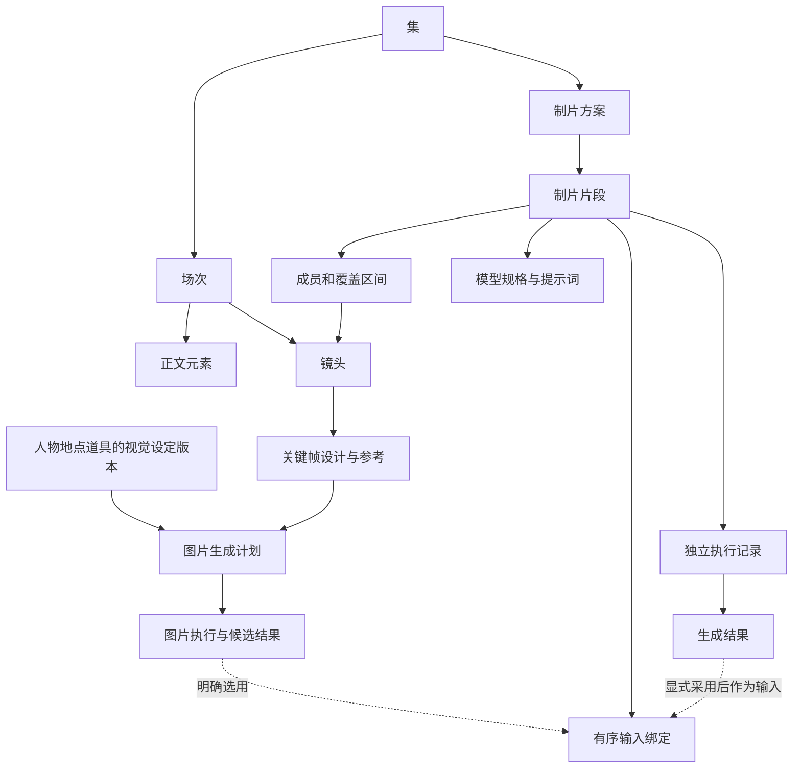
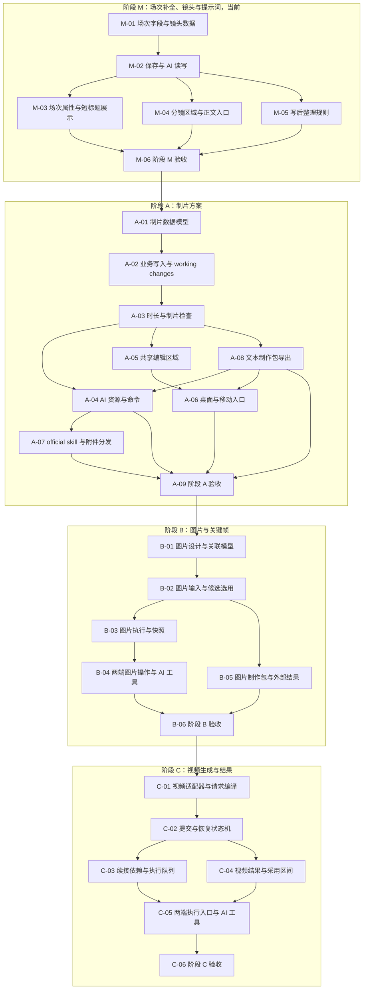

# 剧本、分镜与制片一体化方案

> 状态：方案草案，未实施。
> 日期：2026-09-10。
> 依据：[AI 短剧 Skill 研究](../research/ai_short_drama_skills_research.md)、当前剧本编辑器与 AI 工具实现。
> 范围：制片方案是本方案的正式组成部分，包括请求编排、模型规格、提示词、参考素材、执行快照和结果回收。
> 实施分期：当前先完成场次字段补全、镜头与提示词展示，再补完整制片方案，之后接图片与关键帧、视频执行。完整设计范围不等于当前开发范围，尚未实施或批准上线。
> 修订 2026-09-10：按当前代码核对后修正五处——场次顺序是派生值不新增列、空间取值属于 scene_heading 元素、镜头不带 `season_id`、场次标题与目标时长明确归入 M 阶段，以及分镜改为与场次平级的工作区区域而非正文内的页签。

## 1. 背景与目标

用户提供的《东门危机》样例同时包含整集目标、场次信息、15 秒全景、4 秒反应特写，以及摄影、声音和生成关键词。现有剧本能保存动作、人物、对白和注释，但无法明确表达镜头、镜头计划时长，以及这些镜头如何组成一次视频生成请求。

本方案选择一个工作区、三个任务视图：**剧本、分镜、制片**。剧本保存故事事实，分镜引用正文并决定视听表达，制片方案把镜头转换成可检查、可导出、可执行的请求。

成功标准：

1. 用户能保留现有剧本，逐场拆镜，不需要重新建立人物、地点或大纲。
2. 一个场次包含多个镜头，每个镜头只属于一个场次；镜头有稳定身份、画面、摄影、时长和可独立保存、展示、编辑、复制的提示词。
3. 同一镜头能拆成多个制片片段，多个镜头也能组成一个制片片段；换模型不改变正文或镜头身份。
4. 计划清楚显示模型限制、所需参考、提示词、请求秒数和未解决问题，能导出供外部制作使用。
5. 执行使用准确输入的不可变快照；重复点击、断网和重启不会静默重复提交。
6. 上游改变时相关下游标记待复核，保留已有创作与结果，不自动覆盖。
7. 桌面、Android、iOS 使用同一内容模型和工具契约，分别提供可操作的布局和文件入口。
8. official skill 能完成对应写作、分镜、计划与审查任务，确定性规则由软件执行。

不纳入本方案的产品能力：完整非线性剪辑器、音频混音台、自动评判成片是否好看、全剧批量无人值守生产。生成结果的采用区间与外部剪辑交付要有数据出口，但不在创作编辑器中实现视频轨道剪辑。

### 1.1 与已有方案的关系

[剧本写作第一期](screenplay-writing.md) 将分镜列为第一期非目标，本方案是其新增阶段，不修改第一期已交付的正文语义。该旧文档的部分状态早于当前实现；实际结构以当前代码为准。

保留以下现状：季与集结构、人物和地点复用、整集正文编辑、稳定元素 ID、场次级正文审阅、当前作品写入边界、跨作品只读。尤其不能为了增加镜头，把现有 `ScreenplayBeats` 改成镜头或正文动作拍。

### 1.2 关键假设

| 假设 | 不成立时的影响 | 设计应对 |
| --- | --- | --- |
| 作者可能先写剧本，也可能直接带制作稿进入 | 单一向导会迫使用户重做工作 | 允许从现有正文或分镜材料进入，映射先预览，保留原文 |
| 视频模型的请求时长、参考能力和方言会变化 | 固定一镜一请求或固定 15 秒会不断返工 | 镜头、制片片段、模型规格分开，执行冻结规格版本 |
| 用户可能在外部工具生成媒体 | 强依赖应用内执行会阻断创作 | 同一个制片方案支持导出、结果导入与应用内执行 |
| 模型不保证精确遵守切点和动作 | 请求成功容易被误认为分镜完成 | 计划时刻与实测结果分开，结果初始为未审阅 |

### 1.3 完整方向与首批建议

完整产品方向是“剧本 → 分镜 → 制片方案 → 图片与视频结果”，所有阶段使用同一份故事、镜头身份与来源关系。

**当前先做场次补全、镜头与提示词。** 用户能在已有场次上补齐短标题、目标时长、情绪与事件，为跨内外的连续行动选“内外”，并在场次下建立文字镜头、填写镜头描述与时长，保存、展示、编辑、复制每镜的提示词。不要求先创建制片方案、ProductionClip 或模型规格，不依赖图片和实际生成能力。

场次四个字段放在 M 而不是更后面，是因为它们决定场次在列表与分镜分组里能不能被区分。一集里大量重复地点是常态——某部样例第 1 集 13 场里，“萧家迎客大厅”连着三场、“萧家后山”三场、“萧炎房间”两场——只靠地点标题读不出哪场是哪场，而分镜正是按场分组挂镜头的。分镜列表可用的前提是场次先能被认出来。

完整制片方案保留为下一阶段：把镜头编成片段、指定模型规格、组织请求级提示词和导出制作包。镜头提示词独立交付后，下一阶段继续复用同一套镜头数据。

图片与视频生产在本文完整定义，但不成为首批的必需依赖：

| 阶段 | 用户得到什么 | 该阶段无需具备什么 |
| --- | --- | --- |
| M：场次补全、镜头与提示词（当前） | 场次的短标题、目标时长、情绪与事件、“内外”取值；场次下的文字镜头、时长、单镜提示词的保存、展示、编辑与复制 | 制片方案、ProductionClip、模型规格、图片与媒体生成 |
| A：制片方案 | 镜头的 `purpose` 与摄影三字段、请求编排、模型规格、请求级提示词与文本制作包 | 图片库集成、图片生成、视频执行、媒体结果管理 |
| B：图片与关键帧 | 视觉设定版本、参考图导入、关键帧出图、候选选择与图像输入绑定 | 视频供应商执行或剪辑器 |
| C：视频生成与结果 | 根据原有计划提交视频、续接、回收结果、审阅和外部剪辑交付 | 应用内完整视频剪辑时间轴 |

M 阶段不显示制片入口或要求配置模型；A 可以保留“这个镜头需要什么参考”的文字说明，但不能把说明显示为已有图片。B、C 未交付时不显示不可用的上传或生成操作。各阶段的资源 schema 随功能发布做静态扩展，不按当前用户或运行状态动态裁剪。

## 2. 核心决策

### 名称约定

| 对象 | 模型名称 | 界面名称 |
| --- | --- | --- |
| 一集的一套制片安排 | `ProductionPlan` | 制片方案 |
| 方案中准备一次生成的内容 | `ProductionClip` | 制片片段，制片区域内简称“片段” |
| 片段与镜头的关联 | `ProductionClipMember` | 成员镜头 |
| 一次实际执行 | `GenerationJob` | 生成任务 |
| 一次执行或外部制作的产物 | `GenerationResult` | 生成结果 |

工作区区域名统一为“剧本 / 场次 / 分镜 / 制片”，分镜与制片是新增的平级区域（见 §3.1）。`ProductionClip` 表达可编辑的制作安排，可以关联多个镜头，也可以覆盖一个镜头的一部分；实际媒体文件属于生成结果。图片生成计划保留 `ImagePlan`，不因统一制片命名而与视频片段合并。

| 方案 | 结果 | 决策 |
| --- | --- | --- |
| 场次与镜头合成一个对象 | 小样例录入快，但切镜会改变剧情组织，公共资料重复 | 不采用 |
| 场次下直接保存供应商视频请求 | 一镜一生成容易实现，但换模型、拆段和重试改变故事结构 | 不采用 |
| 剧本、镜头、制片方案分层，共用工作区与引用 | 支持不同创作入口和生成粒度，额外成本是来源与版本管理 | 采用 |

具体决定：

- 正文是逐字台词和故事事件的唯一可编辑真源。
- 每镜的提示词直接保存为镜头 `prompt`，不放在场次上，不需要通过制片方案才能使用。
- 人物和环境如何变化写在剧本正文中，不在镜头或制片片段重复维护起始、结束状态字段。
- 场次参照 chapter 增加 `emotion` 和 `events`；编辑、审阅与撤回统一使用现有 working changes，不增加独立的业务修订计数器。
- 镜头直接保存所属场次，在场次内排序；整集按场次顺序展示各场镜头，场序与镜号都是派生值（见 §4.2）。不支持一个镜头关联多个场次，不建立独立的正文片段来源表。
- 场次空间选项支持“内”“外”“内外”。连续从门外跟到门内可作为同一场次，选择“内外”，具体空间变化写在环境与动作描述里。
- 每集可以有多个命名制片方案，例如不同模型版本或不同分组方案；首个计划由用户开始安排生成时创建，不在开集时预建。
- 一个制片片段代表一次请求的编排意图；每次正式提交建立独立执行记录，结果属于该次执行。
- 创作可以没有目标模型；制片方案草稿也允许规格不完整。只有声明可执行时才要求能力、参数、素材和提示词闭合。
- 固定 ID 与当前展示序号分开；插入、重排、改名不更换 ID。
- 没有输入不能记为通过，没有媒体不能记为已生成，没有审阅不能记为可采用。

## 3. 用户体验

### 3.1 分镜是与场次平级的区域

继续复用季、集、场次上下文。现有大纲、结构节拍与资产入口保留。分镜不做成正文区域内的页签，而是**照现有场次区域新增一个平级区域**，制片将来同样如此。这样既不往主导航塞一套制作系统，也不在正文区域内部再叠一层视图状态。

| 区域 | 默认展示 | 次要信息 |
| --- | --- | --- |
| 剧本（现有） | 场次标题、出场人物、环境与动作、角色与对白 | 场次头行尾的分镜入口与情绪 badge；点场次头开场次属性 |
| 场次（现有，M 扩展） | 场次清单、事件短标题、地点、内外景、时间、梗概 | 出场人物、情绪摘要、统计、排序与增删；完整事件与目标时长在场次属性里 |
| 分镜（M 新增） | 按集列出各场，场下挂镜号、短标题、时长、画面描述、提示词入口 | 摄影、关键帧、参考 |
| 制片（A 新增） | 方案选择、目标模型、片段列表、准备问题 | 每段镜头成员、请求时间、参考顺序、提示词、执行与结果 |

分镜区域的作用域与场次区域一致：按当前集列出全部场次，每场下面挂它的镜头。这与 §4.2 的整集镜号按集派生一致，也便于跨场查看节奏。

镜头有两个入口，都指向同一个共享编辑区：分镜区域的列表，以及剧本正文里场次标题上的“分镜”入口——后者打开该场镜头的弹窗，桌面用 `showDialog`、移动用 `showModalBottomSheet`，与现有场次标题编辑同一套写法。两个入口共用一份 widget 与一份保存路径，不各写一遍。

表格描述最终形态。M 新增分镜区域、正文弹窗入口和场次属性；A 新增制片区域；B 增加图片与参考操作，C 增加视频执行与结果。各阶段都在原位置扩展，不另开一套同名区域。

场次属性承载本次全部四个场次字段加“内外”取值：短标题、目标时长、空间取值、情绪标签、有序事件。它不是新建的一屏——桌面 `scene_dialog.dart` 与移动 `scenes_page.dart` 的 `_SceneEditSheet` 已经在做地点、内外景、阶段、节拍和梗概，M 在这两处各扩四项，不另开第二个场次编辑入口。事件支持折叠，避免这一屏被一长串事件撑开。

**入口是场次头本身，不再放编辑按钮。** 场次头是结构化元素而非自由文本——地点是地点实体的引用（属性里是下拉加“新建地点”），内外景是枚举——所以正文里这一行本就不可直接编辑，点它打开属性是最短路径。当前正文场次头右侧的编辑图标撤掉；场次列表整行、场次板卡片标题同样点即打开，都不额外放按钮。同一行里既有可点的标题、又有一个干同样事的按钮，是两个入口一件事。

正文场次头右侧只保留分镜入口一个按钮，悬停才露出但位置一直占着。

#### 镜头提示词

镜头描述下方提供可展开的“提示词”区域及复制按钮，支持就地编辑。默认不让长提示词占满镜头列表。为空时显示添加入口，不用镜头描述自动冒充提示词；内容可为空，也可以只修改提示词而不改画面描述。

```text
镜头 02 察觉危机                                  4秒
画面：达奚野抬头，眼神收紧……

提示词                                    [编辑] [复制]
近景特写，人物猛然抬头……
```

复制只复制提示词正文，保留换行，不拼接标题、时长或内部字段。编辑沿用现有保存与 working changes；失败保留本地输入，清空提示词也是有效修改。无需选择 Provider、模型或准备参考图才能填写和复制。

正文与镜头按场次提供双向定位：“查看原文”进入所属场次，“查看分镜”进入该场镜头列表，不定位到具体字句。切换区域保留各自滚动位置、选中场次、镜头和计划。分镜与计划无需跟随正文滚动持续重排，只在用户定位或明确切换作用域时移动。

#### 场次标题不进正文

场次 `title` 是 M 新增字段，与长梗概分开；为空时用现有地点标题展示，不从梗概自动截取并永久写回。

它只出现在按场次组织的界面上：场次列表（第二列与场次区域）、分镜分组头、出场矩阵列头、场次属性。这些位置显示事件短标题，地点、内外景和时间为次行。

**剧本正文不显示 `title`。** 正文的场次头保持 `场号、地点 时间/内外` 不变，理由有两条：正文是标准剧本格式的载体，§9.2 的制作包里 `screenplay.md` 要交给外部制作使用，多一个自造字段就不再是标准剧本；而 `title` 本身是纯展示字段，不参与镜号、排序或 AI 逻辑，纯导航标签不进内容真源。作者在正文里定位某一场靠左栏场次列表跳转，那里有 `title`。

因此也不存在“正文里显示但导出时剥掉”的中间形态——正文里的**文字**，编辑器所见与导出内容必须是同一份。

#### 情绪 badge 可以进正文

`emotion` 与 `title` 的结论相反：它显示在正文场次头的行尾，与分镜、场次属性两个入口同属一块界面元件。这一块整体不可编辑、不可选中、不可复制，也不进导出。

两者待遇不同不是双标，差别在于会不会被读成稿子：短标题是与地点同级的一段中文，插在场次头里就是正文的一部分，读者和导出都无法分辨；情绪是 sans 字体的小号 accent chip，与正文的衬线排版完全不同形，一眼看得出是界面而不是稿子。判据是“它看起来像不像正文里的字”，不是“它要不要显示”。

作者写正文时最需要知道的是这一场是什么调子，所以情绪常驻显示；分镜与属性两个入口是动作，悬停才露出，但位置一直占着，避免鼠标扫过时整行位移。

情绪不进场次导航列表（当前实现里的第二列）：那一列约 230 宽，职责是跳场次，加 badge 会把场次名挤到看不见。情绪在正文、场次列表、场次板和分镜分组头这四处显示，已经够用。

#### 空间取值“内外”

空间选项新增“内外”，用于一场戏同时覆盖室内与室外的连续行动。保留现有未指定状态；“内外”是明确选项，不等同于未填写。它保存在该场 scene_heading 元素的空间取值上，与地点、时间同级；镜头通过所属场次的标题元素读取，不在镜头或场次表中再存一份，也不因切换内外空间自动拆场。

“内外”随 M 交付，与场次四字段同批——它同样是正文场次头与场次列表上的展示口径，分开做会让同一行标题在两个版本里改两次。

### 3.2 样例映射

以下为作者采用映射后的展示示例；导入过程不能自动合并用户已命名的段落。

```text
EP01 东门危机                                      目标 1分30秒

场次 01 东门遇险 · 东门外与门洞 · 内外 · 早晨
  镜头 01 东门全貌                                  15秒
  镜头 02 察觉危机                                   4秒

制片方案 A
  片段 01：镜头 01 的前一部分
  片段 02：镜头 01 的后一部分，接续段 01 的结果
  片段 03：镜头 02
```

如果目标模型支持 15 秒镜头，可将前两个制片片段改为一个；这只修改制片方案。若目标模型支持多镜头请求，也可把合适的连续镜头编成同段，界面展示各切点。产品不预设上述任一种能力已被某供应商支持。

### 3.3 制片片段编辑

默认从用户选中的连续镜头创建制片片段；已存在多个场次或顺序跳跃时给出可见说明，不静默重排。编辑区按任务顺序展示：

1. 镜头成员及各自覆盖区间。
2. 请求中的镜头位置与段间续接方式。
3. 目标模型和本段有效参数。
4. 有序参考素材、用途及是否实际可读。
5. 提示词正文与需要逐字保留的台词。
6. 准备检查、导出、生成入口和历次结果。

镜头计划总时长、请求总时长分别显示。模型只接受更长请求时，用户可以明确添加起始或结束保持区间，也可以重新编排；界面直接显示差额，不自动拉长镜头计划。

“预览请求”是查看当前准确请求的入口。用户从该预览执行一次或一批明确请求；授权范围可覆盖整批，不要求逐镜反复确认相同内容。未请求生产的普通创作操作不插入生产确认流程。

### 3.4 双端布局

桌面分镜和制片片段使用纵向可重排列表，详情在主区域内展开。宽屏可并列查看正文来源；窄屏改为来源定位入口。首版不默认用横向卡片墙承载主要编辑。

移动端采用单列列表和独立详情页，底部提供保存状态及本段操作；长提示词可全屏编辑。两端都能编辑成员、区间、参数与参考顺序，不能把移动端做成只读列表。

若添加横向镜头预览带，遵循 `HorizontalWheelScroll` 规则；仅作为只读辅助的横排提供滚动条或翻页按钮。已有内容刷新时保留布局、筛选、选择和滚动，不插入挤动内容的加载横幅。

## 4. 领域关系与数据真源



内容依赖方向为“正文 → 镜头 / 视觉设定 → 制片方案 → 执行 → 结果”。图片作为视频参考时，引用明确选用的图片结果；视频续接引用较早制片片段的明确结果。所有图片与视频输入依赖共同检查无环，不能出现某段视频依赖的首帧又等待该段视频生成。结果不会自动回写或改变原镜头。

第 4 至 11 节描述最终模型。M 只实现镜头及提示词所需部分；A 再加入制片方案、成员、规格与文本快照；图片计划、文件绑定、job 和媒体结果按 B、C 引入，不提前创建空表或运行服务。

### 4.1 正文沿用现有元素

环境与动作描述统一使用现有 `action` 元素，包括风声、车轮声等环境细节。保持现有正文类型、排版、统计和读写契约，不新增元素类型或专门的环境子字段。

设计镜头或编写提示词时，读取所属场次的正文及人物信息；台词以原正文为准，不维护镜头专属的可编辑台词副本。镜头与制片方案是独立业务对象，不加入正文 element 枚举。

#### 场次的四个新字段

场次参照现有 chapter 的字段结构，在 M 阶段新增以下四个字段。当前 `ScreenplayScenes` 只有梗概、阶段、统计与生命周期，这四项都不存在，M-01 必须一次加全：

| 字段 | 内容与用途 |
| --- | --- |
| `title` | 事件短标题，用于场次列表与分镜分组的显示名；纯展示，不参与镜号、排序或 AI 逻辑，为空时回退显示地点标题。不进剧本正文，见 §3.1 |
| `target_duration_seconds` | 可空的本场目标秒数，语义同集级 `targetDurationSeconds`；与文本估算、镜头计划时长互不覆盖 |
| `emotion` | 情绪标签数组，描述本场正文的主导情绪，例如“紧张”“警觉” |
| `events` | 按本场事件发生顺序保存的列表；每项包含 `title`、`summary` 和可选的 `state_change` |

事件项内的 `title` 点明该事件，`summary` 概述发生了什么，`state_change` 说明事件造成的变化；它与场次自身的 `title` 是两个层级的字段，不要互相回填。情绪与事件属于场次，镜头通过所属场次读取，不在每镜复制一份。沿用 chapter 的字段解析和存储约定，包括 `emotion` 的字符串列表与 `events` 的 JSON 列表 converter，但不照搬章级事件数量建议，也不顺带新增 `brief`、`tension` 或其他字段。

`title`、`emotion`、`events` 三项均为写后整理：由“故事连续性维护”根据本场完整正文提取，作者可校正，修改进入现有 working changes。`title` 纳入写后整理而不是只靠手填，是因为它与 `events` 每项的 `title` 是同一类产物——用一句话点明发生了什么，提取逻辑现成，差别只在一个描述整场、一个描述单个事件；而一个纯展示、无逻辑、可空的字段如果只能手填，实际结果多半是整部剧都为空，最后全部回退成地点标题，等于没加。`target_duration_seconds` 不属于写后整理，它是作者的创作意图，只手填。

场次梗概继续表达该场的概括或创作意图，情绪与事件不能根据未写入正文的大纲冒充已发生事实。返工后重新核对，旧整理结果在重做前保留并提示待核对。

场次属性展示并编辑这四项加空间取值，事件支持折叠；正文页不强制插入一组表单。列表展示 `title` 与情绪摘要，完整事件只按需读取，沿用 chapter 避免重字段进入整棵目录查询的思路。桌面、移动端和 AI 读写使用同一结构。

### 4.2 镜头

新增 `ScreenplayShots`，每个镜头直接归属于一个场次：

| 字段 | 阶段 | 语义 |
| --- | --- | --- |
| `id`、`scene_id` | M | 稳定身份与必填的所属场次 |
| `episode_id` | M | 内部查询字段，由服务根据所属场次维护；不作为镜头工具的输入、输出或可编辑字段 |
| `sort_order`、`title` | M | 场内顺序与可编辑短标题 |
| `visual_description` | M | 这个镜头具体拍到什么 |
| `prompt` | M | 当前镜头的生成提示词文本，可为空；与画面描述分别保存，支持直接展示、编辑与复制 |
| `duration_ms` | M | 镜头时长，可空、正整数毫秒；未知不写 0 |
| `created_at`、`updated_at`、`deleted_at` | M | 生命周期；编辑记录、审阅与撤回复用 working changes |
| `purpose` | A | 这个镜头要表达的变化，供制片编排与审查引用 |
| `framing`、`camera_angle`、`camera_movement` | A | 景别、角度、运动的创作描述，不绑定供应商枚举 |
| `keyframe_description` | B | 图片阶段增加的冻结画面设计 |

阶段列是建表节奏：M 只落 M 行的列，A、B 行随对应阶段的 migration 追加。M 不实现摄影字段和 `purpose`，M-04 的编辑区与 M-06 的验收也不覆盖它们。

镜头的来源就是所属场次，不增加单独的来源关联对象，也不维护文字选区、偏移量或逐句映射。需要补充镜头如何表达这场戏时，直接写在镜头目的与描述中。

当前只设置一个 `prompt`，不拆成图片提示词、视频提示词等多个必填字段，也不自动从 `visual_description` 拼接生成。镜头描述用于创作阅读，提示词用于用户后续生成，两者可以分别修改；历史或新建镜头无提示词时保持空值。

`scene_id` 决定镜头归属，`episode_id` 只是为了不必先查出本集有哪些场就能按集过滤。创建或移动镜头、跨集移动场次时，由服务在同一内容库事务内同步维护，不能让它与实际层级不一致。它不出现在镜头资源的工具 schema 与记录返回中；按集、场筛选的查询参数仍按各自路径契约提供，不要求模型维护冗余字段。

不加 `season_id`。没有按季筛选镜头的功能，工具契约也只提供按集和按场查询；加上它只会把“跨季移动集”变成镜头表的一致性义务。冗余范围对齐现有 `ScreenplaySceneElements`（`scene_id` + `episode_id`），不发明第三种形状。

#### 镜号是派生值

整集镜号 = （该场的场序，镜头 `sort_order`），查询时派生，不落库。场序本身也不是存储字段：当前场次没有顺序列，场次顺序由该场 scene_heading 元素在整集元素流中的 `sortOrder` 决定，现有 `sceneNumber` 就是这样算出来的。因此按集列出全部镜头并编号时，排序要 join 到 scene_heading 元素；`episode_id` 能省掉找场的一步，省不掉排序这一步。

由此带来一个必须承认的行为：作者拖动正文元素改变了场序，镜号随之变化，镜头身份和归属不变。这不是错误状态，界面不提示复核，但 §8.1 的依赖表把它单列，避免实现时误判为数据不一致。

场次正文改变后，依据现有 working changes / 已提交修改记录提醒该场已有镜头重新检查；不为场次或镜头另加修订号。首版接受按场次提示的粒度，不自动判断某一句变化只影响哪一个镜头。

从门外跟到门内的连续镜头仍只有一个所属场次。该场次选择“内外”，镜头描述交代相机与人物如何进入，不新建跨场关系。

### 4.3 参考设计与真实素材

新增 `ScreenplayShotReferences`，表达镜头希望保持什么，以及对应素材是否存在：

- `shot_id`、`ordinal`、`purpose`、`control_notes`。
- `source_kind` 为 `image_asset`、`generation_result`、`image_plan` 或 `external_plan`。
- 对应显式的 `image_asset_id`、`generation_result_id`、`image_plan_id` 或 `external_description`，互斥校验。`image_plan` 表示待完成的图片设计，不能当成文件输入。
- `purpose` 区分身份、造型、地点、道具、风格、构图、起始帧、结束帧。

人物、地点、道具身份继续引用现有实体；图片引用只表达视觉参考，不取代人物或地点关系。需要独立视觉变体时，使用明确的变体实体再关联，不依靠图片 `metadata` 判断它是哪个人物的哪套造型。

镜头参考表达创作需求，制片片段输入表达这一次请求实际送什么。两者通过稳定引用关联；编排请求时只选择需要的参考，不把该集全部角色图塞入每个请求。

#### 图片阶段的完整设计

图片包含两类对象，不混成一张泛用“参考图”：

| 类别 | 设计依据 | 使用位置 |
| --- | --- | --- |
| 视觉设定图 | 人物身份和造型、地点光照、道具状态 | 可复用于多个镜头，决定外观和空间 |
| 镜头关键帧 | 某镜头的构图、站位、起点或终点 | 服务具体镜头，决定视频从什么状态开始或结束 |

B 阶段新增 `ScreenplayVisualDesigns`：稳定 ID、类别、对应的 `character_id` / `location_id` / `item_id`、可空的 `variant_of_id`、名称、外观说明、状态说明与生命周期。编辑记录复用 working changes。实体引用按类别互斥；变体图不创建第二个人物或地点身份。

新增 `ScreenplayImagePlans`：稳定 ID、`source_kind`（`visual_design` 或 `shot_keyframe`）、对应 `visual_design_id` / `shot_id`、关键帧位置（`start` 或 `end`）、模型规格版本、图片尺寸、提示词及其采用的内容依据。计划编辑复用 working changes。每项是一份可反复生成候选的图片意图，实际执行另建 job。

处理流程：

1. 先保存剧本正文、文字视觉设定和镜头画面描述。关键帧从这些内容设计，不额外填写镜头起止状态。
2. 选择导入现有图片，或建立图片生成计划；不要求必须经过生成才能提供参考。
3. 图片计划选择本次参考、尺寸和提示词，核对是否只表达目标状态。
4. 明确执行后生成候选，成功结果进入现有图片库并关联该次 job。
5. 用户明确选用某个候选后，镜头或制片片段绑定准确图片资产和内容版本。

修改视觉设计不覆盖已生成图片；原图片标记来源已变化。再出图增加候选，不替换所有镜头正在使用的图片。把新候选应用到多个镜头时展示影响范围，未选择的镜头保留原绑定。

复用已有图片服务与图片库的上传、生成和持久化能力，新增剧本领域的设计与执行关联。不能仅凭图片 `batchId` 或 `metadataJson` 推断它属于哪个镜头；失败候选、选用结果和源版本使用显式关系。

### 4.4 制片方案与制片片段

新增 `ScreenplayProductionPlans`，每条记录对应一个 `ProductionPlan`：`id`、`episode_id`、`name`、`default_model_profile_key`、`default_model_profile_version` 及生命周期字段；计划修改进入现有 working changes。

新增 `ScreenplayProductionClips`，每条记录对应一个 `ProductionClip`：

| 字段 | 语义 |
| --- | --- |
| `id`、`plan_id`、`sort_order`、`title` | 片段身份、制片方案归属与展示顺序 |
| `model_profile_key`、`model_profile_version` | 本段采用的准确模型规格；创建时复制计划默认值，之后独立编辑 |
| `mode` | `text_to_video`、`image_to_video`、`reference_to_video`、`continuation`，由规格校验 |
| `request_duration_ms` | 请求秒数的毫秒表示，未知可空；不覆盖镜头时长 |
| `aspect_ratio`、`resolution`、`frame_rate`、`seed` | 通用参数；不支持或未指定时为空，不造默认值 |
| `prompt_language`、`prompt_text` | 提示词语言与当前可编辑正文 |
| `transition_notes` | 续接和段内切换说明；人物、环境和事件的变化以正文为准 |
| 生命周期字段 | 创建、更新与软删除；编辑和冲突检查复用 working changes |

计划默认参数只用于创建新段。修改默认模型时，显式选择是否批量应用到已有段并预览影响；不能让已有段的有效规格通过隐式继承突然变化。

新增 `ScreenplayProductionClipMembers`：`clip_id`、`shot_id`、`ordinal`、`shot_start_ms`、`shot_end_ms`、`request_start_ms`、`request_end_ms`。镜头与成员变化通过现有修改记录核对，不另存镜头修订号。

这张关联表明确两条时间线：

- 镜头覆盖区间说明本段负责计划镜头的哪一部分。
- 请求区间说明这部分画面在生成请求的哪个时间段内发生。

默认两者等长，不提供隐式变速。范围只能整组为空或成对完整；任一时长未知时保持草稿。成员区间不能重叠、越界或倒序，额外请求时间必须有显式保持区间说明。一个镜头分到多个段时可以分割覆盖；有意回放必须用显式说明，不能把重复覆盖视为全新进度。

新增 `ScreenplayProductionInputs`：所属制片片段 `clip_id` 或图片计划 `image_plan_id`（两者恰有一个）、输入顺序、用途、输入种类、对应图片或结果 ID、来源镜头参考 ID，以及可空的前置段 / 图片计划引用。图片阶段与视频阶段共用输入身份和用途约定，各模式允许的输入由规格校验。延后绑定的输入保存期望角色，不冒充真实文件。

表中引用、顺序、状态、时长和业务归属均为显式列。模型扩展参数若确有需要，使用按规格版本定义的 typed payload 和集中适配器解析，不引入任意 `metadata` 业务查询。

## 5. 时间与覆盖计算

### 5.1 六种时长互不覆盖

| 名称 | 保存 / 计算方式 |
| --- | --- |
| 集或场次目标时长 | 集沿用 `targetDurationSeconds`；场次的 `target_duration_seconds` 由 M-01 随 §4.1 的场次字段一并新增 |
| 文本估算 | 保留现有 `estimatedDurationSeconds`，注明来源于正文排版算法 |
| 镜头时长 | `duration_ms`，按镜头或所选范围汇总 |
| 生成请求时长 | 各段 `request_duration_ms`，可能包含保持余量或多次续接 |
| 素材实际时长 | 从媒体探测结果保存，未探测为空 |
| 建议采用时长 | 从结果的人工确认采用区间派生，不能称为整集成片时长 |

新时间区间统一用整数毫秒计算，显示为秒或分秒；现有整数秒字段在边界转换。请求适配器负责换算供应商单位与精度，不能静默四舍五入后宣称同一个请求。

完整镜头合计只统计一次镜头计划时长。不同制片方案、多个结果和重复试生成不累加成故事时长。计划覆盖采用镜头区间的并集，额外保持和重复覆盖单列，不把请求总秒数当完成比例。

### 5.2 成员示例

某镜头计划 15 秒，所选规格允许两次请求分别覆盖 8 秒与 7 秒：

| 段 | 镜头覆盖区间 | 请求中的区间 | 请求时长 |
| --- | --- | --- | --- |
| A | `[0, 8000)` | `[0, 8000)` | 8000 ms |
| B | `[8000, 15000)` | `[0, 7000)` | 7000 ms |

若 B 的规格只接受 8000 ms，可增加 1000 ms 结束保持。镜头仍为 15 秒，两个请求合计为 16 秒，建议采用内容为 15 秒。这个示例仅解释计算，不声明具体模型能力。

三个镜头为 3000、4000、5000 ms 时，可在支持段内切换的规格中组成 12000 ms 请求，切点为 3000、7000 ms。切点由成员请求区间计算，提示词编译与验证共用同一结果。

## 6. 模型规格与提示词

### 6.1 模型规格是可版本化能力描述

新增应用内 `GenerationModelProfile` 注册表，每项至少声明：

- `modality`（`image` 或 `video`）、模型标识、明确版本、适配器标识、规格版本、来源与核对日期。
- 支持的生成模式、是否支持段内多镜头、续接所需素材类型。
- 时长约束：离散值或最小 / 最大 / 步长，单位和精度。
- 画幅、分辨率、帧率的允许组合。
- 输入用途到供应商 role 的映射、数量与大小限制、互斥组合。
- 提示词方言、已知长度限制、是否接受结构化切点或只能文本表达。
- 能否按任务 ID 查询 / 取消，是否支持幂等提交与结果回收。

图片规格使用尺寸、画幅、张数和图片编辑模式等约束，不要求填写视频秒数或帧率；视频规格使用前述时长与续接约束。两者按固定 DTO 分支表达，不用一份到处为空的运行时动态 schema。A 阶段先交付用于视频计划的规格描述，B 接入图片规格与已支持图片生成链路。

不在这份方案里写入未经验证的 H3、Seedance 等当前上限。具体适配器上线前，按选定版本的官方资料和真实请求验证注册项。内置规格更新增加版本，不重写历史执行的规格快照。

用户可以建立只用于外部制作的手工规格，界面标明“用户声明，未验证”。此类规格可编排和导出，但不能自动变成应用内适配器可执行的能力。缺项时返回具体未知项，不猜测相近模型。

### 6.2 提示词保留编辑能力，派生片段由软件生成

镜头 `prompt` 服务单镜的独立展示与使用；制片片段 `prompt_text` 服务该次请求，可能需要整合多个镜头或只覆盖某镜头的一部分。后续编排可以参考镜头提示词，但不会自动反向覆盖它，也不把多个镜头提示词简单拼接当成已适配的最终请求。

当前阶段直接编辑镜头提示词即可。制片阶段的请求级提示词编写过程：

1. 读取本段成员、所属场次正文、镜头描述、镜头提示词与真实参考用途；人物和环境的变化从正文理解。
2. 计算请求内的镜头时刻和素材标签。
3. 按选定规格把这些内容组织成模型要求的请求表达。
4. 对逐字台词、切点、输入顺序和参数做确定性对账。
5. 通过 working changes 保存提示词及修改记录；作者可以修改创作措辞，核对使用的正文、镜头和参数是否仍然一致。

参数名、字段必填和类型写在静态工具 schema 中；提示词不包含内部 ID、数据库、hash、保存流程、审批标记或应用私有路径。参考图通过适配器要求的标签或输入 role 表达。

修改成员、时长、台词、参考顺序、模式或模型规格，旧提示词标记待复核，不自动覆盖。用户选择“刷新提示词”时查看差异并保留可撤回版本；纯改镜头展示标题不必使无关模型输入失效。

### 6.3 准备状态为检查结果

不要用一个手工维护的 `ready` 布尔值当真源。根据当前依赖得到：

| 状态 | 含义 |
| --- | --- |
| `draft` | 信息未齐，可继续编辑 |
| `needs_review` | 上游或规格已变，需要核对当前安排 |
| `waiting_inputs` | 依赖的参考或上一段结果尚未就绪 |
| `invalid` | 已知结构、引用或模型约束冲突 |
| `ready_for_export` | 外部制作所需说明完整，可以存在明确的外部挂图计划 |
| `ready_for_execution` | 有受支持适配器、真实可读输入和通过校验的准确请求 |

状态附带问题列表、对象位置和可执行修正；不把未验证项转换成通过。独立保存“创作审阅状态”，不能把结构准备就绪当成导演已认可。

## 7. 执行快照、重试与结果

制片方案在当前方案中完整设计。实际调用某视频供应商属于该适配器的交付范围；没有适配器时仍可完整编辑、校验、导出和导入结果，不展示可点击但必然失败的生成按钮。

### 7.1 一次执行对应一份不可变请求

新增 `ScreenplayGenerationJobs`：`id`、`modality`、`clip_id` / `image_plan_id`（按模态恰有一个）、`mode`、`provider_id`、`model_key`、`profile_version`、`request_fingerprint`、`parent_job_id`、状态、远端任务 ID、错误类别、时间戳，以及 typed `request_snapshot`。B 先实现图片分支，C 增加视频分支；图片生成不需要先造一个制片片段。

快照包含明确版本的模型参数、最终提示词、有序输入与内容摘要；视频快照另含成员映射和正文依据，图片快照另含视觉设计或关键帧来源。采用固定 DTO 与 TypeConverter；用于路由、查询和状态判断的字段保留显式列，不从任意 JSON metadata 推断。

快照不含凭据。Provider 关联只表示执行账户配置，密钥在调用时通过既有凭据路径读取。输入文件需要不可变本地副本或内容寻址引用，避免预览后文件被替换；重新生成的图片产生新资产或结果引用。

生成前核对当前内容与预览快照一致，原子地建立待提交记录并取得该次提交的唯一权利。多次点击同一预览只得到同一 job；再次试生成是明确新建的 job，可指向 `parent_job_id`，不能复用旧成功记录覆盖结果。

### 7.2 状态机与未知结果

```text
prepared -> submitting -> running -> downloading -> available
                  |           |             |
                  v           v             v
           submission_unknown failed    retrieval_failed

prepared -> cancelled
running -> cancel_requested -> cancelled / running / available
```

- `submitting` 前先持久化 job 与快照，发请求不放进数据库事务。
- 收到远端任务 ID 后立刻保存；程序重启后优先查询该任务。
- 请求可能已被接收但客户端超时时进入 `submission_unknown`。有幂等键或查询能力时核对原请求；没有可靠核对方式时保留未知状态，不自动再发一遍。
- `retrieval_failed` 只重试下载已有结果，不重新生成。
- 明确失败后再次生成建立新 job，UI 说明是新请求及费用含义。
- 取消请求不等于远端取消成功或不会计费；保存真实返回，取消后的迟到结果仍可关联原 job。
- 轮询可退避重试，但提交重试必须遵守适配器幂等契约。未知提交不走通用 AI 自动重试 hook。

新发请求需要符合用户已经授权的范围。授权可以覆盖一次完整、具体的批次；批次中未变更的成员不重复询问。输入、参数或预计费用实质变化后重新预览受影响部分，不能把旧授权无限扩展。

### 7.3 续接与批量运行

视频续接依赖必须指向同计划的前置段；图片准备依赖可以引用本作品可访问的图片计划。两类依赖共同验证无环。对每项请求区分本次已绑定的真实输入，以及待前项完成后才能绑定的结果角色。

前段产出多个候选时不猜测后段使用哪一个。默认等待用户选择；若用户已经授权按明确规则选择，则记录实际命中的结果。后段只有在实际视频、尾帧等必需输入齐备后才冻结请求。重新选择前段结果只使未提交后段需要重新准备，已运行的 job 继续保留原快照。

一批运行只提交用户选定且依赖满足的段。前段失败阻塞依赖它的段，独立段可以继续。默认每 Provider 同时提交一个新生成请求，查询和下载分开管理；具体适配器验证限额后才能提高提交并发。

首版执行队列由单设备持有，不宣称关闭应用后仍能提交或支持多设备共同调度。重新打开时恢复已知任务查询。要支持跨设备后台调度，需要单独设计后端执行租约与账户边界，不能仅把本地状态同步过去就开启第二个执行者。

### 7.4 结果与采用

新增 `ScreenplayGenerationResults`：`id`、`origin`、可空的 `job_id` / `export_snapshot_id`、快照内来源条目 ID、候选序号、媒体类型、对应图片资产 ID 或应用托管的媒体相对路径、MIME、大小、摘要、实测时长、宽高、帧率、可读状态、审阅状态、建议采用入出点及说明。应用内结果引用真实 job；外部结果引用导出快照；未绑定导入不伪造任一来源，绑定完成前不能作为已核对结果使用。

图片结果绑定 `ImageAssets`，时长、帧率与采用入出点为空；视频结果绑定真实视频并按探测结果填媒体字段。图片可在 B 阶段独立审阅和选用，不依赖视频能力。

`available` 只表示文件下载或导入完成且可读取；审阅状态独立为 `unreviewed`、`accepted`、`rejected`。只有成功探测才填实际时长，不能从请求时长补值。

用户可导入外部生成结果，必须选择对应导出版本或具体请求快照。没有可信版本关联的文件可以保存为未绑定素材，不能自动挂到当前最新段。外部执行结果不虚构应用内 Provider 请求 ID 或计费记录。

首版建议采用区间只作外部剪辑交付信息，按真实文件毫秒范围验证。总成片时长必须在有完整剪辑时间轴后计算，不能从候选素材或请求时长相加得到。

## 8. 修订、审阅与删除

### 8.1 依赖失效

| 改动 | 应受影响内容 | 不应发生 |
| --- | --- | --- |
| 修改场次正文 | 该场镜头待复核，使用这些镜头的制片片段提示词待复核 | 自动改写所有下游、丢弃历史结果 |
| 移动正文元素或拆场 | 受影响场次的镜头待复核；拆场后由作者指定需要移到新场的镜头 | 按文字选区猜测镜头归属 |
| 移动正文元素改变了场序 | 镜号按新场序重新派生 | 把镜号变化当成数据不一致、提示复核，或把派生镜号写回镜头 |
| 合场或移动场次、跨集移动场次 | 保留镜头 ID 与相对顺序，事务内同步所属场次及内部 `episode_id`；原制片方案检查归属 | 镜头同时属于两场、`episode_id` 与实际层级失配，或制片片段悄悄改为另一集 |
| 修改镜头时长 | 该镜头在各计划的成员区间、切点和提示词检查失效 | 默默拉伸区间或覆盖目标时长 |
| 修改模型或参考顺序 | 本段参数、标签、模式与提示词重校验 | 静默改为文生视频或换一张图 |
| 修改图片文件或选择新结果 | 相关未执行段重新准备 | 改变已执行快照引用的字节 |
| 修改当前段 | 旧 job 和结果仍对应旧版本 | 用当前提示词解释过去结果 |

依赖检查在读取详情与执行准备时重新计算，编辑事件仅用于及时刷新。这样即使缓存通知丢失，也不会把陈旧段当作可执行。

### 8.2 保存与 AI 审阅

沿用项目已应用、可退回的 working overlay 语义，不能把待审阅描述成未写入的隔离草稿。正文继续按场次审阅；新增镜头以单镜为审阅单位，制片片段以单段及其成员和输入绑定为一个原子审阅单位。

镜头、视觉设计和制片方案不新增独立修订计数器，统一接入现有 working changes 及提交历史。场次情绪、事件分别作为可修改字段接入同一机制，不与正文混成一份不可分开的撤回内容。

模型规格版本和导出格式版本仍用于识别外部契约；执行 / 导出快照只记录实际交付内容，不是另一套编辑版本系统。即使旧 working changes 按既有保留策略归档或清理，已有请求的实际输入也不能因此丢失。

多个 AI session 修改同一单位时使用现有所有权与版本冲突机制。局部文本编辑仅改目标字段；重排、拆镜、并镜及制片片段成员替换，先读取完整范围，再通过事务提交。用户手动保存与 AI 待审阅合并的行为须与既有文档保存一致。

撤回正文不会自动删除后续镜头，而是重新计算依赖状态；撤回镜头修改也不删除已经运行的 job。恢复依赖到相同内容可以消除版本差异，但结构通过仍不替代已要求的语义复核。

### 8.3 软删除与正在运行任务

- 删除镜头软删除镜头及当前关联，计划成员保留可诊断的失效引用，要求用户修订或移除；不自动重新分配给邻近镜头。
- 删除场次时，所属镜头一并软删除并保留原关联，撤销时一起恢复；相关制片方案提示镜头已归档。执行记录、结果和共享素材不随之删除。
- 删除计划或段不删除已执行的请求、素材或共享图片；后台已提交任务仍要收尾查询并归档结果，除非用户另行取消。
- 删除整个作品沿用现有作品生命周期，运行任务的取消 / 收尾必须纳入编排；不得新增隐式硬删除。
- 历史结果与来源快照按归档关系可追溯；物理清理不在本方案授权范围内。

## 9. 存储、导出与跨平台

### 9.1 数据库边界

镜头、关联、制片方案、段、导出快照、视觉设计、图片计划、输入、job 和结果索引随对应阶段保存在作品内容库。现有图片库 `ImageAssets` 在主库，新关系使用应用层受校验的图片资产 ID，不声明不存在的跨数据库外键或事务。

素材导入顺序：先通过平台适配取得应用可读副本，完成文件写入和图片 / 媒体登记，再在内容库建立引用。后一步失败时保留已成功导入的素材并报告“素材已导入，关联失败”，可按操作 ID 重试关联；不能误删共享资产作为补偿。

导出先收集内容与媒体引用，检查缺失，再复制到本次专用临时目录；成功后交给系统保存或分享。取消和失败仅清理本次创建的临时副本。Android SAF URI 和 iOS 授权 URL 不作为普通文件路径直接读写。

### 9.2 制作包

制作包按交付阶段递进：A 只含文字剧本、分镜、计划、提示词、中立请求描述与版本清单；B 增加真实参考图及媒体清单；C 增加执行、结果和建议采用区间。A 的包是人工制作资料，不宣称包含全部图生输入或可一键执行。

A 阶段新增 `ScreenplayProductionExports` 保存不可变导出快照：稳定 ID、作品内计划 ID、格式版本、typed 内容快照、创建时间及交付状态。文本包据此渲染，B、C 导入外部结果时仍能找到准确的导出内容；不能为保存导出历史而提前创建假的生成 job。系统保存面板取消或失败时，记录未交付，不能宣称文件已送达；重试可继续交付同一快照。

导出格式采用版本化 manifest，第一版 `format_version: 1`：

```text
制作包/
  manifest.json
  screenplay.md
  storyboard.md
  plan.md
  clips/<稳定片段ID>/prompt.txt
  clips/<稳定片段ID>/request.json
  references/<文件内容摘要>.<扩展名>
```

manifest 至少含作品和集的稳定标识、计划 ID、导出快照 ID、规格版本、制片片段顺序、成员区间、输入顺序与用途、文件摘要、未满足的外部准备项。文件名使用稳定 ID，用户名称只作展示；不包含 Provider 密钥、本机绝对路径或系统授权 token。

有外部挂图计划时导出“人工制作包”，列明缺少哪些项目内文件；该包不能声明可由应用自动执行。完全可执行的包必须所有必需输入可读，或有明确的前置结果依赖契约。`request.json` 采用本方案中立 DTO，除非已经选择并验证适配器，否则不伪装成供应商 API payload。

修改计划不会更新过去导出的包。导入结果时选择导出快照，即使当前计划版本已变化也保留正确来源。

## 10. AI 工具与 official skill

### 10.1 保留现有工具名，增加静态资源契约

新增路径均为拟议契约，实施前加入统一 schema registry：

| 路径 | 能力 |
| --- | --- |
| `scenes/{id}/title`、`scenes/{id}/target_duration_seconds` | 场次短标题与目标秒数的读写；短标题可清空，清空后由展示层回退地点标题 |
| `scenes/{id}/emotion`、`scenes/{id}/events` | 参照 chapter 读写情绪标签和事件列表；正文写后整理及人工校正，不以梗概替代事实 |
| `shots?episode_id=...`、`shots?scene_id=...`、`shots/{id}` | 按集或场查询，镜头字段读写、场内排序和明确移场；创建时必须指定所属场次 |
| `shots/{id}/references` | 视觉参考；正文通过镜头的所属场次读取 |
| `production_plans?episode_id=...`、`production_plans/{id}` | 计划创建、命名和默认规格 |
| `production_clips?plan_id=...`、`production_clips/{id}` | 制片片段、参数、提示词和安排 |
| `production_clips/{id}/members`、`production_clips/{id}/inputs` | 请求成员区间和实际输入 |
| `generation_model_profiles`、`generation_model_profiles/{key}` | 只读能力与规格版本；支持按明确版本读取 |
| `visual_designs/{id}`、`image_plans/{id}` | B 阶段加入的视觉设计版本与图片生成计划，独立于制片片段 |
| `generation_jobs/{id}`、`generation_results/{id}` | 只读执行事实；结果审阅通过受校验操作完成 |

镜头资源的 `prompt` 随 M 阶段开放，使用现有 Read / Create / Write / Edit 路径读写，支持单独更新和清空。界面复制不调用模型，也不要求 `Run generation`。

继续使用 Read、Create、Write、Edit、Remove；制片阶段新增 `Run generation` 命令域承载 `check`、`prepare`、`submit`、`status`、`collect`、`cancel`、`export` 等有操作语义的步骤。业务状态不能通过普通 Write 任意设为成功。

A 交付 `check` 与文本制作包 `export`，不开放媒体提交；B 为图片计划加入执行操作，C 为制片片段加入执行操作。图片执行内部复用已有 `Run image` 对应的服务能力，不让 Agent 对同一请求分别调用两个入口而产生重复生成。

`submit` 必须消费与具体请求快照对应的授权记录；由用户操作或现有工具授权机制建立，模型不能自行写一个 `approved: true` 绕过。重复提交同一授权返回既有 job；新试生成建立新请求。异步取消和回收返回实际状态，不冒充新生成。

所有 schema 一次定义，不能按当前模型、素材数量、草稿状态或平台裁剪。模型能力通过只读资源返回，运行时校验参数并报具体错误。路径说明和工具 description 只讲调用所需边界、结果及跨字段关系，不复述参数清单。

建议错误分类：`source_changed`、`invalid_range`、`missing_reference`、`unknown_model_capability`、`unsupported_parameter_combination`、`dependency_cycle`、`waiting_for_result`、`submission_unknown`、`request_already_submitted`、`media_unavailable`。错误附对象路径与可操作原因。

### 10.2 官方技能分工

| Skill | 读取 | 写入 | 边界 |
| --- | --- | --- | --- |
| 短剧写作 | 集意图、正文、必要人物与设定 | 场次、环境与动作、对白 | 不直接写模型提示词 |
| 短剧分镜 | 当前正文、视觉事实 | 镜头、来源、摄影、关键帧设计 | 不静默改台词和故事结果 |
| 制片方案 | 镜头、目标规格、可用参考 | 段、成员区间、输入计划、模型提示词 | 准备完成不等于已获生产授权 |
| 视觉设定（B 阶段） | 人物、地点、道具、镜头的视觉要求 | 视觉设计版本、图片计划与选用绑定 | 不把文字设定当已生成图片，不自动替换已有选用图 |
| 短剧审查 | 用户选定层及直接依赖 | 带位置和证据的审查结果 | 结构通过不等于内容正确，不自动改源文档 |

场次写后整理继续由已有“故事连续性维护”负责，新增短标题、情绪与事件产出去向。当前 `references/screenplay.md` 明确禁止写场次的 emotion / events，该约束随 M 交付同步调整为允许 `title` / `emotion` / `events` 三项；`target_duration_seconds` 是作者创作意图，技能不写；brief / tension 等未纳入字段继续不写。无需新建另一份提取技能。

这条规则的调整属于 M 的交付范围，不能推到 A：M 落了四个字段却没有能写它们的技能，`title` 与情绪、事件就只剩手填一条路，等于交付了三个空列。

复用既有“剧本工具使用规范”和“故事连续性维护”；不另建同职责技能。A 通过现有角色、地点和物品能力理解视觉事实，B 随视觉版本与图片计划功能加入视觉设定技能。视频生成由执行工具承担，C 扩展制片方案技能的执行指引，不再新增一份重复编排技能。

主文保持目标、边界、入口和完成条件，按需 reference 包含对白、镜头连续性、时长安排、模型方言、引用与修订案例。官方目录 loader 需要完整携带 references，并将附件变化纳入版本 / hash 校验和升级测试。

## 11. 代码落点

这是一项超过 8 个文件、包含多个共享服务与 Orchestrator 的功能，不能直接往桌面页面 `build` 中追加逻辑。以下新增路径是拟议文件，不表示当前已经存在。

### 11.1 现有文件

- `lib/shared/database/novel_content_database.dart`：M 阶段为 `ScreenplayScenes` 新增 §4.1 的四个字段（`title`、`target_duration_seconds`、`emotion`、`events`）并注册镜头表；两者都合并进现有 v18 migration，不动 `schemaVersion`。情绪和事件复用 chapter 对应的现有 converter。空间取值改的是 `ScreenplaySceneElements.interiorExterior` 的 `customConstraints` CHECK，不在场次表加列。
- `lib/shared/database/novel_content_database_migrations.dart`：增量迁移与历史表重建核对。
- `lib/shared/database/type_converters.dart`：固定请求快照、规格快照的 typed converter。
- `lib/shared/models/screenplay.dart`、`screenplay_element.dart`：空间取值与校验支持“内外”；正文元素类型保持不变。
- `lib/shared/models/screenplay_document.dart`：场次定位、拆合场后的镜头归属与依赖检查入口。
- `lib/shared/database/novel_content_daos/screenplay_dao.dart`、`lib/shared/models/screenplay.dart`：场次详情读写情绪与事件；列表不携带完整事件正文，避免重查询。
- `lib/shared/services/screenplay_service.dart`、`screenplay_edit_orchestrator.dart`：更新场次目标、保持现有事务和撤销语义。
- `lib/shared/services/screenplay_metrics.dart`、`lib/shared/widgets/screenplay/labels.dart`：文本估算与秒级格式化，不混入生成请求统计。
- `lib/shared/widgets/screenplay/document_editor.dart`、`document_heading.dart`：场次标题上增加该场的分镜入口。弹窗照现有场次标题编辑的写法——同一个共享 widget，`actions.mobile` 决定走 `showModalBottomSheet` 还是 `showDialog`，并复用 `headingEditors` 那类回调挂点，不为两端各写一份。
- 加“内外”的真实成本在展示层，不在 schema。现有三处分支对未知取值的默认行为各不相同，而且全部静默，必须逐处改：

  | 位置 | 现有写法 | 不改会怎样 |
  | --- | --- | --- |
  | `lib/shared/widgets/screenplay/document_heading.dart:52-58` | `== 'interior' ? 内景 : 外景` 三元，且硬编码字符串而非常量 | 显示成“外景” |
  | `lib/shared/widgets/screenplay/labels.dart:78-83` | `switch` 带 `_ => ''` | 显示成空 |
  | `lib/mobile/features/screenplay/support.dart:48-51` | 两个 `if` 拼列表 | 显示成空 |

  连带要改 `lib/shared/services/screenplay_service.dart:1862` 的校验集、`lib/shared/models/screenplay.dart:21` 的 `screenplayInteriorExteriorValues`，以及 `lib/shared/models/screenplay_element_render.dart` 的文本输出。
- locale key `screenplay.interior_exterior` 已经是**字段标签**（中文“内外景”、英文“Interior / exterior”），用在 `scene_dialog.dart:151`、`document_heading.dart:341`、`scenes_page.dart:394`。新取值要用另一个 key，不要覆盖这个标签。
- `lib/shared/models/novel_workspace.dart`：桌面区域枚举 `NovelWorkspaceSection` 照 `screenplay_scenes` 新增 `screenplay_storyboard`（A 再加 `screenplay_production`），同步 `aiResourceType`、`aiResourcePath`（镜头返回 `/shots/{id}`）、`fromString` 与 `isScreenplayResource` 判定，缺一处就会在 AI 定位或快照回读时静默落空。
- `lib/desktop/widgets/workspace/novel_workspace_panel.dart`：在现有 `ScreenplayScenesRegion` 分支旁增加分镜区域分支，并补侧边栏条目、图标与 locale key。
- `lib/shared/models/screenplay_workspace_state.dart`、对应 provider：移动区域枚举 `ScreenplayWorkspaceSection` 新增同名成员，并增加镜头、制片方案、片段的本机定位状态。不再引入正文区域内的子视图枚举。
- `lib/mobile/features/screenplay/editor_page.dart`：区域标签表与区域到页面的映射各加一项，照 `MobileScreenplayScenesPage` 的结构新增分镜页。
- `lib/desktop/features/screenplay/script.dart`、`context_panel.dart`、`scene_dialog.dart`、`script_status.dart`：桌面组合与导航。
- `lib/mobile/features/screenplay/editor_page.dart`、`script_page.dart`、`scenes_page.dart`：移动组合、属性与定位。
- 共享场标题编辑、桌面 `scene_dialog.dart` 与移动 `_SceneEditSheet` 都新增“内外”选项，并在同一屏补上短标题、目标时长、情绪与事件；在现有 `interior` / `exterior` 之外增加第三个取值 `interior_exterior`（列名与取值同名，注意别读成新列），中文显示“内外”，英文与标准文本输出显示 `INT./EXT.`。AI 的静态资源 schema、Create / Write 校验与回读同步支持该值。
- `lib/shared/services/ai/tools_schema.dart`、`tools_screenplay.dart`、`tools_run.dart`：静态资源及命令路由；关联通用工具注册点同步更新。
- `lib/shared/services/working_overlay.dart`：接入镜头、制片片段及场次四字段的 apply / revert，复用现有修改记录与冲突检查；短标题与情绪、事件各自是可单独撤回的字段，不与正文混成一份。
- `assets/bundled_skills/story-continuity/references/screenplay.md`：参照 chapter 指南增加短标题、情绪与事件的提取规则，保留按场次定位及正文事实边界；目标时长不写。
- `lib/shared/services/bundled_official_skills.dart`、`pubspec.yaml`、`assets/official_skills/`：技能和附件分发。
- `lib/shared/localization/locale_keys.dart`、`assets/translations/en/screenplay.json`、`assets/translations/zh-CN/screenplay.json`：新区域名、时长口径、准备状态与执行错误文案。

### 11.2 新增文件分工

| 新目录 / 文件 | 职责 |
| --- | --- |
| `lib/shared/models/screenplay/shot.dart` | 镜头、所属场次、prompt 与参考模型；参考能力随图片阶段加入 |
| `lib/shared/models/screenplay/production.dart` | 制片方案、片段、成员、输入与导出 DTO |
| `lib/shared/models/screenplay/generation.dart` | 生成任务、请求快照与结果 DTO |
| `lib/shared/models/screenplay/model_profile.dart` | 版本化能力规格 |
| `lib/shared/models/screenplay/visual_design.dart` | B 阶段的视觉变体、关键帧图片计划与来源关系 |
| `lib/shared/database/novel_content_daos/storyboard_dao.dart` | 镜头与关联的窄范围查询和事务写入 |
| `lib/shared/database/novel_content_daos/generation_dao.dart` | 计划、执行与结果索引 |
| `lib/shared/services/screenplay/storyboard_service.dart` | 身份、场内顺序、场次归属与软删除约束 |
| `lib/shared/services/screenplay/generation_service.dart` | 计划和区间校验、准备检查、状态事实读写 |
| `lib/shared/services/screenplay/generation_orchestrator.dart` | 一次准备、提交、回收或取消操作的跨文件 / 网络 / DB 编排 |
| `lib/shared/services/screenplay/export_orchestrator.dart` | 制作包快照、文件收集、输出与临时副本清理 |
| `lib/shared/services/screenplay/model_profiles.dart` | 规格注册与版本解析，不含凭据 |
| `lib/shared/services/screenplay/generation_adapter.dart` | 供应商编译、提交、查询、回收与幂等契约 |
| `lib/shared/services/image_library_service.dart`、`lib/shared/services/ai/image.dart`（已有文件） | B 复用图片文件、生成与候选持久化能力，新增领域关联不藏入 metadata |
| `lib/shared/providers/screenplay/` | 按作品路径管理共享服务、窄范围查询与执行状态 |
| `lib/shared/widgets/screenplay/storyboard/`、`generation/` | 共用编辑区与显示组件，两端 shell 负责布局 |

Service 由 Provider 管理生命周期并通过构造注入依赖；Orchestrator 每次操作创建，输入通过方法参数传入。页内编辑态使用 Hooks / 现有表单库，跨页面选择与运行状态使用现有状态管理方式。

素材文件与内容库关联遵循第 9 节；不复用仅支持图片的表把视频标成图片，也不把跨库操作包装成一个假的事务。实现前完整读取被改文件的直接调用方、测试和命中的 UI、数据库及文件访问规则。

## 12. 交付顺序与迁移

### 12.1 当前交付与完整扩展阶段

**交付 M：场次补全、镜头与提示词，当前优先。** 场次侧新增 `title`、`target_duration_seconds`、`emotion`、`events` 四个字段与 scene_heading 的“内外”取值，交付场次属性这一屏、列表与分镜分组的短标题展示，以及故事连续性维护对短标题、情绪、事件的写后整理；镜头侧在场次下保存文字镜头、描述、时长和 `prompt`。两侧都提供双端展示、编辑、复制及 AI 字段读写，复用 working changes。这个交付独立完成，不需要制片方案、ProductionClip、模型规格、制作包导出或任何媒体能力。

场次与镜头放在同一批，是因为分镜按场次分组：场次在列表里认不出来，分镜列表就用不了（§1.3）。正文沿用现有元素，正文场次头不显示 `title`（§3.1）。

**交付 A：制片方案。** 在 M 的场次与镜头基础上，增加镜头的 `purpose` 与摄影三字段、制片片段编排、模型规格描述、请求级视频提示词、依赖变化提示和文本制作包导出，以及对应 official skill。编辑历史复用 working changes。图片需求仅作明确的文字计划；不要求集成图片库、不生成图片或视频、不导入媒体结果。用户能把完整制片资料交给外部工具，不重复创建 M 已有镜头或迁移镜头提示词的归属。

**交付 B：图片与关键帧。** 包含视觉设定版本、图片计划、上传和参考绑定、利用已有图片服务生成候选、图片执行快照、用户选用、真实图片制作包与图片结果导入。它直接服务角色一致性和构图准备，即使 C 未实施也能独立使用。上传已有图片与生成新图是两条同等有效入口。

**交付 C：视频生成与结果。** 包含明确选择并核验的视频适配器、请求预览和授权、幂等与未知提交处理、续接队列、结果回收和导入、审阅及建议采用区间。复用 A 的制片片段、B 的图片与执行基础，不再建第二套生产计划。每个适配器独立通过能力和实测验收后才显示可执行。

各阶段内部按“模型与事务 → 计算与校验 → 视图与工具 → official skill 和验收”完整交付。阶段发布时所承诺的流程必须可保存、修订和交付；模型扩展随对应能力实施，不为远期能力预建空表、空服务或不可操作入口。

### 12.2 Task Graph

下图是实施任务依赖，不是运行时模型关系。M 为当前最小交付，A、B、C 为后续完整扩展；每个阶段都可在后续阶段不实施的情况下独立使用。阶段内任务可分别提交，但必须通过该阶段的完整验收后才发布。所有任务当前均未实施。



依赖表示任务完成所需的输入。准备界面文案、测试用例等不依赖实现结果的工作可以提前进行；共享数据库、schema registry、working overlay 等文件的修改按依赖顺序整合，Flutter 测试始终串行运行。

#### 阶段 M 任务：当前先做

| 任务 | 依赖 | 改动范围与交付物 | 完成条件 |
| --- | --- | --- | --- |
| M-01 场次字段与镜头数据 | 无 | 内容库、migration、`screenplay.dart`、`shot.dart` 与场次 / 镜头 DAO；场次新增 §4.1 的四个字段（title、target_duration_seconds、emotion、events）与 scene_heading 的“内外”取值；镜头保存 §4.2 标为 M 的字段：scene_id、内部 episode_id、title、sort_order、visual_description、duration_ms、prompt 与生命周期 | 四个场次字段一次加全，不留到 M 的后续任务；情绪与事件复用 chapter 的 converter，不新增 brief / tension；“内外”改的是 scene_heading 的 CHECK，场次表不加列；镜头只属于一场，prompt 可为空且独立于描述；无 season_id、无摄影字段、无 purpose；不建制片、模型规格、图片或任务表；旧场次正文不变 |
| M-02 保存与 AI 读写 | M-01 | `screenplay_service.dart`、`storyboard_service.dart`、working overlay、场次 / 镜头 provider 与静态资源 schema；场次四字段与“内外”的读写校验；镜头创建、修改、场内排序、删除及 prompt 单独读写；按集列镜头时 join scene_heading 元素派生场序与镜号 | 手动和 AI 修改进入同一保存与审阅链路；短标题与提示词清空、撤回有效；场次列表查询不携带完整事件正文；工具不暴露内部 episode_id；镜号不落库；不要求模型配置或制片命令 |
| M-03 场次属性与短标题展示 | M-02 | 扩桌面 `scene_dialog.dart` 与移动 `scenes_page.dart` 的 `_SceneEditSheet`，补上短标题、目标时长、内外、情绪、事件；第二列场次列表、场次区域列表与场次板、分镜分组头、出场矩阵列头显示短标题并在为空时回退地点标题；“内外”逐处修掉 §11.1 点名的三处静默回退；i18n 新取值用新 key | 四个字段与“内外”在两端都可编辑、保存和撤回；短标题为空时回退地点标题且数据库仍为空；正文场次头不显示短标题，导出内容不变；三处展示分支没有一处回退成“外景”或空字符串 |
| M-04 分镜区域与正文入口 | M-02 | 共享镜头编辑区；`NovelWorkspaceSection` / `ScreenplayWorkspaceSection` 各加分镜成员，桌面区域分支与移动分镜页照场次区域新建；正文场次标题增加分镜弹窗与场次属性两个入口；i18n。描述下方展示可展开的提示词及编辑 / 复制操作 | 两端均可从分镜区域和正文弹窗两个入口新增、保存、展开和复制，且用的是同一份 widget 与保存路径；分镜区域按集列场、场下挂镜头且分组头显示短标题；复制仅含 prompt 正文并保留换行；空内容有添加入口；保存失败保留输入，无图片和制片依赖 |
| M-05 写后整理规则 | M-02 | `assets/bundled_skills/story-continuity/references/screenplay.md`：放开场次 `title` / `emotion` / `events` 的写入，参照 chapter 指南补提取规则并保留按场次定位与正文事实边界 | 三项都能由写后整理产出且作者可校正；`target_duration_seconds`、brief / tension 仍不写；不依据未写入正文的大纲冒充已发生事实；返工后旧结果保留并提示待核对 |
| M-06 阶段 M 验收 | M-03、M-04、M-05 | 场次与镜头服务、工具、working changes、写后整理与双端 UI 的最窄测试和手工流程 | 无制片方案、无 Provider 配置时完成“补场次短标题与情绪事件 → 创建镜头 → 写提示词 → 重开查看 → 修改 / 撤回 → 复制”；描述未被意外覆盖，正文未被改写；重复地点的场次在列表与分镜分组里可区分；拖动正文元素改变场序后镜号按新场序显示、镜头归属不变 |

**M 发布边界：** M-01 至 M-06 完成即可交付场次补全与镜头提示词能力，不等待 A。复制就是当前交付出口，不额外要求文件导出或实际生成；除故事连续性维护的规则调整（M-05）外，新 official skill 的完整套件不作为这一步的前置依赖。

#### 阶段 A 任务

| 任务 | 依赖 | 改动范围与交付物 | 完成条件 |
| --- | --- | --- | --- |
| A-01 制片数据模型 | M-06 | 内容库、migration、`production.dart`、`model_profile.dart` 和对应 DAO；新增镜头的 purpose 与摄影三字段、ProductionPlan、ProductionClip、成员与文本导出快照，复用 M 的场次字段与镜头 | 新旧库可用，原镜头 ID 和 prompt 原样保留；场次四字段与“内外”已由 M 交付，不在这里重复新增；无新增 sound、起止状态或 revision；不预建图片和执行表 |
| A-02 业务写入与 working changes | A-01 | `screenplay_edit_orchestrator.dart`、`storyboard_service.dart`、`generation_service.dart`、`working_overlay.dart`；完成方案和成员的读写、移动、软删除及撤回，并接上 M 已有的场次与镜头写入路径 | 层级移动在事务中保持一致；失败整体回滚；镜头与片段的审阅单位明确；改稿后按场次提示复核 |
| A-03 时长与制片检查 | A-02 | `model_profiles.dart`、制片服务及共享时长格式化；实现镜头时长、成员覆盖、片段时刻、请求时长、规格检查与提示词依据核对 | 15 秒镜头可拆成 8 秒和 7 秒；多镜可组成一片段；未知时长不当 0；未知模型能力不猜测；所有计算使用同一实现 |
| A-04 AI 资源与命令 | A-03、A-08 | `tools_schema.dart`、`tools_screenplay.dart`、`tools_run.dart`；增加 production_plans、production_clips 及其成员与输入，以及 `Run generation check / export` 路由；场次字段与 shots 路径已由 M 开放 | schema 静态一致；镜头内部 `episode_id` 不作为工具记录字段暴露；局部修改与整组成员写入守住边界；不开放媒体提交 |
| A-05 共享编辑区域 | A-03 | `lib/shared/widgets/screenplay/`、对应表单与 provider；复用 M 的场次属性与镜头块，给镜头补 purpose 与摄影三字段，新增制片方案和片段编辑区 | 可编辑、保存和撤回；镜头 prompt 与请求 prompt_text 分别编辑、不双向覆盖；参数与提示词不混进正文；无图片操作依赖 |
| A-06 桌面与移动入口 | A-05、A-08 | 两端 screenplay shell、工作区选择快照、制片区域入口、locale keys 与 en / zh-CN 文案 | 剧本、场次、分镜、制片四个区域都可进入；移动端具备完整文字编辑与导出；切换与刷新保持选择、滚动和布局 |
| A-07 official skill 与附件分发 | A-04 | 官方技能主文和 references、loader、打包清单；故事连续性维护的场次规则已由 M-05 调整，这里不再重复 | 写作、分镜、制片方案和审查各守职责；技能只使用已实现路径；附件可安装、读取和升级；无新增声音或文字范围规则 |
| A-08 文本制作包导出 | A-03 | `export_orchestrator.dart`、导出快照、平台保存 / 分享入口；从同一快照输出剧本、分镜、方案、提示词和中立请求描述 | 无图片也可导出；改稿不改变旧包；取消或失败不误报交付成功；仅清理本次临时副本 |
| A-09 阶段 A 验收 | A-04、A-06、A-07、A-08 | 按第 13 节运行数据、服务、工具、双端 UI、技能分发及导出检查，记录实际结果 | 用户样例可在 M 已有的场次与镜头上完成“编排片段 → 修改 → 导出”；未交付图片或视频能力不阻断；无假成功、未保存内容丢失或旧数据破坏 |

A-05 与 A-08 可在 A-03 完成后分别实现；A-04 在 A-08 已有可调用导出能力后完成，A-06 接入共享编辑区域与真实导出。A-07 不要求等待双端界面完成。A-09 必须验证联通路径，不能只验证各自的占位或 mock。

**A 发布边界：** A 的任务全部完成后交付制片编排；M 的场次补全与镜头提示词能力不因 A 未完成而延后。B、C 即使暂不开发，用户仍能完整使用文字剧本、分镜和制片方案，并把制作资料交给外部工具。

#### 阶段 B 任务

| 任务 | 依赖 | 改动范围与交付物 | 完成条件 |
| --- | --- | --- | --- |
| B-01 图片设计与关联模型 | A-09 | `visual_design.dart`、内容库与 DAO、working changes；增加视觉设计、图片计划、镜头参考、输入绑定，以及图片分支的任务和结果记录 | 人物 / 地点 / 道具身份复用；图片计划与真实图片分开；不要求先创建视频片段才能设计图片 |
| B-02 图片输入与候选选用 | B-01 | 图片库服务、平台文件入口、参考关联与输入检查；支持导入已有图片、用途排序和明确选用 | 同图可用于多镜；新候选不替换旧选用；跨库关联失败保留已导入素材；没有文件不冒充可执行输入 |
| B-03 图片执行与快照 | B-02 | 复用现有图片生成服务，接入图片规格、`generation_orchestrator.dart`、job 快照和候选回收 | 预览与执行输入一致；同一次操作不被双入口重复提交；失败候选与成功结果如实记录；生成结果关联准确图片计划 |
| B-04 两端图片操作与 AI 工具 | B-03 | 镜头参考、图片计划、候选选择的共享区域与两端入口；静态工具扩展、视觉设定 skill 和 i18n | 两端均可导入、查看、选用和生成；工具只引用真实资源；操作状态不挤动内容；选用变化使相关未执行片段重新检查 |
| B-05 图片制作包与外部结果 | B-02 | 扩展 `export_orchestrator.dart`、输入清单与结果导入编排 | 制作包能携带真实参考图；外部结果绑定准确导出快照；缺失图片、取消和部分写入失败可辨认；未绑定结果不伪造生成来源 |
| B-06 阶段 B 验收 | B-04、B-05 | 图片分支的数据、文件、工具与双端检查；验证选定图片 Provider 的真实生成路径 | 可完成“视觉设定 / 镜头描述 → 导入或出图 → 选用 → 图像制作包”；实际执行与未测项分别记录；无需视频适配器也可交付 |

**B 发布边界：** 可用图片和关键帧能力形成完整闭环，视频生成仍未开放。已有文字流程继续工作，图片失败不清空剧本、镜头或提示词。

#### 阶段 C 任务

进入 C 前，由维护者确定具体视频模型、版本和执行通道。按用户配置的供应商或兼容网关核对接口、任务身份和认证；未确定这些输入时，C 保持未启动，不以通用接口设计宣称适配器已经可实施。

| 任务 | 依赖 | 改动范围与交付物 | 完成条件 |
| --- | --- | --- | --- |
| C-01 视频适配器与请求编译 | B-06 | `generation_adapter.dart`、选定供应商适配实现与 model profile；用准确规格编译 ProductionClip、参考与提示词 | 时长、模式、输入 role 和切点符合已核验契约；记录查询、取消、幂等和回收能力；不把未知能力当支持 |
| C-02 提交与恢复状态机 | C-01 | `generation_orchestrator.dart`、任务持久化、授权与唯一提交逻辑；增加视频分支恢复路径 | 重复点击只提交一次；响应丢失进入未知状态；可查询的旧任务先查询；下载重试不重新生成；取消与迟到结果如实保存 |
| C-03 续接依赖与执行队列 | C-02 | 输入依赖、无环检查、选定结果绑定、单设备队列与重启恢复 | 必需输入齐备才提交；多候选不猜选用；前置失败只阻塞依赖片段；未知提交不盲目重发 |
| C-04 视频结果与采用区间 | C-02 | 视频文件保存与探测、结果索引、外部导入、建议采用区间和制作包扩展 | 实测时长与请求时长分开；结果绑定准确快照；未读到文件不标可用；未审阅不标可采用 |
| C-05 两端执行入口与 AI 工具 | C-03、C-04 | 制片区域的预览、执行、等待、取消、恢复和结果操作；`Run generation` 执行命令、skill 指引与 i18n | UI 与工具使用同一提交和状态链路；参数实质变化重新准备；批次授权不重复打断；后台状态刷新保持编辑内容稳定 |
| C-06 阶段 C 验收 | C-05 | fake adapter 的故障回归、选定真实供应商的提交 / 查询 / 回收验证，以及双端运行检查 | 正常、失败、超时、取消、重启、续接和外部导入路径均有证据；真实调用未验证的适配器不显示为可执行 |

**C 发布边界：** 按适配器逐个开放，任务和结果可恢复、可追溯。无需以完整剪辑器为前提，也不把某个供应商验证通过扩大为所有模型均受支持。

#### 任务完成与交接规则

- 每项任务记录实际修改、验证命令与结果、未执行检查和仍存在的限制；失败或仅完成模型声明不算任务完成。
- 业务测试随对应任务编写和运行，M-06 / A-09 / B-06 / C-06 负责联通与发布验收，不把所有测试推迟到阶段末尾。
- 模型、DAO 和工具契约先稳定，再接 UI 和 skill；修改共享契约时同步更新依赖任务，不能用临时 fallback 让下游绕过未完成项。
- M、A、B、C 的业务数据模型按阶段迁移；迁移版本遵循下一节，不为每个内部任务单独增加发布版本。
- 文档中的“可分别实现”仅表示任务依赖允许，不要求多 Agent 或并行运行测试；同一共享文件的并发修改仍需协调。

### 12.3 迁移

内容库 schema 为 18，尚未发布；主库为 33，本方案不改主库，复用图片库不要求为了镜头关联动它。

- v18 未发布，因此 M 和 A 的结构改动全部合并进现有 migration，保持 `schemaVersion` 为 18，不新增版本。场次四个字段与镜头表都在 M 这一批落进去。开发库用 `ALTER TABLE ... ADD COLUMN` 手动升级并查询验证；不加运行时补列 fallback 掩盖差异。
- 新场次字段可空或为空串，历史目标、正文、人物和地点不改变。
- 历史场次的 `emotion`、`events` 初始未整理，不根据梗概自动填入；完成正文提取后再保存真实结果。历史场次 `title` 为空，由展示层回退到地点标题，不做任何数据回填。镜头、图片计划和制片方案不新增业务修订号字段。
- 镜头与制片方案表初始为空，不把每个历史场次自动迁成镜头。
- 正文元素类型保持不变。
- 空间取值写在 `ScreenplaySceneElements` 的 `customConstraints` CHECK 里，而 v18 就是创建剧本七表、带进这条 CHECK 的迁移。直接改表定义里的 CHECK 字符串加上第三个取值即可，没有 migration 要写。开发库那条旧 CHECK 会拒绝新值且改不掉（SQLite 不支持 `ALTER` CHECK），重建这张表或重建开发库。旧 `interior` / `exterior` 和未指定值原样保留，不自动改成新值。
- 两个区域枚举各增加一个成员即可，旧快照里没有这个名字、按现有回退逻辑落到剧本区域，不需要为此升快照版本；保存无效选中项时只修复导航，不修改业务内容。
- 新表统一使用项目现有时间戳与软删除约定，索引按真实查询建立：场内镜头、按集过滤的镜头、计划内段、输入依赖与活跃 job。不建按季索引，镜头表也没有这个字段。

迁移失败回滚数据库事务并报告。增加新数据后不能靠回退旧二进制保证可读；回滚发行前保存兼容版本备份与制作包。关闭新入口不得删除已保存镜头、计划或结果。

## 13. 验收与测试

### 13.1 必测场景

以下是完整设计的验收清单。M 覆盖场次四字段与“内外”的读写展示，以及镜头及其 prompt 的读写、展示、编辑和复制；A 增加制片编排与文本导出；B 增加图片设计、输入、候选与文件访问；C 增加视频执行、续接和结果。后阶段未实施时记为该阶段未开展，不算当前测试失败，也不声称已验证。

| 场景 | 通过标准 |
| --- | --- |
| 镜头提示词独立使用 | 没有制片方案、ProductionClip 或模型配置，也能保存、展示、编辑和复制 prompt |
| 分镜区域与正文弹窗两个入口 | 同一镜头在两处显示同样内容，任一处保存后另一处立即一致；两处用的是同一份 widget 与保存路径 |
| 分镜区域的区域枚举接入 | 桌面侧边栏与移动区域列表都出现分镜；AI 定位能解析到 `/shots/{id}`；旧导航快照落到剧本区域而不是空白 |
| 空提示词、长提示词、多行提示词 | 添加和清空有效；展开不丢内容；复制只含原提示词且保留换行 |
| 提示词保存失败与撤回 | 输入保留；重试不重复创建镜头；working changes 可撤回，画面描述和正文不受影响 |
| 后续制片提示词 | ProductionClip 可以参考镜头 prompt，但请求 prompt_text 的修改不反向覆盖镜头 |
| 90 秒集、15 秒全景、4 秒特写 | 秒数准确显示，目标、估算与计划分列；未知不当 0 |
| 连续从门外跟到门内 | 一个场次选“内外”，镜头只属于该场；不强制拆场 |
| “内外”在桌面、移动与 AI 间读写 | 属性选择、正文标题、列表、工具校验及文本输出一致，旧值和未指定状态保持 |
| “内外”在三处展示分支 | 正文标题、列表标签、移动端摘要都显示“内外”，没有一处静默回退成“外景”或空字符串；字段标签文案未被取值文案覆盖 |
| 场次情绪与事件 | 两端与工具的结构和 chapter 一致，完整事件按需读取；修改、审阅与撤回通过 working changes |
| 场次短标题在各处展示 | 场次列表、分镜分组头、出场矩阵列头显示短标题；**剧本正文与导出的 `screenplay.md` 都不显示**，正文场次头仍是“场号、地点 时间/内外” |
| 同一集重复地点 | 三场同为“客船前舱”时，列表与分镜分组靠短标题可区分；短标题全为空时回退地点标题，不报错也不阻断 |
| 正文返工后重新整理 | 提醒本场情绪、事件和镜头需核对，保留旧值直到成功更新；不把大纲事件当已发生事实 |
| 镜头保存与历史 | 时长字段为 `duration_ms`；无独立起止状态或修订计数器，编辑与撤回沿用 working changes |
| 镜头、场次、集的层级移动 | 镜头 `episode_id` 与场次归属一致，失败时整体回滚；工具不暴露或接收这个冗余字段；镜头表没有 `season_id` |
| 拖动正文元素改变场序 | 镜号按新场序重新派生，镜头 ID 与所属场次不变，不提示复核，也不产生数据不一致告警 |
| 场次标题为空 | 列表与分镜分组回退显示地点标题，数据库里的 `title` 仍为空，未被梗概截取回填 |
| 一镜分两次请求 | 镜头身份不变，覆盖区间无缺口，续接有真实输入依赖 |
| 三镜合为一次请求 | 镜头顺序、切点、请求秒数和提示词一致 |
| 模型只接受更长请求 | 显式保持余量，镜头计划时长不被覆盖 |
| 一句台词跨两镜 | 正文仅一份，分镜与请求不会重复发声 |
| 原位改动作或台词 | 镜头场次归属保留，该场镜头与相关提示词待复核，不做逐句定位 |
| 拆合场、拆并镜、撤销重做 | ID 与历史可追溯，失效引用明确，未改内容不变 |
| 参考改序、图片变更、缺文件 | 请求标签重新校验，旧快照字节不变，无静默降级 |
| 同一人物多个造型、同一镜头多个图片候选 | 身份复用，视觉版本和候选独立；新出图不替换已选图片 |
| 直接导入已有参考图 | 不要求先生成图片计划或重复出图，绑定真实文件与用途 |
| 图片计划与制片片段互相依赖 | 跨模态循环被识别，不能各自显示等待而永久卡住 |
| Provider 或规格变化 | 旧记录保持原规格，新段与新执行重新检查 |
| 连续点击生成 | 只产生一次提交，返回同一 job |
| 提交已接受但响应丢失 | 进入未知状态，查询或幂等恢复，无盲目重复请求 |
| 下载失败或应用重启 | 回收同一远端任务，不产生第二次生成 |
| 取消后迟到结果 | 保存真实状态，结果仍归原 job，不谎报取消成功 |
| 前段多候选、前段失败、依赖成环 | 不猜结果，依赖等待；独立段可继续；循环拒绝 |
| 导出后改稿再导入结果 | 结果绑定导出快照，不能挂到当前版本冒充最新 |
| 移动端选择取消、URI 无权限、部分复制失败 | 明确区分结果，保留业务数据，仅清理本次临时文件 |
| 刷新与保存失败 | 两端内容、选择、滚动及关键控件位置稳定 |
| official 主文或附件升级 | 新旧安装都可读准确附件，用户本地修改分支不被覆盖 |

### 13.2 测试落点与命令

新增具有业务断言的测试：

- `test/shared/models/screenplay/shot_scene_test.dart`：单一场次归属、场内排序、正文变化后的复核提示，以及场序与镜号的派生——包含元素重排后镜号改变而归属不变的用例。
- M 阶段增加场次四字段的读写、回退与写后整理测试，以及镜头 prompt 的服务 / AI 单字段更新与双端展示复制测试；测试不依赖 ProductionPlan、ProductionClip、模型规格或媒体服务。
- `test/shared/services/screenplay/production_plan_test.dart`：成员覆盖、切点、规格与失效。
- `test/shared/services/screenplay/generation_execution_test.dart`：fake adapter 验证未知提交、恢复、重复点击和迟到结果。
- `test/shared/services/screenplay/generation_export_test.dart`：导出快照、素材缺失和结果绑定。
- `test/shared/database/screenplay_storyboard_migration_test.dart`：旧库数据、索引、CHECK 与 Typed DAO 读取。
- 现有桌面和移动 `test/*/features/screenplay/`：增加分镜区域与正文弹窗两个入口的编辑、定位、刷新与失败路径，并覆盖区域枚举新增成员后的快照回读。
- 现有场标题、文本渲染、服务与 AI 工具测试：覆盖“内 / 外 / 内外 / 未指定”的创建、修改、保存和回读。
- 现有 `tools_screenplay_test.dart`、新增生成工具测试，以及 official loader / install / upgrade 测试。

实施后使用项目 SDK 串行执行，新增文件完成后下列命令才适用：

```bash
fvm flutter test --no-pub --concurrency=1 --timeout 60s test/shared/models/screenplay test/shared/services/screenplay test/shared/database/screenplay_storyboard_migration_test.dart
fvm flutter test --no-pub --concurrency=1 --timeout 60s test/desktop/features/screenplay
fvm flutter test --no-pub --concurrency=1 --timeout 60s test/mobile/features/screenplay
fvm flutter test --no-pub --concurrency=1 --timeout 60s test/shared/services/ai/tools_screenplay_test.dart test/shared/services/ai/tools_generation_test.dart test/shared/services/bundled_official_skills_test.dart test/shared/services/official_skill_auto_upgrade_test.dart
```

生成源改动使用 `make codegen` 或 FVM build_runner，并检查生成 diff。供应商接口不能仅用 fake 通过就上线，需对准确版本实测提交、查询、回收和恢复；本方案尚未选择或验证具体视频适配器。

### 13.3 AI 质量评估与成本

用用户样例、无对白长镜头、多人对话、环境描述、缺参考和原位改稿等固定输入，检查原意、来源、连续性和台词是否保留。按用户明确要求另行运行真实模型评估，本次不执行。

默认按选定场次或制片片段读取直接依赖，不把整剧和全部资产塞入上下文。软件直接计算切点、覆盖和引用，不消耗模型回合；分镜与提示词是两项显式创作任务，修改展示名称不触发自动重生成。记录实际输入输出 token 与调用次数后再调整批次，不编造“每镜免费”或固定成本。

## 14. 风险与实施边界

| 风险 | 处理 |
| --- | --- |
| 领域结构过多压垮编辑体验 | 三个任务视图、按需展开，不要求作者先填生产字段 |
| 静态检查通过但内容已错 | 依据现有修改记录提示复核，审查提供正文证据，结构与创作认可分开 |
| 供应商变化使规格失效 | 明确版本、来源和核对日期，未知能力禁自动执行但允许草稿 |
| 跨库引用或大媒体失败 | Orchestrator 分阶段落地，保留已导入素材，明确关联失败 |
| 10 倍镜头数与素材量 | 按集 / 计划分页与虚拟化，窄 provider 订阅，列表不读完整提示词和媒体字节 |
| 断网重试重复计费 | 持久化提交身份、未知状态与适配器幂等契约，回收不等于重生成 |
| 多设备同时执行同一计划 | 首版限定单设备执行拥有者；跨设备后台执行另需后端租约设计 |
| 场次改稿导致较多镜头提示复核 | 首版按场次检查，由作者逐镜确认，接受这一粒度，不增加文字范围追踪 |
| 本地内容库升级后旧版本无法读取 | v18 未发布，改动合并进现有 migration，开发库手动升级并验证恢复路径，不把删表当回滚 |

本方案新增的数据、AI 路径和工作区区域可以在客户端内完成，不要求新增后端 REST API。供应商适配器按实际服务契约核对 DTO、任务身份与认证，不预设项目配套的代理接口。

本次只编写方案文档，未修改数据库、业务数据、工具 schema、官方技能或界面；未运行 Flutter 测试、真实模型或媒体生成。当前交付 M 无需任何媒体生成配置，A 无需新增媒体生成账号或凭据；B 优先复用用户已有图片 Provider，C 的具体视频模型与执行通道由维护者在适配器立项时选择。媒体执行上线前必须完成准确版本的文档与可达性核验，不把完整设计视为这些能力已经可用。
