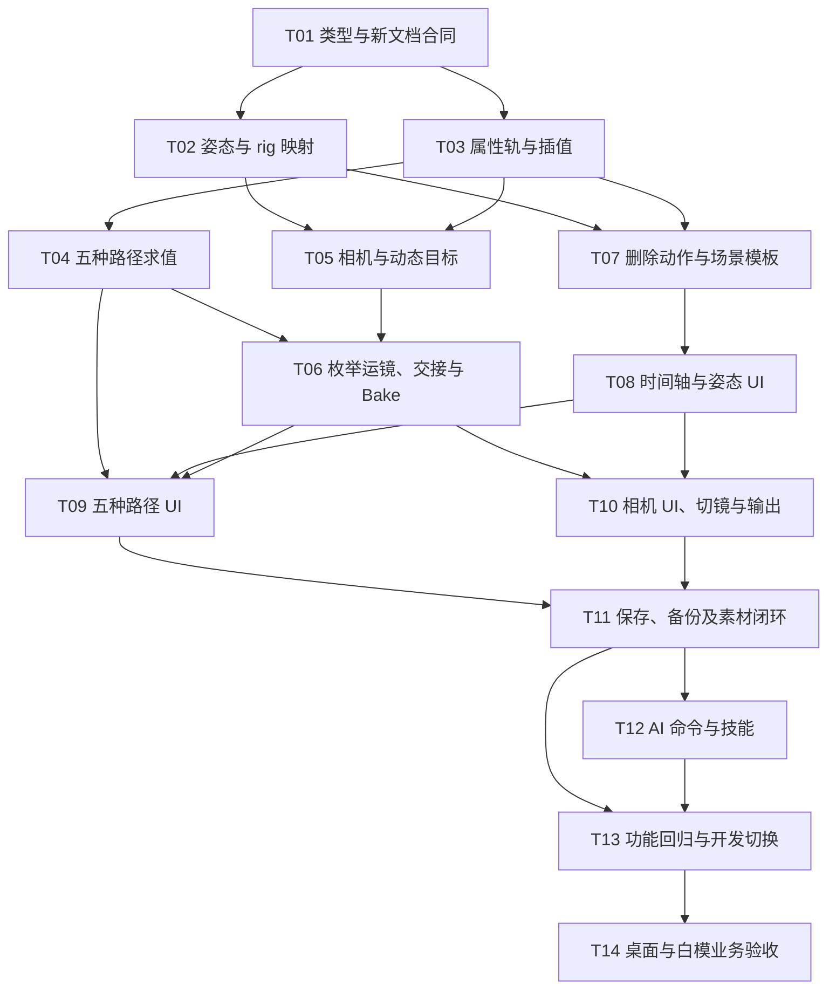

# 导演台姿势、运动轨迹与整场预演改造计划

状态：产品范围与实施任务图已明确，待实施。本文不代表代码完成或数据清理完成；专项性能验证按用户决定后置。

更新日期：2026-10-16。文件名沿用现有路径，正文不再以 v1/v2 划分格式或实施阶段。

目标：作者和 AI 使用同一套数据与编辑命令，通过姿势调整、姿态关键帧、运动轨迹、机位、运镜和切镜完成白模预演。验收关注空间关系、动作节拍和镜头可读性，不要求动作捕捉级表演质量。

## 1. 已确认的范围

沿现有 DirectorDocument、CommandHistory、导演工作区和导出链路改造，正式交付平台为 Windows、macOS。本轮不做 Android 入口与验收，不更换渲染引擎，不新增后端服务。

本次交付：

- 姿势预设、身体部位滑杆与角度输入、完整姿态关键帧。
- 位置、旋转、缩放、颜色、可见性及现有灯光的稀疏属性动画。
- 直线、圆环、矩形、铅笔和钢笔五种运动路径，全部提供可用的 UI 编辑入口。
- 枚举预设运镜、自由朝向与注视目标、目标过渡、滚转、真实光学参数、机位切换。
- 保存、撤销、历史、备份、预览和 PNG/MP4 输出的一致性。
- 统一采样、局部校验与确定性的随机 seek；本轮不开展专项性能优化或性能基准验收。

本轮暂不开放动作库、动作片段编排、动作模板制作、自动步态、动作分层、骨骼遮罩、FBX 导入、跨骨架重定向、IK、物理碰撞、手指与表情编辑。删除导演台动作目录、求值、片段命令和 UI/AI 入口，源码历史由 Git 保留。独立素材的数据保留边界见第 7 节。

移除内置的对话、进场场景模板及加载能力，新建导演文档使用空白工程。姿势预设和机位/运镜预设继续保留；场景模板删除不扩大到这些编辑预设。

人物效果由姿态关键帧和走位表达。路径只负责移动人物；走路、跑步的迈步需要手动姿态键，不把沿路径移动描述成已具备自然步态。

当前处于开发阶段：直接修改现有合同，保持文档 `version=1` 和数据库 `schemaVersion`，不做旧格式兼容、版本升级、离线转换或旧采样对照。用户已授权清空既有导演台开发数据，执行边界见第 7 节。

一份 staging 表达一段共享时间轴的场景调度，包含多个人物和机位。人物共享场景时间；切镜只决定输出使用哪台机位。

## 2. 现状

### 2.1 当前代码

| 现状 | 代码证据 | 本轮处理 |
|---|---|---|
| 静态姿势是骨骼欧拉角预设 | presets.dart 的 actorPoses | 增加语义化姿态参数，预设只负责填入参数 |
| 内置动作由公式生成，自定义动作由骨骼键采样 | sampling.dart 的 _clip/_turnYaw、custom_action.dart | 删除导演动作执行与片段入口，不保留闲置函数 |
| 手动轨只有位置和旋转，首键必须为 0 且至少两键 | document.dart、commands.dart | 统一属性定义，允许稀疏单键并增加姿态等属性 |
| 机位缺滚转，注视演员固定胸口点 | _baseCamera、相机与渲染适配 | 本帧解析骨骼锚点，支持完整朝向和滚转 |
| 原实现允许机位轨上叠加运镜 | _baseCamera 后调用 _applyMove | 新合同明确通道和区间的控制来源，不转换旧叠加文档 |
| 编辑触发全相机、全帧校验 | mutate → fromJson | 分离结构校验、当前帧检查和完整审计 |
| 前序运镜可能递归重复求值 | _sampleCameraWith | 有序编译依赖并缓存派生起点，保持自动衔接 |
| 渲染时自动升降模型贴地，坐蹲跪依赖该修正 | ActorRig.pose | 固定模型基准与姿态根节点高度分开；预设显式提供高度，不逐帧自动贴地 |

已有静态姿势、骨骼映射、时间轴、命令历史和输出代码继续复用，独立动作播放从本轮产品和代码中移除。已有第一场预演暴露过裁头、悬空、倒地停顿不足与缺少实际切镜的问题，新的验收仍检查这些画面结果，不要求保留旧记录。

## 3. 数据真源与扩展边界

```text
UI / AI edits / 文件导入
          |
解析与规范化 → 不可变导演文档 → 类型化命令 → 保存 / 撤销 / 历史
                    |
              编译动画求值计划
                    |
属性与姿态 / 路径 → 骨骼局部变换 → 世界锚点 → 相机与切镜
                    |
                FrameSample
                    |
          视口 / 属性显示 / PNG / MP4
```

继续在 video_stagings.document 保存 JSON，复用 Drift converter。集合沿用有 ID 的数组，运行时建立索引，不新增独立曲线资产或数据库表。

| 内容 | 持久化真源 | 只在运行时计算 |
|---|---|---|
| 静态姿势 | 完整关节角度与根节点高度偏移 | 骨骼局部变换、世界锚点 |
| 手动动画 | 属性轨关键帧 | 插值结果、时间索引 |
| 运动路径 | 几何、时间区间、缓动、转向设置 | 弧长索引、位置与朝向 |
| 预设运镜 | 预设枚举、机位引用、时间区间 | 起点、终态和依赖缓存 |

类型模型覆盖对象、姿态、相机、属性轨、路径、运镜和切镜。字段类型、范围、单位、插值与 UI 输入共同引用导演领域的静态定义，不建立通用反射框架，不在 AI 帮助中复制另一份 schema。

### 3.1 删除动作实现，保留骨骼输出扩展边界

- 删除 sampling.dart 中仅服务动作的 _clip、_turnYaw、_fade、_blend、_standing，以及 custom_action.dart 的自定义动作求值；移除相关 import、调用和动作专用类型。仍供姿态、旋转或运镜使用的数学函数继续保留，不按函数相邻位置成片删除。
- 删除 presets.dart 的 ActionPreset、actionPresets/actionKinds/actionGroups 等动作目录，保留 actorPoses 对应的姿势预设和完整 movePresets/moveKinds 运镜目录。
- 删除 CommandHistory.action、文档 clips/samplingClips 访问与实例化/删除时的片段处理，删除动作面板和时间线/track_editor/inspector 的动作分支；apply_asset.dart 删除导演动作应用分支，保留 move/prop 应用。
- 正式文档不再含 action_clips，连空数组占位也不保留；旧字段按未知字段拒绝。同步移除 AI collection/schema/帮助和备份引用收集中的动作片段路径，不新增兼容解析。
- 不用 unused_element ignore、虚假调用或仅为保留死代码而新增的测试绕过分析。删除失效专用测试，通用测试替换输入但保留原有行为断言，具体清单见第 9.1 节。
- 姿态参数通过 rig 映射生成骨骼局部变换，渲染器消费四元数旋转与明确空间下的平移/缩放。未来 FBX 导入器可输出同类变换，不要求反解成姿势滑杆数值；本轮不预建资产引用、播放和混合系统。
- 骨骼世界位置计算不依赖 GPU 节点，同一 rig 元数据服务纯采样与渲染。这一扩展边界继续保留，不以保留旧动作实现作为扩展条件。

## 4. 导演文档与采样合同

保留 objects、cameras、tracks、camera_moves；删除 action_clips；新增 motion_paths、camera_cuts 和 default_camera_id。字段使用 snake_case，文档 version 保持 1。

场景时间为整数帧，帧率仍为 24，时长仍为 24 至 720 帧。换算读取文档 fps；秒数只用于 UI 显示和输入。区间为 `[start_frame,end_frame)`，终点可编辑、单帧检查，MP4 不额外输出终点帧。

### 4.1 姿势参数与完整姿态键

人物 pose 使用完整参数对象，包含 25 个语义角度和一个根节点高度偏移，共 26 个标量。角度覆盖身体、躯干、头、左右肩臂、肘、髋、膝：身体和躯干各为前倾/转身或扭转/侧倾，头部为点头/转头/歪头，双肩与双髋各为前举或前抬/外展/扭转，双肘和双膝各为弯曲。角度单位为度，骨骼轴向和旋转顺序由固定 rig 映射处理。

采用“姿态参数包含根节点高度”的方案：`pose.root_offset_y` 表示相对标准站姿基准、沿角色局部 Y 轴的整副骨架高度偏移，单位为米，向上为正，站姿为 0，允许负值。它在对象旋转和缩放之前应用，随角色等比缩放；不表示世界地面高度，不修改对象 position，也不新增独立高度轨。

- 姿势预设是填值命令，同时写入关节角度和 root_offset_y。sit、squat、kneel、kneel_both 的预设高度必须按实际男女模型分别标定：以共享 rig 的正向运动学和脚底、前脚掌、膝部接触探针，计算相对站姿基准所需的下沉量，将结果作为对应模型的预设值。默认直立、对象 Y 为 0 时，指定支撑部位落地且其他接触探针不穿地；不依赖每帧渲染修正，也不共用猜测的身高常量。
- 选择预设只写 pose，不写对象 position、位置键或路径。坐姿只保证标准预设的脚部支撑，不自动寻找椅面；需要匹配座椅时由用户调整姿态高度或场景位置。处于高台、空中或倾斜角色上的预设不承诺自动吸附世界地面。
- 一人一条 property=pose 轨，key 为 frame/value/easing；value 同时保存全部角度和 root_offset_y。高度与角度原子记录、复制、重置和撤销，没有部位补丁、骨骼遮罩或姿态叠加层。
- linear 对角度和高度分别按数值插值，smoothstep 使用同一缓动进度，hold 在后一键同时切换。角度不在中途按模 360 改写方向。站到蹲等过渡不自动解算脚部接触；需要中途接地时补完整姿态键并调整高度，不恢复逐帧贴地或隐含 IK。
- 首键前使用人物基础姿态，末键后保持末姿态；单键表示从该帧采用该姿态，不自动补零帧。删除最后一键移除轨，保留基础姿态。
- 修改一个关节后记录本帧完整姿态，保留当前显式高度，不自动重新贴地。固定参数集、站姿默认值、轴向和关节范围集中定义，UI 与 AI 共用，拒绝未知字段和非有限值；左右镜像只执行一次。root_offset_y 为必填有限数值，范围负 50 至正 50 米，并检查最终求值的空间边界。
- 人物世界走位与朝向属于对象变换，姿态的身体旋转和根节点高度属于模型内部变换。路径控制 position 时仍可独立编辑 pose 的高度，不将下蹲的局部下沉写成路径位移。
- 静止模型的脚底基准偏移只计算一次。采样与渲染按相同顺序合成关节姿态、固定模型基准、root_offset_y，再应用对象的缩放、旋转与位置；高度只应用一次。头胸锚点、拾取和导出使用同一结果，不能仅在 renderer 中移动模型。运行时不再按最低关节重算高度，明确指定的腾空不会被拉回地面。

复用男女 Quaternius 模型，采样和渲染共用 rest pose、骨骼父子关系与固定模型基准。头部、胸部锚点在姿态和整体变换之后计算，不用固定身高点冒充骨骼位置。

### 4.2 五种运动路径

motion_paths 每项包含 id/target_id/kind/start_frame/end_frame/easing/orient_to_path 及对应几何数据。本轮五种路径用于角色整体运动。机位使用第 4.4 节现有运镜枚举及属性关键帧，不新增 path 运镜类型。

| 路径 | 编辑方式与持久化真源 |
|---|---|
| 直线 | 起终点，支持视口拖动和精确坐标输入 |
| 圆环 | 中心、半径、平面朝向、起始角、绕行方向；区间内完成一周 |
| 矩形 | 中心、宽深、平面朝向、起始角点、绕行方向；闭合直线边，角点保持折线语义 |
| 铅笔 | 在当前绘制高度平面上自由描画；误差受控简化为折线路点，提交后可继续拖动编辑 |
| 钢笔 | 点击建立锚点、拖动建立入/出柄；保存三次贝塞尔锚点与控制柄，支持开放/闭合、角点/平滑节点 |

- 坐标为世界坐标，绘制平面默认地面，数值编辑可调整高度。圆环和矩形只保存参数，不再存另一份可编辑采样点。
- 用缓动后的弧长进度定位。直线/矩形使用解析长度，铅笔使用折线长度，钢笔使用确定性的误差受控细分；弧长表仅是缓存，不序列化。
- 铅笔简化的世界空间误差不超过 0.01 米，钢笔弧长表按 0.001 米误差细分。超出容量或数值边界仍不能满足误差时明确拒绝，不静默截断。
- 半径和边长为正，路径总长度非零；连续重复路点可规范化合并，不能把空路径当作站立。点和控制柄遵循对象空间边界。
- 同一角色路径区间不得重叠。路径控制位置；orient_to_path 还控制朝向，首版保持角色直立并让前向对齐水平切线。关闭时旋转可独立动画。
- 纯垂直段保持该路径内最近的有效水平朝向，首段无水平切线时用起点朝向。矩形角点有意使用出边方向瞬时转向；铅笔采用下述平滑规则，两者不能混用。结果由数据确定性计算，不依赖上次播放帧。
- 铅笔路径的位置仍沿简化折线移动，但朝向在每个有效拐点附近平滑过渡。以路径弧长为坐标，拐点两侧半窗宽取 0.1 米、入段长度一半、出段长度一半的最小值；窗内以 smoothstep 进度沿最短偏航角从入段转到出段，窗外采用当前段方向。相邻窗口不会重叠，窗口边缘方向连续；重复点和垂直段先按既定规则处理。
- 铅笔闭合路径的首尾也使用同一转向窗口。若水平入/出单位方向精确反向或点积不大于 -0.999999，绕行方向不唯一，开启 orient_to_path 时明确要求修改路径或关闭自动转向，不任意选择转向侧。平滑只影响朝向，不改写路点、位置轨迹或简化误差；窗口及中间方向是派生缓存，不保存为另一套可编辑旋转键。
- 手动轨的插值段不得跨入路径控制区间并控制同一通道。交接键可以位于边界，起点由新控制接管；不以求值顺序静默覆盖。
- 路径结束保持受控通道终态，直到下一显式控制接管。创建和编辑路径的命令显式处理交接边界，保留区间外内容；会裁切已有控制的操作必须由用户选择替换。
- UI 对受控通道提供编辑路径或转换为关键帧。转换按工程帧率采样、稀疏化、移除对应路径控制，一次可撤销提交；容量不足整次失败。
- 路径不生成自动步态，不改写姿态轨；迈步和踢腿由姿态键表达。

### 4.3 属性轨与容量

每个 `(target_id,property)` 最多一条手动轨。键按帧递增、同帧唯一；非空轨允许单键，首键可晚于 0，之前用基础值，末键后保持末值。删除首键或倒数第二键不自动删整条轨。

| 目标 | 支持属性 |
|---|---|
| 角色、道具 | position、rotation、scale、color、visible；角色另有 pose |
| 相机 | position、focal_length_mm；free 模式的 rotation；look_at 模式的 camera_target、roll |
| 文档灯光 | lighting.ambient_intensity、lighting.key_intensity、lighting.key_direction，以文档 ID 为目标 |

数值和位置使用线性插值，旋转使用四元数最短弧 slerp，颜色在 linear-sRGB 中插值，可见性只允许阶跃。缩放为正，演员保持等比。roll 使用有符号角度，允许跨越 360 度。

灯光 key_direction 的基础值和键值先校验有限、非零，再归一化为单位方向。linear/smoothstep 使用单位方向向量的最短大圆弧 slerp，缓动仅作用于时间进度；不是向量 lerp 后归一化，也不能套用四元数的符号翻转规则将相反灯光方向视为等价。

- 两端单位向量点积先夹紧到 [-1, 1]。点积不小于 0.999999 时使用归一化线性插值处理近同向段；其余合法连续段使用方向 slerp，并归一化输出消除舍入误差。
- 点积不大于 -0.999999 时，大圆路径无法稳定唯一确定，拒绝该连续段并要求中间方向键。报错指出轨道与两端帧；允许的接近反向段仍走 slerp，不经过接近零的线性中间向量。
- hold 不做中间插值，到下一键切换，允许直接切换到相反方向。采样精确命中键时采用该键归一化方向。

容量不采用此前提出的 65,536 个键。保持对象与机位数量、5 MiB 文件边界；手动属性轨最多 128 条。手动关键帧、切镜键及路径控制点共用 2,048 个预算单位：完整姿态计一个键且参数集固定，贝塞尔锚点和存在的入/出柄分别计数，圆环和矩形各按四个几何控制量计数。路径最多 128 条，运镜片段沿用最多 256 条。

所有持久化记录纳入结构和字节预算，不因隐藏或删除标记绕开。大小按实际 UTF-8 JSON 字节数检查。容量是输入合法性边界，本轮只验证计数、字节上限与超限报错，不以满容量吞吐量或延迟作为验收门槛；不能静默丢键。

颜色更新独立材质，可见性影响渲染与拾取但不等同删除。传感器、near/far 本轮可编辑并实际生效，不提供动画轨。画幅定义由模型、编辑器和输出共同引用，未知值在解析边界报错。

### 4.4 枚举预设运镜与交接

继续使用现有 moveKinds：static、pan_l、pan_r、tilt_u、tilt_d、dolly_in、dolly_out、zoom_in、follow_pan、follow、lead、orbit、crane_up、crane_down、rise_out。它们是当前合同的合法枚举，不改名为通用算子，也不新增“旧枚举到参数”的适配层。

camera_moves 的业务字段仍为 id/camera_id/kind/start_frame/end_frame；kind 引用上述枚举，缓动统一使用 smoothstep。幅度与算法作为预设定义集中维护，不新增 parameters、definition_version、片段 easing 或 path 类型。用户选择预设和时间区间；需要自定义幅度时使用机位属性键或 Bake 后编辑。

move 素材继续保存 version=1、kind=move、preset、seconds，seconds 范围仍为 0.1 至 120 秒。AssetContent 解析、素材编辑器选项、导演运镜面板、AI 能力查询与采样使用同一 moveKinds；应用时将 preset 原值写入片段 kind，按工程 fps 换算秒数并受选区和文档时长约束。未知枚举明确拒绝，不替换成默认预设。

- 相对运镜从到达起点时刻的机位继续运动。起点由基础属性、合法手动轨和前序运镜派生，结束保持受控终态；static 冻结起点机位。修改前段后，后段自动重算衔接。
- 起点和终态按时间顺序计算、按文档快照缓存，不保存 anchor 或起始副本，不提供“衔接前段”修复命令。随机 seek、倒序播放与导出一致。
- 同机位运镜片段不能重叠，手动轨与运镜按通道和区间互斥；控制通道集中定义，未被使用的属性可独立动画。交接遵循路径同类规则。
- follow_pan、follow、lead、orbit 使用机位 camera_target 的对象或骨骼引用作为主体，创建和完整审计时校验有效主体；free 模式或 point 目标不能静默当作无效跟随继续播放。其余预设从当前朝向模式的最终前向和上方向求值，不要求恢复 target/look_at_id 字段。
- 编辑受控属性时选择更换预设、调整区间或 Bake。Bake 固定当前求值结果，按工程输出帧与终点检查各通道，采用本节规定的分通道误差进行稀疏化。
- Bake 保留机位朝向模式：free 写旋转键，look_at 写 point 类型目标与 roll 键，连同受控位置和焦距记录最终结果。不能为局部转换改变整台机位的模式。转换后的区间不再跟随原动态目标，区间外的目标引用和控制语义保持。
- 转换需完整预算检查、原子提交和撤销；整条时间轴的输出帧和终点都要对照，以检出交接或参考朝向传播造成的区间外变化。无法满足误差时保留原文档并明确失败。
- Bake 后受控区间只有手动轨真源，不保留有效运镜控制；区间外手动内容保持。原有“轨＋运镜”文档不转换、不兼容，不新增迁移回归。

Bake 与路径转换的误差按物理通道分别定义，稀疏化停止条件和回归断言共用以下阈值：

| 通道 | 比较方法 | 最大绝对误差 |
|---|---|---|
| 世界位置、look_at 世界注视点 | 三维欧氏距离 | 0.001 米 |
| focal_length_mm | 焦距差的绝对值 | 0.01 毫米 |
| 最终相机朝向、路径转向 | 单位四元数旋转夹角，使用绝对点积，q 与 -q 等价 | 0.01 度 |
| look_at 模式的 roll | 展开后的有符号角度差，不按模 360 丢失整圈 | 0.01 度 |

旋转夹角为两倍的 arccos 绝对点积，点积夹紧到 [0, 1] 后换算成度，不比较四元数各分量差。朝向、位置和焦距必须同时达标；look_at 额外检查注视点和 roll，避免相同朝向掩盖目标距离或滚转圈数变化。每个输出帧、关键帧、控制交接边界及终点均检查，阈值不代表所有连续子帧的误差证明。预算不足或任一通道超限时整体失败。

### 4.5 相机目标与完整朝向

orientation_mode 为 free 或 look_at，新建默认 look_at。free 由 rotation 四元数决定朝向；look_at 由目标、reference_up 和 roll 决定朝向。模式是整台机位配置，不是动画属性；切换保持当前构图，涉及已有方向动画时要求显式处理，不静默丢弃。

机位完整持久化字段如下。新建命令写出默认值；解析器要求必填字段显式存在，不通过旧字段补齐：

| 字段 | 类型及必填条件 | 新建值或约束 |
|---|---|---|
| id | 字符串，所有模式必填 | 唯一机位 ID |
| name | 字符串，所有模式必填 | 沿用非空、最多 40 字符的名称规则 |
| position | 三元数值数组，所有模式必填 | 世界坐标米数，分量有限且在负 100 至正 100 内；空白工程为 [0, 1.6, 5] |
| orientation_mode | free/look_at，必填 | 空白工程为 look_at |
| focal_length_mm | 数值，必填 | 空白工程为 35；范围 18 至 120 毫米 |
| sensor_height_mm | 数值，必填 | 默认 24；范围 1 至 100 毫米 |
| near | 数值，必填 | 默认 0.05；范围 0.001 至 10 米 |
| far | 数值，必填 | 默认 200；范围 0.01 至 10000 米，且大于 near |
| rotation | 四元数 [x, y, z, w]，仅 free 必填 | 非零有限输入，规范化为单位四元数；look_at 中禁止出现 |
| camera_target | 目标描述，仅 look_at 必填 | 空白工程为 point，position 为 [0, 1, 0]；free 中禁止出现 |
| reference_up | 三元方向数组，仅 look_at 必填 | 默认 [0, 1, 0]，有限非零并归一化；起始朝向不能与其平行，free 中禁止出现 |
| roll | 数值，仅 look_at 必填 | 默认 0，单位度，允许有符号多圈；free 中禁止出现 |
| deleted_at | 可选的既有软删除元数据 | 沿用文档内对象的软删除约定，不参与朝向求值 |

旧 target 和 look_at_id 从文档合同移除，不作为别名保留。目标坐标和引用统一写 camera_target；解析到旧字段、错误模式字段（即使值为 null）或未知字段时拒绝。基础值、属性轨、blank/newCamera、编辑命令、sample、renderer、导出和 AI schema 同步更新，不仅修改字段校验。

camera_target 的基础值和关键帧使用以下完整判别结构，type 为必填标签，非本类型字段禁止出现：

| 类型 | 保存内容 |
|---|---|
| point | type=point、position=[x, y, z]，世界坐标米数 |
| object | type=object、object_id、offset=[x, y, z]，允许人物和道具；offset 为必填对象局部米数，无偏移时显式写零向量 |
| bone | type=bone、actor_id、bone、offset=[x, y, z]；bone 为支持的规范骨骼名，offset 为必填骨骼局部米数 |

- 先采样本帧对象与姿态，解析相邻两键目标在当前时刻的世界位置，再按进度混合。允许三种类型交叉过渡，不插值 ID，不把移动目标冻结在键的时刻。
- linear/smoothstep 连续过渡，hold 在后一键时切换；末键后持续跟踪其引用。偏移只在目标描述内保存，取消独立 target_offset 轨。
- UI 提供类型、目标、骨骼、偏移、关键帧及过渡方式，AI 使用同一命令。注视点混合不保证匀角速度转动，纯朝向动画使用 free 旋转轨。
- 目标与机位重合、引用失效、非有限结果明确报错。参考 up 从固定起点建立连续框架，跨极点按固定时间顺序求解并缓存，支持真正垂直俯拍；结果不能依赖上次播放状态。
- 投影、拾取、预览和导出共用上表光学参数，垂直 FOV 由传感器高度与焦距计算。look_at 模式的最终旋转只作为采样结果，不反写成另一份持久化 rotation。

### 4.6 切镜与输出

default_camera_id 引用有效机位；camera_cuts 每项为 id/frame/camera_id，同帧唯一，切点在该帧立即生效。首切点前或空切镜轨使用默认机位；切镜不混合机位、不重置人物或运镜时间。

编辑器区分按切镜预览与固定查看机位，观察选择不改文档。PNG/MP4 使用 camera_mode=sequence/fixed，fixed 必须给 camera_id；调用方统一更新，不添加旧调用推断。画布第 0 帧预览按 sequence 选择机位。

输出任务冻结文档和参数，manifest 记录模式与每帧实际机位。删除被默认机位、切镜和注视引用的对象时列出影响，要求同批处理引用。保留取消、失败、私有文件交付、资产登记与备份，不新增跨重启补帧系统。

## 5. 采样、校验与后续性能验证

### 5.1 统一求值

编译计划索引对象、轨道、路径、机位及运镜依赖。单帧顺序为：基础属性和手动轨、路径控制与交接、完整姿态、骨骼局部/世界变换、相机目标与运镜、切镜、FrameSample。

视口、overlay、inspector 和 renderer 共享同帧结果。随机查键用时间索引，顺序采样可用游标，不逐帧扫描全部键；路径弧长表与运镜依赖只随相关内容变化重建。

标题、revision、选择和视口尺寸不触发全场动画重算。姿态变化使相关骨骼目标失效，运镜变化使受影响后继失效。缓存不序列化、不参与 dirty 判断或撤销内容，生命周期受快照和既有撤销容量限制。

### 5.2 校验边界

| 入口 | 必须执行 |
|---|---|
| 导入/解析 | 字节、重复字段、规范化、类型、引用、区间、容量及控制冲突 |
| 拖拽预览 | 相关字段及当前帧检查，失败保留已提交状态 |
| 提交/撤销/重做 | 不可变修改与受影响依赖校验，不隐含全场审计 |
| 保存 | 结构与引用校验，动态问题保留具体诊断 |
| 完整验证/导出 | 冻结内容的全部输出帧及终点审计，错误带 frame/target/property |
| 当前帧渲染 | 有限数值和有效方向检查，失败显示错误并阻止该帧输出 |

不静默夹紧成另一个姿势，不删键或截断路径来凑容量。动态约束走有界审计，不要求解析阶段证明所有连续时刻均合法。

### 5.3 专项性能验证后置

用户明确本轮暂不关注性能，将在后续使用中验证，发现问题再定位。本轮不安排 profile 基线、满容量负载基准、CPU p50/p95、8 ms 指标、峰值内存或增长曲线验收，也不为这些指标增加专项优化任务。

容量仍是功能合同：128 条属性轨、2,048 个预算单位、路径/运镜数量及 5 MiB 字节上限继续校验；边界合法值可解析，越界要明确拒绝。随机 seek、顺播和导出一致性属于正确性验证，仍需执行。

第 5.1 节的共享采样、时间索引和派生缓存用于统一求值与控制依赖，不作为性能已经达标的证明。后续出现实际卡顿、CPU 或内存问题时，再按 profile 技能采证定位；性能未测不阻止本轮功能交付，也不能在交付说明中写为已通过。

## 6. 桌面编辑器与 AI

### 6.1 时间轴、姿势和路径交互

- 时间轴关闭时显示属性、姿势；打开后增加运动轨迹。关闭只隐藏编辑入口，不停用动画、不删轨，保留当前预览时刻。
- 关闭时，无动画控制的属性可改基础值；已有轨、路径或运镜控制的属性只读并提示打开时间轴，不允许编辑后被动画覆盖而没有反馈。
- 打开时，自动帧开启则修改在当前帧新增/更新键；关闭时，当前有键则改该键，没有轨道则改基础值，有轨道但当前无键则提示先加键。自动帧不能绕过路径/运镜控制互斥。
- 姿势面板提供预设、部位滑杆、角度输入和以米显示的“姿态高度”，支持完整姿态记录、重置、撤销。姿态高度与角度共用自动帧规则，重置恢复整套站姿及零高度偏移；白模实时反馈，不要求输入四元数。
- 时间线按人物展开已启用属性，姿态只显示一条轨；可复制/粘贴姿态键制作重复迈步，不新增动作模板入口。相机展示属性与运镜，切镜单列全局轨。
- 五种路径都支持创建、选择、几何和区间编辑、删除、转换为关键帧。拖拽可取消，一次手势只提交一条撤销。
- 删除正式导演入口的动作面板、动作资产应用和动作片段写入代码；保留姿势编辑和 move/prop 素材应用，不增加隐藏开关或 feature flag。
- 沿现有共享组件拆分 region，不新建设计稿；表单使用现有 form 和非惰性布局，文案走 i18n。桌面页头改动覆盖 Windows/macOS/Linux 布局分支，Linux 仅为布局检查。

### 6.2 AI 命令

沿用 Run stagings，顶层 tool schema 静态，UI 与 AI 共用命令、字段定义和采样结果。

| 入口 | 本轮合同 |
|---|---|
| schema | 姿态、属性、路径、运镜、目标、切镜字段及单位、范围、控制规则 |
| presets | 姿势与机位/运镜预设，不返回动作模板或片段能力 |
| read/apply | 对象、机位、属性键、路径、运镜、切镜；按目标和属性查建轨、按帧 upsert，批次原子提交 |
| sample | 最多 12 个时刻，返回对象、姿态、有效机位和诊断 |
| validate | 冻结文档完整审计，不写文档，不把数值合法当作视觉合格 |
| preview/output | sequence/fixed 统一输出合同及实际 PNG/MP4 交付 |

删除动作 collection 与导演动作应用入口，不扩展层、遮罩或 root_motion。旧动作请求按未知 collection 或不支持的素材类型明确拒绝，不保留旧执行分支。修改 tool description 仍须先提交具体文案确认，本计划不自动授权未提供的描述。

### 6.3 业务验收流程

先读场次与文档，安排走位、关键姿态和镜头，经 sample、完整审计和真实图像检查修正。不把静态踢腿称为完整踢击，不把位移称为自然行走，不把运镜称为切镜。

沿既有 screenplay-tools 和 screenplay-production 导演附件更新能力说明，不新增 Skill。真实模型端到端评测仅在用户明确要求时运行；手工编排不能冒充模型已自动完成。

## 7. 开发数据与版本

- 用户已授权清空既有导演台开发数据，实施新合同切换时直接清理 Debug 导演台记录、对应历史、导演台画布节点及关联边，不兼容、不转换旧记录。
- Release、其他项目、正文、人物档案、独立素材和已交付媒体不在此次清理范围。独立动作素材行不连带删除；本次删除的是导演动作执行与应用代码。通用资产模块读取、展示既有 action 素材所需的内容模型保留在该模块内，不能据此重新开放导演播放或加载旧导演文档。
- 不新增格式版本、DB migration、离线转换器、旧版 fallback 或启动时自动清库逻辑；旧导演文档不保证可读。
- move 素材不清空、不改写，继续保留 preset/seconds 和现有枚举，素材版本不变。对真实格式样本做解析、编辑、应用和保存回读回归；这是未变更的素材合同，不是旧导演文档兼容。
- 删除 `assets/director/templates/dialogue.director.json` 和 `assets/director/templates/entry.director.json`，不转换其中的字符串 pose 或非空 action_clips。同步移除 `pubspec.yaml` 的该资源目录声明、`DirectorFileOutput.loadTemplate` 及仅用于这些模板的无引用文案/映射；新建空白工程和用户文件导入导出保留。
- 删除 `test/fixtures/director/` 下同名两份旧样本，将依赖它们的测试改为按新合同构造最小场景或专用 fixture：完整 pose 含 root_offset_y，不再含 action_clips 字段。文档往返、命令、轨道、运镜、画幅、姿态、导出和桌面测试原有的有效断言继续保留，不通过删除测试或增加解析 fallback 消除失败。动作专用测试按第 9.1 节移除或改写，不为已删除的算法建立新的公开测试入口。
- 一次性清理通过 SQLite 技能核对实际库，保留可恢复备份和行数记录。用户最新要求先更新文档，本文不声称清理已完成。
- 新文档继续使用既有保存、版本历史和备份。清空旧开发数据不等于删除新数据的历史与恢复能力。
- 修改官方技能时按本地 tags 核对其发布状态，维护技能版本、contentHash、updatedAt 和 Debug 官方安装快照；这不是导演文档升版。

## 8. 实施任务图（Task Graph）

以下图是实现依赖，不是逐节点发布计划，也不自动授权并行启动多个 Agent。全部任务当前均未开始；每个任务须在完成对应改动和验证后更新状态，不以“代码已写”代替通过验收。



### 8.1 任务、依赖与完成证据

路径未写前缀时，模型指 lib/shared/models/director/，服务指 lib/shared/services/director/，UI 指 lib/shared/widgets/director/。测试文件和详细删改清单见第 9、10 节。

| ID | 前置任务 | 工作范围与主要落点 | 完成证据 |
|---|---|---|---|
| T01 | 无 | document.dart 与静态类型/属性定义；声明完整 pose、五类路径几何、两种机位模式、切镜与容量规则；更新 blank/newCamera、编解码及最小新合同 fixture | 合法文档往返，缺字段/未知字段/错误模式/超限明确拒绝；无 action_clips、target/look_at_id 或旧模板依赖 |
| T02 | T01 | presets.dart、rig 元数据、姿态求值、actor_models.dart、scene_builder.dart；完成 26 参数映射、预设高度标定和固定模型基准，取消逐帧自动贴地 | 男女模型坐蹲跪支撑与缩放验证，姿态高度只应用一次，纯采样锚点与渲染一致 |
| T03 | T01 | sampling.dart、属性注册和 commands.dart 的键编辑；实现单键/首末外推、pose 插值、四元数、颜色/可见性/缩放和灯光方向 slerp | 对应属性与边界测试通过；动作与运镜共用的有效数学函数不误删 |
| T04 | T03 | 路径几何与采样模块、文档路径校验；五种几何、弧长、铅笔简化与朝向窗口、垂直/反向段和闭合边界 | 五种路径的数值结果、确定性 seek、误差与超限拒绝通过，不依赖 UI 播放历史 |
| T05 | T02、T03 | 相机模型、camera.dart、renderer.dart 与目标求值；实现 free/look_at、point/object/bone、动态混合、reference_up、roll、真实光学参数 | 模式字段、动态锚点、跨极点、目标换绑、投影和拾取回归通过 |
| T06 | T04、T05 | commands.dart、sampling.dart 与控制依赖编译；实现手动轨/路径/运镜交接、现有运镜枚举自动衔接和两类 Bake | 受控通道冲突明确，起止边界与终态一致，位置/焦距/角度分别满足 Bake 阈值，区间外结果保持 |
| T07 | T02、T03 | 删除 custom_action.dart、动作私有函数/目录/命令/面板/AI collection；删除两份产品模板、旧 fixture、loadTemplate、资源声明和无引用文案 | 第 9.1 节测试逐类处理；无悬空 import、unused_element 或动作执行路径；姿势、运镜和通用素材读取保留 |
| T08 | T07 | workspace/sidebar/inspector/timeline/track_editor 及姿态 region；自动帧、静态属性只读提示、滑杆/角度/高度、完整姿态键、撤销 | 桌面 widget 测试覆盖时间轴显隐、同帧键编辑、输入提交、取消和一次手势一次撤销 |
| T09 | T04、T06、T08 | 路径工具 region、视口操控和时间区间编辑，调用 T04 求值器与 T06 控制命令接入完整交接 | 五种路径均能创建/编辑/删除/转换，钢笔柄和铅笔描画可取消，受控属性 UI 无隐式覆盖 |
| T10 | T06、T08 | camera inspector、运镜面板、切镜轨、file_output/export_task 及实际输出调用方 | 目标类型与关键帧可编辑，固定机位/切镜模式一致，PNG/MP4 冻结快照与实际切点正确 |
| T11 | T09、T10 | staging_edit、persistence、production/backup_media、apply_asset、MoveAssetContent 及素材编辑器 | 新建/保存/重开/历史恢复/备份闭环通过；move 素材枚举和 preset/seconds 无损，prop 应用正常，导演 action 应用拒绝 |
| T12 | T11 | stagings Run handler、schema/presets/sample/validate、工具测试与既有技能附件 | UI/AI 合同一致，批次原子性、未知动作拒绝、实际输出返回正确；技能版本和指纹按项目规则维护 |
| T13 | T11、T12 | 串行执行第 10 节受影响 analyze 与测试，核对依赖残留；在新合同完整后执行已授权的 Debug 导演数据清空 | 分析与功能测试通过；新样本可创建；清理结果按实际执行记录，Release 和独立素材未被清理 |
| T14 | T13 | Windows/macOS 实际 UI、保存和输出验收；按场次正文新建导演文档并抽帧核对 | 姿态、五种路径、机位和切镜可操作，视频与时间线一致；未运行平台明确未验证，不报告性能通过 |

T09 的编辑提交依赖 T06；路径工具的纯几何展示可以先做，但不能将尚未接入交接规则的工具计为完成。测试随任务推进，不集中拖到 T13 才编写或运行；T13 负责完整功能回归。

### 8.2 交付与协调边界

- T01 至 T12 是同一新合同下的内部任务，包含数据、渲染、UI 和调用方的共同切换，不能把“只改 schema”或“只删旧代码”作为可独立发布阶段。不为中间状态保留第二套格式或动作执行 fallback。
- 中间任务可单独提交审阅，但在 T13 完成前不将半成品替换为用户日常使用的构建，也不因 T01 完成就提前清空开发数据。
- 姿态、路径与机位能力均需自己的 UI、命令、采样和保存验证，不让后续 AI 阶段承担补齐基础编辑能力的责任。
- document.dart、sampling.dart、commands.dart、timeline.dart、schema 与 fixture 属于共享改动点。图中的分支表示依赖关系，不表示可以同时修改同一文件；若后续安排并行工作，须按文件所有权顺序接入。
- Flutter 测试始终串行。真实 Windows/macOS 设备与图形环境不可用时记录缺项，不能用宿主分析代替跨平台实际验收。
- T12 若需要修改 tool description，先完成可审阅文案再按项目规则获得确认；未获确认时不改描述。原有读取、编辑与其他不依赖该文案的实现可继续。
- 本图不包含性能基准或专项优化。用户后续验证出实际性能问题，再单独采证和处理。
- 首场验收受 30 秒上限约束，无法容纳原场次时报告限制，不擅自删戏。清空后不要求沿用旧 staging ID，也不以旧动作迁移为前置条件。

## 9. 文件落点与规模

实现会超过 8 个文件，复用既有渲染、命令、存储和输出链，不新增后端服务、付费模型、全局状态服务或提前抽象的插件系统。

| 范围 | 主要落点 |
|---|---|
| 数据与校验 | shared/models/director/document.dart，同目录按职责拆分姿态、属性与编解码 |
| 采样与路径 | sampling.dart、presets.dart，必要的路径几何和 rig 求值文件及派生元数据 |
| 动作删除 | custom_action.dart、sampling.dart 的动作私有函数、presets.dart 的动作目录、commands.dart 的 action、动作面板/轨道分支、apply_asset.dart 的动作应用和 AI/备份的片段引用处理 |
| 运镜素材保留 | shared/models/production/asset_content.dart 的 MoveAssetContent 和 moveKinds 校验、desktop/features/asset/content_editor.dart 的 move 编辑、shared/services/production/apply_asset.dart 的 move 应用 |
| 命令与状态 | shared/services/director/commands.dart、session.dart |
| 渲染 | actor_models.dart、scene_builder.dart、camera.dart、renderer.dart |
| UI | shared/widgets/director/ 的时间线、姿态/路径检查器、视口和独立 region |
| 保存与输出 | staging_edit.dart、file_output.dart、export_task.dart、备份及实际输出调用方 |
| 删除内置场景模板 | `assets/director/templates/dialogue.director.json`、`entry.director.json`；`pubspec.yaml` 目录声明；`lib/shared/services/director/file_output.dart` 的 loadTemplate；`lib/shared/widgets/director/strings.dart`、locale_keys.dart 及 en/zh-CN 的 director 翻译中仅供模板使用的无引用项 |
| AI 与技能 | stagings Run handler、统一帮助与既有导演附件 |
| 替换旧测试样本 | 删除 `test/fixtures/director/dialogue.director.json`、`entry.director.json`；调整 shared/director 下 document、commands、tracks、moves、poses、aspect_ratio、export_task 测试，以及 desktop/director 下 controls、timeline、layout 测试；按新合同保留有意义的覆盖 |
| 其他测试 | test/shared/director/、test/desktop/director/、相关 production 与工具测试 |

不创建原计划的 layers.dart、动作模板资源库或 tools/director_upgrade/。Dart 文件遵循项目文件头和规则；修改生成源走 FVM codegen 并检查生成 diff。

### 9.1 动作相关测试的处理

按测试目的处理用例，不整文件删除混合测试，不通过 skip、ignore 或恢复旧字段制造通过：

| 测试文件 | 处理方式 |
|---|---|
| shared/director/commands_test.dart | 删除专属 action 命令调用；以运镜片段验证仍共用的区间替换逻辑，以 pose 键验证原子编辑与撤销 |
| shared/director/document_test.dart | 新合同样本移除 action_clips；保留往返、字段和引用校验，增加旧动作字段拒绝及完整机位模式字段检查 |
| shared/director/gizmo_test.dart | 当前是拖拽手势与旋转数学测试，没有动作片段构造，保留；共享数学函数若移动则更新 import，不为去掉动作而删手势覆盖 |
| shared/director/moves_test.dart | 删除转身动作和遍历 actionKinds 的专用测试；保留各 moveKinds、衔接、控制通道与数值边界测试 |
| shared/director/staging_test.dart | 用 pose 键或机位轨修改替换动作写入，保留保存、快照、编辑器与 AI 合并、恢复和并发语义 |
| shared/director/tracks_test.dart | 删除动作重叠与淡出回站姿的专用用例；保留普通轨道采样，并增加姿态高度、灯光方向与路径交接验证 |
| shared/production/director_backup_test.dart | 用当前文档和历史中的不同道具引用验证备份闭包；移除导演动作片段引用预期，保留无关资产排除和文件完整性断言 |
| shared/services/ai/tools_production_test.dart | 非法引用、原子批次、持久化及编辑器同步改用新合同；另断言动作 collection 不再可写，不恢复动作执行 |
| shared/production/advanced_assets_test.dart | 删除依赖 sampleCustomAction 和导演动作应用的用例；保留通用素材解析/编辑及 move/prop 应用覆盖，新增所有运镜枚举的素材回读验证 |

fixture 消费方及其他测试仍需按符号和数据字段扫描，以上列表不替代残留检查。只在测试覆盖已删除功能时删除用例，普通采样、旋转、素材读取和备份能力不随之减少。

## 10. 验收矩阵

| 类别 | 必验场景 |
|---|---|
| 姿势 | 26 个标量完整记录；角度和高度一起插值、阶跃、复制、重置、撤销、保存重开；首键前、末键后与删除末键均采用包含高度的完整姿态；非法高度拒绝 |
| 预设支撑 | 男女模型在对象 Y 为 0、直立、等比缩放 0.5/1/2 时，sit/squat/kneel/kneel_both 的指定支撑探针距地面绝对误差不超过 0.001 米，其余接触探针不低于负 0.001 米；同时抽帧检查坐蹲跪不悬空、不穿地 |
| 高度与走位 | 应用预设不改对象 position、位置键或路径；站到蹲的中间帧按指定高度插值，补中间键能修正支撑；路径运动中可下蹲；对象 Y 为 2 时保持对应局部支撑面偏移，不被吸回世界地面 |
| 模型基准 | 固定基准和姿态高度各应用一次；抬腿、倾倒、腾空不被自动贴地覆盖；随机 seek、骨骼注视锚点、拾取、预览与导出一致 |
| 路径 | 五种工具全部可用，钢笔控制柄和闭合、铅笔简化与超限、弧长、垂直段、零长度、交接和转换；铅笔位置仍在折线上，转向窗口前中后及闭合首尾连续；短段窗口不重叠，反向拐点明确拒绝，随机 seek 一致；矩形角点保留有意跳转 |
| 属性 | 单键、非零首键、颜色、可见性、正缩放与等比、控制冲突；灯光同向、近同向、90 度、允许的近反向方向 slerp，中间方向单位长度且无零向量；临界反向连续段拒绝，hold 反向可用 |
| UI | 时间轴显隐、关闭时动画属性只读、自动帧开关、关节反馈、单次撤销、取消 |
| 相机 | 两种模式完整必填字段、模式互斥字段、旧 target/look_at_id 拒绝、目标三种完整结构；top-down、跨极点、roll、动态 A 到 B 换绑、骨骼引用、光学与拾取一致 |
| 运镜 | 全部现有枚举的默认行为、自动衔接、前段改动重算、空隙终态、随机 seek、控制互斥；move 素材的解析/编辑/应用/回读和秒转帧不破坏原 preset/seconds |
| Bake | 位置及目标点 0.001 米、焦距 0.01 毫米、旋转夹角及展开 roll 0.01 度分别验收；q/-q 等价、roll 跨圈；逐通道超限拒绝，阈值内稀疏化，全帧/边界/终点和区间外结果一致 |
| 切镜 | 第 47/48 帧交接、首切点晚于零、空轨、重复拒绝、fixed/sequence 区别 |
| 保存输出 | 重开、历史、备份、冻结输出期间编辑、取消/空间不足/捕获失败不破坏已完成输出 |
| 场景模板移除 | 两份产品模板及资源目录声明、loadTemplate 和旧 fixture 引用无残留；空白新建、画幅、自适应视口、文件往返与导入导出仍有效；新合同样本的姿态含高度且无动作片段 |
| 容量与求值正确性 | 2,048 单位、128 轨及字节上限的合法/超限处理，完整审计的检查范围正确，随机 seek 与顺播/导出一致；不验收耗时、吞吐量或峰值内存 |
| 能力边界 | 动作实现、入口与 action_clips 字段无残留；未知动作请求拒绝，静态姿势和运镜保留；分析无 unused_element，不以 ignore 或虚假调用保留死代码 |
| 平台 | Windows、macOS 的姿态、五种路径、时间线、保存重开、输出，未运行明确未验证 |
| 业务 | 人物关系和节拍可读，无无意悬空或自动漂移，切镜和实际视频与时间线一致 |

不运行旧文档迁移回归，验证新建、编辑、保存重开与输出闭环。纯数值测试不等于真实画面合格。

实施后使用 FVM SDK，Flutter 测试串行执行：

```bash
fvm flutter analyze lib/shared/models/director lib/shared/services/director lib/shared/widgets/director
fvm flutter analyze lib/shared/services/production/apply_asset.dart lib/shared/models/production/asset_content.dart lib/desktop/features/asset/content_editor.dart test/shared/director test/shared/production/advanced_assets_test.dart test/shared/production/director_backup_test.dart test/shared/services/ai/tools_production_test.dart
fvm flutter test test/shared/director --concurrency=1 --timeout 2m
timeout 300s fvm flutter test test/desktop/director --concurrency=1 --timeout 2m
fvm flutter test test/shared/production/director_backup_test.dart test/shared/production/director_output_test.dart --concurrency=1 --timeout 2m
fvm flutter test test/shared/production/advanced_assets_test.dart test/shared/services/ai/tools_production_test.dart --concurrency=1 --timeout 2m
fvm flutter test test/shared/services/bundled_control_skills_test.dart test/shared/services/bundled_official_skills_test.dart --concurrency=1 --timeout 2m
```

以上为待执行命令，不是本次文档修改的验证结果。原生视口和 MP4 抽帧独立留证，不把 mock renderer 测试当作实际画面证明；专项性能验证后置。

## 11. 风险与完成定义

本轮主要正确性风险为姿态参数的骨骼轴向映射、旧贴地修正移除、路径与手动轨交接和相机跨极点。采用统一采样、明确控制来源与对应回归，不增加旧行为 fallback。性能留待用户后续实际验证。

五种路径全部属于本轮交付。未来 FBX 仅保留统一骨骼输出扩展边界，已删除的动作实现可从 Git 历史查阅，不以其未接入为本轮未完成。

完成需要新合同、桌面 UI、AI 命令、保存/历史/备份与输出一致，输入容量和功能正确性通过验证，Windows/macOS 状态明确，并实际检查一段手工编排白模预演。专项性能验证不作为本轮完成条件。当前只更新方案与任务图，代码实现、数据清空与运行验收分别报告。
