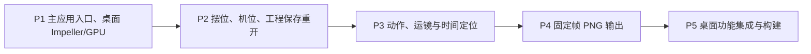

# P：桌面 3D 导演台

> 本文保存导演工程、编辑与输出合同及回归标准。进度和验收结论只在[实施任务](README.md#实施任务) P-01、P-02、D2-01 维护。

[返回方案总览](README.md) · [Agent 输出与权限](agent.md#导演输出与直接成片) · [后续 D1/D2：媒体基础与导演参考输出](production.md) · [历史核验记录](references.md)

## 模块衔接

目标导演实体为 VideoStagings，SQL 表名 video_stagings，记录类型 VideoStagingRow，保留 id、title、document、version 及 createdAt／updatedAt／deletedAt。工程具有独立身份，表内不添加 screenplay_id 或 episode_id；文档模型仍为 DirectorDocument。Video 前缀用于共享数据库命名空间，目录内文件和 staging_id 引用不重复加前缀。

画布 director 节点用 refType=video_staging、refId 引用；Revisions 以 entityType=video_staging、entityId、version 保存新工程的历史。`/stagings` 工具路径保持简洁，备份、版本恢复、节点打开和资源登记均改用新表及新类型。

当前实现的 ScreenplayStagings／screenplay_stagings 及 screenplay_staging 类型不作为兼容入口。不搬迁旧导演文档、历史快照或关联，不保留旧名称／类型别名，不双读或 fallback；旧工程需重新建立。目标 schema 移除旧表，旧节点／资产中的历史关联不转换，显式报告失效而不冒充新实体。其他业务数据及原媒体文件不因这次重构删除。

媒体基础和导演输出继续复用既有媒体服务与 DirectorOutputOrchestrator；视频剪辑使用独立 VideoEditings 与预览。结构变更仍核对实际发布记录与标签，不沿用历史“未发布”结论；本次只更新文档，不执行数据库操作。

下文保留原工程合同作为设计基线；工程序列化字段以当前 `lib/shared/models/director/document.dart` 和已提交 fixture 为准。输出合同已调整为每次按当前工程创建新任务，不保存输出工程快照或跨重启续跑记录；实施状态见 D2-01，本次不修改代码或宣称验收通过。

## DirectorDocument v1：P 的固定数据合同

P 采用 UTF-8 JSON，扩展名 `.director.json`，文件最大 5 MiB。以下为原工程合同记录；D2 沿用当前代码中的同一文档模型，资产工程来源使用显式字段，角色身份沿用当前文档中的 catalogId。所有字段按下表保存，不以缺字段隐式补默认值；默认值只供“新建”使用。未知版本、未知字段、未知枚举、重复 JSON key、非有限数、错误类型或缺字段均拒绝载入，原编辑工程保持不变。错误返回字段路径和原因，不部分导入。

| 字段 | 类型、默认值与校验 |
|---|---|
| `format` / `version` | 固定 `reveric.director` / 整数 `1` |
| `id` / `revision` / `title` | id 为 UUID，创建后不变；revision 为非负安全整数，新建 0，每条成功编辑命令递增；title 为去首尾空白后 1 至 80 字符，默认“未命名导演工程”，按界面语言新建 |
| `units` / `upAxis` | 固定 `meters` / `Y`；右手系；演员本地正前方为 +Z。转换到库相机坐标由 renderer 集中处理 |
| `fps` / `durationFrames` | P 固定 fps=24；durationFrames 为 24 至 720 的整数，默认 120。时长唯一真源是帧数；D2 的输出资产 durationMs 从帧时长派生并取最近整数毫秒 |
| `output` | `{width,height,background}`；P 尺寸仅 720×1280 或 1280×720，默认前者；background 为 `#RRGGBB`，默认 `#E8E8E8`。1080p 与其他 fps 不在 P 中开放 |
| `objects` | 对象数组，活动演员≤6、道具≤20，总记录含软删除≤256；id 全局唯一。数组顺序仅表示列表顺序，不影响图层或动画 |
| `camera` | 单一输出摄影机，字段见下表；P 不提供多机切换，不把编辑视角保存到该对象 |
| `lighting` | `{ambientIntensity,keyIntensity,keyDirection}`；默认 0.6、1.0、`[-1,-2,-1]`；强度范围 0 至 4，方向非零且分量有限，使用时归一化。固定中性白光，P 关闭阴影和后处理，颜色/构图优先 |
| `tracks` | 变换关键帧轨数组，总记录含软删除≤128；字段见下表；活动轨关键帧总数≤2048 |
| `actionClips` | 动作片段数组，总记录含软删除≤256；字段见下表。P 不引用外部骨骼、贴图、音频或可执行资源 |

通用 id 为 UUID；新增时生成、载入时保留。`deletedAt` 为可空 UTC Unix 毫秒整数，null 表示活动。时间取值及浮点字段在 Dart 模型入口统一校验。样例用固定 UUID，实际新建不复用样例 ID。

新建对象统一 position=`[0,0,0]`、rotation=`[0,0,0,1]`、scale=`[1,1,1]`、deletedAt=null；演员默认 neutral 和 `#4477AA`，道具默认 none 和 `#999999`，name 使用对应本地化类型名及序号。新增轨道默认 linear；默认挥手片段 24 帧、行走片段 96 帧，超出时长时要求选择合法区间，不隐式延长工程。

| 嵌套对象 | 完整字段与规则 |
|---|---|
| `objects[]` | `{id,kind,name,geometryKey,position,rotation,scale,color,pose,deletedAt}`。kind=`actor` 或 `prop`；name 为 1 至 40 字符；actor 的 geometryKey 固定 `actor.segmented.v1`，pose 为 `neutral/sit/point`；prop 的 geometryKey 为 `prop.box.v1/prop.door.v1/prop.counter.v1`，pose 固定 `none` |
| 对象变换 | position 为三数向量 `[x,y,z]`，XZ 均在 −50 至 50 米、Y 固定 0；rotation 为 `[x,y,z,w]` 单位四元数，P 只允许绕 Y，容差 `1e-6`；scale 为三数正向量，各分量 0.1 至 10；演员只允许等比缩放，道具可非等比。color 为不透明 `#RRGGBB` |
| `camera` | `{id,position,target,focalLengthMm,sensorHeightMm,near,far}`；默认 position=`[0,1.6,5]`、target=`[0,1,0]`、焦距 35 mm、传感器高 24 mm、near=0.05 m、far=200 m；焦距 18 至 120 mm，后三个光学常量固定。position/target 每分量在 −100 至 100 米，相距≥0.05 m，观察方向与 Y 轴的夹角不得小于 1° 或大于 179°，roll 固定 0 |
| `tracks[]` | `{id,targetId,property,keys,deletedAt}`；property 为 `position/rotation/cameraTarget/focalLengthMm`。对象仅允许前两项，相机允许 position/cameraTarget/focalLengthMm；每个活动 target/property 最多一条活动轨；targetId 必须存在 |
| `keys[]` | `{frame,value,easing}`；frame 为 0 至 durationFrames 的整数、严格递增不重复；非空轨至少两键且首键 frame=0，末键可以小于时长。value 必须符合被动画字段类型及边界；easing=`linear/smoothstep/hold`，表示该键到下一键的插值，最后一键仍显式写入但不参与段计算 |
| `actionClips[]` | `{id,actorId,kind,startFrame,endFrame,deletedAt}`；kind=`idle/walk/wave`；actorId 必须指向 actor；`0≤startFrame<endFrame≤durationFrames`，活动区间为 `[startFrame,endFrame)`；同一活动演员的活动片段不得重叠 |

活动轨/片段只能引用活动对象。软删除对象时，同一命令将其轨和动作一并软删除，保存仍保留原值；撤销恢复整组。载入允许软删除轨引用软删除对象，但不允许悬空 ID。达到含软删除记录上限时拒绝新增，保留文件并说明容量限制，不自动清理业务记录。

P 的程序化资源固定尺寸：地面 20×20 米、Y=0，只是背景，不计入对象列表；box 为中心离地 0.5 米的 1 米立方体；counter 为 2×1×0.6 米长方体；door 为 1.2 米宽、2.2 米高的无门板门框，立柱和横梁截面 0.1 米。均在根变换后渲染，不进行碰撞或动力学模拟。

`actor.segmented.v1` 用刚性分节体构成，脚底原点，站姿高 1.7 米；头部球半径 0.15 米、中心 Y=1.55，躯干 0.4×0.5×0.2 米、中心 Y=1.15。肩位于 `[±0.28,1.35,0]`，上/下臂长均 0.25 米、宽深 0.08 米；髋位于 `[±0.12,0.9,0]`，大/小腿长均 0.4 米、宽深 0.1 米，脚高 0.1 米。肢体绕近端关节旋转。neutral 为四肢自然向下；sit 为髋下降 0.35 米、两髋绕 X 转 −π/2、两膝转 +π/2；point 为右肩绕 X 转 −π/2、右肘伸直。P 用该固定形体保证动作可见，不追求解剖准确或足部 IK。

## P 样例：双人对话与进场

以下 JSON 可直接保存为 `dialogue.director.json`，加载后有两名演员、一个柜台及固定摄影机。颜色与 actor ID 分别保持身份；未配置轨道时整段静止。

```json
{
  "format": "reveric.director",
  "version": 1,
  "id": "10000000-0000-4000-8000-000000000001",
  "revision": 0,
  "title": "双人对话",
  "units": "meters",
  "upAxis": "Y",
  "fps": 24,
  "durationFrames": 120,
  "output": {"width": 720, "height": 1280, "background": "#E8E8E8"},
  "objects": [
    {"id": "20000000-0000-4000-8000-000000000001", "kind": "actor", "name": "演员 A", "geometryKey": "actor.segmented.v1", "position": [-0.8, 0, 0], "rotation": [0, 0, 0, 1], "scale": [1, 1, 1], "color": "#4477AA", "pose": "neutral", "deletedAt": null},
    {"id": "20000000-0000-4000-8000-000000000002", "kind": "actor", "name": "演员 B", "geometryKey": "actor.segmented.v1", "position": [0.8, 0, 0], "rotation": [0, 0, 0, 1], "scale": [1, 1, 1], "color": "#CC6677", "pose": "neutral", "deletedAt": null},
    {"id": "20000000-0000-4000-8000-000000000003", "kind": "prop", "name": "柜台", "geometryKey": "prop.counter.v1", "position": [0, 0, -0.7], "rotation": [0, 0, 0, 1], "scale": [1, 1, 1], "color": "#999999", "pose": "none", "deletedAt": null}
  ],
  "camera": {"id": "30000000-0000-4000-8000-000000000001", "position": [0, 1.6, 5], "target": [0, 1, 0], "focalLengthMm": 35, "sensorHeightMm": 24, "near": 0.05, "far": 200},
  "lighting": {"ambientIntensity": 0.6, "keyIntensity": 1, "keyDirection": [-1, -2, -1]},
  "tracks": [],
  "actionClips": []
}
```

第二个 fixture `entry.director.json` 由上述文件复制：根 id 尾号改为 `002`、title 改为“进场与推进”，其余字段保持一致，用下面两个数组替换 tracks/actionClips。模板创建新工程时重新生成工程及所有内部 ID 并重映射引用；fixture 测试保留固定 ID。

```json
{
  "tracks": [
    {"id": "40000000-0000-4000-8000-000000000001", "targetId": "20000000-0000-4000-8000-000000000001", "property": "position", "keys": [{"frame": 0, "value": [-0.8, 0, -2], "easing": "linear"}, {"frame": 96, "value": [-0.8, 0, 0], "easing": "hold"}, {"frame": 120, "value": [-0.8, 0, 0], "easing": "hold"}], "deletedAt": null},
    {"id": "40000000-0000-4000-8000-000000000002", "targetId": "30000000-0000-4000-8000-000000000001", "property": "position", "keys": [{"frame": 0, "value": [0, 1.6, 5], "easing": "linear"}, {"frame": 120, "value": [0, 1.6, 4], "easing": "hold"}], "deletedAt": null}
  ],
  "actionClips": [
    {"id": "50000000-0000-4000-8000-000000000001", "actorId": "20000000-0000-4000-8000-000000000001", "kind": "walk", "startFrame": 0, "endFrame": 96, "deletedAt": null},
    {"id": "50000000-0000-4000-8000-000000000002", "actorId": "20000000-0000-4000-8000-000000000001", "kind": "wave", "startFrame": 96, "endFrame": 120, "deletedAt": null}
  ]
}
```

## 确定性采样与动作规则

- 工程键帧用整数帧；编辑游标只落在 `0…durationFrames`。播放可按单调时钟计算分数帧，在实际绘制时取最近的整数帧；输出固定取 `0…durationFrames-1`，5 秒样例最后输出帧为 119。终点帧 120 可编辑/预览但不额外导出。暂停留在当前帧，停止回到 0，到结尾停在 durationFrames；P 默认不循环。
- 每次采样先从工程基础变换和静态姿态重建值，再覆盖轨道，再应用动作。绝不从上次采样结果累计位移或关节角度。无轨字段使用基础值；最后键之后保持末值；命中某键时直接取该键值。
- 区间内 `u=(frame-a.frame)/(b.frame-a.frame)`；linear 使用 u，smoothstep 使用 `u²(3−2u)`，hold 在到达 b 前保持 a。位置/目标/焦距逐分量线性插值，旋转用最短弧 slerp；点积<0 时反转后一四元数，接近同向时归一化线性插值。四元数输出统一归一化；UI 的角度只在输入/显示边界转换。
- 移动路径使用 position 轨，直线段连接路点，不做隐藏的样条拟合。默认移动不自动改演员朝向；“沿路线朝向”是显式命令：按当前及后一非零 XZ 段计算 `yaw=atan2(dx,dz)`，在路点生成 rotation 键、使用 hold，末点沿最后非零段；全路径静止时保留原朝向。调用前展示将替换的朝向轨，确认后作为一条可撤销命令。
- “转身”生成旋转轨上的起终键，使用 smoothstep；不另存会与 rotation 竞争的动作类型。同一 actor 的 idle/walk/wave 片段不重叠，相邻片段可首尾相接；空档恢复静态 pose；walk/wave 要求 pose=neutral，sit/point 演员若有活动片段则必须为 idle。校验失败保留当前工程，不自动改 pose 或裁掉片段。
- 转身命令在用户选定的 `[startFrame,endFrame]` 建键，起值取修改前采样姿态，终值取输入朝向；确认后替换该区间内的旋转键，区间外键保留。没有原轨且 startFrame>0 时补 frame=0 基础姿态，不能让前段意外转动。移动/机位预设采用相同的区间替换规则。
- idle 仅保留静态姿态。walk 的腿/对侧手臂按 `s=sin(2π×(frame-startFrame)/24)` 绕 X 摆动，左右腿为 ±0.45s 弧度、左右手臂为 ∓0.3s，不改变根位移；wave 的右肩绕 Z 抬起 2.3 弧度，右肘绕 Z 为 `0.35×sin(4π×(frame-startFrame)/24)`。两者都乘以片段首尾各 `b=min(6,(end-start)/2)` 帧的 smoothstep 包络：`w=smoothstep(clamp((frame-start)/b,0,1))×smoothstep(clamp((end-frame)/b,0,1))`；仅动作内部使用该包络，根轨道不受影响。首尾动作回到 neutral，本方案不做交叉混合或自动步幅匹配。
- 相机 FOV 由 `2×atan(sensorHeightMm/(2×focalLengthMm))` 得到纵向视角，宽高比取输出尺寸；编辑视口按该比例显示取景框，窗口变化不改变输出。target 是世界坐标点；“看向演员”把当前演员胸部位置复制为目标点，不建立隐式跟随关系。移动目标需明确编辑 cameraTarget 轨。
- 推进/拉远预设沿当前目标观察方向生成位置键，横移沿 `normalize(cross(forward,Y))` 生成位置键；P 不开放环绕预设按钮，完整制作阶段 D2 实现环绕时以 Y 轴旋转相机相对目标的向量生成逐帧位置键，目标不动。预设会列出将替换的轨道，用户应用后作为一条命令；不叠加两份真源。
- 降低时长若会截断键/片段，拒绝提交并标明超界项，用户先调整它们；提高时长只延长末状态。不按比例重排已有键，不自动拉伸动作。更改输出方向保留所有相机参数，立即用新比例预览。
- 导入及编辑提交后校验全部输出帧与终点帧：相机不得与 target 重合或与 up 近似共线，所有采样值有限且在字段范围内。最多 720 帧，验证采用同一个纯 Dart 采样器；失败带 frame/targetId/field，不替换最后有效工程。

## P 编辑交互、保存与撤销

桌面采用对象列表、中央编辑视口、属性面板和底部时间轴。P 直接使用 Flutter 标准控件，不另做设计稿。固定工具只有选择、移动、旋转；当前模式必须可见。编辑视角可以自由观察，输出摄影机始终只有一个，提供“查看输出机位”和“返回编辑视角”，两者的操作对象不同。

| 操作 | 桌面 | 共同约束 |
|---|---|---|
| 选择 | 左键选最近可见命中对象，空白点击清空；列表可选被遮挡对象 | P 单选，不做框选/多选 |
| 地面移动 | 移动模式拖拽选中对象，将指针射线与 Y=0 地面求交，保留按下时偏移；X/Z 手柄限制对应轴 | 只拖已选对象/手柄；空白拖拽不移动对象。射线近平行地面时保持最后有效点；超界阻止提交而不截断坐标 |
| 朝向 | 旋转模式拖 Y 环；数值栏可输入角度。平面交点不可用时用水平拖动，每逻辑像素 0.5° | 同一角度规则；默认不吸附，面板可显式启用 15° 吸附 |
| 编辑视角 | 右键拖动环绕编辑目标，中键拖动平移，滚轮缩放；F 聚焦选中对象 | 观察操作只改本地视图，不修改输出机位或撤销栈 |
| 输出机位 | “查看输出机位”下默认只看取景；位置/焦距/目标通过属性或“将编辑视角设为机位”修改 | 后者是一次工程命令；不会把随手观察自动记录进影片 |
| 时间轴 | 单击/拖动游标，播放中开始拖动即暂停；方向键逐帧，空格播放/暂停 | 同步提供播放、停止、前后帧按钮；无悬停操作依赖 |
| 键帧 | 基础模式只在第 0 帧编辑无对应活动轨的字段；已有轨或游标非 0 时提示进入关键帧模式。关键帧模式在当前整数帧新增或替换键；首次建轨在 frame=0 插入基础值 | 拖动释放时一次提交；若只在第 0 帧录键则增加 durationFrames 的同值键，满足至少两键；不隐式覆盖整条动画 |
| 动作 | 选择演员及时间区间后应用 idle/walk/wave；重叠则报出冲突区间，用户调整后重试 | 转身走朝向键，不出现在动作片段菜单；片段拖动按整数帧吸附 |
| 删除/恢复 | Delete 软删除所选对象及关联轨/片段，提供撤销；已删除列表可恢复 | 恢复保留原对象及轨的 ID，先校验数量与冲突，超限不部分恢复；不删除外部文件 |

对象手势达到 4 个逻辑像素才视为拖动，避免点击产生编辑；手势途中只更新预览，释放后形成一个命令，Esc、系统 pointer cancel 或进入后台取消当前手势并恢复拖动前状态。数值字段在确认/失焦时校验并提交，失焦校验失败保留输入和错误；播放与导出前必须先解决当前无效输入。文本字段有焦点时不拦截 Delete、方向键、空格或文本自身撤销快捷键。

命令历史包含变换、键帧/动作编辑、增删/恢复、预设及输出设置。每条命令记录前后文档值，最多 100 条且总量≤20 MiB，超限先丢最旧历史，至少保留最近一条；历史不是业务文件，不跨重启持久化。新命令清空 redo；撤销/重做也递增 revision，恢复内容不恢复旧 revision。保存不清空历史。dirty 比较当前业务内容与上次保存内容，排除 revision；撤销回已保存内容后恢复“已保存”。

新建默认使用本节空白配置：objects/tracks/actionClips 为空、camera/light 用默认值。添加演员/道具放在原点，不自动布局；重叠允许，通过列表选取。选择模板会创建新工程而非覆盖当前工程，dirty 时先提供保存、放弃、取消。打开文件、关闭窗口及返回上级使用同一规则；导出进行中要求先取消或等待导出完成，再处理未保存内容。系统强制终止不弹窗，提供最近恢复快照。

保存先校验，再把完整 JSON 写入主应用导演模块私有目录中的新 revision 文件，flush 成功后原子更新小型 current 指针；保留上一有效文件，不原地截断。保存失败 dirty 与输入保留。编辑停止 500 ms 后将有效文档写入独立 recovery 文件；恢复记录不更新“已保存”标记。重启发现未保存 recovery 时提供恢复或忽略，忽略只标记不再提示，不删除原记录。P 不自动清理历史业务文件；无磁盘空间时报告保存失败。

打开外部工程通过系统单文件选择器复制到程序私有工作区，校验成功才替换当前工程；原文件不自动写回。外部路径和 URI 不保存在工程 JSON。主动“导出工程”才交给系统 Save/Share，取消只返回取消；仅处理桌面系统选择器返回的授权文件，不引入 Android/iOS 的新文件访问流程。新增演员/恢复/模板导入均遵守容量限制。

## P 输出任务与失败处理

输出状态固定 `idle → preparing → rendering → packaging → completed`，可由 preparing/rendering/packaging 进入 cancelling→cancelled 或 failed；后台切为 paused 并记录原阶段，回前台显示“继续”，不自动开启 GPU 工作。一次仅允许一个输出任务。PNG 单帧和帧序列共用采样/捕获器；帧序列在应用私有目录完成后可打包 ZIP 交给系统 Save/Share，P 不编码 MP4。

每次点击输出都创建新任务，读取当前有效工程；编辑器内包含尚未保存但已提交的编辑命令，制作画布和 Agent 入口读取当前已保存的工程。仅在本次运行的内存中固定文档、机位与输出参数，避免输出期间的编辑使前后帧不一致。未确认或无效表单字段阻止输出，必须先提交或取消。输出结果标记所用 revision，导出不把工程标为已保存。

不再写入 `source.director.json`、输出任务恢复用 `task.json` 或输出工程快照，不新增导出任务表，不提供按旧任务 ID 重试、补帧或跨重启续跑。渲染失败或应用退出后，用户再次输出时从当前工程重新生成所选帧或区间，不读取旧临时帧。工程本身的保存、Revisions 历史与未保存编辑恢复仍沿原合同，不属于本次移除范围。

每次操作在新的 UUID temporary 目录生成帧，进度与暂停状态仅在当前运行中维护；预检空间按 `2×width×height×4×frameCount + 20% + 64 MiB`，覆盖临时帧与最终复制，额外打 ZIP 时再加一份序列体积。若两目录位于不同卷，按各卷实际承担的副本分别检查。写完一帧、释放 Image/Picture 后才请求下一帧。没有空间检测能力时报告 `storage_probe_failed`，不得以无限空间继续；运行中仍处理 ENOSPC。输出过程中可以继续编辑，但新编辑不修改本次内存中的文档与 Scene。

manifest 保留输出格式与版本、operationId、documentId、documentRevision、cameraId、kind、画幅、fps、帧区间、frameCount 和 frames，供帧序列编码、输出记录展示与文件交付使用；不保存完整工程、documentSha256 或逐帧 sha256。frames 项为 `{index,sourceFrame,timeNumerator,timeDenominator,file}`。完整序列 startFrame=0、endFrameExclusive=durationFrames；单帧输出区间为当前帧到当前帧+1，允许单独捕获终点帧。时间用 `sourceFrame/fps` 的分数表示，不用四舍五入毫秒累计。文件名为 `frame_000000.png` 起的六位索引。资产登记所需的工程标题与机位名称由本次运行直接传给 DirectorOutputOrchestrator，不再从落盘工程副本读取。

同平台相同输入的采样数值必须一致，允许不同 GPU 对抗锯齿结果有像素差异；不得用跨设备 PNG 字节相等作为可行性标准。P 关闭随机效果、物理、曝光自适应和时间累积后处理。确认帧数、时间码、尺寸和解码结果后，先复制到私有 completed 下本任务的新 staging 目录，再在同一目录内原子改名，完成后清理本任务 temporary 副本；不假定 temporary 与持久目录可跨卷 rename。不计算或比较工程、帧文件与复制副本的 SHA；ZIP 只包含输出图片与 manifest，不包含工程快照。复制阶段失败不把 staging 作为完成结果展示；P 不自动清理持久目录。系统分享另记已打开面板/取消/失败，不把分享面板返回当作用户已保存到外部位置。

| 情况 | 行为与保留范围 |
|---|---|
| 取消 | 等当前单帧写入结束，停止后续采样，释放渲染资源，清理本次 temporary 副本；不删除 completed、工程、源文件或此前输出 |
| 切后台 | 当前帧落盘后暂停，在内存中保留本次文档与下一帧位置；同一进程内选择继续后，从下一帧开始，不写入恢复存档 |
| 进程终止 | 本次输出停止；重启不扫描未完成导出任务，也不复用旧帧。用户再次输出时读取当前工程，创建新任务并从所选区间起点生成 |
| GPU 初始化/捕获失败 | failed，返回 `gpu_unavailable/capture_failed` 与阶段/帧号，编辑工程不丢；释放当前 Scene/Image。再次输出使用当前工程创建新任务，不自动循环重启 |
| 文件/空间/权限失败 | failed，分别返回 `storage_probe_failed/storage_full/file_write_failed/access_denied`；用户处理原因后重新输出。私有临时帧按本操作清理，不删除用户输入或工程 |
| 外部导出失败/取消 | 已完成的私有结果继续可用，只重试 Save/Share，不重渲染，不记为 GPU 失败 |

文件适配固定使用当前项目已有的 file_selector、path_provider、share_plus 和 archive；输出任务不再因内容校验依赖 crypto，资产登记的导入去重哈希继续按 Assets 合同处理。P 锁定版本与项目 lock 一致，不导入主应用数据库服务。磁盘容量查询以应用私有路径为输入，通过主应用桌面原生 channel 返回 availableBytes：macOS 使用卷可用容量、Windows GetDiskFreeSpaceExW、Linux statvfs；移动端能力不在本方案范围；失败保留结构化错误。所有外部路径按 `.agents/rules/file-access.md` 处理。API 日志只记 operationId、阶段、帧号和错误码，不写工程正文或完整用户路径。

实施时删除 ExportTaskOrchestrator 的输出快照写入、任务恢复文件写入、resumeId／unfinished 恢复分支及对应 SHA 比对；保留运行期暂停、取消和已完成输出展示。DirectorOutputOrchestrator 改收本次输出的标题与机位名称，移除读取 `source.director.json` 的依赖；调用方显式传入这些值。已有业务工程、历史与已完成输出不因本次调整被删除，不增加旧输出快照的迁移或清理任务。

## 主应用桌面导演模块

- `lib/desktop/pages/home.dart`：在首页“作品”区增加“3D 导演台”，用现有 Navigator 路线打开主窗口内的 DirectorPage，保留首页状态。
- `lib/desktop/features/director/`：page 负责延迟初始化与 DesktopWindowFrame，workspace 组合对象列表、工具栏、视口、属性和时间轴；gizmo、pointer_gesture、track_editor 各持有对应交互。接入主应用主题、组件、表单与本地化；返回使用现有未保存弹窗，关窗保持隐藏到托盘的既有语义。
- `lib/shared/models/director/`：document 与 sampling 持有版本化工程、校验和纯时间采样；`lib/shared/services/director/`：commands、session、camera、scene_builder、renderer、storage、export_task 负责命令、会话与文件/GPU 输出。只保留这一套核心，不复制到第二个应用。
- `assets/director/`、`test/fixtures/director/`：工程模板与确定性测试样例；`test/shared/director/`、`test/desktop/director/` 及正式原生集成入口覆盖本文件功能验收用例。测试使用隔离的私有目录，不能读取用户保存的当前工程或恢复记录。
- 根 `pubspec.yaml` / `pubspec.lock`、桌面三个 runner：加入固定 flutter_scene，启用桌面 Impeller/GPU 与文件容量接口，进入导演页时才初始化三维资源。不改移动端入口和平台配置，不新增 DB migration。
- `assets/translations/{en,zh-CN}/director.json`、locale_keys、merging_asset_loader：注册正式 namespace，通用动作复用 common。
- `tools/director_probe/` 的原型实现迁出后不再作为产品入口或维护第二套核心；仅允许保留必要的薄测试/诊断入口与历史证据。旧原型容器中的工程和输出不删除、不自动迁入主应用，可由用户通过文件打开。

## P 的交付范围

P 的入口和界面直接属于 Reveric 主应用，目录按 [改动清单](director.md)。使用根项目的 FVM、依赖锁、桌面 runner、主题与翻译。它是可以先交付的功能阶段，不是独立 app；第一阶段工程仍用主应用私有目录中的 JSON，不要求先选择小说/剧本，也不接 AI 网关、制作画布或编码库。

使用程序生成的地面、演员和道具，以及双人对话/进出场工程。桌面范围为 macOS、Windows、Linux，本机实际验证 macOS，其他宿主没有执行时明确列为未验证；不以某端结果代表其他平台。本阶段不做移动端 UI；性能采样执行状态见任务表 V-03。



| 子任务 | 交付内容 | 完成条件 |
|---|---|---|
| P1 | 共享核心迁入、正式依赖、首页入口及桌面 Impeller/GPU 配置 | 主应用可打开导演页，离开可回首页，进入时初始化三维资源；移动端入口保持现状 |
| P2 | 摆位/旋转手柄、机位、JSON 保存恢复、主应用属性表单 | 保存重开一致；无效或未提交输入保留；返回/退出保护沿用主应用；不接作品 DB |
| P3 | 绝对时间采样、动作/运镜、关键帧与动作片段编辑和拖动 | 时间定位确定；移动/裁切整帧吸附、重叠拒绝、取消回退、每次拖动一次撤销 |
| P4 | 单次运行固定 Scene、PNG 与 120 帧序列、manifest/ZIP、同进程暂停／继续／取消 | 工程编辑不影响本次输出；再次输出使用当前工程，不保存输出快照或跨重启续跑；失败不覆盖已有结果，不编码 MP4 |
| P5 | 桌面正式页面、功能测试、真实 GPU 输出与构建 | 本文件功能验收中的用例通过，实际平台结果逐项列明；性能采样按任务表 V-03 的授权状态执行 |


P 的工程文件只保存导演模块自身状态，结果只写入其私有目录或用户明确选定目录。manifest 字段、分数时间与失败状态按 [导演输出合同](#p-输出任务与失败处理)，输出不携带工程快照或内容校验哈希。原 P 设计仅要求本地输出，不消费模型额度、不启用云端上传、不增加新匿名事件；布景持久化复用当前内容库及 staging 服务，不按历史版本重建工程表。

执行真源对应为：P1 使用 [改动清单](director.md) 的 SDK/平台配置；P2 使用 [导演工程的文档字段](director.md)、fixture、交互及保存命令；P3 使用同节采样与动作规则；P4 使用同节输出状态和 manifest；P5 逐条执行本文件功能验收矩阵。数据流固定为“控件 → 命令校验 → 有效 DirectorDocument → 采样器 → renderer”，导出读取冻结副本，保存读取有效文档；渲染器不反向修改工程。

本节定义主应用桌面入口、导演编辑和确定性帧输出的交付边界；性能采样的执行状态见任务表 V-03。后续 D2 验收 MP4 参考输出与统一资产登记，B 验收生成和结果采用；C 音频合成与剪辑按独立合同验收，不以导演工程验收代替剪辑验收；模型对参考的遵从性仍需显式开启真实评测，不借 P 的结论提前宣称可用。P 一并将主应用 Impeller 设为开启；旧配置的对照数据只用于解释差异，不设“不比 Skia 慢”的通过条件，不以轻微 CPU 增量阻塞验收。

P 交付主应用中的可运行导演页、JSON 样例、PNG/帧序列及功能验证记录。已完成的独立原型结果只作历史证据，后续修改主应用导演时仍需回归入口、主题/表单、返回与功能，不重新设立迁入阶段。即使后续 A 至 F 不实施，作者也可以在主应用中编辑、预演并输出导演参考。

## 桌面功能回归基线

以下保留 [P1 至 P5 交付范围](director.md)的桌面功能验收基线；实际验证结果和性能采样状态见任务表。移动端不在本方案范围。片段、作品数据库、网关、编码库共存与模型调用不属于当前 P 的条件。暂缓项不能写成通过，也不因它们继续阻塞当前功能开发。

P 的必验矩阵如下。数值采样容差为 `1e-5`，四元数比较旋转等价性，q 与 −q 视为相同；影像采用构图和姿态检查，不强求跨 GPU 字节一致。

| 用例 | 操作与固定预期 | 对应任务与验证层 |
|---|---|---|
| P-T01 工程往返 | 加载 dialogue，保存再读后业务字段逐项相等，ID/颜色/输出摄影机保持；拖动编辑视角不改 JSON；entry 按规定替换后合法 | P2；document 单测和文件实机用例 |
| P-T02 非法输入 | 分别注入 version=2、重复 ID/JSON key、非单位四元数、缺字段、悬空 target、未知枚举、相机看向自身、超容量及>5 MiB；全部给出路径/原因，当前有效工程与 dirty 不变 | P2；document 单测 |
| P-T03 轨道定位 | entry 帧 0/48/96/120，演员 A 的 Z 分别 −2/−1/0/0，相机 Z 分别 5/4.6/4.2/4；按 120→0→96→48 乱序定位仍一致；smoothstep 中点为两端均值，hold 在后一键前不变 | P3；tracks 单测 |
| P-T04 朝向与动作边界 | +170° 到 −170° 中点经过 180°；walk 的 0…95 与 wave 的 96…119 不重叠，96 只属于 wave、120 无动作；静止路径不产生非法方向；overlap、sit+walk 被拒绝 | P3；tracks 单测及可见关节抽查 |
| P-T05 编辑命令 | 一次拖动仅一条历史，Esc/后台中断恢复原值；文本焦点下 Delete 不删演员；删演员后关联轨/片段软删除，撤销整组恢复；撤销到保存状态 dirty=false，新编辑清空 redo | P2/P3；commands 单测、桌面鼠标和移动触摸实机 |
| P-T06 保存与恢复 | 保存失败仍 dirty；关闭时取消保留页面，放弃不覆盖已保存文件；模拟指针更新前进程退出，旧文件仍可读且 recovery 可恢复；未知版本不写回原文件 | P2；storage 故障注入及重启检查 |
| P-T07 输出一致性 | entry 导出恰好 120 帧，首末 sourceFrame=0/119，最后时间=119/24 秒；manifest、时间码与尺寸正确；本次输出不受中途编辑影响，下一次输出使用已修改工程；终点单图可捕获 frame=120；无输出工程快照或 SHA 字段，资产命名无需读取工程副本 | P4；真实 GPU 输出、PNG 解码与 manifest 验证 |
| P-T08 生命周期 | 第 37 帧落盘后进入后台，无新帧；同进程继续从 38 开始；终止进程后不恢复旧任务，修改工程并重新输出时从头使用新内容；不写任务恢复文件、不读取旧帧；取消只清理本任务 temporary，completed 和工程保持 | P4/P5；export_task 故障注入与实机后台/重启 |
| P-T09 空间与权限 | 空间预检不足阻止开始，运行中 ENOSPC/捕获失败转 failed，已有输出不变；系统 Save/Share 取消保留私有 completed，不重渲染；桌面中文路径和系统授权文件可导入 | P2/P4；文件层故障注入及各端系统面板 |
| P-T10 主应用集成 | 首页入口、返回时未保存提示、主应用表单/翻译、桌面窗口框架、暂停/关闭和 GPU 输出正常；记录实际桌面构建结果；性能采样状态见任务表 V-03 | P1/P5；正式页面、共享退出服务的窄回归及原生功能验证 |

上述测试迁入主应用测试目录。此前原型运行证据不等于主应用集成通过，实际执行命令与结果写入实施记录。从仓库根执行受影响测试，串行运行并设置进程截止时间：

```bash
fvm flutter pub get
fvm flutter analyze lib/desktop/features/director lib/shared/models/director lib/shared/services/director
fvm flutter test test/shared/director --concurrency=1 --timeout 2m
fvm flutter test test/desktop/director --concurrency=1 --timeout 2m
fvm flutter build macos --release
```

原生集成测试使用主应用 runner 与隔离工程目录，覆盖真实视口、手柄、时间轴、返回和 120 帧输出；Windows/Linux 在对应宿主检查。性能基准和 CPU/RSS 采样按任务表 V-03 的授权状态执行，不用未测项冒充已通过。
