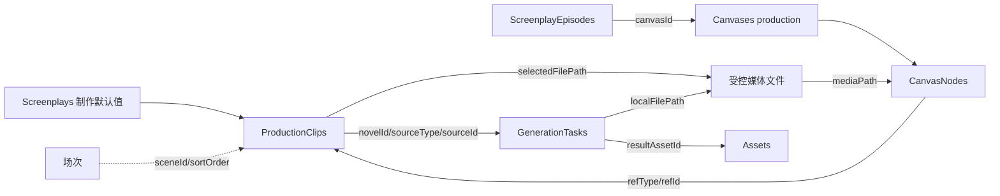

# 片段、统一资产、视频制作与直接导出

> 本文定义片段、画布、资产和直接导出合同；多轨剪辑见 [C](editing.md)。进度与代码差异只在[实施任务](README.md#实施任务)维护。
>
> 2026-10-08 起以「片段」取代独立分镜：制作单位是一次生成的片段，片段在制片页的片段列表里规划与确认，在制作画布上以节点制作；镜头只是片段提示词里的分段文字。原「一镜一节点」、独立分镜表与剧本区分镜入口的设计作废。

[返回方案总览](README.md) · [视频任务合同](video-generation.md) · [导演回归基线](director.md)

## 阶段交付边界

| 顺序 | 交付范围 | 独立可用结果 |
|---|---|---|
| E1 | 前移 ImageAssets → Assets 必需的数据层迁移，补齐必填任务来源、来源索引、结果资产登记与恢复 | 独立通过服务完成有来源的生成、结果资产登记与重启恢复 |
| D1 | 复用 E1 的 Assets 数据层，完成图片/视频/音频导入、FFprobe、播放、两端原生媒体包与基础编码、文件导出及备份 | 独立导入、探测、预览、导出和恢复媒体资产，为 B 提供完整媒体基础 |
| A | 本集制作设置、片段列表、制作画布与视频节点（片段 / 视频）、Shot 格式提示词、采用与任务反馈、生成配置、Agent 读写与变更历史 | 手工或通过聊天 Agent 拆分并通读修改当前集片段，画布上同步出现节点；重开、审阅、回退 |
| B | 输入连线（素材节点与视频节点两种来源）、导入图片/视频/音频、调用 E1 生成、重做历史和自动采用、从资产库为片段选用视频、节点单段导出 | 用参考生成片段视频，找回历次结果，单段导出 |
| X | 导出弹窗：整集成片 MP4、采用片段按成片顺序批量导出、Markdown/CSV 提示词文本；依赖 B，可与 D2 并行 | 一集做完后导出成片，或导出片段与提示词表交给外部剪辑 |
| D2 | 导演工程资产入口、导演 PNG/MP4 输出接入，以及场景/文本/道具包/动作/运镜/风格资产的编辑与应用 | 在已有视频闭环上增加导演参考和高级素材能力，工程保存及历史沿用 P |
| C | X 之后交付独立剪辑工作区、多轨编辑、工程保存、低清分段预览和剪辑成片；共用合成引擎 | 在 Reveric 内完成剪辑再导出，不依赖音频生成 G |

E1 先交付结果登记所需的统一 Assets 表、DAO、旧图片迁移及最小备份适配，不等待 D1 的播放或编码。D1 完成媒体使用能力，A 完成片段来源接入。通用任务服务的来源由调用方提供和校验，E1 使用既有画布节点验证真实来源；不为提前验收创建空作品、假片段或占位来源。

D1 包含 FFprobe 和两端原生媒体包，基础工作不推迟到 D2。D1 用固定媒体验证探测、解码、播放和 H.264/AAC 编码能力；D2 再把这些能力接到导演逐帧捕获与预演输出。B 可直接使用角色图、场景图及导入媒体，不等待导演 MP4 或模板编辑器。D2 的既有模板范围保持不变，实施顺序只表达依赖。

[G 音频生成节点](audio-generation.md)独立设计，排在 D2 后，模型与输入合同见音频文档，任务纳入同一目标版本。按成片顺序简单拼接整集已确认纳入本方案，与采用片段批量导出、提示词文本一起作为独立阶段 X 交付；随后由 C 交付内置多轨编辑、混音、低清分段预览与剪辑成片；Agent 接入按当前已实现的字幕编辑和输出能力验收，工具合同见 [Agent 全流程](agent.md)。专有制作包的导入、导出均不纳入本方案，后续按独立迁移需求评估，不绑定 C。

## 用户流程

### 片段、镜头与视频节点

| 概念 | 当前模型与用途 |
|---|---|
| 片段 | ProductionClips 中关联 scene_id、sort_order 的生成节点；直接整集导出只取其中 kind=video 的行，按场次顺序与场内顺序排列 |
| 自由视频节点 | 同为 kind=video，但 scene_id、sort_order 为空；不自动进入直接成片，可作为生成参考，或显式加入剪辑工程 |
| 图片／音频节点 | kind=image/audio，共用生成任务、采用结果与历史入口；音频节点不关联场次，图片节点可带角色或地点来源 |
| 镜头 | 提示词中的摄影分段文字，不单独建表，不持久化镜头数量 |

kind 只区分媒体类型（video/image/audio），创建后不可改；它不区分片段与自由节点。scene_id 与 sort_order 同空或同非空，跨集移动被服务拒绝。场内排序、场次归属与画布坐标互相独立。剧本修改不自动覆盖提示词或已有结果；场次失效时保留关联与媒体，明确提示来源问题，不自动删除素材。

### 入口与导航

沿用作品工作区与季/集选择，保留剧本、场次、大纲、节拍和角色等区域，在 NavRail「创作」组增加「制片」入口（不叫「分镜」：镜头只是提示词里的分段文字，没有逐镜记录）。制片页是 app 内页面，不全屏：沿用 NavRail、第二栏和右侧助手，主区顶栏右侧切换「片段 | 画布」两个视图，写法与场次页的「列表 / 场次板 / 出场矩阵」一致，默认进入片段视图；剧本区域不放片段或镜头的制作界面。资产库统一展示场景、导演工程、文本、图片、视频、音频、道具及模板；角色继续沿用已有业务模型。

- 片段列表按场次分组、按成片顺序列出本集片段，每段显示段号、标题、采用情况、任务反馈、模型与时长（不显示镜头数：镜头只存在于提示词文字里，数出来的值不可靠），提示词默认完整展开、可直接编辑，逐段折叠后只留标题行；场内可拖动调整顺序，每场可新增片段或让 Agent 拆分。AI 写入直接生效，不设接受步骤：片段行只用小圆点标出 AI 新增或改写，回退沿用聊天面板输入框上方的「最近改动」卡片（逐条或全部回退），与写作页一致。
- 画布视图用于连参考、生成与查看结果。片段列表与画布读写同一份数据，没有第二份副本；两边可互相跳转定位同一片段。
- 第二栏在两个视图共用，复用场次页的「剧集 + 场次」，只负责定位、不列片段明细：片段视图中点击场次滚动到该场，画布视图中定位到该场的区域。画布需要更多空间时，用第二栏已有的折叠按钮收起。
- 制作画布每集一张，跟随第二栏选中的集切换；只从制片页进入，不出现在「画布」列表中。
- 场次与片段都可以“查看原文”，按 scene_id 只定位原场次。
- 场次导演台从画布的「3D 导演台」节点打开（一场一个），片段列表不另设入口；D2 增加导演资产登记与 MP4 输出。
- 节点提供生成、任务状态、预览、采用、重做历史和文件导出。C 在制片页提供当前集的「剪辑」入口，打开独立工作区；不把完整剪辑器塞入节点或导出弹窗，不发布占位入口。
- 每集最多一张默认制作画布，首次进入按需建立，使用 `kind=production`，由 ScreenplayEpisodes.canvas_id 显式关联。制作画布只从当前集制作入口打开，不出现在原构思画布列表；原构思画布及演示画布分别保留 `user`、`demo`。

### 从剧本到视频

1. 作者打开制片页的片段列表，在聊天中让 Agent 把选定场次拆成片段，或手工新建片段（排在该场末尾）。
2. Agent 读取选定范围的剧本、角色和地点，通过资源工具写入片段；制作 Orchestrator 在同一事务中为新片段建立画布节点并按场次布局。界面立即显示，并进入现有变更审阅与历史。
3. 作者在片段列表通读修改：标题、提示词、时长与顺序；不满意的 AI 改动在「最近改动」中回退。提示词按镜头分段，格式见[提示词格式](#提示词格式)。分段确认后再进入画布制作。
4. 如需空间安排，进入导演台摆位、设置人物动作与机位，保存工程，输出构图图或预演 MP4。导演是可选步骤，参考可独立导出。
5. 从资产库选择参考，或导入图片、视频、音频，通过输入连线设置用途与顺序；也可以把另一个视频节点（片段或视频）连进来，用它当前采用的结果作参考。在提示词中输入 @ 选择资源标签，指明各参考的用途。检查转换后的实际请求与媒体对应关系，再明确生成。
6. 开始生成后展示当前任务进度；结果文件保存并登记成功后，自动更新采用文件，任务完成与采用情况分别显示。每次一个结果，旧文件和任务保留，历史按需查看。
7. 预览当前视频，不满意则调整后明确重做，也可切回历史结果；单段导出；全部采用后由 X 的导出弹窗导出整集成片，或按成片顺序批量导出采用视频及对应 Markdown/CSV 提示词表交给外部剪辑工具。需要在应用内编辑时，进入 C 从采用片段创建工程，完成裁切、叠层、配音/BGM 编排与预览，再从剪辑页导出成片。

视频节点用于试验：可以在视频节点上换参考、换模型反复生成。自由节点不会因生成完成自动获得场次归属；它的每次成功结果都登记为视频资产，片段可以在结果列表中“从资产库选择视频”，把某个资产设为采用结果。也可以把视频节点连给片段当参考。同一片段的多次尝试记录在节点自己的生成历史中，不复制成多个片段。导入素材节点只引用资产，不要求生成任务或片段。

### 导入图片、视频与音频

| 类型 | 用户操作与用途 |
|---|---|
| 图片 | 系统选择器导入角色图、场景图、首尾帧等；预览后连接到视频节点 |
| 视频 | 导入外部拍摄或生成的视频；可直接预览/导出，模型支持时用作参考 |
| 音频 | 导入录音、配音、音乐；试听后按模型能力用作参考或独立导出文件 |

导入文件复制到应用受控资产目录，校验格式并探测规格后登记 Assets；不依赖原文件继续留在原路径。已在资产库的文件直接引用，不为每个作品再登记一份相同内容。作品备份必须收集实际引用的资产及文件。权限、格式、磁盘或登记失败时保留已有内容并显示可操作错误。

## 数据归属

| 数据 | 唯一保存位置 | 读写边界 |
|---|---|---|
| 剧本级制作默认值 | Screenplays.ratio/resolution/styleAssetId | 整部剧共用，默认 16:9 / 720p；初始化新节点，修改后不回写已有节点 |
| 本集画布与目标时长 | ScreenplayEpisodes.canvasId/targetDurationSeconds | 一集关联一张 production 画布，不新增独立制作设置表 |
| 生成节点 | ProductionClips | 保存提示词、媒体类型、场次归属、模型参数和采用文件 |
| 采用与反馈 | ProductionClips.selectedFilePath/errorDismissed/lastAppliedGenerationTaskId | 文件路径是读取真源，任务反馈由 GenerationTasks 派生，不增加手工制作状态列 |
| 素材节点 | CanvasNodes.mediaPath/mediaType | 从受控目录读文件；可选资产来源不参与文件可用性判定 |
| 生成节点关联 | CanvasNodes.refType/refId | refType=production_clip、refId=ProductionClips.id；clipId 是代码访问器，不是新物理列 |
| 输入关系 | CanvasEdges.sourceNodeId/targetNodeId/role/sortOrder | 文件来源从素材节点解析，动态来源从生成节点的采用文件解析 |
| 资产目录与生成结果 | AppDatabase.Assets | 资产行用于管理、收藏、来源与结果登记；文件身份可独立使用 |
| 生成任务 | AppDatabase.GenerationTasks | kind 区分 image/video/audio，保存固定请求、来源、输出与结果资产指针 |
| 导演工程 | 内容库 VideoStagings／Revisions | 独立导演实体，目标 refType／entityType 为 video_staging，节点以 refId 引用 |
| 剪辑工程 | 内容库 VideoEditings | 独立文档及 revision；新建 episode 自动创建并绑定空工程，已有集打开且 editing_id 为空时补建，Run editing 按 editing_id 操作 |

## 关系与真源



画布边表达本次生成输入，不是自动执行依赖。作品内容和应用级任务分库保存，恢复服务协调结果应用；不添加跨库 SQL 外键。

## 片段与本集设置

### Screenplays 与 ScreenplayEpisodes

制作比例、分辨率、风格由 Screenplays 保存，默认值为 16:9、720p、未指定风格。输出尺寸复用 ProductionSettings.dimensions，保持正偶数尺寸。ScreenplayEpisodes 只保存本集 canvasId、目标时长及原有剧情信息；本集不另存一套制作比例和分辨率。

风格沿现有 ProductionClips.styleSelection 语义：null 继承剧本风格，none 禁用，preset 前缀或资产身份指定风格。请求编译沿当前风格解析器执行，不引入第二个隐藏拼接入口。

### ProductionClips

| 字段组 | 当前字段与语义 |
|---|---|
| 身份与归属 | id、episodeId、kind、sceneId、sortOrder、title；kind 为 video/image/audio，sceneId 与 sortOrder 同空或同非空 |
| 提示词与来源 | prompt；图片节点可有 characterId 或 locationId，二者互斥，其他媒体类型不填 |
| 风格与模型 | styleSelection、providerId/modelId、referenceMode、durationMs、ratio、resolution；provider/model 同时有值或同时为空，实际参数按模型能力校验 |
| 采用文件 | selectedFilePath：应用受控相对路径；读取不依赖资产登记行。保留已有 selectedAssetId 列，但不将其作为新的读取或自动采用真源 |
| 反馈与去重 | errorDismissed 控制是否显示已关闭的错误提示；lastAppliedGenerationTaskId 防止已应用任务重复覆盖人工选择 |
| 生命周期 | createdAt、updatedAt、deletedAt；业务对象软删除，原媒体不随之物理清理 |

片段段号由场次和场内顺序派生，不保存镜头数量或正文元素绑定。直接导出使用场次内的视频节点；图片、自由视频、音频可以从素材区显式加入剪辑工程。模型输入校验复用 StoryboardService.apply 与具体请求类型，不能用文档列出的字段新增一套保存规则。

### 提示词格式

一个片段的提示词按镜头逐个描述，仍是一份自由文本，不拆成结构化镜头列表。每个镜头依次写：

- 镜头头：`Shot N（景别·角度·运镜·时长）`，例如 `Shot 3（近景·微俯拍·手持固定构图·2s）`。
- 区间：`【起-止s】`，即该镜头在本片段中的起止时间；镜头按顺序首尾相接，从 0 开始，最后一个镜头的结束时间等于片段时长。
- 首帧：开场画面的景别、构图、前景与背景、人物位置和姿态、光线。
- 节拍：每行以 `[起-止s]` 开头，写这段时间内可见的动作、表情、视线、镜头运动，以及对白原话和语气、语速；时间码落在本镜头区间内，可以精确到 0.1 秒。
- 结束状态：本镜头最后一帧的画面，供下一个镜头或下一次生成衔接。

时间码是提示词文字，由作者或 Agent 书写；调整某个镜头的时长后，由书写者同步修改后续区间和节拍时间码，产品不自动重排。生成输入框提供“插入镜头”，在末尾追加一个镜头模板，编号和起始时间按已有文本推算。Agent 的写法规范放在 `assets/bundled_skills/screenplay-tool-guide.md`。

### 提示词内的资源引用

片段和视频节点使用独立的 `<ref>` 引用协议。标签只表示正文在此处引用某个具体来源，不含工具调用、Read 路径或执行指令。聊天继续使用原有 `<user-remind>`，两者的解析与语义分开。

持久化格式为自闭合标签，两种形式二选一：

- 文件：`<ref file_path="media/example.mp4" label="显示名称" />`，指向应用受控相对路径。
- 视频节点：`<ref clip_id="ProductionClips ID" label="显示名称" />`，指向另一个片段或视频节点，生成时取它当前采用的结果。

file_path 或 clip_id 与 label 都必填，同一标签不能同时带 file_path 和 clip_id；身份属性是稳定身份，label 仅用于显示；文件引用保存受控相对路径，不保存绝对系统路径、用途或模型媒体槽编号。用途和顺序来自对应输入边，媒体槽在提交时生成。同名或改名不改变引用身份，不能用 label 查找或猜测资产。

用户输入 @ 后从允许引用的资产和已连为输入的视频节点中选择，正文显示可点击、可预览的名称/缩略图标签。示例显示为“参考 @原视频 的场景与动作，让 @白衣女子 出现在门口”。持久化 prompt 的示例：

```xml
参考 <ref file_path="media/reference.mp4" label="原视频" /> 的场景与动作，让 <ref file_path="images/character.png" label="白衣女子" /> 出现在门口。
延续 <ref clip_id="clip_2_2" label="段 2-2" /> 落幅的光线与人物位置。
```

新增保留文本与引用交错位置的解析/序列化、正文内 @ 编辑器及视频请求编译器，不调用聊天的 `buildAgentTextWithReferences()` 或会剥离标签的 `parseUserMessagePresentation()`。通用 XML 属性转义可使用 `lib/shared/services/ai/xml_utils.dart`，chip 可沿用既有视觉样式，但不复用聊天控制标签协议。引号、&、<、> 按属性规则转义，解析后恢复原属性值；缺少必填属性、同时带两种身份、非自闭合或嵌套的 ref 标签明确报错，保存失败保留编辑内容。

应用按 file_path 通过 ProductionMediaFile 校验受控路径和可读性、按 clip_id 在当前集查找 ProductionClips 行，并定位输入边，这是编辑器和保存服务内部行为。Agent 可通过 `/assets` 查询元数据和路径，通过制作资源编辑素材节点与输入关系；读取文件内容使用经过授权的 Run files，Read 不接受文件路径。完整合同见 [Agent 全流程](agent.md)。

通过现有 `assets/bundled_skills/screenplay-tool-guide.md` 告诉 Agent 提示词格式与引用规则，when_to_use 包含编辑片段提示词，沿用技能目录与 AgentSkill 按需加载。规范说明：ref 是对用户选定来源的稳定引用，label 是显示名，不是素材内容的识别结果。普通润色只编辑周围文字，完整保留已有 ref 标签、身份属性、label 及对应语义。明确更换素材时，Agent 可通过资源写入原子提交新 prompt 与输入关系，按同一保存服务校验；未通过 Run files 读取内容前，不得根据 label 猜测素材内容。

Agent Read 片段 prompt 仍严格返回原始字段文本，使用规范放在独立指导中，不拼进 prompt 返回值或视频请求。Agent 仅改文本时，保存层核对既有引用身份、显示名和出现次数，标签损坏或隐式引用变化则整次拒绝。显式参考编辑须同时提交输入关系与 prompt，素材节点、输入边及文本一起校验保存，失败全部回滚。人工通过 @ 编辑引用继续按下文规则处理；单独的文字润色不隐式补节点或连线。独立解析器和这些校验随 A 交付，B 再验收含真实媒体的完整编辑流程。

引用标签保留它在句子中的位置，同一来源可以被多次提及。复制/粘贴和重开编辑器须保留稳定引用；普通键入的 @名称 在未选择资源前只是文本，不靠名字猜资产。缩略图输入区表示实际选中的参考，正文引用表示这些参考在指令中的用途；添加参考不要求正文一定提及。

#### 与输入连线的关系

实际生成输入仍以 CanvasEdges 的输入关系为准，来源分两种：

| 来源 | 输入边保存 | 生成时的输入 |
|---|---|---|
| 素材节点 | source_node_id 指向 media 节点，节点保存 media_path/media_type；不依赖边上的旧 asset_id | 固定文件路径 |
| 生成节点 | source_node_id 指向来源节点，按 ref_id 读取 ProductionClips | 提交时取 selected_file_path，校验 kind 与输入 role；来源换了采用只影响下一次生成，已提交输入副本不变 |

role 和 sort_order 仍由同一输入关系保存。生成节点来源的文件类型必须匹配用途，可选用途由目标模型能力决定。来源还没有采用结果时，连线可以保留，但提交被阻止并提示先采用或断开。输入关系不允许成环：目标节点已经是来源的上游或就是来源本身时，拒绝连线。

从 @ 选择已有输入只插入引用标签；从资产库选择尚未加入的文件参考时，确认用途，并按下文素材节点规则，在同一次保存中创建或复用可见来源节点、补齐输入连线并保存标签。同一视频节点内，一个来源（同一资产或同一来源视频节点）只承担一个用途；重复选择或提及复用已有输入，不增加上传或请求输入。改变用途须明确编辑原输入的 role，不为同一来源新增另一用途的边。首尾帧模式可分别选择不同资产，不要求同时支持首尾帧与普通参考混用。

删除正文标签只删除这处文字引用，参考可继续留在输入区。断开输入、删除资产、删除来源视频节点或替换所选文件后，受影响标签显示失效；用户修正引用或明确移除后才能提交，不能静默丢参考或换成同名资产。文件引用始终固定到具体路径；生成节点来源按其采用结果动态解析，这一点在节点输入区和提交预览中可见。

E1 建立 Assets 数据层，D1 完成媒体资产管理；A 支持引用文本的完整保存、Agent 读写与往返展示；B 交付 @ 选择、输入边同步、视频来源解析与视频请求转换。引用编辑期间沿用本地表单，保存失败保留输入，不在每次按键时落库。

#### 提交到视频模型

1. 保留原始带标签 prompt，按顺序解析文本片段与资源引用；校验引用语法、资产类型、作品可访问性、资产有效性和对应输入边。视频来源解析为其当前采用的资产，没有采用结果或形成环时拒绝提交。
2. 固定所有实际输入的 file_path、用途、顺序和文件副本。按所选供应商合同建立“文件/用途 → 本次媒体槽”的映射，不用 label 或用户手写数字作为身份。
3. 在标签原位置替换为模型支持的引用形式；有专用媒体标记时使用其协议，没有时仅采用经过合同验证的引用表达，不假定所有模型理解同一种 @ 或“视频 1”。同步传入真实文件/参考 URL，不能只发送文字名称。
4. 对不支持的资源/引用方式明确报错。图片、视频、音频按能力处理；文本或风格资产通过明确的套用操作写入普通提示词文本，不作为文件引用槽。角色、场景、导演工程、道具/动作 JSON 不冒充可上传媒体，需选择相应参考图/预演文件。当前视频 @ 选择器只列出所选模型可用的媒体资产和视频来源。
5. 提交预览同时展示原始编辑内容、最终文本及有序媒体对应关系，视频来源标明本次解析出的具体结果。排序变化时重新编译，标签身份不变；不改写用户的提示词或添加未经确认的摄影/对白指令。
6. 任务快照保存带标签原稿、最终提交文本和当次资源到输入槽的对应信息（含视频来源解析出的资产）；执行只读冻结值。这里的资源信息用于还原当次请求，不成为另一份当前输入关系，也不用于跨任务业务查询。

编译时只按 `<ref>` 协议解析引用，不执行提示词中的工具指令；原始 ref 标签必须转换为当前模型支持的表达和实际媒体输入后再提交，不能直接发送内部标签。工具描述如需新增或修改，按现有确认流程处理。

Markdown/CSV 文本导出显示可读的引用名称并附资源身份清单；X 的批量导出同时列出每段实际导出的视频文件名。不新增制作包导入或为其实现资产 ID 重映射；既有备份恢复仍须保持资源身份与 ref 中的身份属性一致。

### 制作状态与任务状态

ProductionClips 不持久化待制作／制作中／已完成三态，也不提供手工切换这套状态的保存合同。采用情况由 selectedFilePath 是否有值决定，任务反馈来自同一 source 的最新 GenerationTask；二者可以同时存在，例如保留旧采用结果并显示重做进度或失败。

任务 completed 必须同时完成本地输出校验和 AppDatabase 资产登记。ProductionResultService 只应用该来源最新且 cancel_requested_at 为空的 completed 任务：校验媒体类型与可读路径，在内容库事务写入 selectedFilePath 和 lastAppliedGenerationTaskId；已应用任务不重复覆盖人工切换，旧任务迟到不替换新任务，已删除来源不复活。跨库应用失败保留已完成任务和输出，恢复只补应用。

显式取消通过 [后台取消合同](agent-tools.md#取消如何落实)持久化取消意图，迟到结果只保存为资产，不自动覆盖采用；取消前已经提交的采用不回滚。

人工采用已有文件或切回历史结果只更新 selectedFilePath，不伪造生成任务，不修改任务状态或已应用去重标记。错误关闭使用 errorDismissed；开始下一次生成时清除旧的关闭标记。保存失败、提交不确定、结果待应用与生成失败分别展示，不将它们合并成一个制作状态。

### Agent 与人工编辑

沿用现有聊天 Agent、资源工具和 WorkingOverlay。片段、视频节点与本集制作设置不维护修订编号，保存直接更新提交字段。工具与人工界面使用同一来源校验及保存命令；成功工具调用直接写入，新建片段时由制作 Orchestrator 同事务建立节点，并产生可审阅、提交和回退的变更。人工保存接管对应资源范围的 AI 变更。单次写入失败整次回滚，取消聊天不撤销已成功调用。

Agent 全流程使用 [统一工具合同](agent.md)：providers 查询可用模型，clip generations 发起生成，Write 导演／画布 output 输出文件，Run editing 剪辑，Run ffmpeg 处理素材，Run files 授权读取文件内容。权限按实际目标匹配全局、整部作品、episode、session，不取当前页面作为授权依据。

新建、复制、场内排序与本集跨场移动均按业务 ID 操作；跨集复制分配新 ID。保存失败保留本地输入，切换对象/集或关闭时提供保存、放弃和留在当前页。完整编辑表单不得惰性回收字段。

X 的提示词文本导出为 UTF-8 Markdown/CSV，按成片顺序包含场次、派生段号、标题、提示词、采用情况和生成规格，只含片段，不依赖媒体。新增或修改工具 description 在实施前单独确认具体文案；本次文档更新不修改工具描述。

## 统一资产库

### Assets 存储与文件身份

Assets 是应用库中的统一资产表，字段包括 id、type、类型化 content、name、novelId、batchId、purpose、source、path、sha256、metadataJson、favorite 及时间戳／软删除列。媒体 MIME、字节数、宽高和时长属于 Image/Video/AudioAssetContent，经 AssetContentConverter 读写，不再按旧图片表假设独立 mime_type、prompt 或 model 列。

Assets.sha256 保留用于导入去重：ImageLibraryService.importFile 经 ImageAssetDao.findBySha256 复用相同图片；MediaImportOrchestrator 经 AssetDao.findByHash 按内容与媒体类型复用已有资产。命中后返回原资产，避免重复登记与最终文件副本。该字段不作为剪辑素材可用性或备份恢复的内容校验条件。上传参考使用请求快照中的 fileHash，剪辑缓存由渲染层维护内容指纹，不将这两者误写为直接读取 Assets.sha256。

已有资产和图片批次保持其当前身份及关联，具体迁移以仓库历史 migration 为依据；不根据旧方案再执行一遍 ImageAssets 重命名或旧列回填。图片专用调用限定 type=image，非媒体资产通过对应类型化内容保存，不伪造空文件。

文件路径与资产身份分开：从素材库选择文件、节点预览、生成参考和采用结果都能按受控相对路径工作；资产登记用于目录管理和生成结果关联，缺少资产行不能自动等价为文件缺失。备份同时收集业务引用的文件路径及存在的资产行，不能只从资产 ID 出发收集文件。

GenerationTasks.resultAssetId 与 Assets 登记在应用库事务内完成；原始生成请求在任务中保存。同一路径或内容在多次任务、节点或剪辑片段中被引用时，不据此删除历史对象或替换其来源。

### 资产类型

下表是资产类型范围。E1 先交付支持图片、视频、音频的共同存储能力，D1 再交付导入、预览和媒体资产管理；D2 增加其余类型的业务字段、编辑、应用和导演工程入口，B 不依赖这些扩展。D1 不预建无法使用的模板入口，类型扩展时再补对应校验与迁移。

| 类型 | 内容与边界 |
|---|---|
| 图片 / 视频 / 音频 | 文件及规格、来源；生成和导入结果共用 |
| 文本 | 可复用提示词或参考文本，不另存一份剧本正文真源 |
| 场景 | 可复用视觉场景描述/布景；不替代组织剧情的 ScreenplayScenes，也不复制已有地点实体 |
| 导演工程 | 归属原作品的原场次，资产库只登记查找和打开入口；保留保存、版本历史和恢复，不提供跨场次、跨作品复用 |
| 道具 | 一个完整资产包：模型、贴图、缩略图、默认尺寸和配置；不拆道具表再引用另一条模型资产 |
| 动作 / 运镜 / 风格 | 各类型的明确模板，统一收藏、检索和复用 |

角色沿用已有角色模型，可以在资产界面投影展示，不因统一入口搬迁角色业务数据。资产类型不代表 UI 必须同时支持全部编辑能力；用户自定义动作/道具的编辑和导入范围由 D2 交付，不把存储格式可用当作编辑器已完成。

### 自定义动作与道具

自定义动作是带格式版本的 JSON 值对象，包含适用骨架、动作时长、循环设置、骨骼旋转关键帧、必要根位移和插值/过渡。模板不绑定某个角色实例；套用时绑定当前角色并确定起点。用户通过编辑器保存和套用，不要求手写 JSON。当前固定动作种类和采样函数需要扩展才能支持自定义骨骼动作，动作编辑、校验、预览及骨架不兼容提示是完整功能的一部分。

道具整体作为资产，资源包内的文件按受控相对路径组织。导演工程保存道具实例的资产引用、位置、旋转和缩放；同一道具资产可以实例化多次，调整实例不改原资产。道具可跨作品使用同一资产或明确复制，此规则不扩展到导演工程，不为每类模板另建表。

### 导演工程唯一真源

导演工程目标表为 VideoStagings／video_stagings（id、title、document、version），记录类型 VideoStagingRow；画布 director 节点通过 refType=video_staging／refId 关联。Revisions 使用 entityType=video_staging、entityId、version 保存新工程快照，复用既有快照机制；不新增 saved_revision_id 或平行草稿表。旧表、旧引用类型和旧快照不迁移、不兼容，见 [导演实体合同](director.md#模块衔接)。

导演资产入口打开原工程；图片或预演视频每次输出读取当前工程，在本次运行内固定内容与机位，之后的工程修改不回写已有文件。不随输出保存完整工程快照；资产登记所需标题与机位名称由本次调用传入。剪辑工程使用独立文档，不改变导演关键帧模型。

## 画布与输入关系

### 画布分类与生命周期

Canvases.kind 增加 `production`，现有 `user`、`demo` 及默认值保持原样。kind 只区分用途，集归属仍以 ScreenplayEpisodes.canvas_id 为唯一关联，不给 Canvases 再加一份 episode_id，也不靠名称或 metadata 判断用途。

原构思画布列表和普通 Agent `/canvas` 枚举明确只查询 `user`、`demo`；制作入口按当前集的 canvas_id 读取并校验 `kind=production`。普通画布路径解析及按 ID 打开的入口同样校验用途，不能通过已知名称或 ID 绕过列表过滤。用于备份、恢复和全量数据检查的底层查询继续包含制作画布，不把所有 getAll/watchAll 查询统一收窄。共享层过滤同时覆盖既有调用方，移动端不新增制作入口。

创建由制作 Orchestrator 在内容库同一事务中重新检查当前集关联，创建 `production` 画布并写入 canvas_id；并发进入复用同一张画布。关联目标须属于当前内容库、未删除且未被其他活动集制作记录占用。关联非空但目标失效或用途不符时显示错误，不能悄悄替换；普通 Create 不接受创建 production 画布或转换既有画布用途。

制作画布的删除只由制作入口调用对应 Orchestrator。普通画布删除命令在业务层拒绝 production，包括 Agent Remove；不能只隐藏菜单。制作删除在同一事务中清空 ScreenplayEpisodes.canvas_id、软删画布及节点、硬删边，任一步失败整次回滚。ProductionClips、资产、采用结果和任务保留；再次进入按需建立新画布，并为本集现存的 ProductionClips 行重新建立节点（按场次布局），不恢复旧输入配置。删除造成输入配置丢失的说明沿用下文硬删除合同。

`assets/bundled_skills/canvas-composition/` 分别说明构思与制作画布，制作路径维护在 `references/production.md`；两类资源的寻址和业务校验继续隔离。A 同步交付普通画布枚举、路径访问及删除校验，并回归现有演示画布；技能边界不能代替代码校验。工具 description 或 schema 参数描述如需调整，仍须先确认具体文案。

### 节点与生成输入

制作画布上的视频节点只有一种类型，通过 ref_type=production_clip 与 ref_id 引用 ProductionClips 一行，节点与行一一对应；节点 JSON 不存提示词或配置副本。片段与视频节点的区别只看该行是否带场次。节点位置与尺寸沿用现有列。

一个片段可以包含多个镜头，镜头写在提示词中，不建镜头节点，也不做结果切点确认。重做继续用原节点，不复制节点；想并排试另一套配置时，新建或复制一个视频节点，满意后由片段从资产库选用它的结果。片段时长超出所选模型限制时，由作者调整提示词和时长，或拆成多个片段。

生成输入复用 CanvasEdges 的输入边、role 和 sort_order，source_node_id 指向素材节点或生成节点。素材节点通过 media_path/media_type 提供文件，生成节点通过 ref_id 找到对应 ProductionClips.selected_file_path；当前写入不依赖 asset_id，保留旧列但不新增双写。文件媒体类型必须匹配目标 role，来源不能成环；可用输入按所选模型能力决定。

#### 从资产库添加参考

每条输入边的 source_node_id 必须指向当前画布中真实、可见且未删除的来源节点。作者从资产库选择参考后，即使没有手动拖入画布，保存成功后也有对应节点；不建立隐藏节点、空端点或仅存在于输入面板的关系。

1. 当前视频节点已有该文件的输入时，复用原输入边及其来源节点，不重复建节点或连线。
2. 没有对应输入时，在当前画布查找 mediaPath 相同的活动素材节点。存在则复用并保留其位置；多个匹配时按节点中心到目标视频节点中心的距离选最近者，同距按节点 ID 排序取首个。不同目标视频节点可以共用一个素材节点。
3. 没有匹配素材节点时，创建保存所选文件 mediaPath/mediaType 的素材节点，将其 ID 写入 source_node_id。默认放在目标视频节点左侧；被占用时按实际节点尺寸和间距寻找附近空位，不移动已有节点，也不触发整图重排。从资产库选择的结果资产总是作为固定文件输入，不自动转成跟随采用结果的视频来源；要跟随某个视频节点的采用结果，须从该视频节点拖线。
4. 选择、拟新增节点、连线及提示词引用先留在本地编辑态。保存时由制作 Orchestrator 校验资产和目标，并在同一内容库事务中重新检查可复用节点与输入、创建必要节点和边、保存相关提示词修改。重复或并发保存不产生重复输入、重复自动素材节点；取消不落库，失败整次回滚并保留本地输入。此事务只引用已有受控文件及可选资产来源，不复制文件，也不假设与 AppDatabase 跨库原子写入。

#### 输入唯一性与删除

保留现有表级唯一约束 `(canvas_id, source_node_id, target_node_id, type)`，不因输入用途重建表或把 role 并入 type。同一来源节点到同一视频节点只保留一条生成输入边；重复连接复用原边，改变用途更新原边。明确改选资产时按上述规则选择对应素材节点，更新输入的 source_node_id，不改写共享素材节点的 mediaPath，也不静默替换资产。Dart 保存逻辑在同一事务按 `(canvas_id, target_node_id, 来源身份)` 校验并复用输入，来源身份是 file:path 或 clip:id；即使不同来源节点引用同一文件，也不重复添加。成环检查同在保存逻辑中完成。旧构思边的去重语义保持原样。

现有构思边继续表达原有关系，仅生成输入类型参与请求；画布不能沿任意连线递归收集内容。视频来源只解析其采用结果这一层，不递归收集来源自己的输入。

CanvasEdges 保留硬删除，不新增 deleted_at。用户于 2026-10-07 明确确认此范围：断开连线删除对应边，软删除节点时硬删除以其为端点的边，软删除画布时硬删除其全部边。删除后不保留输入的资产选择、用途和顺序；恢复节点或画布不自动恢复这些关系，未提交及上次生成后新调整的输入需要重新配置。该例外只覆盖 CanvasEdges 关系行，不扩展到资产、业务文件、片段或任务。

断开输入只删除对应边，保留素材节点和源资产，即使节点已无连线也不自动清理。用户明确删除节点时才按上述规则处理其关联边；仍引用已断开输入的提示词标签显示失效并阻止提交。已创建任务继续使用自己的冻结输入和文件副本，不依赖当前连线，也不因删边取消、修改或重新提交。重新连接可复用保留的素材节点并创建新的输入关系，按当前配置校验，不从旧任务快照自动恢复。

## GenerationTasks 与重做历史

### 通用来源及结果关联

所有生成任务共用 AppDatabase.GenerationTasks，kind 区分 image/video/audio；来源为 novelId + sourceType=production_clip + sourceId=ProductionClips.id。视频节点和片段使用相同来源类型，资产被其他片段采用不改变原任务来源。

requestJson 是 GenerationRequest 类型化快照，视频分支包含 request 与 inputs；没有独立 inputs_json 列。resultAssetId 关联已登记的资产，localFilePath 指向本地输出；既有 outputHash 不再作为生成结果恢复的比对条件。图片、视频、音频恢复统一检查实际文件能否读取、解码／探测与登记，不因文件内容和旧哈希不同而拒绝。每次重做创建新任务，历史按 GenerationTaskDao 的源查询顺序展示，不依赖作品编辑器存第二份任务清单。

### 提交、保存与恢复

1. 校验节点、模型、输入文件和引用，冻结请求及输入副本。来源不能有会阻塞新提交的活动任务，判断复用 GenerationTaskDao.blocksSource，不为不同媒体类型重复定义状态集。
2. 在任务创建和提交前调用来源校验钩子；请求副本和任务身份固定后才提交。节点编辑不改变已创建任务，未知提交结果不自动重发。
3. 视频成功后先完整下载并探测媒体，任务保持 saving，不做输出哈希比对；资产登记失败转 action_required。只有 GenerationTaskDao.completeResult 成功提交资产与任务指针后才成为 completed。
4. ProductionResultService 在内容库应用最新成功任务，更新采用文件及去重标记；已完成任务的跨库应用可恢复，不再生成。
5. 取消、失败和重做保留原采用文件。手工选用文件不伪造任务，任务输出与素材库文件都能作为显式采用来源。

视频的状态、轮询、原回执恢复与下载合同以[视频任务文档](video-generation.md)为准，音频以[音频文档](audio-generation.md)为准；不把视频远端轮询规则套用到同步图片或音频调用。

## 文件、导出和备份

资产服务沿用应用受控路径管理：已有 images 路径不搬动，新媒体和道具包使用各自受控目录，Assets.path 始终是相对应用数据根的路径。任务输入和结果仍在 `video/tasks/{taskId}/`，不能当作临时导出文件清理。作品备份按内容库与引用关系收集全局资产行及文件，不要求文件物理存放在作品目录。

人工文件导出经系统保存面板交付；Agent 的 Write output／Run editing export 可交付到受控路径或用户明确指定的外部目标，复用同一文件访问与输出校验。导演预演 MP4 按固定帧序列编码、探测再保存；取消不删除原素材。本方案不建立成片导出任务表或 JSON 导出任务存档。导演输出同样不保存工程快照或任务恢复存档，不跨重启续跑；再次输出按当前工程新建任务，同一进程内的暂停／继续仍可用。

### 导出

Agent 直接成片使用 `Write /episodes/{episode_id}/production/canvas/output`，value 为文件路径；剪辑成片使用 Run editing export。两者均返回实际状态和输出位置，运行期任务不等于持久导出任务存档，见 [Agent 输出合同](agent.md#导演输出与直接成片)。

B 在节点上提供单段视频导出。导出弹窗的功能作为独立阶段 X（依赖 B，可与 D2 并行），包括按成片顺序批量导出、整集成片和提示词文本；弹窗固定尺寸，切换类型时只滚动内容区。

X 的按成片顺序批量导出目标为用户选择目录下的新建普通文件夹。批量导出只含片段，不含视频节点；冻结本次选择范围、成片顺序及各段的采用资产 ID，按场序和场内顺序输出；文件名使用补零段号与清理后的标题，保留真实媒体扩展名，不改格式或重新编码。Markdown/CSV 提示词表与视频同目录，包含段号、标题、提示词和实际视频文件名，保持逐段对应。名称冲突创建新目录，不静默覆盖已有文件；同一资产被多段采用时按各段分别输出，便于外部剪辑对照。

X 提供直接整集成片导出：冻结本集全部片段的当前采用文件，按场次顺序与场内顺序首尾相接，使用实际探测时长。输出画幅跟随剧本设置，分辨率可选 720P/1080P，固定 24 fps、H.264/YUV420P 与 AAC；尺寸使用统一设置工具派生为正偶数。不同画幅等比缩放补边，保留原声，无音轨段补静音，统一音频采样规格。本方案按统一合成规则编码，不要求同规格文件无损直拼，也不在 UI 暴露未验证的直拼分支。

空集、任一段未采用、文件不可读、无视频流或时长无效时阻止直接导出并列出原因，可跳回片段定位，不静默漏段。片段边界用整数帧计算，避免逐段浮点误差累积；输出总帧数与规范化时间线一致。编码写入本次操作的临时文件，显示真实进度并支持取消，验证流、帧数、时长和可解码性后再保存。磁盘满、保存权限与编码错误分别处理；保存失败允许当前操作重试，操作结束仅清理本次临时文件，不动原资产或已有目标文件，不创建生成任务或导出任务存档。

X 始终按当前采用片段直接导出，不读取已保存的剪辑工程。C 从剪辑页冻结工程修订并导出编辑后的时间线；两者共用合成计划、FFmpeg、探测与取消能力，具体合同见 [多轨剪辑](editing.md)。X 不依赖 C 的保存表或编辑器，可以先独立交付。

导出前检查所选片段的采用视频及文件可读性，缺失时列出片段并要求修正或明确调整范围，不静默漏段。复制过程流式处理；取消或失败保留原资产，报告已导出与未完成项，不把部分成功标为全部完成。参考图片、音频及导演输出继续支持独立文件导出。X 的提示词文本导出不依赖视频，可在没有生成结果时使用；批量导出复用同一提示词表并补上文件名对应。

`reveric.production` 的专有格式、导入和导出均不在本方案；本阶段不实现制作包 manifest、跨库 ID 映射、新建目标集、引用标签身份重写或专有包版本兼容。以后有明确的单集迁移需求再设计，不预先发布 v1 格式，也不因 C 开始而自动纳入。

现有备份恢复继续扩展以覆盖本集设置、片段与视频节点、画布及输入边、资产行与文件、导演工程及完整版本/恢复草稿，以及 C 的剪辑工程、修订和全部固定素材引用（含不再被当前片段采用的历史文件）；预览缓存可重建，不纳入备份。应用全量备份还须保存任务身份、来源、结果及结果应用去重记录，恢复不新建收费任务；跨库引用沿既有备份策略保持一致。整库迁移与数据保护由这条路径承担，既有备份的版本、完整性及路径安全校验继续有效。

媒体导出和备份恢复不能漏文件，媒体导入及备份恢复不触发新生成。旧 `reveric.canvas` v1 保持不携带制作媒体的合同，不允许用它静默丢失视频。节点、片段或作品软删除不物理清理用户资产和任务结果。

## 导演与原生媒体基础

复用 `lib/shared/models/director/`、`services/director/`、`widgets/director/` 和现有剧本宿主。工程格式及固定帧行为以当前源码和 fixture 为准；D2 不新增平行渲染器。人物动作、机位关键帧和导演播放时间轴继续存在；C 独立实现视频/音频剪辑工程，不复用导演工程格式。

沿用已选 flutter_scene/Flutter GPU 路线及主应用桌面配置。静止时按需渲染，播放状态局限于导演区域；后台/关闭停止持续帧更新并释放图像及监听。GPU 失败明确显示错误并保留工程，不新增备用引擎或提高最低系统要求。

D1 交付 FFprobe 探测、单一活动播放器、媒体文件管理和完整原生媒体包。Windows / macOS 都验证格式/尺寸/时长读取、图片/视频/音频导入、视频与音频播放、基础 H.264/YUV420P 和 AAC 编码、取消及失败处理；用固定样片或 PNG 序列验收编码，不依赖导演功能。已有视频/音频预览保留原声，不因导入或预览再做合成。文件独立导出、资产备份恢复和旧图片入口回归随 D1 一起交付。

D2 接入导演固定步长捕获、PNG/MP4 资产登记与预演导出，直接使用 D1 已验证的媒体能力。5 秒/24 fps 输出 120 帧，最多两帧驻留；编码冻结尺寸、fps 和帧区间，不从窗口尺寸推导。FFprobe 核对尺寸、帧数和时长后才报告成功，导演工程保存、历史和恢复保持原有能力。

原生包与播放库在 D1 完成 Windows / macOS 同一进程交替播放/编码验收，保留源码、许可证、构建脚本和产物校验；不依赖 PATH 中 ffmpeg。X 增加整集规范化合成验收，C 增加音轨混合、画面叠层及分段预览验收；字幕输出按当前已实现的渲染能力回归，Agent 导出沿用同一合同。

## 改动与验证入口

| 范围 | 主要文件和职责 |
|---|---|
| 片段与设置 | `novel_content_database.dart` 及 migrations、片段/制作设置 DAO 和 Service；复用 Screenplays/ScreenplayEpisodes 与 ProductionClips |
| 移除独立分镜 | 既有 `lib/shared/services/storyboard/service.dart` 与 `lib/desktop/features/storyboard/` 仍被制作入口复用；按实际调用关系维护，不因目录历史命名直接删除 |
| Agent 与状态 | 片段资源路由、WorkingOverlay 适配、人工保存与回退；采用情况与任务反馈分别投影；`screenplay-tool-guide.md` 维护提示词格式与引用规则 |
| 提示词引用 | 独立 ref 解析/序列化（file_path 与 clip_id 两种身份）、正文内编辑、资产选择、输入边同步、视频来源解析与视频请求编译；仅复用通用转义和 chip 视觉样式，保持聊天协议与解析器独立 |
| 统一资产 | `app_database.dart`、`database/daos/asset_dao.dart`、`production/library_service.dart`、类型化 content、图片调用方和备份；复用当前模型 |
| 导演 | `lib/shared/services/director/`、`production/staging_export_orchestrator.dart`、`director_output_orchestrator.dart`；复用工程、历史与媒体登记 |
| 画布 | 现有 canvas DAO/Service、Canvases/CanvasNodes/CanvasEdges、列表与节点 renderer；production 分类、制作创建/删除 Orchestrator、视频节点与 ProductionClips 一一对应、两种输入来源、成环检查 |
| 画布 Agent 边界 | `tools_canvas.dart` 的枚举、路径访问与删除校验；`assets/bundled_skills/canvas-composition/` 按构思／制作分篇指导 |
| 生成 | `ai/video/task_service.dart`、`generation_task_dao.dart`、`providers/video_tasks.dart`；必填来源、result_asset_id、单来源重复提交保护和资产登记恢复 |
| 导入/导出/备份 | 资产服务、`backup_service.dart`、`backup_orchestrator.dart`、`storage_paths.dart`；媒体导入、既有备份扩展；X 的批量导出、整集成片与提示词表，流式文件处理 |
| 桌面入口 | 制片页（app 内页面；片段 / 画布两个视图，第二栏复用场次页）、资产分类/预览、模型设置；剧本区域不放制作界面，不新增任务管理页；C 增加本集剪辑工作区入口 |
| 媒体打包 | `pubspec.yaml`/lock、原生包 patch、`tools/production_media/` 构建与校验；Windows / macOS 实际探测/播放/导演 MP4 |
| 文案 | common 动作复用，采用情况与任务反馈、资产类型、来源/恢复/错误文案；AI 提示词共用一份 |

shared 改动保持现有移动端图片库、剧本和导演功能兼容；本方案不新增移动端制作入口或权限。生成文件通过 FVM codegen 产生，Flutter 测试串行，按改动范围运行窄测试、故障用例和原生验收。

## 结构调整与数据保留

不根据本方案的历史 schema 数字或“未发布”记录决定迁移方式。实施任何新增列前，核对实际发布记录、标签对应代码及当前 migration：已发布结构增加正式版本与迁移；核实未发布时才可合并开发迁移并按 SQLite skill 升级开发库。本次文档修复不执行数据库操作。

复用既有 Screenplays、ScreenplayEpisodes、ProductionClips、GenerationTasks、Assets、CanvasNodes 与 CanvasEdges。导演改用 VideoStagings，剪辑新增 VideoEditings，episode 仅保存 editing_id；目标 schema 移除旧导演表及 editing_document／editing_revision。旧导演／剪辑数据不搬迁、不双读、不 fallback，不保留旧引用类型或寻址别名。其他业务数据及原媒体保持，结构变更按发布基线执行并覆盖新表 Typed DAO 往返；不为旧模型补回独立制作设置表、segment 类型或制作三态。

备份、软删除和失败回滚遵循现有仓库规则；新结构备份恢复保留任务身份、媒体文件、资产行、提示词引用及 VideoStagings／VideoEditings 引用，不重提收费生成。旧导演和内嵌剪辑不转换恢复为新实体。

业务关系用列、索引和既有主键表达；枚举、归属、必填组合在 Dart 校验，不新增 SQL CHECK、外键、触发器或级联。结构调整失败应回滚并保留原数据；功能回退关闭新操作但保留资产、工程和已接收任务查询，不靠删除表/文件或降级打开新库回退。
